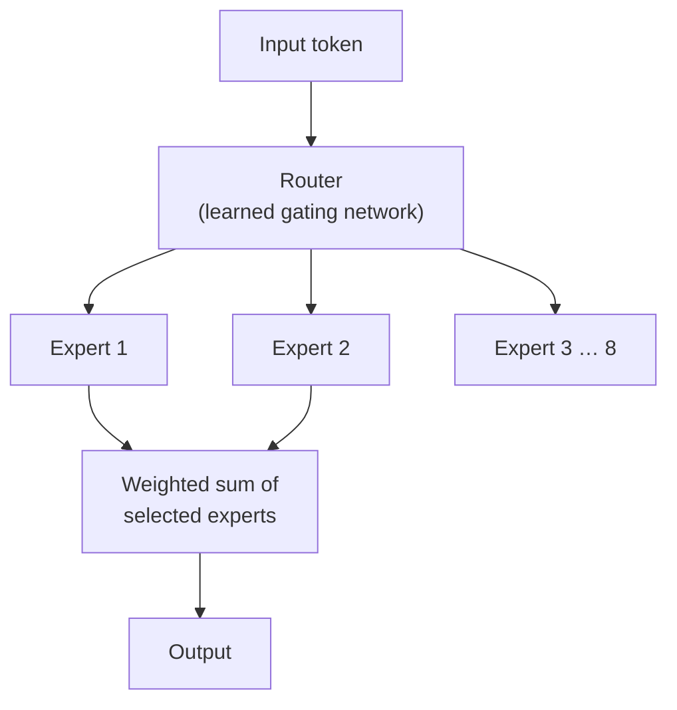

# Quantization glossary

> [!note] Not tested locally
> Concept note on quantization names. Its one command uses `llama-server` flags tested
> in [[ai/llama-cpp]].

The terminology you hit when downloading and running local models: quantization
labels, model architectures, and file formats.

## Quantization

Quantization reduces the numerical precision of model weights to make them smaller
and faster. A full-precision model uses 16 bits per weight (FP16); quantization cuts
that to 8, 5 or 4 bits, shrinking the file proportionally and trading away some
quality.

### Reading a quantization label

Labels like `Q4_K_M` follow the pattern **Q{bits}\_{method}\_{size}**.

**Bit width** — the number after `Q`:

| Label | Meaning |
| --- | --- |
| `Q8` | 8 bits per weight. Near-lossless. Large files. |
| `Q6` | Very high quality. |
| `Q5` | The sweet spot for quality against size. |
| `Q4` | Good balance for most uses. The recommended lower bound. |
| `Q3`, `Q2` | Visible degradation. Avoid for coding. |

**Method** — the letters after the underscore:

- **`K`** — K-quants. Two-level block quantization with double-quantized scales.
  Named after Kawrakow, who implemented them. Significantly more accurate than the
  legacy methods at the same bit width.
- **`IQ`** — importance-matrix quants. The `I` belongs to `IQ`, not to `K`. Uses
  non-linear quantization weighted by an importance matrix computed from calibration
  data. Below Q4 they retain noticeably more quality than the equivalent K-quant, but
  they are slower on CPU and need a recent llama.cpp.
- **`_0`, `_1`** — legacy formats, without grouped scales. Less accurate than
  K-quants. Avoid without a specific reason.

**Size modifier** — the trailing letters:

| Label | Meaning |
| --- | --- |
| `S` (small) | Aggressive — target bit width for nearly all weights |
| `M` (medium) | Balanced — sensitive weights, mainly attention, keep higher precision |
| `L` (large) | Conservative — more weights kept higher |
| `XL` | More conservative still. Mostly on Unsloth Dynamic uploads; keeps embeddings and attention above the nominal width, so quality approaches the next level up |
| `XXS` | The most aggressive variant, only on IQ quants |
| `NL` (non-linear) | Non-linear codebook variant of IQ4. Slightly better than `IQ4_XS` at similar size |

### Unsloth Dynamic (UD) variants

Files prefixed `UD-` come from [Unsloth](https://huggingface.co/unsloth) and use
**dynamic per-layer quantization**. Rather than one bit width everywhere, Unsloth
analyses each layer's importance with an imatrix, keeps the critical layers —
embeddings, attention output, some MLP layers — at higher precision, and compresses
the rest harder.

In practice a `UD-Q4_K_XL` file is around 10–15% larger than `Q4_K_M` but measurably
better, often matching `Q5_K_M` quality at close to `Q4_K_M` size. **Where a repo
offers both, take the UD variant.**

### MXFP4_MOE

A microscaling FP4 format aimed at MoE models. Expert weights are stored in a compact
4-bit floating-point representation with per-group scales — smaller than `Q4_K_M` at
comparable quality on MoE architectures. Needs a recent llama.cpp, and only appears
in MoE repos.

### Multimodal projector files

Vision-language models ship two files: the main `.gguf` with the language weights,
and an `mmproj-*.gguf` holding the vision encoder. Run both:

```bash
llama-server -m model.gguf --mmproj mmproj-F16.gguf
```

Projectors come in `F32`, `F16` and `BF16`; `F16` is the standard pick. For
text-only work, ignore them entirely.

### Recommendation ladder

Best quality to smallest. Where both a standard and a UD variant exist at the same
bit width, prefer UD.

| Variant | Quality | Use when |
| --- | --- | --- |
| `Q8_0` / `UD-Q8_K_XL` | Near-lossless | Memory is not a constraint |
| `Q6_K` / `UD-Q6_K_XL` | Very high | Quality matters, disk does not |
| `UD-Q5_K_XL` | High — best Q5 choice | Available, and better than `Q5_K_M` for similar size |
| `Q5_K_M` | High — the sweet spot | Best balance if there is no UD variant |
| `Q5_K_S` | Good | Slightly more compressed |
| `UD-Q4_K_XL` | Good+, recommended | Available — closest to `Q5_K_M` at Q4 size |
| `Q4_K_M` | Good, recommended | The common default |
| `Q4_K_S` | Acceptable | Tight on memory |
| `IQ4_XS` / `IQ4_NL` | Acceptable | Smaller than `Q4_K_S`, similar quality, slower on CPU |
| `IQ3_M` / `IQ3_S` | Noticeable loss, still usable | Only if Q4 does not fit |
| `Q3_K_M` | Noticeable loss | Only if nothing else fits and no IQ variant exists |
| `IQ2` / `Q2_K` | Poor | Avoid for coding |

> [!tip] The rule of thumb
> Start at `Q4_K_M`, or `UD-Q4_K_XL` where offered. Move to Q5 if you have the memory
> and want better output. Go below Q4 only when the model physically will not fit —
> and below Q4, prefer IQ quants over K-quants.

## Dense versus sparse

### Dense models

Every parameter activates for every token. A 27B dense model uses all 27B per token.

Examples: Qwen 3.6-27B, Qwen 3.5-9B, Llama 3.

- Predictable memory: model size plus overhead
- Consistent inference speed
- Simpler to reason about

### Sparse models

Only a subset activates per token — more total capacity, less compute per token.

Examples: Qwen 3.5-397B-A17B, Qwen 3.6-35B-A3B, Mixtral 8x7B.

The notation `397B-A17B` means 397B total parameters with 17B **A**ctive per token.

## Mixture of Experts

MoE is the dominant sparse architecture.



1. A **router** examines each token and selects which experts should handle it.
2. Only the selected **experts** — typically 2 of 8 — actually compute.
3. Their outputs are combined as a weighted sum.

**Benefits** — speed, since only a fraction computes per token; capacity, since
knowledge is spread across all experts; and cheaper training than an equally capable
dense model.

> [!warning] MoE saves compute, not memory
> Every expert must be resident in RAM or VRAM even though only a couple activate. A
> `397B-A17B` model needs memory for all 397B parameters. This is the single most
> common misunderstanding about MoE sizing.

| Model | Total | Active | Feels | RAM at Q4_K_M |
| --- | --- | --- | --- | --- |
| Qwen 3.6-27B (dense) | 27B | 27B | Moderate | ~18 GB |
| Qwen 3.6-35B-A3B (MoE) | 35B | 3B | Fast | ~22 GB |
| Qwen 3.5-397B-A17B (MoE) | 397B | 17B | Moderate | ~200 GB |

The 35B MoE feels faster than the 27B dense — 3B active against 27B — while needing
*more* memory, because 35B is stored either way.

## GGUF

GGUF (GPT-Generated Unified Format) is the file format used by [[ai/llama-cpp]],
replacing the older GGML.

A single `.gguf` file contains the quantized weights, the tokenizer configuration,
and model metadata including architecture, context length and chat template. It is
self-contained — no separate tokenizer or config files. Download one file, point
llama.cpp at it, run.

Find them on [HuggingFace](https://huggingface.co/): search `<model name> GGUF` and
prefer uploads from trusted quantizers such as `bartowski`, `unsloth`, or the model
creator's own repository.

## Other terms

**Context window** — the maximum tokens the model can process in one conversation.
Longer contexts cost memory: a 32K window on a 27B model adds roughly 2–4 GB on top
of the weights. See [[ai/hardware-requirements]].

**Thinking mode** — some models produce an internal chain of thought before
answering, either visible in `<think>` tags or hidden. It improves quality on hard
tasks at the cost of tokens and latency.

**Distillation** — training a smaller model to reproduce a larger one's behaviour.

**Frankenmerge** — combining layers or components from different models into one.

## Where to go next

- [[ai/models]] — which models to actually download
- [[ai/hardware-requirements]] — sizing the choice to your machine
- [[ai/llama-cpp]] — the engine that reads these files

<!-- uplink -->
Part of [[ai/index|Local LLMs]].
