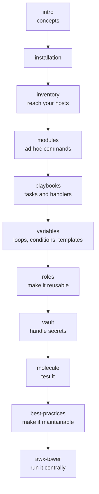

# Ansible

Notes on Ansible, from concepts through to project conventions.

## Start here

| Note | What it covers |
| --- | --- |
| [[automation/ansible/intro]] | what Ansible is, its philosophy, vocabulary, and the YAML rules |
| [[automation/ansible/installation]] | installing with pip, where Ansible looks for `ansible.cfg`, the main settings |

## Reaching your hosts

| Note | What it covers |
| --- | --- |
| [[automation/ansible/inventory]] | inventories, groups, SSH and WinRM connections, testing connectivity, facts |
| [[automation/ansible/modules]] | finding and reading module docs, `command`/`shell`/`script`/`raw`, ad-hoc commands |

## Writing automation

| Note | What it covers |
| --- | --- |
| [[automation/ansible/playbooks]] | plays, tasks, idempotence, blocks, handlers, `run_once`, `serial`, delegation, tags, execution control |
| [[automation/ansible/variables]] | declaring and using variables, precedence, lists and dicts, loops, conditions, filters, inclusion, Jinja2 templates |
| [[automation/ansible/roles]] | role anatomy, `meta/main.yml`, Galaxy, collections |
| [[automation/ansible/vault]] | encrypting files and values, vault IDs, what Vault does not protect |

## Quality

| Note | What it covers |
| --- | --- |
| [[automation/ansible/best-practices]] | naming conventions, inventory and project structure, modularity, documentation, review |
| [[automation/ansible/molecule]] | testing roles across distributions, scenarios, the test lifecycle |
| [[automation/ansible/cheatsheet]] | recipes that are hard to remember — cross-host variables, per-distribution task files |

## Running at scale

| Note | What it covers |
| --- | --- |
| awx-tower | operating AWX / Tower / AAP: services, logs, cleanup, backup, execution environments |

## Suggested reading order

For someone new to Ansible:

## Related

- yaml — block scalars and the type-inference traps, which bite Ansible users
  constantly
- git — the projects these notes describe all live in Git
- config-validation — pair with `validate:` on the `template` module

Part of Automation.
