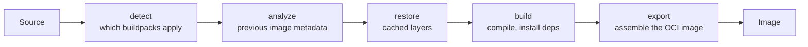

# Cloud Native Buildpacks

> [!note] Not tested locally
> A `pack build` pulls over 1 GB of builder images, and the classic Paketo builders
> (`builder-jammy-*`) publish **amd64 only** — on Apple Silicon the build runs under
> emulation. Multi-arch builders exist (`heroku/builder:24` is amd64 + arm64); check
> with `docker manifest inspect <builder>` before adopting one.

[Cloud Native Buildpacks](https://buildpacks.io/) turn source code into an OCI image
without a Dockerfile. You point a builder at a directory; it detects the language,
installs dependencies, and produces a runnable image.

This is a genuinely different model from
writing your own Dockerfile, and worth
understanding as an alternative to hardened base images rather than a replacement for
them.

## The pitch

Writing a good Dockerfile is a skill most application teams do not have and should not
need. Left to themselves they produce images running as root, on `:latest`, with a
full build toolchain shipped to production. Buildpacks move that expertise into a
shared, versioned component.

```bash
brew install buildpacks/tap/pack

pack build myapp:1.0 --builder paketobuildpacks/builder-jammy-base
docker run myapp:1.0
```

No Dockerfile anywhere.

## How it works



Three pieces:

| Piece | Role |
| --- | --- |
| **Buildpack** | Detects a language or framework and knows how to build it |
| **Builder** | A build-time image bundling a set of buildpacks plus a build environment |
| **Run image** | The minimal base the result runs on |

The **lifecycle** orchestrates the phases. Each buildpack contributes discrete
layers, which is what makes the next section possible.

## Rebasing — the feature that justifies the model

Because the application layers are cleanly separated from the run image, a base image
update can be applied **without rebuilding**:

```bash
pack rebase myapp:1.0
```

This swaps the underlying run image for a patched one and rewrites the metadata. It
takes seconds and requires no source, no toolchain, and no CI run.

> [!important] This is a materially better answer to base-image CVEs
> With Dockerfiles, patching a vulnerable OS library across two hundred services means
> two hundred rebuilds — which means two hundred pipelines that must still work, two
> hundred sets of tests, and weeks of elapsed time.
>
> With rebase it is one operation per image, mechanical and fast. For an organisation
> whose main supply-chain pain is "there is a critical CVE in glibc", this alone can
> justify buildpacks.
>
> The caveat: rebase only works for changes in the **run image**. A vulnerability in an
> application dependency still needs a real rebuild.

## Buildpacks versus Chainguard

They solve overlapping problems from opposite directions, and are often compared as
alternatives.

| | Buildpacks | Chainguard images |
| --- | --- | --- |
| You provide | Source code | A Dockerfile |
| Who builds | The buildpack lifecycle | You |
| Base image | Chosen by the builder | Chosen by you |
| CVE patching | `pack rebase`, seconds | Rebuild, or rebase manually with tooling |
| Image size | Larger — general-purpose run image | Minimal, often distroless |
| Control | Low by design | Total |
| Learning curve | Low for app teams | Higher |
| SBOM | Generated automatically | You generate it |

> [!tip] They are not mutually exclusive
> A buildpack's run image is just an image, and it can be a minimal hardened one. The
> genuinely interesting configuration is buildpacks for the build ergonomics with a
> minimal, well-maintained run image underneath — you keep automatic SBOMs and rebase,
> and get a small attack surface.

The comparison people actually mean is usually "should application teams write
Dockerfiles at all?" — and for a large organisation with many teams of varying
expertise, the answer is often no.

## SBOMs, free

The lifecycle knows exactly what it installed, so it emits an SBOM without a scanner
guessing:

```bash
pack sbom download myapp:1.0 --output-dir ./sbom
```

That is a **build-time** SBOM, more accurate than scanning a finished image — see
sbom. It will not, however, see anything a buildpack fetched
outside its dependency management, so scanning as well remains worthwhile.

## Configuration

A `project.toml` beside the source:

```toml
[project]
id = "com.example.myapp"

[[build.env]]
name = "BP_JVM_VERSION"
value = "21"

[[build.buildpacks]]
uri = "paketo-buildpacks/java"
```

```bash
pack build myapp:1.0 \
  --builder paketobuildpacks/builder-jammy-base \
  --env BP_JVM_VERSION=21 \
  --cache-image myregistry/myapp-cache
```

`--cache-image` stores the layer cache in a registry rather than locally, which is
what makes builds fast on ephemeral CI runners.

## Where it fits, and where it does not

**Good fit:** many services in mainstream languages, teams without container
expertise, a platform team that wants to control base images centrally, and frequent
base-image patching.

**Poor fit:** unusual build requirements, images that must be genuinely minimal,
compiled binaries where a `scratch` image is two lines of Dockerfile, and anything
needing precise control over layer structure.

> [!warning] You are trading control for consistency
> When a buildpack does not do what you need, the escape hatches are limited —
> writing a custom buildpack is more work than writing the Dockerfile you were
> avoiding. Evaluate against your awkward service, not your simplest one.

For a Go binary, a `scratch` image built from a five-line Dockerfile is smaller,
faster and simpler than anything buildpacks will produce. The model pays off at
organisational scale, not per project.

## Where to go next

- secure-container-images — the Dockerfile-based approach in detail
- sbom — what the generated SBOM is for
- [[containers/docker]] — building images the conventional way

## Further reading

- [buildpacks.io](https://buildpacks.io/)
- [Buildpacks: an open source alternative to Chainguard](https://dzone.com/articles/buildpacks-open-source-alternative-to-chainguard)

<!-- uplink -->
Part of [[containers/index|Containers]].
