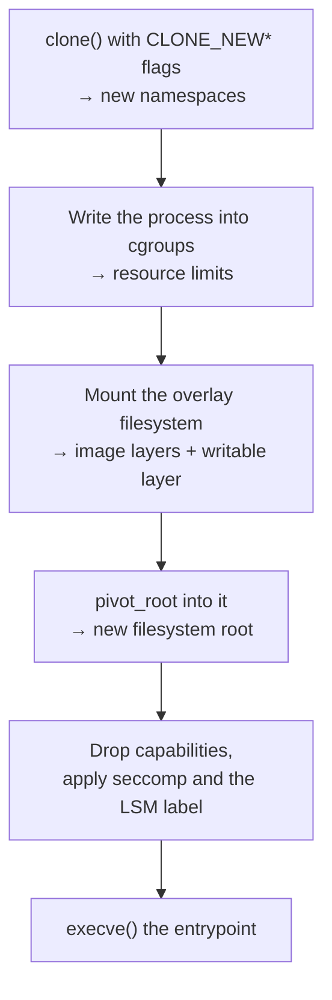

# What a container actually is

A container is not a thing the kernel implements. There is no `container` system call
and no container object in the kernel. A container is **a normal Linux process** that
has been started with several isolation features switched on at once.

That framing explains almost every container behaviour that surprises people:

- Why `ps` on the host shows container processes — they *are* host processes.
- Why a container escape is possible at all — the boundary is a set of kernel
  features, not a hypervisor.
- Why a container cannot run a different kernel — it is using yours.
- Why containers start in milliseconds — nothing is being booted.

Four mechanisms do the work.

## 1. Namespaces — what a process can see

A namespace virtualises a global kernel resource so processes inside see their own
copy.

| Namespace | Isolates | Effect |
| --- | --- | --- |
| **pid** | Process IDs | The container's first process is PID 1 and cannot see host processes |
| **mnt** | Mount points | Its own filesystem tree |
| **net** | Network stack | Own interfaces, routes, iptables rules, sockets |
| **uts** | Hostname and domain | `hostname` differs from the host's |
| **ipc** | System V IPC, POSIX queues | Cannot reach the host's shared memory |
| **user** | UID and GID mappings | Root inside can map to unprivileged outside |
| **cgroup** | cgroup root | Cannot see the host's cgroup hierarchy |
| **time** | Boot and monotonic clocks | Own uptime |

Inspect them — they are just files:

```bash
ls -l /proc/self/ns/
lsns
lsns -p $(pgrep -f myprocess)
```

Enter one:

```bash
sudo nsenter -t <pid> -n ip addr        # that process's network namespace
sudo nsenter -t <pid> -a               # all of them
```

> [!tip] `nsenter` is the debugging tool for distroless images
> A `scratch` or distroless container has no shell to `exec` into. But its namespaces
> are entirely ordinary, so you can enter them from the host with tools the host
> provides:
>
> ```bash
> PID=$(docker inspect -f '{{.State.Pid}}' mycontainer)
> sudo nsenter -t "$PID" -n ss -tlnp
> ```
>
> This is how you inspect a minimal image's networking without adding `netstat` to it
> and undoing the attack-surface work. See secure-container-images.

The network namespace is the one worth understanding deeply — see
virtual-interfaces for the veth pairs and bridges that connect
them.

## 2. The user namespace, specifically

The user namespace deserves separating out, because it is what makes **rootless**
containers possible.

It maps UIDs inside to different UIDs outside. Root inside the container (UID 0) maps
to an unprivileged UID on the host — so a process can hold full capabilities within
its namespace while being harmless outside it.

```bash
cat /proc/self/uid_map
# inside-start  outside-start  length
#            0         100000      65536
```

The ranges come from `/etc/subuid` and `/etc/subgid`.

> [!important] Without a user namespace, root in the container is root on the host
> A container running as UID 0 without user namespace remapping has the *host's* UID
> 0. If it escapes, it escapes as root. This is why "do not run as root" is the single
> most repeated container hardening rule, and why [[containers/podman]] running
> rootless is structurally safer than a Docker daemon running as root.

## 3. cgroups — what a process can consume

Namespaces control **visibility**; control groups control **consumption** — CPU,
memory, I/O, PIDs.

Without cgroups a container can exhaust the host. This is a resource-availability
control rather than an isolation one, but a fork bomb in a container with no PID limit
takes the node down just as effectively as an escape would.

See [[containers/cgroups-v2]] for the mechanism, and
[[kubernetes/observability/resource-limits]] for how Kubernetes expresses it.

## 4. Capabilities, seccomp and LSMs — what a process may do

Even as root, a process's power is divided into **capabilities**:

```bash
capsh --print
grep Cap /proc/self/status
```

Container runtimes drop most of them by default. Docker keeps around 14 of roughly 40,
retaining `CHOWN`, `NET_BIND_SERVICE`, `SETUID` and similar, and dropping the
dangerous ones.

| Capability | Grants | Why it matters |
| --- | --- | --- |
| `CAP_SYS_ADMIN` | An enormous, ill-defined set | Effectively root. Frequently the pivot in an escape |
| `CAP_SYS_PTRACE` | Attach to other processes | Read memory of anything in the same namespace |
| `CAP_SYS_MODULE` | Load kernel modules | Game over — you own the kernel |
| `CAP_NET_ADMIN` | Configure networking | Manipulate routes and firewall rules |
| `CAP_DAC_READ_SEARCH` | Bypass file read permission checks | Historically used to break out via open file handles |

On top of that:

- **seccomp** filters which system calls are permitted at all. The default profile
  blocks around 40 of ~350.
- **LSMs** — SELinux or AppArmor — apply mandatory access control
  on top of everything else.

The practical guidance is in [[containers/security]]: drop `ALL`, add back only what
is needed, keep `seccompProfile: RuntimeDefault`, and never `privileged: true` —
which switches all of this off at once.

## 5. The filesystem — layers and copy-on-write

An image is a stack of read-only layers. Starting a container adds a thin **writable
layer** on top, and a union filesystem (overlayfs, in practice) presents the result as
one tree.

```bash
docker inspect -f '{{ .GraphDriver.Data.UpperDir }}' mycontainer
```

> [!note] Empty under the containerd image store
> On a Docker engine using the **containerd image store** (the default on current
> Docker Desktop), `docker inspect` has no `GraphDriver` entry — layers live in
> containerd's content store, not in the graph driver's directories. The layer
> model is the same; only these inspection paths disappear.

Consequences that matter operationally:

- **Layers are shared.** Ten containers from one image use one copy on disk.
- **Deleting a file does not shrink the image.** A later layer records a whiteout; the
  data is still in the earlier layer. This is why a secret `RUN`-ed in and `rm`-ed out
  is still recoverable — see secure-container-images.
- **Writes to the container layer are ephemeral** and disappear with the container.
  Anything that must persist needs a volume.
- **Copy-on-write costs on first write.** Modifying a large file in an image copies it
  up to the writable layer first, which is why write-heavy workloads want a volume.

## Putting it together

Starting a container is roughly:



You can do all of it by hand with `unshare`:

```bash
sudo unshare --pid --net --mount --uts --ipc --fork --mount-proc bash
# then look around: hostname, ps, ip addr
```

That is genuinely worth doing once. It makes the whole abstraction concrete in about
thirty seconds.

## What this means for security

> [!warning] The kernel is shared, and it is the boundary
> Every container on a host talks to the same kernel. A kernel vulnerability reachable
> from an unprivileged process is a container escape. Namespaces and seccomp reduce
> the reachable surface; they do not create a hypervisor boundary.
>
> Where the workload is genuinely untrusted — multi-tenant, or running customer code
> — the answer is a stronger boundary: gVisor's userspace kernel, Kata Containers'
> lightweight VMs, or plain virtual machines. Choose
> deliberately rather than assuming the container is one.

## Where to go next

- [[containers/cgroups-v2]] — the resource control layer in detail
- [[containers/containerd/index|containerd]] — the runtime that assembles all this
- [[containers/security]] — the hardening that follows from these mechanisms
- virtual-interfaces — how network namespaces get connected

<!-- uplink -->
Part of [[containers/index|Containers]].
