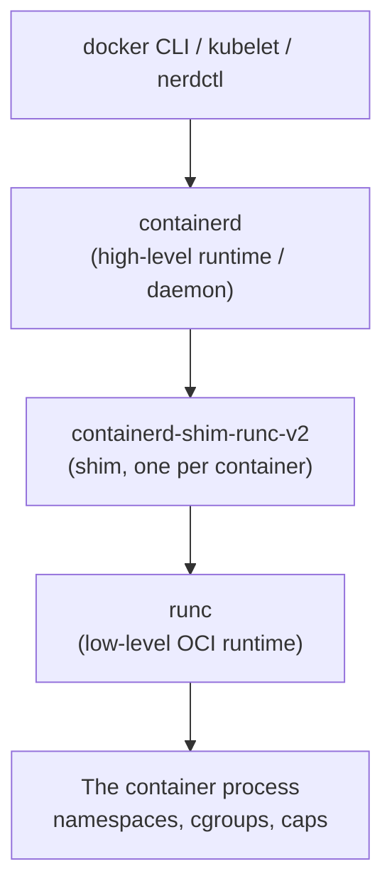

# What containerd is

[containerd](https://containerd.io/) is a container **runtime** — the daemon that
actually pulls images, manages storage and supervises container processes. It is a
CNCF graduated project, and it is what runs your containers whether or not you have
ever typed `containerd`.

Docker uses it. Kubernetes uses it. If you run either, it is already there:

```bash
systemctl status containerd
ctr version
```

## The layers

The word "runtime" is used for three different things, which is the main source of
confusion:



| Layer | Job | Lives for |
| --- | --- | --- |
| **Client** — `docker`, `kubelet`, `nerdctl` | User or orchestrator intent | — |
| **containerd** | Image pull, storage, networking handoff, lifecycle, supervision | The host's lifetime |
| **shim** | Keeps a container's stdio and exit status; one per container | The container's lifetime |
| **runc** | Applies namespaces, cgroups, capabilities, then `execve` | Milliseconds |

`runc` is startlingly short-lived. It sets up the isolation described in
[[containers/concepts]], executes the entrypoint, and exits. The shim is what remains
to hold the container's file descriptors and report its exit code.

> [!important] The shim is why containerd can be restarted
> Because each container is parented to its own shim rather than to the daemon,
> `systemctl restart containerd` does **not** kill running containers. This is a
> genuine operational difference from the classic Docker daemon architecture, and it
> is why upgrading containerd on a Kubernetes node is far less disruptive than people
> expect.

## Its relationship to Docker

Docker is not a competitor to containerd — Docker *contains* it. `dockerd` provides
the build system, the CLI, Docker networking, Compose and Swarm, and delegates the
actual running of containers to containerd underneath.

```bash
ctr --namespace moby containers list    # Docker's containers, seen from containerd
```

Docker's containers live in containerd's `moby` namespace. Kubernetes uses `k8s.io`.
This is why `ctr containers list` on a busy node appears empty: you forgot the
namespace. See [[containers/containerd/cli]].

## The CRI, and the "Docker deprecation"

Kubernetes talks to runtimes through the **Container Runtime Interface**, a gRPC API.
containerd implements it directly, via a plugin.

Kubernetes 1.24 removed `dockershim`, the adapter that let the kubelet drive Docker.
This was widely misreported as "Kubernetes is dropping Docker support".

> [!note] What actually changed, and what did not
> The kubelet stopped talking to `dockerd`, and now talks to containerd directly —
> removing a translation layer that was, in almost every deployment, sitting in front
> of the same containerd that is now used directly.
>
> **Images did not change.** Docker builds OCI images; containerd runs OCI images.
> Anything built with `docker build` runs unchanged. The practical impact for most
> clusters was that `docker ps` on a node stopped showing Kubernetes containers, and
> you needed `crictl` instead.

## Why you would use it directly

Most of the time you do not — you use Kubernetes or Docker on top. Reasons to reach
for it directly:

- **Debugging a node.** `ctr` and `crictl` show what the kubelet sees when `kubectl`
  is not helping.
- **A minimal host.** No build system, no Compose, no daemon-owned networking. Less
  installed and less attack surface.
- **Embedding.** containerd is a library with a stable Go client API, which is why so
  many platforms build on it.

## Alternatives

| Runtime | Notes |
| --- | --- |
| **CRI-O** | CRI-only, no Docker heritage. Red Hat's default in OpenShift. Deliberately narrower |
| **runc** | The default low-level OCI runtime |
| **crun** | A C rewrite of runc — faster start, lower memory. Default on newer Fedora/RHEL |
| **gVisor (runsc)** | Userspace kernel; syscalls are intercepted rather than passed through |
| **Kata Containers** | Each container in a lightweight VM — a real hypervisor boundary |

The last two matter when the shared-kernel boundary discussed in
[[containers/concepts]] is not sufficient. containerd can drive any of them through
its runtime handler configuration — see [[containers/containerd/advanced]].

## Where to go next

- [[containers/containerd/basics]] — installing and configuring it
- [[containers/containerd/cli]] — `ctr`, `crictl` and `nerdctl`
- [[containers/containerd/advanced]] — snapshotters, runtime classes, registries
- [[containers/concepts]] — what it is assembling underneath

<!-- uplink -->
Part of [[containers/containerd/index|containerd]].
