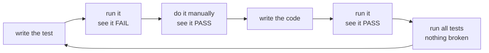

# Gherkin and BDD

## Overview

Gherkin is a language for defining use cases and writing tests. It is a means of
communication and exchange between clients and developers.

It was created for the **Cucumber** tool suite in Ruby, and became the usual language
for **Behaviour Driven Development** (BDD), an offshoot of **Test Driven Development**
(TDD).

It is a working method — a way of approaching or writing a specification, and above
all of ordering how you work.

## Advantages

- helps avoid functional omissions
- ensures backwards compatibility of the code
- makes code easier to maintain and to refactor
- forces you to perform the actions manually before implementing them
- obliges developers to write tests
- makes implementing an unfamiliar feature less daunting
- lets you order the work
- gives you a catalogue of reusable features
- makes collaborative work easier
- keeps the code structure consistent
- lets you prioritise features and plan sprints
- gives the project lead visibility of progress
- can serve as documentation

## Disadvantages

- takes practice before you write correct scenarios
- is another syntax to learn
- means writing more code
- imposes a working workflow
- can be constraining and slow for a small project

## Usage

The logic is fairly simple and revolves around the keywords `Given`, `When` and
`Then`.

Gherkin describes use cases called **features**. A feature is a piece of
functionality to implement, made up of several **scenarios**.

The first job is therefore to identify the features, by creating a `.feature` file
named after each:

```text
install_apache.feature
configure_vhost.feature
```

That list does not need to be complete or precise — iterative work will improve it.

Once the features are identified, score each by **importance** and **implementation
difficulty**. The combination lets you plan the order of work, and so the coming
sprints and versions:

| Feature | Importance | Difficulty | Score |
| --- | --- | --- | --- |
| `browse_article.feature` | 5 | 1 | 6 |
| `fill_basket.feature` | 4 | 3 | 7 |
| `site_login.feature` | 5 | 4 | 9 |
| `checkout.feature` | 5 | 5 | 10 |

Here you can ship a first version where an anonymous user can only browse articles.
Then they can fill a basket, then authenticate by logging in, and finally check out.

Working alone, that is four sprints with known contents. Working as a team, the
features can be distributed.

### Anatomy of a feature file

A `.feature` file always follows the same shape:

```gherkin
@tag
Feature: A description of the feature to implement

  Scenario: A scenario leading to the feature
    Given the prerequisites for this scenario
    When the inputs or actions of the scenario
    Then the expected result
```

| Keyword | Meaning |
| --- | --- |
| `Feature` | the description of the use case |
| `@tag` | a shorthand for referring to the feature |
| `Scenario` | one of the tasks needed to reach the feature's objective. There can be several, and each one runs on its own: steps that several scenarios share go in a `Background`, which runs before each of them |
| `Given` | the prerequisites for running the scenario — things **not** to implement in this feature |
| `When` | usually a user input, or the use of a variable |
| `Then` | the expected result for this scenario |
| `And` / `But` | continue the previous keyword |

> [!warning] No colons after the step keywords
> Do not write `Given:`, `When:`, `Then:` or `But:`. Only `Feature:`, `Scenario:` and
> the other *block* keywords take a colon. With a colon, a step is not a step: before
> the first real step, the line silently becomes part of the scenario's description,
> so the scenario has one step less; after a step, the parser rejects the file. Step
> keywords are followed directly by the text:
>
> ```gherkin
> Given I am on a Linux machine with YUM
> ```

An example:

```gherkin
# install_apache.feature
@install_httpd
Feature: Install, enable and start the apache service

  Scenario: Install the apache service
    Given I am on a Linux machine with YUM
    When I use YUM to install httpd
    Then httpd is installed on the server

  Scenario: Ensure apache is still active after a reboot
    Given the apache service is installed
    When I restart the server
    Then the service starts automatically at boot

  Scenario: Start the apache service
    Given the apache service is installed
    When I look at the running services
    Then I see the apache service in the list
```

### The BDD workflow

With a properly detailed feature, it has to be turned into code. The most effective
way is BDD, which imposes this workflow:

1. Write the test corresponding to a feature's first scenario.
2. Run the test and **watch it fail**.
3. Perform the action *manually* to make the test pass — this confirms the test is
   written correctly, and that you know how to do the thing before implementing it.
4. Write the code that makes the test pass.
5. Run the test and watch it succeed.
6. Run every other implemented test, to be sure nothing is broken.



Step 2 is the one people skip, and it is the important one: a test that has never
failed has not been shown to test anything.

### Constraints

Sometimes you want to flag something specific for the developer. This method calls
these **constraints**. A constraint is written like a feature, draws particular
attention to a requirement, and **must carry the same name as its feature**.

> [!warning] `Constraint:` is not a Gherkin keyword
> Constraints are a convention of this method, not part of Gherkin. A Gherkin parser
> (Cucumber, behave, pytest-bdd) rejects a file that starts with `Constraint:`. The
> `.constraint` extension keeps those files out of the test runner. If you want a tool
> to run them, write them as a `Feature:` with a `@constraint` tag.

Take a simple feature:

```gherkin
# create_database_user.feature
Feature: Create a user in the database

  Scenario: Create a user
    Given I have a database server
    When I create <user> with <password>
    Then <user> is in the database and can connect with <password>
```

That is straightforward to implement, and reading it identifies the variables needed.
`<user>` and `<password>` are only placeholders here: Gherkin fills them in only in a
`Scenario Outline`, from an `Examples` table. In a plain `Scenario` they stay plain
text.

But the DBA points out that a secure password is required. That is a constraint on
the feature's implementation:

```gherkin
# create_database_user.constraint
Constraint: Create a user in the database

  Scenario: The password must satisfy the security policy
    Given I have a <password>
    When I compare it against the policy of 2 uppercase, 1 lowercase, 1 special
    Then the password must be valid
```

Now the constraint is recorded, and as with features you write a test for it.

> [!important] Finding the right granularity is the hard part
> Neither too macro nor too micro. The worked example below should help calibrate it.

## Worked example: writing a yum role

Deliberately didactic: writing an Ansible role whose job is configuring repositories
on a RHEL-family machine (Rocky Linux, for example), following the Gherkin method and the associated Git workflow.

See [[automation/ansible/roles]] for role structure and
[[automation/ansible/molecule]] for the test tooling.

### Creating the role structure

```text
yum
├── defaults/
│   └── main.yml
├── documentations/
│   ├── features/
│   │   ├── todo/
│   │   ├── wip/
│   │   └── done/
│   └── constraints/
│       ├── todo/
│       ├── wip/
│       └── done/
├── meta/
│   └── main.yml
├── molecule/
│   └── default/
│       ├── converge.yml
│       ├── molecule.yml
│       ├── vars.yml
│       ├── verify.yml
│       └── tests/
├── tasks/
├── README.md
└── .gitignore
```

Beyond a classic role we add `documentations/{features,constraints}/{todo,wip,done}`,
which hold the Gherkin files and track their progress — the directory a file sits in
*is* its status.

Initialise Git and a working branch — see [[dev/git-conventions]]:

```bash
git init -b main
git add . && git commit -m ":tada: init project"
git switch -c develop
```

### Creating the features

We want to empty the directory holding the repositories, and add a new one. So:

1. create `clean_repos.feature` in `documentations/features/todo/`
2. create `add_repos.feature` in `documentations/features/todo/`

```bash
git add documentations/features/
git commit -m ":sparkles: create features clean_repos and add_repos"
```

### Feature: clean_repos

With two people these could be shared out; working alone, start with the deletion.

```gherkin
# documentations/features/todo/clean_repos.feature
@clean_repos
Feature: Remove the yum repository files

  Scenario: Remove the yum repository files
    Given I have a Rocky Linux server with YUM and configured repositories
    When I remove the repository files
    Then YUM no longer tries to reach them
```

One scenario, but it already says what has to be done. Transposing Gherkin into
Ansible usually means:

| Gherkin | Ansible |
| --- | --- |
| a feature | a `.yml` task file |
| a scenario | a block of tasks |
| `Given` | the requirements — Molecule vars, for instance |
| `Then` | the assertion in `verify.yml` |

Claim the feature by moving it to `wip`, and commit on develop:

```bash
mv documentations/features/{todo,wip}/clean_repos.feature
git add -A documentations/features/
git commit -m ":construction: start feature clean_repos"
```

Then branch to work in:

```bash
git switch -c feature/clean_repos
```

#### Implementing the feature's test

Following BDD, write the test first — which amounts to implementing the scenario's
`Then`:

```yaml
# molecule/default/tests/test_clean_repos.yml
- name: "List files in {{ yum_reposdir }}"
  ansible.builtin.find:
    path: "{{ yum_reposdir }}"
    file_type: any
    hidden: true
  register: __yum_reposdir_result

- name: "Check that {{ yum_reposdir }} is empty"
  ansible.builtin.assert:
    that: "__yum_reposdir_result.matched == 0"
    fail_msg: "{{ yum_reposdir }} is not empty"
```

Run it and watch it fail — nothing is implemented yet:

```bash
molecule converge && molecule verify
```

#### Automating it

Create `tasks/clean_repos.yml` and implement the scenario:

```yaml
- name: "List the files in {{ yum_reposdir }}"
  ansible.builtin.find:
    path: "{{ yum_reposdir }}"
    file_type: any
    hidden: true
  register: __yum_reposdir_result

- name: Remove the yum repository files
  ansible.builtin.file:
    path: "{{ __yum_repo_file.path }}"
    state: absent
  loop: "{{ __yum_reposdir_result.files }}"
  loop_control:
    loop_var: __yum_repo_file
```

And in `tasks/main.yml`:

```yaml
- name: Clean the yum repositories
  ansible.builtin.import_tasks: clean_repos.yml
  tags: clean_repos    # the feature's @tag
```

Re-run `molecule converge && molecule verify`. If the test passes, the implementation
works and can be committed; otherwise fix it. Remember to move the feature from `wip`
to `done`:

```bash
mv documentations/features/{wip,done}/clean_repos.feature
git add -A tasks/ documentations/features/
git commit -m ":triangular_flag_on_post: feature clean_repos implemented"
```

Then merge into develop, tag it, and delete the branch:

```bash
git switch develop
git merge feature/clean_repos
git tag -a 0.1.0 -m 0.1.0
git branch -d feature/clean_repos
```

> [!note] Molecule reads `molecule/default/`
> The scenario directory is `molecule/default/`, singular. A test in
> `molecule/defaults/tests/` lands somewhere Molecule never reads.

### Feature: add_repos

Nothing very different. Write the scenario:

```gherkin
# documentations/features/todo/add_repos.feature
@add_repos
Feature: Add a list of repositories to yum

  Scenario: Add a repository to yum
    Given YUM is installed
    When I add a repository from the <yum_repos> list
    Then the repository is configured and reachable
```

Then repeat the same cycle: claim it into `wip`, branch, write the assertion in
`molecule/default/tests/`, watch it fail, implement `tasks/add_repos.yml`, watch it
pass, move to `done`, merge, tag `0.2.0`.

### Constraint on clean_repos

And here is a good example of a constraint. All the tests are green — but connecting
to the container shows the directory is *entirely* empty. What the role actually does
is:

1. create repositories
2. delete every repository

So the tests pass and nothing is installed.

There are several ways to resolve this; we choose this constraint:

```gherkin
# documentations/constraints/todo/clean_repos.constraint
@clean_repos
Constraint: Remove the yum repositories except those we want to keep

  Scenario: Remove the yum repositories except those we want to keep
    Given YUM is configured with repositories including ones we want to keep
    When I run the scenario that removes the yum repositories
    Then everything is removed
    But not those in the <yum_repos> list
```

Claim it and branch:

```bash
mv documentations/constraints/{todo,wip}/clean_repos.constraint
git add -A documentations/constraints/
git commit -m ":construction: start constraint clean_repos"
git switch -c constraint/clean_repos
```

#### Implementing the constraint's test

Modify the existing test to account for the constraint:

```yaml
# molecule/default/tests/test_clean_repos.yml
- name: "List the files in {{ yum_reposdir }}"
  ansible.builtin.find:
    path: "{{ yum_reposdir }}"
    file_type: any
    hidden: true
  register: __yum_reposdir_result

- name: "If yum_repos is empty, check {{ yum_reposdir }} is empty"
  ansible.builtin.assert:
    that: "__yum_reposdir_result.matched == 0"
    fail_msg: "{{ yum_reposdir }} is not empty"
  when: yum_repos | length == 0

- name: "If yum_repos is set, check only those files remain"
  ansible.builtin.assert:
    that: "__yum_reposdir_result.matched == (yum_repos | length)"
    fail_msg: "{{ yum_reposdir }} does not contain exactly the kept repositories"
  when: yum_repos | length > 0
```

#### Automating the constraint

No magic — edit `tasks/clean_repos.yml` so it removes only the right files:

```yaml
- name: Initialise the list of files to keep
  ansible.builtin.set_fact:
    __files_path: []

- name: "List the files in {{ yum_reposdir }}"
  ansible.builtin.find:
    path: "{{ yum_reposdir }}"
    file_type: any
    hidden: true
  register: __yum_reposdir_result

- name: Populate the list of files to keep from yum_repos
  ansible.builtin.set_fact:
    __files_path: "{{ __files_path + [yum_reposdir ~ '/' ~ item.name ~ '.repo'] }}"
  loop: "{{ yum_repos }}"

- name: Remove the files, except those in the keep list
  ansible.builtin.file:
    path: "{{ __yum_repo_file.path }}"
    state: absent
  loop: "{{ __yum_reposdir_result.files }}"
  loop_control:
    loop_var: __yum_repo_file
  when: __yum_repo_file.path not in __files_path
```

> [!warning] Arithmetic inside the braces
> This form gives a string, not a list:
>
> ```yaml
> __files_path: >-
>   "{{ __files_path }} + ['{{ yum_reposdir }}{{ item.name }}.repo']"
> ```
>
> The whole expression is inside literal double quotes, so Jinja renders
> `__files_path` and the result is the *string* `"[] + ['...']"`: the `+` is never
> evaluated. The `not in` test then compares a path against a string, and the keep
> list never matches. Put the arithmetic **inside** the braces, as above. `~` is the
> explicit string-concatenation operator, and it also avoids a missing path
> separator.

Re-run `molecule converge && molecule verify`, and when green:

```bash
mv documentations/constraints/{wip,done}/clean_repos.constraint
git add -A tasks/ documentations/constraints/
git commit -m ":triangular_flag_on_post: constraint clean_repos implemented"

git switch develop
git merge constraint/clean_repos
git tag -a 0.2.1 -m 0.2.1
git branch -d constraint/clean_repos
```

The role is now written, test-first, with BDD and Gherkin.

Finally, merge into main and push:

```bash
git switch main
git merge develop
git push origin main
```

<!-- uplink -->
Part of [[dev/index|Development]].
