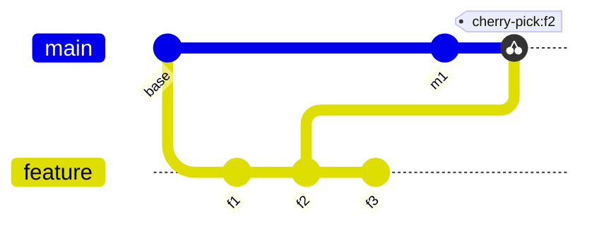

# Git cheatsheet

Commands for the cases [[dev/git]] only touches. Settings that change how these
commands behave are in [[dev/gitconfig]].

> [!warning] Anything that rewrites commits changes their hashes
> `commit --amend`, `rebase` and `filter-branch` create new commits. On a branch
> someone else has pulled, that breaks their history. Rewrite only what you have not
> pushed, or agree on it first.

## Reading the state

```bash
git status --short --branch
git log --graph --oneline --decorate --all
git show --stat HEAD~1
```

## Commit

### Multi-line messages

Each `-m` is one paragraph; git puts a blank line between them:

```bash
git commit -m "Add the CSV parser" -m "The old regex missed quoted fields. The parser handles them and reports the line number of an error."
```

For a longer body, read the message from standard input:

```bash
git commit -F - <<'EOF'
Add the CSV parser

The old regex missed quoted fields. The parser
handles them and reports the line number of an error.
EOF
```

Or run `git commit` alone and write it in the editor. Either way: a subject under
72 characters, one blank line, then the body.

### Amend the last commit

```bash
git commit --amend                         # change the message
git commit --amend --no-edit               # add the staged changes, keep the message
git commit --amend --no-edit --reset-author   # take the current identity and date
```

### Part of a file

```bash
git add -p
```

Git shows each change ("hunk") and asks: `y` stage it, `n` skip it, `s` split it
into smaller hunks, `e` edit it by hand, `q` stop.

### Fixup commits

Fix an older commit on your branch without an interactive rebase session:

```bash
git commit --fixup HEAD~2
GIT_SEQUENCE_EDITOR=: git rebase -i --autosquash HEAD~4
```

The first command makes a commit named `fixup! <subject of HEAD~2>`. The rebase
moves it right below that commit and merges the two. `GIT_SEQUENCE_EDITOR=:` accepts
the prepared list without opening the editor; leave it out to review the list
first. With `rebase.autoSquash = true`, `--autosquash` is the default.

`git commit --fixup=reword:HEAD~2` changes only that commit's message.

### Other commit options

| Option | Effect |
| --- | --- |
| `--allow-empty` | a commit with no change, for example to start a CI run |
| `--author="Bob <bob@example.com>"` | Bob is the author; you stay the committer |
| `--date="2026-01-31 10:00"` | sets the author date |
| `--trailer "Reviewed-by: Bob <bob@example.com>"` | adds a trailer line at the end of the message |
| `--no-verify` | skips the `pre-commit` and `commit-msg` hooks |
| `git commit <path>` | commits only that file, whatever else is staged |

## Rebase

### Interactive

```bash
git rebase -i HEAD~4
```

Git opens the list of the last 4 commits, oldest first. Change the word in front of
a commit, or reorder the lines:

| Word | Effect |
| --- | --- |
| `pick` | keep the commit as it is |
| `reword` | keep it, change its message |
| `edit` | stop after it, to change it; then `git commit --amend` and `git rebase --continue` |
| `squash` | merge it into the commit above, and edit the combined message |
| `fixup` | merge it into the commit above, keep only the message above |
| `drop` | remove the commit (or delete its line) |
| `exec <command>` | run a shell command at that point; the rebase stops if it fails |
| `break` | stop here; `git rebase --continue` resumes |

When the rebase stops, on a conflict or an `edit`:

```bash
git rebase --continue     # after fixing and git add
git rebase --skip         # drop the commit that conflicts
git rebase --abort        # back to the state before the rebase
```

### Move a branch to another base

`feature-b` started from `feature-a`. Now `feature-a` is merged, and `feature-b`
should start from `main`, without `feature-a`'s commits:

```bash
git rebase --onto main feature-a feature-b
```

This takes the commits of `feature-b` that are not in `feature-a`, and replays them
on `main`.

### Test every commit

```bash
git rebase --exec "make test" main
```

Runs the tests after each replayed commit and stops at the first that fails.

### Stacked branches

```bash
git rebase --update-refs main
```

When other branches point to commits inside the rebased range, they move with it
instead of staying on the old commits. `rebase.updateRefs = true` makes it the
default.

### Undo a finished rebase

```bash
git reset --hard ORIG_HEAD
```

Rebase, merge and reset save the previous tip in `ORIG_HEAD`. After later commands,
use `git reflog` to find it.

## Rewriting all of history

| To change | Use |
| --- | --- |
| the last commit | `git commit --amend` |
| a few recent commits on your branch | `git rebase -i` |
| every commit: an email, a file, a word | `git filter-repo`, or `git filter-branch` |

### First, a backup

```bash
git bundle create ../before-rewrite.bundle --all
git bundle verify ../before-rewrite.bundle
```

A bundle holds every branch and tag in one file. Restore it with
`git clone ../before-rewrite.bundle`, or fetch a branch back from it.

### With git filter-repo

The tool the git documentation recommends. It is a separate install
(`pip install git-filter-repo`).

```bash
git filter-repo --email-callback 'return email.replace(b"@work.example.com", b"@example.com")'
git filter-repo --path secrets.env --invert-paths   # remove a file from every commit
git filter-repo --replace-text replacements.txt     # replace text in every file
```

It works on a fresh clone and refuses otherwise unless you add `--force`. It also
removes the `origin` remote, so you cannot push by accident before checking.

> [!note] Not tested here
> The test container does not have `git-filter-repo`. The commands follow its
> documentation. The `filter-branch` path below is tested.

### With git filter-branch

Built into git, so it works where `filter-repo` is not installed. Slower, and the
working tree must be clean.

```bash
FILTER_BRANCH_SQUELCH_WARNING=1 git filter-branch -f \
  --env-filter '
    case "$GIT_AUTHOR_EMAIL" in *@work.example.com) GIT_AUTHOR_EMAIL=alice@example.com;; esac
    case "$GIT_COMMITTER_EMAIL" in *@work.example.com) GIT_COMMITTER_EMAIL=alice@example.com;; esac
    export GIT_AUTHOR_EMAIL GIT_COMMITTER_EMAIL' \
  --msg-filter 'sed "s/^WIP: //"' \
  --tree-filter 'test -f notes.txt && sed -i "s/@work\.example\.com/@example.com/g" notes.txt || true' \
  -- --all
```

| Filter | Runs on | Changes |
| --- | --- | --- |
| `--env-filter` | each commit's environment | author and committer name, email, date |
| `--msg-filter` | each message, on stdin | the commit message |
| `--tree-filter` | a checkout of each commit | file contents; slow, one checkout per commit |
| `--index-filter` | the index of each commit | faster, with `git rm --cached` and similar |

`-- --all` rewrites every branch and tag, not only the current branch.

The `sed -i` in the tree filter is GNU syntax. On macOS, BSD `sed` needs `sed -i ''`,
or write the filter in a script language instead.

### Remove the old commits for real

After `filter-branch`, the old commits still exist: in `refs/original/`, and in the
reflog. A grep in `.git` still finds them, and so does `git log --all`, because
`--all` includes `refs/original/`. Delete both, then prune:

```bash
git for-each-ref --format='%(refname)' refs/original | xargs -n1 git update-ref -d
git reflog expire --expire=now --all
git gc --prune=now
```

### Prove it is clean

```bash
git log --all --format='%ae %ce' | sort | uniq -c
git cat-file --batch-all-objects --batch | grep -c "work.example.com"
```

The first line lists every identity left. The second searches **every object** in
the repository, reachable or not, so `0` really means none is left.

When only messages were rewritten, prove that no content changed: the set of tree
hashes is the same before and after.

```bash
git log --all --format=%T | sort -u > trees-after.txt
diff trees-before.txt trees-after.txt && echo "same content"
```

(`trees-before.txt` comes from the same command, run before the rewrite.) `sort -u`
matters: commits that share a tree, and old commits still in `refs/original/`,
would otherwise add duplicate lines.

### Publish

```bash
git push --force-with-lease --all origin
git push --force-with-lease --tags origin
```

`--force-with-lease` refuses if the remote moved since your last fetch, so you do not
overwrite someone else's push. Everyone with a clone must then clone again, or reset
to the new branches.

## Stash

```bash
git stash push -m "half-done parser"      # tracked changes, staged or not
git stash push -u -m "with the new files" # also untracked files
git stash push --staged -m "staged only"  # only what is staged
git stash push -- src/parser.py           # only these paths
git stash push -p                         # choose hunks, like git add -p
```

```bash
git stash list
git stash show -p stash@{1}               # the diff of one stash
git stash apply --index stash@{1}         # restore it, and restage what was staged
git stash pop                             # apply the newest, then drop it
git stash branch fix-parser stash@{0}     # a branch from where the stash was made, with it applied
git stash drop stash@{1}
git stash clear                           # drop all of them
```

Without `--index`, `apply` and `pop` bring changes to tracked files back unstaged.
New files that were staged stay staged: git has to add them again to restore them.

A dropped stash is still in the repository until garbage collection. `drop` prints
its hash; if that is lost, `git fsck` lists it among unreachable commits:

```bash
git fsck --unreachable --no-reflogs | grep commit
```

Then `git stash apply <hash>` brings it back.

## Reset

`git reset <target>` moves the current branch to `<target>`. The mode decides what
happens to the index (staged changes) and the working tree (your files):

| Mode | Index | Working tree |
| --- | --- | --- |
| `--soft` | kept | kept |
| `--mixed` (default) | reset to the target | kept |
| `--hard` | reset | reset — **uncommitted changes are lost** |
| `--keep` | reset | kept; refuses if a file with local changes would be overwritten |

```bash
git reset --soft HEAD~3      # the last 3 commits become staged changes
git commit -m "One commit instead of three"
```

```bash
git reset HEAD~1             # undo the last commit, keep its changes unstaged
git reset --keep HEAD~1      # drop the last commit, keep your uncommitted work
git reset -- notes.txt       # unstage one file, the same as git restore --staged
```

Undo a reset:

```bash
git reset --hard ORIG_HEAD   # right after a reset, rebase or merge
git reflog                   # every position the branch had
git reset --hard HEAD@{1}    # back to the previous one
```

## Where is this commit

The examples use a repository with `main`, a branch `feature` that started from it,
and one commit of `feature` copied to `main` with `git cherry-pick`:



Which branches and tags contain a commit:

```bash
git branch --contains feature~1        # local branches
git branch -a --contains feature~1     # with remote-tracking branches
git tag --contains feature~1           # tags whose history includes it
```

Which branches are in another one:

```bash
git branch --merged main               # fully contained in main: safe to delete
git branch --no-merged main            # with commits main does not have
```

How two branches relate:

```bash
git merge-base main feature                         # the commit where they split
git merge-base --is-ancestor feature~3 main && echo "feature~3 is in main"
git log --oneline main..feature                     # in feature, not in main
git log --oneline --left-right main...feature       # in one side only: < main, > feature
git log --oneline --left-right --cherry-mark main...feature   # = same change on both sides
git cherry -v main feature                          # + not in main, - an equivalent commit is
```

`main..feature` (two dots) asks "what does `feature` add". `main...feature` (three
dots) asks "what differs on either side". A cherry-picked commit has a new hash, so
`--contains` does not find it in `main`; `--cherry-mark` and `git cherry` compare the
changes themselves, and do.

Name a commit, or find where a change came from:

```bash
git name-rev feature~1                  # its place relative to a ref; tags win: "tags/v1~1"
git name-rev --refs='refs/heads/*' feature~1   # relative to branches only: "feature~1"
git log --all --oneline --source -S "timeout = 60"   # commits that added or removed the text, with the branch
git log --all --graph --oneline --simplify-by-decoration   # only branch tips and tags
```

## Where to go next

- [[dev/gitconfig]] — `rebase.autoSquash`, `rebase.updateRefs`, `merge.conflictStyle` and other settings
- [[dev/git]] — the basics: committing, branches, merge conflicts, worktrees
- [[dev/git-conventions]] — commit message conventions

<!-- uplink -->
Part of [[dev/index|Development]].
