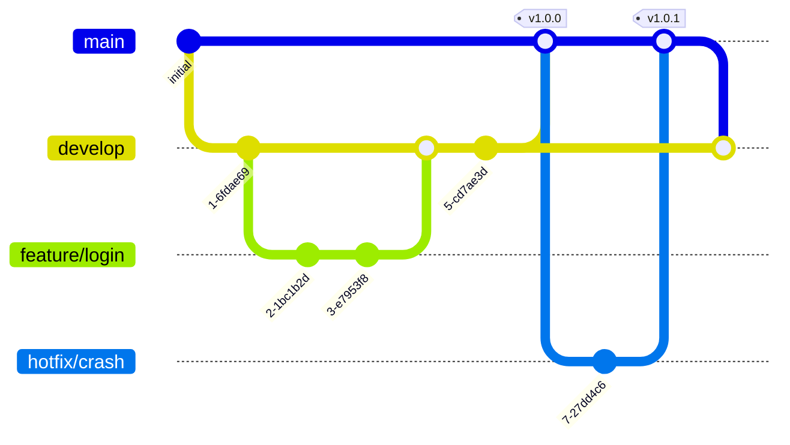

# Git and GitLab conventions

This is not a Git course — see [[dev/git]] for that — but a description of how to
use it within a project. It establishes:

- naming conventions for projects and branches
- which branches to use and when
- the GitLab configuration needed to protect certain branches

## Branches

### A simplified gitflow

The **gitflow** model is worth following. It has been around for years, and a
`git flow` extension exists to drive it.

With a small development capacity and defined role owners, this can be simplified.
There is neither the critical mass nor roles complex enough to need a full,
interdependent development team. So keep two permanent branches:

| Branch | Contents |
| --- | --- |
| **main** | stable, tested, validated code, ready to be used or distributed |
| **develop** | the next version's code. Once a feature is finished and validated, it is merged here |

And two kinds of temporary branch:

| Branch | Purpose |
| --- | --- |
| **hotfix** | fixes for bugs in the code on `main` (production) |
| **feature** | development of a feature — code implementing functionality for the next version |

Which reduces gitflow to:

| Branch | Count | Controlled by | Branched from | Lifetime |
| --- | --- | --- | --- | --- |
| `main` | one | owner | — | permanent |
| `develop` | one | owner | — | permanent |
| `feature` | as many as needed | contributor | `develop` | the feature |
| `hotfix` | as many as needed | contributor | `main` | the bugfix |

> [!note] `main`, not `master`
> GitHub and GitLab name the first branch `main`. Plain `git init` still names it
> `master` (Git 2.47), unless `init.defaultBranch` is set: run
> `git config --global init.defaultBranch main`, or `git init -b main`. Older
> documentation uses both names, but only one should exist in a repository.

> [!tip] Consider whether you need two permanent branches
> gitflow was designed for versioned software with supported releases. For anything
> continuously deployed, GitHub Flow — one permanent branch plus short-lived feature
> branches — has less merge overhead and no long-lived divergence between `main` and
> `develop`. Choose deliberately rather than by default.

### Commits

A commit must be an **atomic functional change**, not a save point. That is what
makes history usable and readable.

The **gitmoji** convention is worth adopting for commits, for two reasons:

- history becomes scannable — the purpose of a commit is visible at a glance
- it keeps commits atomic: if you hesitate between two emoji, your change is too
  large. One commit per emoji.

| Emoji | Code | Commit type |
| --- | --- | --- |
| 🐛 | `:bug:` | fix a bug |
| 🚑 | `:ambulance:` | critical hotfix |
| 📝 | `:memo:` | write documentation |
| 🔒 | `:lock:` | fix a security issue |
| 🔖 | `:bookmark:` | release or version tag |
| ✏️ | `:pencil2:` | fix typos |
| ✨ | `:sparkles:` | add a feature |
| 💩 | `:poop:` | write bad code that needs improving |
| ⏪ | `:rewind:` | revert changes |
| 🔀 | `:twisted_rightwards_arrows:` | merge branches |
| 🙈 | `:see_no_evil:` | add or update `.gitignore` |

> [!note] Character or code
> Column one is the Unicode character. Column two is the code to type into a commit
> message: GitHub and GitLab show it as the emoji, but `git log` shows the code as
> typed.

### Responsibilities

| Profile | Can do |
| --- | --- |
| **contributor** | create `feature` and `hotfix` branches and work in them. Cannot touch `main` or `develop` |
| **maintainer** | validate `feature` and `hotfix` branches and merge them into `develop` and/or `main` |

### The gitflow plugin

A `gitflow` plugin exists that systematises and simplifies creating and managing
these branches. Plain Git commands are preferable — they teach you more about what is
actually happening.

## The life of a repository

### Creation

As a **contributor** you can create your repository locally and then your first
working branch; you do not have to wait for a GitLab repository to exist.

As a **maintainer**, create it in the right group. On GitLab Enterprise you can
create project templates. Once created, either leave it empty or create the `main`
and `develop` branches.

### Permissions

In all cases, set these in GitLab:

- protect **main** against push — only maintainers may merge
- protect **develop** against push — only maintainers may merge
- set the default branch to **develop**, so it receives merge requests by default
- protect tag creation and updates, since tags designate production versions

### A finished contribution

To count as finished, a contribution must:

- be documented
- be tested
- have been functionally validated by the maintainer
- have a clean history

### Validating and merging a feature

If you own the project and a contributor reports their work finished and validated,
you can merge their branch into **develop**.

To be sure the changes do not introduce a bug, verify the automated tests passed
before merging.

Because push is forbidden on `main` and `develop`, merges go through the GitLab
interface. That is a benefit rather than a constraint: it lets you

- review the changes by comparing branches
- start a conversation with the rest of the team via the integrated discussion

### Releases

Features are added to **develop** as they are developed. Before landing code on
**main**:

- collaborate with a selected group of users so they exercise the code on `develop`
- once the planned date arrives and the bugs are fixed, merge `develop` into `main`
  and add a tag carrying the project's version number

That makes a **release** of the code available for users to depend on specifically.

> [!tip] Tag with semantic versioning
> `MAJOR.MINOR.PATCH` — increment MAJOR for breaking changes, MINOR for backwards
> compatible additions, PATCH for fixes. Annotated tags (`git tag -a v1.0.0 -m ...`)
> carry a message and an author; lightweight tags do not, and are best avoided for
> releases.

## Appendix: further gitmoji

| Emoji | Code | Commit type |
| --- | --- | --- |
| 🏗️ | `:building_construction:` | architectural changes |
| ⚗️ | `:alembic:` | experiment with something new |
| 🚧 | `:construction:` | work in progress |
| 🎨 | `:art:` | improve code structure or format |
| ⚡ | `:zap:` | improve performance |
| 🔥 | `:fire:` | remove code or files |
| 🚚 | `:truck:` | move code or files |
| 🩹 | `:adhesive_bandage:` | non-critical patch |
| 💡 | `:bulb:` | document source code |
| 💄 | `:lipstick:` | update styling |
| 🚨 | `:rotating_light:` | remove lint warnings |
| 🎉 | `:tada:` | initial commit |
| ✅ | `:white_check_mark:` | update tests |
| 👷 | `:construction_worker:` | change CI |
| ♻️ | `:recycle:` | refactor code |
| 🔧 | `:wrench:` | change configuration files |
| 💥 | `:boom:` | introduce breaking changes |
| 🔊 | `:loud_sound:` | add logs, increase verbosity |
| 🔇 | `:mute:` | remove logs, reduce verbosity |
| 🚸 | `:children_crossing:` | improve usability |

The full set is at [gitmoji.dev](https://gitmoji.dev).

## Further reading

- [Atlassian: gitflow workflow](https://www.atlassian.com/git/tutorials/comparing-workflows/gitflow-workflow)
- [git-flow cheatsheet](https://danielkummer.github.io/git-flow-cheatsheet/)
- [Conventional Commits](https://www.conventionalcommits.org) — an alternative to
  gitmoji that is machine-parseable, and which tooling can turn into a changelog
  automatically

<!-- uplink -->
Part of [[dev/index|Development]].
