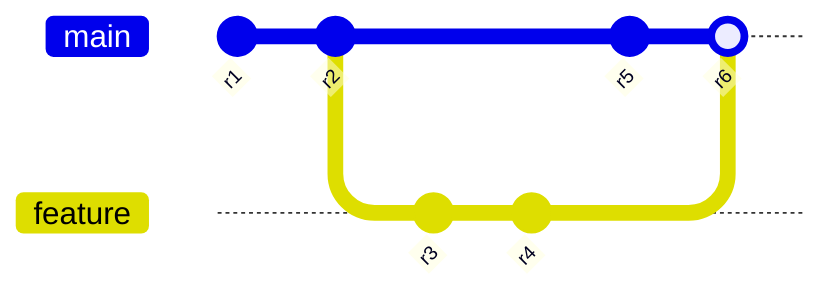

# Git

For branching model and commit conventions see [[dev/git-conventions]]. Settings and how they
combine are in [[dev/gitconfig]]; advanced commits, rebase, history rewriting and
finding commits across branches are in [[dev/git-cheatsheet]].

## Concepts and vocabulary

Git is a revision manager.

| Term | Meaning |
| --- | --- |
| **revision** / **commit** | a set of changes to a project, with a unique identifier |
| **branch** | a line of development. The nominal branch is `main`, considered *stable*; other branches can be created alongside it |

Branching lets you work on a new feature without disturbing collaborators and without
affecting `main`:



Once you ask Git to track a file, it retains every revision of it.

Good practice is to make revisions as **atomic** as possible. They should correspond
to precise, defined changes — adding one feature, for instance. That makes it quick to
identify a change and to revert it if it causes a regression. Each revision should
have an explicit message.

## Configuring your identity

Globally, in `~/.gitconfig`:

```bash
git config --global user.name "your.name"
git config --global user.email "your.name@example.com"
```

```ini
# ~/.gitconfig
[user]
    name = your.name
    email = your.name@example.com
```

Or per repository, in `.git/config` — which is what you want when one machine
commits to both work and personal repositories:

```bash
git config user.name "your.name"
git config user.email "your.name@personal.example.com"
```

> [!tip] Have Git pick the identity for you
> `includeIf` selects a config block by repository path, so you cannot forget:
>
> ```ini
> [includeIf "gitdir:~/work/"]
>     path = ~/.gitconfig-work
> [includeIf "gitdir:~/personal/"]
>     path = ~/.gitconfig-personal
> ```
>
> Note that the `GIT_AUTHOR_EMAIL` and `GIT_COMMITTER_EMAIL` environment variables
> **override all config** if set — a common surprise in CI and automated shells.

## Initialising a project

```bash
git init
git init -b main    # set the initial branch name explicitly
```

## The remote repository

Clone a repository:

```bash
git clone ssh://your.name@gitserver/opt/git/myproject/myproject.git
```

Check where the code came from:

```console
$ git remote -v
origin  https://gitlab.com/your.name/wiki.git (fetch)
origin  https://gitlab.com/your.name/wiki.git (push)
```

See the delta between your clone and the repository:

```bash
git status
```

## Adding and committing

Git shows which files are untracked and offers to add them:

| Command | Stages |
| --- | --- |
| `git add .` | everything under the current directory — new, modified **and** deleted |
| `git add -u` | modified and deleted files only, not new ones |
| `git add -A` | everything in the whole repository |
| `git add <path>` | one file or directory |

> [!note] `git add .` stages deletions
> Since **Git 2.0** (2014), `git add .` stages deletions too, which makes it
> equivalent to `git add -A` for the current directory. The `-u`/`-A` distinction that
> remains is about *scope*: `-A` covers the whole working tree regardless of where you
> are.

Then commit:

```bash
git commit -m "Add the droid feature"
git commit -a -m "Add the droid feature"
```

| Option | Effect |
| --- | --- |
| `-m` | the message describing the commit |
| `-a` | automatically stage every **tracked** file that is modified or deleted, skipping `git add` |

> [!warning] What `-a` does
> `-a` is a shortcut that *bypasses* the staging area for files Git already tracks.
> It does **not** pick up new, untracked files, which is the trap: `git commit -a` on
> a change that includes a new file silently omits it.

## Tags

Tag a commit to mark a project's status or version:

```bash
git tag v2 c11a9316ff
```

List tags:

```bash
git tag
git tag -l "v1.*"
```

> [!warning] Name first, commit second
> The signature is `git tag <tagname> [<commit>]`: `git tag c11a9316ff v2` creates a
> tag literally named `c11a9316ff`, pointing at whatever `v2` resolves to, or fails.
> Listing is `git tag`; there is no `git tags`.

Delete a tag:

```bash
git tag -d v2
```

Annotate a tag, as you would a commit:

```bash
git tag -a v2 c11a9316ff -m "version 2"
```

Annotated tags store an author, date and message; use them for releases. Push a tag
to the remote — tags are not pushed by `git push` alone:

```bash
git push origin v2
git push origin --tags
```

## .gitignore

Exclude files specific to the OS or your local environment by listing them in
`.gitignore` at the project root:

```gitignore
# OS
.DS_Store
Thumbs.db

# Editors
.vscode/
*.swp

# Vagrant
.vagrant/

# Python
__pycache__/
*.py[cod]
.venv/

# Ansible galaxy
roles/galaxy/
collections/
```

> [!note] `.gitignore` only affects untracked files
> A file already tracked keeps being tracked however you list it. Remove it from the
> index first: `git rm --cached <file>`.

## Publishing to a remote

```bash
git remote add origin your.name@yourserver.example.com:/path/to/my_project.git
git push origin main
```

On the first push, when the remote branch does not exist yet:

```bash
git push --set-upstream origin main
```

`--set-upstream` records which remote branch this local branch tracks, so later
`git push` and `git pull` need no arguments.

`push` can do more:

Push local `dev` onto the remote's `main`:

```bash
git push origin dev:main
```

Delete the remote branch `dev`:

```bash
git push origin :dev
```

Push local `main` to a new remote branch named `feature-topic`:

```bash
git push origin main:feature-topic
```

> [!warning] This does not create a pull request
> That last command pushes a local branch to a differently-named remote branch. A pull
> or merge request is created through the forge's web UI or API:
>
> ```bash
> gh pr create --base main --head feature-topic
> glab mr create --source-branch feature-topic --target-branch main
> ```

Change the remote URL:

```bash
git remote set-url origin your.name@yourserver.example.com:/path/to/my_project.git
```

## History

```bash
git log
git log --oneline --graph --decorate --all    # the useful form
git log -p <file>                             # with diffs, for one file
git log --author="your.name"
git blame <file>                              # who last touched each line
```

## Going back in history

To return to an earlier state — because the last commit broke your CI pipeline, for
example:

```bash
git switch --detach HEAD~1
git switch --detach c11a9316ff8536960d957bad69163e4dff914fcf
```

This retrieves the code as it was before the last commit. That commit still exists on
the server and is unchanged.

> [!warning] This leaves you on a detached HEAD
> You are no longer on a branch, and commits made here belong to nothing — they
> become unreachable once you switch away. Either return with `git switch -`, or
> create a branch to keep the work: `git switch -c fix-attempt`.
>
> `git checkout` does this too; `git switch` was introduced in Git 2.23 to separate
> "move between commits" from `git restore`'s "discard changes", because `checkout`
> conflated two unrelated jobs.

From there you can either redevelop and replace the most recent commit with something
less disruptive, or create a new branch.

## Branches

```bash
git switch -c dev        # create and switch to it
git switch main          # switch to an existing branch
git branch -m dev new_dev  # rename
git branch -d dev        # delete a merged branch
git branch -D dev        # delete regardless
git branch -a            # list, including remote-tracking
```

### Merging

To merge, be on the **destination** branch — the one you want the changes brought
into:

```bash
git switch main
git merge dev
```

This keeps the history of both branches, recording a merge commit.

### Rebasing

If instead you want your changes applied sequentially on top of the latest revision,
without your original branch appearing as a separate line, use rebase. Rebase the
**feature** branch onto main, then fast-forward main:

```bash
git switch dev
git rebase main
git switch main
git merge --ff-only dev
```

> [!warning] Not like this
> ```bash
> git switch main
> git rebase dev -m "Rebase branch 'dev'"
> ```
>
> `git rebase` has no `-m` message option, because a rebase creates no merge commit:
> it rewrites existing ones. And the direction is inverted: run from `main`,
> `git rebase dev` replays *main's* commits on top of `dev`. Rebase from the branch
> whose commits you want moved.

> [!important] Never rebase shared history
> Rebasing rewrites commits, giving them new hashes. If anyone else has pulled those
> commits, their history and yours diverge irreconcilably. Rebase only branches you
> alone have.

## Resolving merge conflicts

Configure a tool to visualise conflicts — here `vimdiff`:

```bash
git config --global merge.tool vimdiff
git config --global mergetool.prompt false
```

Then:

```bash
git mergetool
```

The layout shows LOCAL (your branch), BASE (the common ancestor) and REMOTE (the
incoming branch), with the merged result at the bottom — that is the pane to edit.

Inspect the differences directly instead:

```bash
git diff                      # unstaged changes
git diff --staged             # staged changes
git diff main..dev            # between branches
git diff --name-only main..dev
```

Once conflicts are resolved, exit vim in the usual way — `:wqa` — then commit, and
clean untracked files from the repository:

```bash
git commit
git clean -fd
```

> [!warning] `git clean` needs `-f`
> `git clean` alone does nothing: it refuses to act without `-f` (force), and ignores
> directories without `-d`. Run `git clean -nd` first: `-n` is a dry run listing what
> would be deleted. `git clean` deletes untracked files irrecoverably; there is no
> undo.

Abandon the merge entirely:

```bash
git merge --abort
```

## Undoing changes

Stop tracking a file, keeping it on disk:

```bash
git rm --cached wrong_file
```

Unstage a file, keeping your edits:

```bash
git restore --staged staged_file
```

Discard your edits to a file, reverting it to the last commit:

```bash
git restore staged_file
```

> [!warning] Unstage or discard
> `git reset HEAD staged_file` **unstages** the file but leaves your edits in the
> working tree. Discarding the edits is `git restore <file>` (or the older
> `git checkout -- <file>`). The two are easy to confuse and only one loses work.

Undo the last N commits, keeping the changes:

```bash
git reset --soft HEAD~N     # changes stay staged
git reset --mixed HEAD~N    # changes stay in the working tree (the default)
git reset --hard HEAD~N     # changes are discarded entirely
```

> [!warning] `--soft` does not delete anything
> `git reset --soft HEAD~N` moves the branch pointer but leaves every change staged, so
> nothing is lost. `--hard` is the one that discards work — and the one to be careful
> with.

Remove a revision from history by inverting it:

```bash
git revert c11a9316ff8536960d957bad69163e4dff914fcf
```

`revert` removes the effect of a revision by creating a **new** revision that undoes
the changes, which documents the removal. It is the safe option on a shared branch,
where `reset` is not.

> [!tip] `git reflog` is the undo of last resort
> It records every position HEAD has held, including commits made unreachable by a
> bad `reset` or `rebase`. `git reflog` then `git reset --hard <sha>` recovers work
> that appears lost. Entries expire after 90 days by default.

## Pausing your work

To pause your changes and work on something else without losing them, use `stash`. It
records changes not part of a commit and lets you return to them later:

```console
$ git stash
Saved working directory and index state WIP on main: 66ddf70 reorder nav
```

```bash
git stash push -m "half-finished parser"   # with a description
git stash -u                                # include untracked files
```

List the current stashes — their IDs appear in braces:

```bash
git stash list
```

Return to a stash:

```bash
git stash apply stash@{0}   # keep it in the list
git stash pop stash@{0}     # apply and remove it
```

Remove stashes:

```bash
git stash drop stash@{0}
git stash clear
```

> [!warning] `git stash` does not include untracked files by default
> New files stay in the working tree, which means a `git stash` followed by a branch
> switch can leave them lying around and get them committed to the wrong branch. Use
> `-u`.

## Fetching remote changes

| Command | Effect |
| --- | --- |
| `git fetch` | download commits and refs from the remote. **Nothing** in your working tree or branches changes |
| `git pull` | `fetch` followed by `merge` into the current branch |
| `git pull --rebase` | `fetch` followed by `rebase`, giving linear history |

> [!warning] A plain `git pull` does not merge diverged branches
> Since Git 2.33, when your branch and the remote have both moved, `git pull` with no
> setting stops with "You have divergent branches and need to specify how to
> reconcile them". Choose once with `pull.rebase` or `pull.ff` (below), or per pull
> with `--rebase` or `--no-rebase`. A pull that only fast-forwards still works with
> no setting.

```bash
git fetch origin
git fetch --all --prune    # also delete remote-tracking branches that are gone
```

> [!warning] `git fetch` resets nothing
> `git fetch origin` does not touch your local branches or working tree at all: that
> is precisely what makes it safe. To actually match the remote, discarding local
> work:
>
> ```bash
> git fetch origin
> git reset --hard origin/main
> ```

Setting `pull.ff only` is worth doing — it refuses to create an unexpected merge
commit when your branch has diverged, making you decide explicitly:

```bash
git config --global pull.ff only
```

## Tips

### Rewriting author information

If commits landed with the wrong identity (the full procedure, with backup, purge and
verification, is in [[dev/git-cheatsheet#Rewriting all of history]]):

```bash
git filter-repo --email-callback '
    return b"your.name@example.com" if email == b"wrong.email@test.lab" else email
'
```

Then force-push the rewritten history:

```bash
git push --force --tags origin 'refs/heads/*'
```

> [!warning] `git-filter-repo`, not `filter-branch`
> Git's own documentation discourages `git filter-branch --env-filter`: it is slow,
> and has enough subtle failure modes that the manual recommends `git-filter-repo`
> instead. Install it with `pip install git-filter-repo`.
>
> Either way, this **rewrites every commit hash**. Everyone with a clone must reclone.
> Coordinate before doing it on a shared repository.

### Converting a bare export into a working repository

Run this inside the bare repository. It moves every entry into a new `.git`
directory, then turns the repository back into a normal one:

```bash
mkdir .git
find . -mindepth 1 -maxdepth 1 ! -name .git -exec mv {} .git/ \;
git config --local --bool core.bare false
git reset --hard
```

> [!note] Move every entry, not a list of names
> A bare repository has `branches/`, `FETCH_HEAD` and `logs/` only sometimes, and a
> bare clone made by a current git has none of them. A `mv` that names them prints an
> error for each missing one and exits non-zero, which stops a script. Moving every
> entry works whatever the repository contains.

## Worktrees

A worktree is an **additional working directory attached to the same repository**,
each with its own checked-out branch. One repository, several folders, one shared
object store.

```bash
git worktree add ../myapp-feature -b feature/new-thing
git worktree add ../myapp-hotfix hotfix/urgent      # existing branch
git worktree list
git worktree remove ../myapp-feature
git worktree prune                                  # forget manually deleted ones
```

> [!important] A clone copies the history; a worktree shares it
> Commits made in any worktree appear immediately in every other one — there is
> nothing to push or fetch, because they use the same `.git` object store. That is the
> difference from a second clone, and it is why worktrees are cheap: only the working
> files are duplicated.

The traditional use is avoiding the stash dance — an urgent fix while you have
uncommitted work in progress:

```bash
git worktree add ../myapp-hotfix -b hotfix/urgent main
cd ../myapp-hotfix        # your in-progress work is untouched, in the other folder
```

### Rules and limits

- **The same branch cannot be checked out in two worktrees** at once. Git refuses.
- **Only committed work is shared.** Uncommitted edits exist only in the worktree that
  holds them.
- **Remove with `git worktree remove`.** Deleting the folder by hand leaves a stale
  entry until `git worktree prune`.
- Every worktree depends on the main repository's `.git` directory. Delete that and
  they all break.

### With parallel AI agents

Worktrees have become the standard answer to running several coding agents at once.
The reason is physical rather than logical: branches isolate history, but only one
branch can be checked out per directory — so two agents in one folder overwrite each
other's edits.

```bash
git worktree add ../tasks-app-api     -b feature/api
git worktree add ../tasks-app-tests   -b feature/tests
git worktree add ../tasks-app-docs    -b feature/docs
```

Each agent gets a stable directory and its own branch, and each produces a separate,
reviewable diff.

> [!tip] Agents assume a stable working directory
> An agent reads files, reasons about them, and writes back. Switching branches
> underneath it invalidates everything it concluded — and it has no way to notice.
> Giving each one its own worktree removes the whole class of problem.
>
> It also improves the review: three branches with focused commits are far easier to
> assess than one branch containing three interleaved changes.

Zed automates this — see [[ai/parallel-agents]], which covers the worktree picker and
the `create_worktree` hook for per-worktree setup.

> [!warning] Each worktree needs its own dependencies
> A fresh worktree has the tracked files and nothing else: no `node_modules`, no
> `.venv`, no `.env`, no build cache. Anything gitignored does not come with it, so
> the first thing an agent hits is usually a missing dependency.
>
> Automate it — a `create_worktree` hook, or a script:
>
> ```bash
> git worktree add "$1" -b "$2" && cd "$1" && npm ci && cp ../myapp/.env .
> ```

Background:
[The workflow: worktrees and parallel agents](https://www.jpaul.me/2026/07/the-workflow-worktrees-parallel-agents/).

<!-- uplink -->
Part of [[dev/index|Development]].
