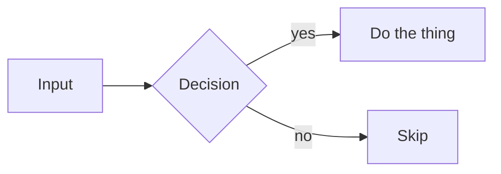

# Markdown in this vault

What is available when writing notes here, and what to write instead of MkDocs
Material syntax.

> [!info] Obsidian and Quartz, not MkDocs
> **MkDocs Material** syntax (`!!! note` admonitions, `=== "tab"` content tabs,
> `++ctrl+alt+del++` key rendering, definition lists and `#only-light` image
> suffixes) does not render in Obsidian or Quartz. The mapping is in
> [[#Migrating from MkDocs Material]] at the end.

## Basics

These work everywhere and need no explanation:

```markdown
# Heading 1
## Heading 2

*italic*  **bold**  ***both***  ~~strikethrough~~  `inline code`

- unordered list
  - nested
1. ordered list

> a blockquote

[a link](https://example.com)


---
```

A horizontal rule is `---` **on its own line with blank lines around it**. Directly
under a line of text it makes that text an H2 instead, which is a common accident.

## Tables

```markdown
| Left | Centre | Right |
| :--- | :----: | ----: |
| a    |   b    |     c |
```

Pipes inside a cell need escaping as `\|`. Tables cannot contain block content — no
lists, no fenced code — so anything structural belongs outside the table.

## Code blocks

Fence with three backticks and name the language:

````markdown
```bash
echo "hello"
```
````

Use `console` for a session including prompts and output, and `text` for output with
no syntax to highlight:

````markdown
```console
$ uname -r
6.1.0-18-amd64
```
````

That distinction is worth keeping: `bash` highlights a `$` prompt as a variable and
mangles the output, `console` understands the prompt.

To show a fence inside a fence, use four backticks on the outer one.

## Callouts

Obsidian's callout syntax, which Quartz renders natively. This is the replacement for
Material admonitions:

```markdown
> [!note]
> Body text.

> [!warning] With a custom title
> Body text.

> [!tip]- Collapsed by default
> Hidden until clicked.

> [!example]+ Expanded but collapsible
> Visible, can be folded.
```

The available types, and how this vault uses them:

| Type | Used for |
| --- | --- |
| `note` | neutral additional information |
| `tip` | a better way of doing the thing just described |
| `important` | something the reader will get wrong otherwise; drawn like `tip` |
| `warning` | a risk, a deprecation, or a trap |
| `danger` | destructive or irreversible operations |
| `example` | a worked example or hands-on exercise |
| `question` | an open point |
| `info` | provenance and attribution |
| `success` / `failure` | expected and unexpected outcomes |
| `abstract` | a summary |
| `todo` | outstanding work |
| `quote` | quoted material |

The `-` suffix starts a callout collapsed, `+` expanded-but-foldable. Callouts nest
by adding another `>`.

Some types are aliases, in Obsidian and in Quartz: `important` is drawn as `tip`, and
`caution` as `warning`, not as `danger`.

## Links between notes

Wikilinks, resolved by note path:

```markdown
[[linux/logging/rsyslog]]
[[linux/logging/rsyslog|the rsyslog note]]
[[linux/logging/rsyslog#Queues]]
[[#A heading in this note]]
```

| Form | Effect |
| --- | --- |
| `[[path/note]]` | link, displaying the note's file name, not its `title` |
| `[[path/note\|alias]]` | link with your own text |
| `[[path/note#Heading]]` | link to a section |
| `[[#Heading]]` | link within the current note |
| `[[path/note#^block-id]]` | link to a specific block |

Prefer wikilinks over Markdown links for anything inside the vault: Obsidian updates
them when a note is renamed, and Quartz builds the graph and backlinks from them.

## Embeds

Prefix a wikilink with `!` to inline the target:

```markdown
![[some-note]]              # the whole note
![[some-note#Section]]      # one section
![[_attachments/diagram.svg]]
```

Useful for including a diagram or a shared warning in several places without
duplicating it.

## Images and attachments

Assets live in an `_attachments/` folder beside the notes that use them:

```markdown

```

A real example: [[linux/boot/systemd]] embeds its `systemd-analyze` output that way.

Prefer SVG for diagrams and PNG for screenshots. Always write alt text — it is what
screen readers announce and what shows if the file goes missing.

## Mermaid diagrams

Quartz renders Mermaid natively, and this vault prefers it over binary diagram files:
it follows the light/dark theme, diffs meaningfully in Git, and needs no export
toolchain.

````markdown

````


Also available: `sequenceDiagram`, `gitGraph` (used in [[dev/git]]), `stateDiagram-v2`,
`erDiagram`, `classDiagram`, `gantt`, `pie`.

> [!tip] Quote labels containing punctuation
> `A[foo (bar)]` breaks the parser. `A["foo (bar)"]` does not. Most other
> punctuation, such as `-`, `:` or `#`, is fine without quotes.

## Footnotes

```markdown
A statement needing a citation.[^1]

[^1]: The citation.
```

Footnotes collect at the bottom of the page regardless of where you define them.

## Task lists

```markdown
- [ ] not done
- [x] done
```

Only files inside `content/` are published: a Markdown file elsewhere in the
repository is not on the site and cannot be reached by a wikilink.

## Highlighting and comments

```markdown
==highlighted text==

%%a comment that never renders%%
```

`%%...%%` is Obsidian's comment syntax and works across lines. Use it for notes to
yourself that should not be published. HTML comments `<!-- ... -->` also work.

## Frontmatter

Every note in this vault opens with YAML frontmatter:

```yaml
---
title: rsyslog
description: Collecting, filtering and forwarding syslog messages
tags: [linux, logging, syslog]
type: reference        # concept | howto | reference | lab | moc
status: complete       # stub | draft | complete
---
```

| Key | Purpose |
| --- | --- |
| `title` | the page title (a wikilink still shows the file name, unless you give an alias) |
| `description` | the summary used in search results and social previews |
| `tags` | the controlled vocabulary; drives Quartz's tag pages |
| `type` | what kind of note this is |
| `status` | how finished it is |
| `draft: true` | keep in the vault, exclude from the published site |
| `aliases` | alternative names that also resolve as wikilinks |

Notes derived from third-party material carry attribution as well:

```yaml
source: https://github.com/jpetazzo/container.training/blob/<sha>/slides/k8s/netpol.md
license: CC-BY-4.0
upstream_commit: <sha>
```

Put the `---` on the **very first line**. Obsidian reads properties only there: after a
blank line, it shows the block as a horizontal rule and the keys as text. Quartz still
reads the block, so the mistake shows in the vault but not on the site.

See [[dev/yaml]] for the quoting rules, which apply here too.

## Migrating from MkDocs Material

If you find any of the left column in an old note, replace it with the right:

| MkDocs Material | Write instead |
| --- | --- |
| `!!! note "Title"` | `> [!note] Title` |
| `??? note` (collapsible) | `> [!note]- Title` |
| `=== "Tab one"` content tabs | separate headings, or a table |
| `++ctrl+alt+del++` | `` `Ctrl+Alt+Del` `` |
| `*[HTML]: HyperText Markup Language` abbreviations | expand the term inline on first use |
| `--8<-- "file.md"` snippets | `![[file]]` embed |
| `Term\n:   Definition` definition lists | a two-column table |
| `` | one theme-neutral image |
| `{: .some-class }` attribute lists | nothing — no equivalent, restructure |
| `:material-check:` icon shortcodes | the literal emoji, ✅ |
| `:tools: lab` | `> [!example] Hands-on` |
| ` ```python title="x.py" hl_lines="2 3" ` | a plain fence; note the filename in the prose above it |

## Linting

```bash
markdownlint '**/*.md'
```

Catches inconsistent heading levels, missing fence languages, trailing whitespace and
the `---`-directly-under-text problem described above.

<!-- uplink -->
Part of [[dev/index|Development]].
