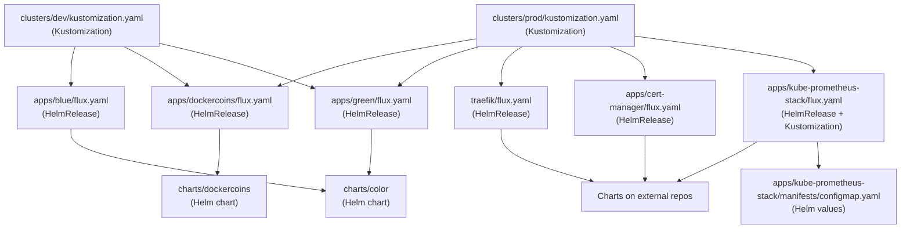

# FluxCD

> [!important] These labs expect the upstream repository
> Commands below reference files by their path in a local clone. Get it with:
>
> ```bash
> git clone https://github.com/jpetazzo/container.training
> ```
>
> The manifests can also be browsed at the pinned commit
> [`56563629`](https://github.com/jpetazzo/container.training/tree/565636291ec03abf1f2ab8bf6b935478e00e69a2).

- We're going to implement a basic GitOps workflow with Flux

- Pushing to `main` will automatically deploy to the clusters

- There will be two clusters (`dev` and `prod`)

- The two clusters will have similar (but slightly different) workloads

## Repository structure

This is (approximately) what we're going to do:

```text
├── charts/                     <--- could also be in separate app repos
│   ├── dockercoins/
│   └── color/
├── apps/                       <--- YAML manifests for GitOps resources
│   ├── dockercoins/                 (might reference the "charts" above,
│   ├── blue/                         and/or include environment-specific
│   ├── green/                        manifests to create e.g. namespaces,
│   ├── kube-prometheus-stack/        configmaps, secrets...)
│   ├── cert-manager/
│   └── traefik/
└── clusters/                   <--- per-cluster; will typically reference
    ├── prod/                        the "apps" above, possibly extending 
    └── dev/                         or adding configuration resources too
```
<small>Source: [`slides/k8s/gitopstree.txt`](https://github.com/jpetazzo/container.training/blob/565636291ec03abf1f2ab8bf6b935478e00e69a2/slides/k8s/gitopstree.txt)</small>

## Resource graph



## Getting ready

- Let's make sure we have two clusters

- It's OK to use local clusters (kind, minikube...)

- We might run into resource limits, though

  (pay attention to `Pending` pods!)

- We need to install the Flux CLI ([packages], [binaries])

- **Highly recommended:** set up CLI completion!

- Of course we'll need a Git service, too

  (we're going to use GitHub here)

[packages]: https://fluxcd.io/flux/get-started/
[binaries]: https://github.com/fluxcd/flux2/releases

## GitHub setup

- Generate a GitHub token:

  https://github.com/settings/tokens/new

- Give it "repo" access

- This token will be used by the `flux bootstrap github` command later

- It will create a repository and configure it (SSH key...)

- The token can be revoked afterwards

## Flux bootstrap

> [!example] Hands-on
> - Let's set a few variables for convenience, and create our repository:
>   ```bash
>     export GITHUB_TOKEN=...
>     export GITHUB_USER=changeme
>     export GITHUB_REPO=alsochangeme
>     export FLUX_CLUSTER=dev
>
>     flux bootstrap github \
>       --owner=$GITHUB_USER \
>       --repository=$GITHUB_REPO \
>       --branch=main \
>       --path=./clusters/$FLUX_CLUSTER \
>       --personal --private=false
>   ```

> [!note] Partly tested
> `flux bootstrap github` needs a GitHub token, so it was not run. The test writes the
> same files that bootstrap writes (`gotk-components.yaml`, `gotk-sync.yaml` and
> `kustomization.yaml` in `clusters/dev/flux-system/`) to a Git server in a pod, and
> runs everything after this point against it, with Flux 2.10.

Problems? See the next section.

## What could go wrong?

- `flux bootstrap` will create or update the repository on GitHub

- Then it will install Flux controllers to our cluster

- Then it waits for these controllers to be up and running and ready

- Check pod status in `flux-system`

- If pods are `Pending`, check that you have enough resources on your cluster

- For testing purposes, it should be fine to lower or remove Flux `requests`!

  (but don't do that in production!)

- If anything goes wrong, don't worry, we can just re-run the bootstrap

> [!note]- Extra details
> ## Idempotence
>
> - It's OK to run that same `flux bootstrap` command multiple times!
>
> - If the repository already exists, it will re-use it
>
>   (it won't destroy or empty it)
>
> - If the path `./clusters/$FLUX_CLUSTER` already exists, it will update it
>
> - It's totally fine to re-run `flux bootstrap` if something fails
>
> - It's totally fine to run it multiple times on different clusters
>
> - Or even to run it multiple times for the *same* cluster
>
>   (to reinstall Flux on that cluster after a cluster wipe / reinstall)

## What do we get?

- Let's look at what `flux bootstrap` installed on the cluster

> [!example] Hands-on
> - Look inside the `flux-system` namespace:
>   ```bash
>   kubectl get all --namespace flux-system
>   ```
>
> - Look at `kustomizations` custom resources:
>   ```bash
>   kubectl get kustomizations --all-namespaces
>   ```
>
> - See what the `flux` CLI tells us:
>   ```bash
>   flux get all
>   ```

## Deploying with GitOps

- We'll need to add/edit files on the repository

- We can do it by using `git clone`, local edits, `git commit`, `git push`

- Or by editing online on the GitHub website

> [!example] Hands-on
> - Create a manifest; for instance `clusters/dev/flux-system/blue.yaml`
>
> - Add that manifest to `clusters/dev/flux-system/kustomization.yaml`
>
> - Commit and push both changes to the repository

## Waiting for reconciliation

- Compare the git hash that we pushed and the one shown with `kubectl get gitrepositories`

- Option 1: wait for Flux to pick up the changes in the repository

  (the default interval for git repositories is 1 minute, so that's fast)

- Option 2: use `flux reconcile source git flux-system`

  (this puts an annotation on the appropriate resource, triggering an immediate check)

- Option 3: set up receiver webhooks

  (so that git updates trigger immediate reconciliation)

## Checking progress

- `flux logs`

- `kubectl get gitrepositories --all-namespaces`

- `kubectl get kustomizations --all-namespaces`

## Did it work?

- No!

- Why?

- We need to indicate the namespace where the app should be deployed

- Either in the YAML manifests

- Or in the `kustomization` custom resource

  (using field `spec.targetNamespace`)

- Add the namespace to the manifest and try again!

## Adding an app in a reusable way

- Let's see a technique to add a whole app

  (with multiple resource manifests)

- We want to minimize code repetition

  (i.e. easy to add on multiple clusters with minimal changes)

## The plan

- Add the app manifests in a directory

  (e.g.: `apps/myappname/manifests`)

- Create a kustomization manifest for the app and its namespace

  (e.g.: `apps/myappname/flux.yaml`)

- The kustomization manifest will refer to the app manifest

- Add the kustomization manifest to the top-level `flux-system` kustomization

## Creating the manifests

- All commands below should be executed at the root of the repository

> [!example] Hands-on
> - Put application manifests in their directory:
>   ```bash
>   mkdir -p apps/dockercoins/manifests
>   cp ~/container.training/k8s/dockercoins.yaml apps/dockercoins/manifests
>   ```
>
> - Create kustomization manifest:
>   ```bash
>     flux create kustomization dockercoins \
>       --source=GitRepository/flux-system \
>       --path=./apps/dockercoins/manifests/ \
>       --target-namespace=dockercoins \
>       --prune=true --export > apps/dockercoins/flux.yaml
>   ```

## Creating the target namespace

- When deploying *helm releases*, it is possible to automatically create the namespace

- When deploying *kustomizations*, we need to create it explicitly

- Let's put the namespace with the kustomization manifest

  (so that the whole app can be mediated through a single manifest)

> [!example] Hands-on
> - Add the target namespace to the kustomization manifest:
>   ```bash
>     echo "---
>     kind: Namespace
>     apiVersion: v1
>     metadata:
>       name: dockercoins" >> apps/dockercoins/flux.yaml
>   ```

## Linking the kustomization manifest

- Edit `clusters/dev/flux-system/kustomization.yaml`

- Add a line to reference the kustomization manifest that we created:
  ```yaml
  - ../../../apps/dockercoins/flux.yaml
  ```

- `git add` our manifests, `git commit`, `git push`

  (check with `git status` that we haven't forgotten anything!)

- `flux reconcile` or wait for the changes to be picked up

## Installing with Helm

- We're going to see two different workflows:

  - installing a third-party chart
    (e.g. something we found on the Artifact Hub)

  - installing one of our own charts
    (e.g. a chart we authored ourselves)

- The procedures are very similar

## Installing from a public Helm repository

- Let's install [kube-prometheus-stack][kps]

> [!example] Hands-on
> - Create the Flux manifests:
>   ```bash
>   mkdir -p apps/kube-prometheus-stack
>   flux create source helm kube-prometheus-stack \
>        --url=https://prometheus-community.github.io/helm-charts \
>        --export >> apps/kube-prometheus-stack/flux.yaml
>   flux create helmrelease kube-prometheus-stack \
>        --source=HelmRepository/kube-prometheus-stack \
>        --chart=kube-prometheus-stack --chart-version=92.18.0 \
>        --release-name=kube-prometheus-stack \
>        --target-namespace=kube-prometheus-stack --create-target-namespace \
>        --export >> apps/kube-prometheus-stack/flux.yaml
>   ```

[kps]: https://artifacthub.io/packages/helm/prometheus-community/kube-prometheus-stack

## Enable the app

- Just like before, link the manifest from the top-level kustomization

  (`flux-system` in namespace `flux-system`)

- `git add` / `git commit` / `git push`

- We should now have a Prometheus+Grafana observability stack!

## Installing from a Helm chart in a git repo

- In this example, the chart will be in the same repo

- In the real world, it will typically be in a different repo!

> [!example] Hands-on
> - Generate a basic Helm chart:
>   ```bash
>   mkdir -p charts
>   helm create charts/myapp
>   ```

(This generates a chart which installs NGINX. A lot of things can be customized, though.)

## Creating the Flux manifests

- The invocation is very similar to our first example

> [!example] Hands-on
> - Generate the Flux manifest for the Helm release:
>   ```bash
>   mkdir apps/myapp
>   flux create helmrelease myapp \
>        --source=GitRepository/flux-system \
>        --chart=charts/myapp \
>        --target-namespace=myapp --create-target-namespace \
>        --export > apps/myapp/flux.yaml
>   ```
>
> - Add a reference to that manifest to the top-level kustomization
>
> - `git add` / `git commit` / `git push` the chart, manifest, and kustomization

## Passing values

- We can also configure our Helm releases with values

- Using an existing `myvalues.yaml` file:

  `flux create helmrelease ... --values=myvalues.yaml`

- Referencing an existing ConfigMap or Secret with a `values.yaml` key:

  `flux create helmrelease ... --values-from=ConfigMap/myapp`

- The ConfigMap or Secret must be in the same Namespace as the HelmRelease

  (not the target namespace of that HelmRelease!)

## Gotchas

- When creating a HelmRelease using a chart stored in a git repository, you must:

  - either bump the chart version (in `Chart.yaml`) after each change,

  - or set `spec.chart.spec.reconcileStrategy` to `Revision`

- Why?

- Flux installs helm releases using packaged artifacts

- Artifacts are updated only when the Helm chart version changes

- Unless `reconcileStrategy` is set to `Revision` (instead of the default `ChartVersion`)

## More gotchas

- There was a bug in Flux that prevented using identical subcharts with aliases
  (not checked against current Flux)

- See [fluxcd/flux2#2505][flux2505] for details

[flux2505]: https://github.com/fluxcd/flux2/discussions/2505

## Things that we didn't talk about...

- Bucket sources

- Image automation controller

- Image reflector controller

- And more!

---

> [!info] Adapted from container.training
> This page is derived from [`slides/k8s/flux.md`](https://github.com/jpetazzo/container.training/blob/565636291ec03abf1f2ab8bf6b935478e00e69a2/slides/k8s/flux.md)
> in **[container.training](https://github.com/jpetazzo/container.training)** by Jérôme Petazzoni and contributors,
> used under [CC BY 4.0](https://creativecommons.org/licenses/by/4.0/).
> **Changes were made**: restructured from slides into a single page, remark
> markup converted to Obsidian callouts, referenced files inlined or linked,
> kustomization path fixed, chart version pinned, tested with Flux 2.10 on kind.

<!-- uplink -->
Part of [[kubernetes/cicd-gitops/index|CI/CD and GitOps]].
