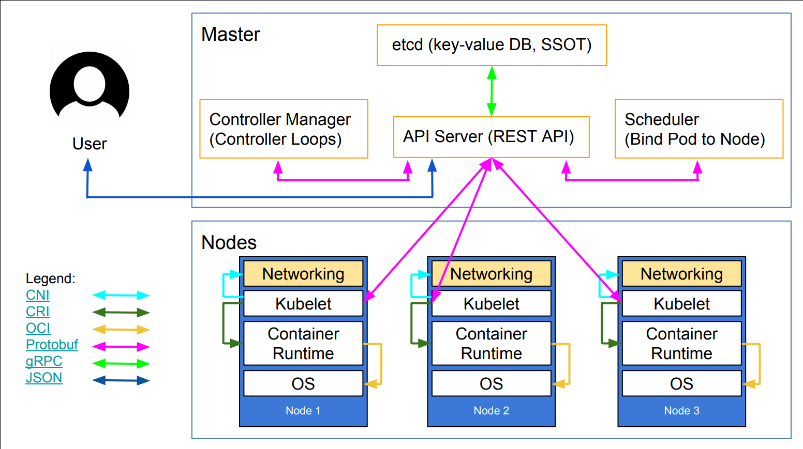
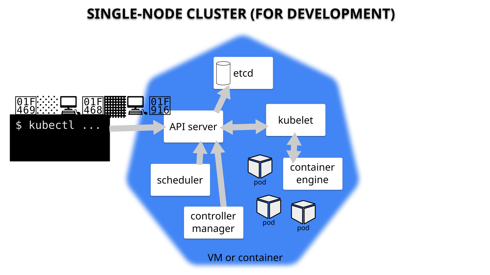
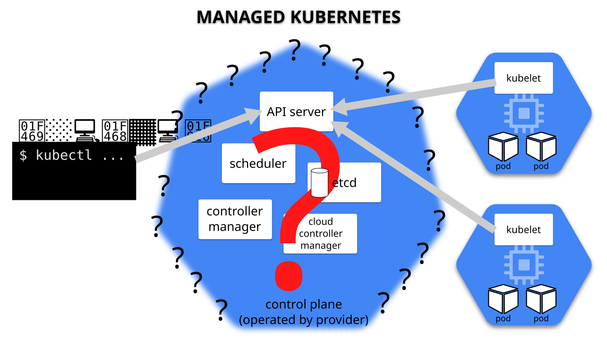
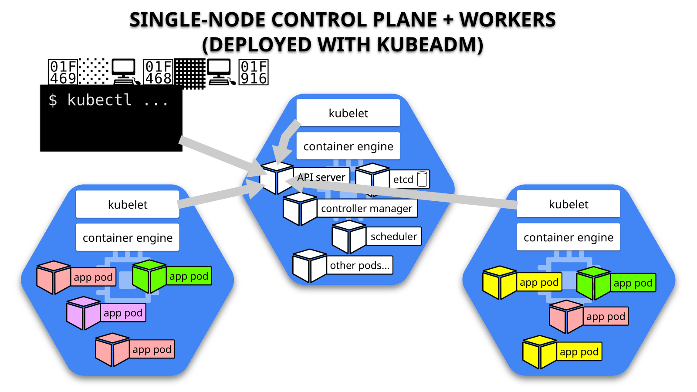
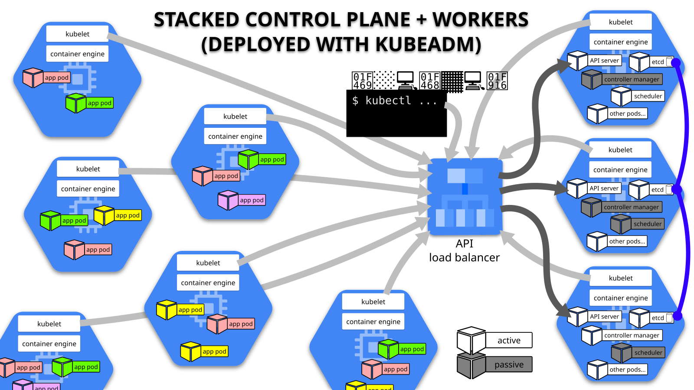
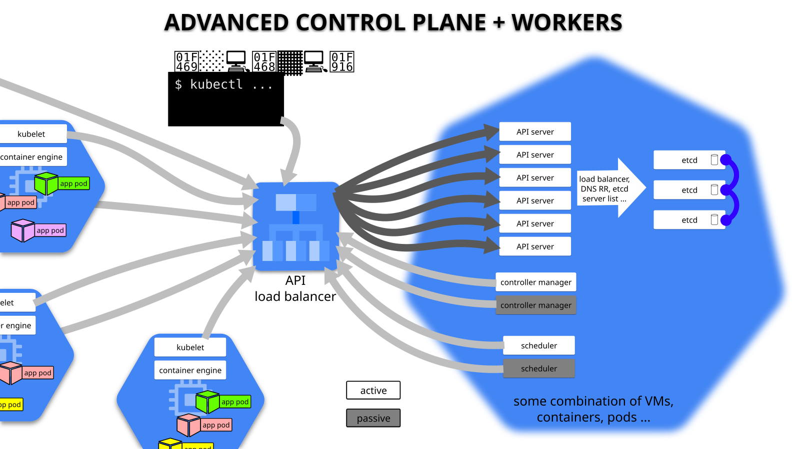
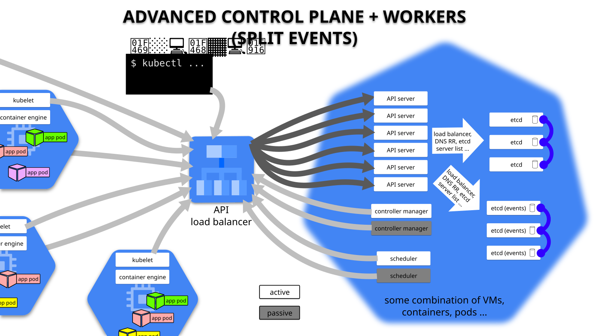
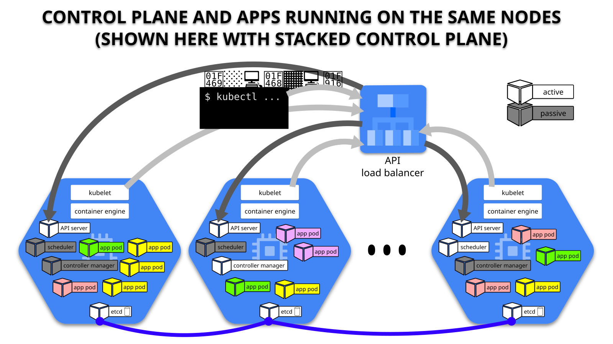

# Kubernetes architecture

You can split Kubernetes in two parts:

- the *nodes*: a set of machines that run your containerized workloads;
- the *control plane*: a set of processes that implement the Kubernetes APIs.

Kubernetes also needs infrastructure underneath: servers and a network, plus optional
parts like storage systems and load balancers.



## What runs on a node

- Your containerized workloads.
- A container engine, such as containerd or CRI-O. In theory the choice does not
  matter: Kubernetes hides the engine behind an interface (the CRI, see below).
- kubelet: an agent that connects the node to the cluster. It connects to the API
  server, registers the node, and receives instructions.
- kube-proxy: a component for communication inside the cluster. It is *not* an
  overlay network or a CNI plugin.

> [!warning] Correction
> The original listed Docker as a container engine, and said that kubelet runs the
> network plugins. Kubernetes 1.24 removed the code that drove Docker Engine directly
> (see [[kubernetes/concepts/versions-k8s]]). Since then, the container engine runs
> the network plugins.

On a cluster built with `kubeadm` (or kind), kubelet is a system service on each
node, and kube-proxy runs as a Pod on each node:

```bash
kubectl get pods -n kube-system -o wide
```

## What's in the control plane

- Everything is stored in etcd. It is the only component with state.
- Everyone talks only through the API server:
  - users talk to the cluster through the API server;
  - the nodes register and get their instructions through the API server;
  - the other control plane components also register with the API server.
- The API server is the only component that reads from and writes to etcd.

With `kubeadm`, the control plane components run as Pods in the `kube-system`
namespace: `etcd-*`, `kube-apiserver-*`, `kube-controller-manager-*` and
`kube-scheduler-*`, one of each per control plane node.

## Communication protocols: API server

- The API server exposes a REST API. Some calls are not REST, for example attaching
  to a container interactively.
- Almost all requests and responses are JSON, in a strict format.
- For performance, requests and responses can also use protobuf. See this
  [design proposal](https://github.com/kubernetes/design-proposals-archive/blob/main/api-machinery/protobuf.md)
  for details.
- In practice, the control plane components and kubelet use protobuf to talk to the
  API server, for the built-in resource types.

## Communication protocols: on the nodes

kubelet uses several special-purpose protocols and interfaces, including:

- CRI (Container Runtime Interface):
  - kubelet uses it to talk to the container engine;
  - it hides the differences between container engines;
  - it is based on gRPC and protobuf.
- [CNI (Container Network Interface)](https://github.com/containernetworking/cni/blob/main/SPEC.md):
  - the container engine uses it to talk to network plugins, when kubelet asks it to
    create a Pod;
  - network plugins are programs, usually in `/opt/cni/bin`, configured by files in
    `/etc/cni/net.d`, and run for each Pod;
  - network plugins provide IPAM (IP address management);
  - network plugins set up the network interfaces in Pods.

## Control plane location

The control plane can run:

- in containers, on the same nodes that run the application workloads. This is the
  default for single-node local clusters like [Minikube](https://github.com/kubernetes/minikube)
  and [kind](https://kind.sigs.k8s.io/);
- on a dedicated node. This is the default when you deploy with kubeadm;
- on a dedicated set of nodes: [Kubernetes The Hard Way](https://github.com/kelseyhightower/kubernetes-the-hard-way),
  [kops](https://github.com/kubernetes/kops), and kubeadm too;
- outside of the cluster: most managed clusters, like AKS, DOKS, EKS, GKE, Kapsule,
  LKE and OKE.

A dedicated control plane node has a *taint* that keeps normal Pods away from it:

```bash
kubectl get nodes -o custom-columns=NAME:.metadata.name,TAINTS:.spec.taints[*].key
```

On a kubeadm cluster, the control plane node shows
`node-role.kubernetes.io/control-plane`.















## The Kubernetes API

> *The Kubernetes API server is a "dumb server" which offers storage, versioning,
> validation, update, and watch semantics on API resources.*
>
> — [Clayton Coleman](https://github.com/smarterclayton), Kubernetes architect and
> maintainer, in the [protobuf design proposal](https://github.com/kubernetes/design-proposals-archive/blob/main/api-machinery/protobuf.md#proposal-and-motivation)

What does that mean?

## The Kubernetes API is declarative

- You cannot tell the API "run a Pod".
- You can tell the API "here is the definition of Pod X".
- The API server stores that definition (in etcd).
- *Controllers* then wake up and create a Pod that matches the definition.

See [[kubernetes/concepts/declarative]].

## The core features of the Kubernetes API

- You can create, read, update and delete objects.
- You can also *watch* objects: be told when an object changes, or when an object of
  a given type is created.
- Objects are strongly typed.
- Types are *validated* and *versioned*.
- etcd provides the storage and watch operations. (The [k3s](https://k3s.io/) project
  can use SQLite instead of etcd.)

## Let's experiment a bit!

Use a test cluster where you are allowed to create namespaces, for example a
[[kubernetes/cluster-setup/kind|kind]] cluster.

> [!example] Hands-on
> - Check that the cluster works:
>   ```bash
>   kubectl get nodes
>   ```
>
> - All nodes should be `Ready`.

## Create

Let's create a simple object.

> [!example] Hands-on
> Create a namespace with this command:
>
> ```bash
> kubectl create -f- <<EOF
> apiVersion: v1
> kind: Namespace
> metadata:
>   name: hello
> EOF
> ```

This does the same as `kubectl create namespace hello`.

> [!note]
> In the original, the lines of this block were indented, `EOF` included. A heredoc
> ends only at an `EOF` at the start of a line, so the command never ended.

## Read

Let's read back the object you just created.

> [!example] Hands-on
> - Read back the object:
>   ```bash
>   kubectl get namespace hello -o yaml
>   ```

You see a lot of data that was not there when you created the object.

- Kubernetes added some data, such as `spec.finalizers` and the
  `kubernetes.io/metadata.name` label.
- Some data is dynamic, typically the content of `status`.

## API requests and responses

Almost every Kubernetes API payload (request or response) has the same format:

```yaml
apiVersion: xxx
kind: yyy
metadata:
  name: zzz
  # (more metadata fields here)
# (more fields here)
```

- These fields are mandatory, except in a few special cases. For example, a list of
  resources has no `metadata.name`.
- This page shows YAML because it is easier to read, but the API uses JSON (or
  protobuf).

> [!note]- Extra details
> ## API versions
>
> - The `apiVersion` field names an *API group* and its version.
> - It is either `v1` (the "core" or "legacy" group), or `group/version`. For example:
>   - `apps/v1`
>   - `rbac.authorization.k8s.io/v1`
>   - `networking.k8s.io/v1`
> - It does not tell which version of Kubernetes you run.
> - It *indirectly* tells the version of the `kind`: which fields exist, their format,
>   and which ones are mandatory.
> - A resource type (`kind`) is rarely versioned alone. For example, the `batch` API
>   group contains both `jobs` and `cronjobs`.
>
> List the groups and versions your cluster serves with `kubectl api-versions`, and
> the resources of one group with:
>
> ```bash
> kubectl api-resources --api-group=batch
> ```
>
> > [!warning] Correction
> > The original gave `extensions/v1beta1` as an example. Kubernetes 1.22 removed the
> > last resources of that group: no current cluster serves it.

> [!note]- Extra details
> ## Group-Version-Kind, or GVK
>
> - A type is identified by the combination of:
>   - the API group it belongs to (core, `apps`, `metrics.k8s.io`...);
>   - the version of this API group (`v1`, `v1beta1`...);
>   - the "Kind" itself (Pod, Role, Job...).
> - "GVK" appears a lot in the API machinery code.
> - Kubernetes can convert between versions, and even between API groups. This
>   happened when Deployments moved from `extensions` to `apps`.

## Update

Let's update the namespace object. There are many ways to do it, including:

- `kubectl apply`, with an updated YAML file;
- `kubectl edit`;
- `kubectl patch`;
- many helpers, like `kubectl label` or `kubectl set`.

In each case, `kubectl`:

1. gets the current definition of the object;
2. computes the changes;
3. sends the changes, with `PATCH` requests.

## Adding a label

As an example, let's add a label to the namespace. The easiest way is
`kubectl label`.

> [!example] Hands-on
> - In one terminal, watch namespaces:
>   ```bash
>   kubectl get namespaces --show-labels -w
>   ```
>
> - In the other, update the namespace:
>   ```bash
>   kubectl label namespaces hello color=purple
>   ```

This shows the *update* and *watch* features: the first terminal prints a new line
for `hello`, with the new label.

## What's special about *watch*?

- The API server itself does not do anything. It is just a fancy object store.
- All the real logic of Kubernetes is in *controllers*.
- A *controller* watches a set of resources, and acts when they change.
- Examples:
  - when a Pod object is created, it gets scheduled and started;
  - when a Pod that belongs to a ReplicaSet ends, it gets replaced;
  - when a Deployment object is updated, it can start a rolling update.

> [!note]- Extra details
> ## Watch events
>
> `kubectl get --watch` shows changes. Add `--output-watch-events` to also see the
> difference between `ADDED` and `MODIFIED` resources, and the `DELETED` ones.
>
> > [!example] Hands-on
> > - In one terminal, watch Pods, with the full events:
> >   ```bash
> >   kubectl get pods --watch --output-watch-events
> >   ```
> >
> > - In another, run a short-lived Pod:
> >   ```bash
> >   kubectl run pause --image=alpine --rm -ti --restart=Never -- sleep 5
> >   ```

## Other control plane components

- API server: covered above.
- etcd: covered above.
- Controller manager.
- Scheduler.

## Controller manager

- The controller manager is a set of loops that watch all kinds of objects.
- That is where the real logic of Kubernetes lives.
- When you create a Deployment, for example with
  `kubectl create deployment web --image=nginx`:
  - you create a Deployment object;
  - the Deployment controller notices it, and creates a ReplicaSet;
  - the ReplicaSet controller notices the ReplicaSet, and creates a Pod.

## Scheduler

- A new Pod is in the `Pending` state.
- The scheduler (or rather, *a* scheduler) must bind it to a node.
  - Kubernetes comes with an efficient scheduler with many features.
  - If you have special needs, you can add another scheduler. For example, this
    [demo scheduler](https://github.com/kelseyhightower/scheduler) uses the cost of
    nodes, stored in node annotations.
- A Pod can stay `Pending` for a long time:
  - if the cluster is full;
  - if the Pod has constraints that no node can meet;
  - if the scheduler is not running.

`kubectl describe pod` then shows a `FailedScheduling` event that says why.

---

> [!info] Adapted from container.training
> This page is derived from [`slides/k8s/architecture.md`](https://github.com/jpetazzo/container.training/blob/565636291ec03abf1f2ab8bf6b935478e00e69a2/slides/k8s/architecture.md)
> in **[container.training](https://github.com/jpetazzo/container.training)** by Jérôme Petazzoni and contributors,
> used under [CC BY 4.0](https://creativecommons.org/licenses/by/4.0/).
> **Changes were made**: restructured from slides into a single page, remark
> markup converted to Obsidian callouts, referenced files inlined or linked.
> Rewritten as prose, stale examples (Docker, `extensions/v1beta1`) corrected, a broken
> heredoc fixed, and commands to inspect the components added.

<!-- uplink -->
Part of [[kubernetes/concepts/index|Concepts]].
