# Kubernetes concepts

Kubernetes is a container management system. It runs and manages containerized
applications on a cluster. What does that really mean?

## What can we do with Kubernetes?

Imagine a 3-tier e-commerce app:

- a web frontend;
- an API backend;
- a database.

You have built images for the frontend and backend components, for example with
Dockerfiles and `docker build`. They run well in a local environment, for example
with Docker Compose. Let's see how to deploy this app on Kubernetes.

## Kubernetes, level 1

- Leave the database outside of Kubernetes, because databases are scary.
- Deploy a managed Kubernetes cluster, in the cloud or with the help of
  [professional services][enix-k8s-expert].
- Start 5 containers from the image `atseashop/api:v1.3`.
- Put an internal load balancer in front of these containers.
- Start 10 containers from the image `atseashop/webfront:v1.3`.
- Put a public load balancer in front of these containers.
- It is Black Friday (or Christmas): traffic spikes. Grow the cluster and add
  containers.
- New release: replace the containers with the new image `atseashop/webfront:v1.4`.
- Keep serving requests during the upgrade: update the containers one at a time.

[enix-k8s-expert]: https://enix.io/en/kubernetes-expert/

## Kubernetes, level 2

- Deploy a pre-production environment (still with the external database, for now).
- Resource management and scheduling: reserve CPU and RAM for containers, placement
  constraints, priorities.
- Autoscaling: simple on CPU, more complex on other metrics.
- Advanced rollout patterns: blue/green deployment, canary deployment.

The picture below is a canary cage with an oxygen bottle, made to keep the canary
alive. See https://post.lurk.org/@zilog/109632335293371919 for details.

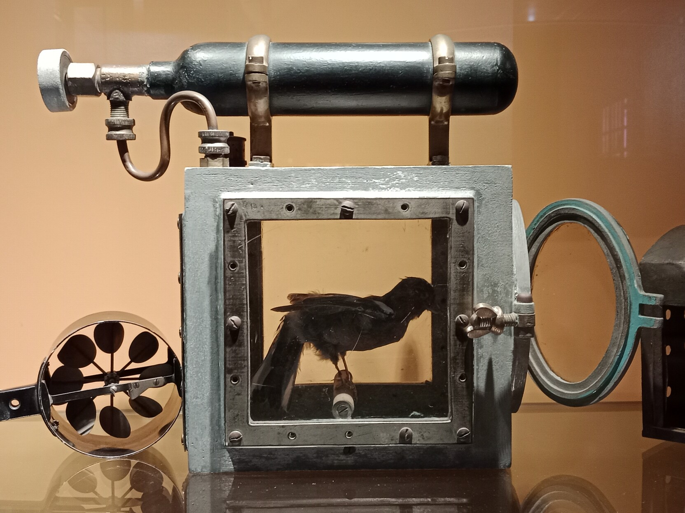

## Kubernetes, level 3

- Run staging databases on the cluster: no replication, no backups, no scaling.
- Deploy feature branches automatically or semi-automatically, each with its own
  database.
- Fine-grained access control: define *what* can be done by *whom* on *which*
  resources.
- Batch jobs: one-off, parallel, and periodic like cron. See
  [[kubernetes/workloads/batch-jobs]].
- Package applications, for example with Helm charts.

## Kubernetes, level 4

- Stateful services with persistence, replication and backups: databases, message
  queues, and so on.
- Automate complex tasks, like database replication and failover, with *operators*.
- Combine the two previous points with database operators like [CloudNativePG][cnpg].
  Learn more about database operators: [FR][pirates-video-fr], [EN][pirates-video-en].
- Use advanced storage, for example local ZFS volumes. Learn more about ZFS and
  databases on Kubernetes: [FR][zfs-video-fr], [EN][zfs-video-en].
- Deploy and manage clusters in-house.

[cnpg]: https://cloudnative-pg.io/
[pirates-video-fr]: https://www.youtube.com/watch?v=d_ka7PlWo1I
[pirates-video-en]: https://www.youtube.com/watch?v=ojUdBjbiKWk&t=5s
[zfs-video-fr]: https://www.youtube.com/watch?v=XN9YL93f8tI
[zfs-video-en]: https://www.youtube.com/watch?v=3sJIYiDnod4

## Kubernetes, level 5

- Deploy and manage clusters at scale: hundreds of clusters, thousands of nodes.
- Write custom operators.
- Hybrid deployments.

## Disclaimer

These levels are not always linear. They are not complete either: for example, they
do not mention observability and alerting.

## Kubernetes architecture

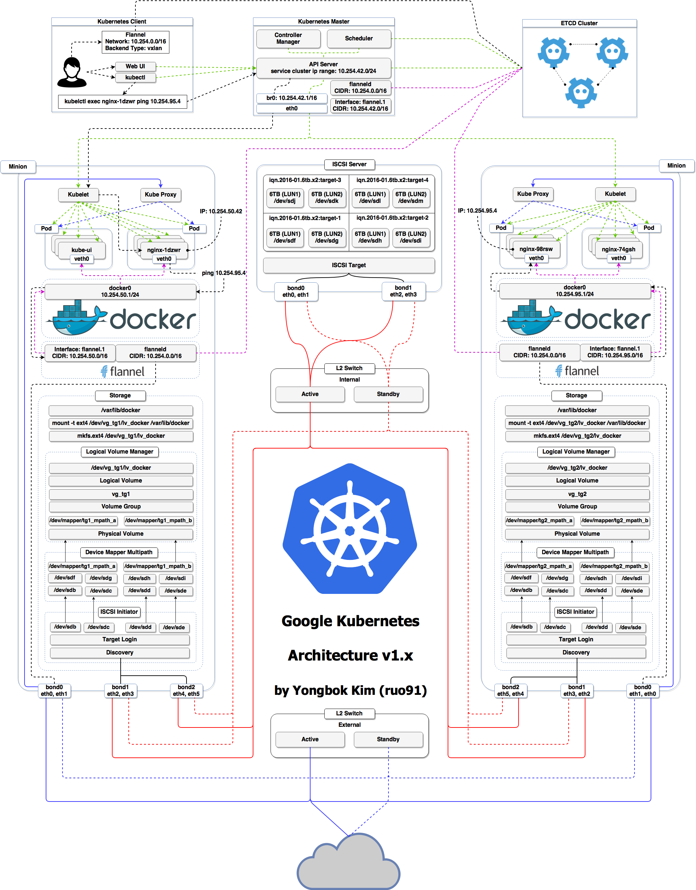

## Kubernetes architecture, for real

Ha ha. That was a joke, to scare you. It is much simpler than that:

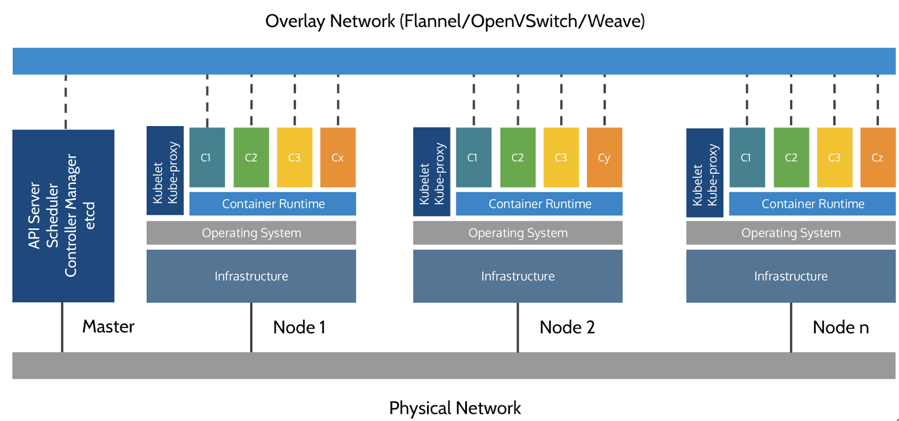

## Credits for the two diagrams

- The first one is a Kubernetes cluster with storage backed by multi-path iSCSI.
  Courtesy of [Yongbok Kim](https://www.yongbok.net/blog/).
- The second one is a simple view of a Kubernetes cluster. Courtesy of
  [Imesh Gunaratne](https://medium.com/containermind/a-reference-architecture-for-deploying-wso2-middleware-on-kubernetes-d4dee7601e8e).

## Kubernetes architecture: the nodes

The nodes that run your containers run a set of services:

- a container engine (typically containerd or CRI-O);
- kubelet, the "node agent";
- kube-proxy, a network component that is needed but not enough on its own.

Nodes were once called "minions". You may see that word in old articles or
documentation.

> [!warning] Correction
> The original said the container engine is "typically Docker". Kubernetes 1.24
> removed direct support for Docker Engine; see the extra details below. The
> `CONTAINER-RUNTIME` column shows the engine of each node:
> ```bash
> kubectl get nodes -o wide
> ```

## Kubernetes architecture: the control plane

The logic of Kubernetes (its "brains") is a set of services:

- the API server, the entry point to everything;
- core services like the scheduler and the controller manager;
- `etcd`, a highly available key/value store: the "database" of Kubernetes.

Together, these services form the *control plane* of the cluster. It used to be
called the "master". See [[kubernetes/concepts/architecture]] for more.

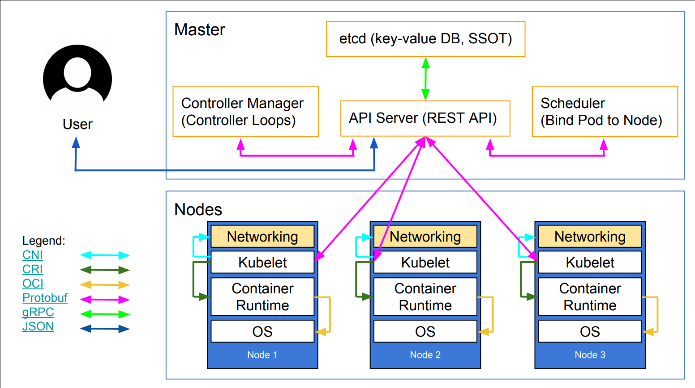

> [!note]- Extra details
> ## Running the control plane on special nodes
>
> - It is common to reserve a dedicated node for the control plane. Single-node
>   development clusters, like minikube, are the exception.
> - This node used to be called a "master". (This was confusing: is the "master" a
>   node, or the whole control plane?)
> - Normal applications cannot run on this node, because of a mechanism called
>   ["taints"](https://kubernetes.io/docs/concepts/scheduling-eviction/taint-and-toleration/).
>   See [[kubernetes/workloads/taints-and-tolerations]].
> - When you need high availability, each service of the control plane must be
>   resilient. The control plane is then replicated on several nodes. This is
>   sometimes called a "multi-master" setup.
>
> > [!warning] Correction
> > Kubernetes dropped the word "master" for nodes. Since 1.25, kubeadm labels and
> > taints control plane nodes with `node-role.kubernetes.io/control-plane` only, not
> > `node-role.kubernetes.io/master`. See the taints with:
> > ```bash
> > kubectl describe nodes | grep -E '^(Name|Taints):'
> > ```

> [!note]- Extra details
> ## Running the control plane outside containers
>
> - The services of the control plane can run in or out of containers.
> - For example, `etcd` is a critical service, so some people run it directly on a
>   dedicated cluster, without containers. The first, "very complicated" diagram shows
>   this.
> - In some hosted Kubernetes offerings (AKS, GKE, EKS...), you cannot see the control
>   plane. You only "see" a Kubernetes API endpoint.
> - In that case, there is no "master node".
>
> *For this reason, "control plane" is more accurate than "master".*

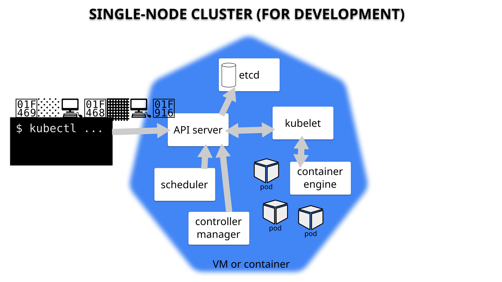

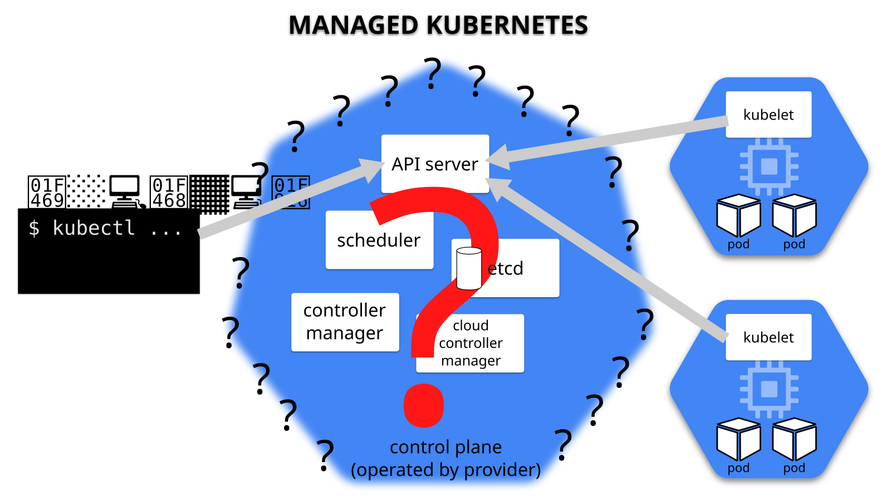

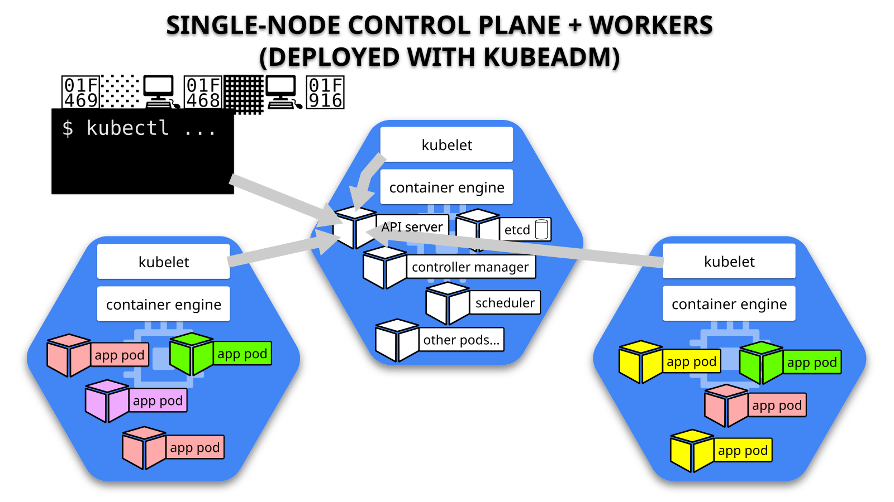

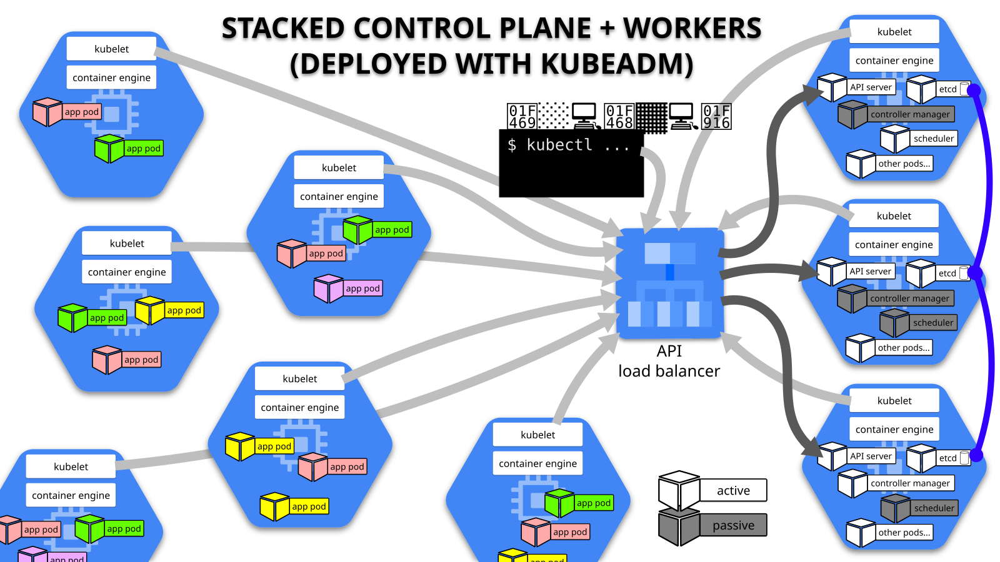

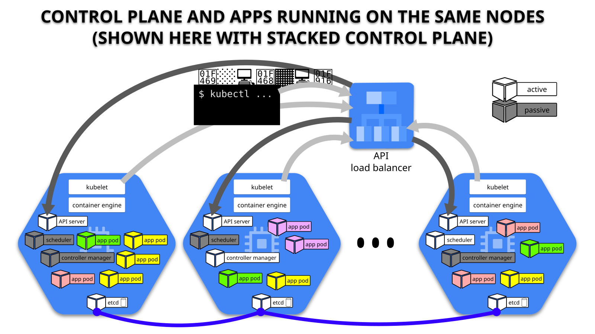

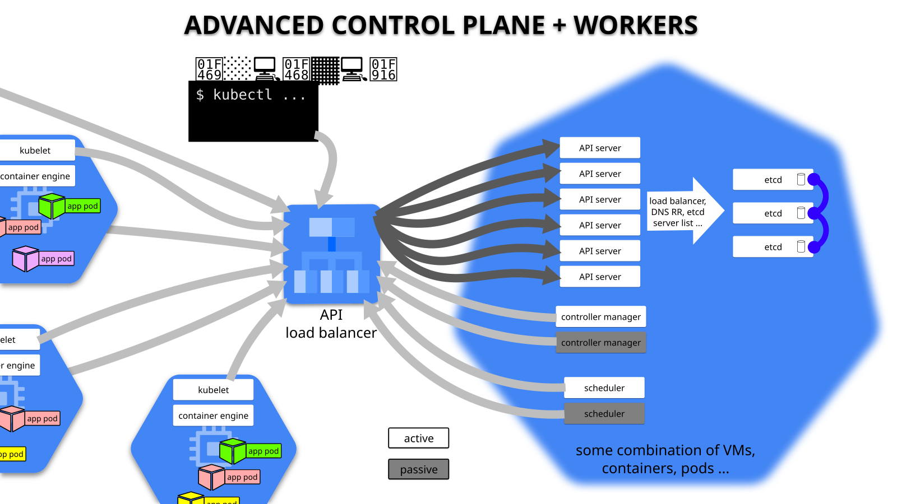

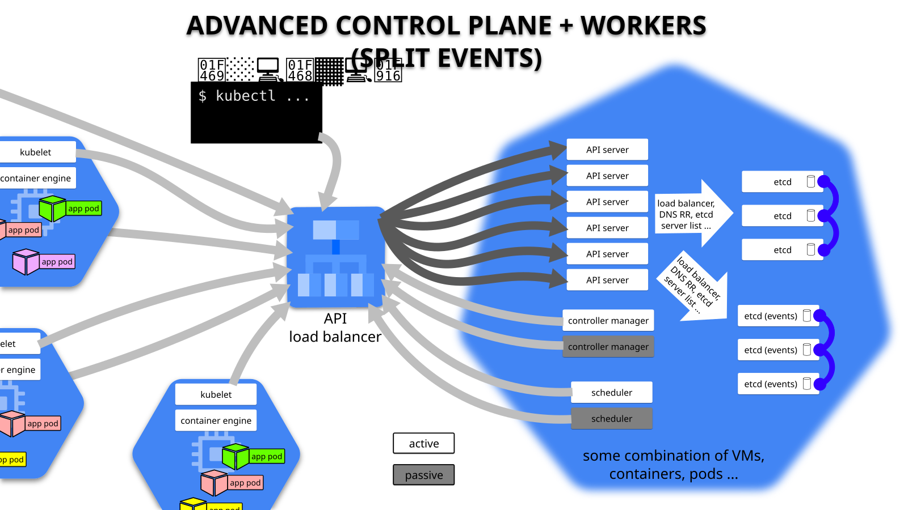

> [!note]- Extra details
> ## How many nodes should a cluster have?
>
> - There is no special rule. You do not need an odd number of nodes for a quorum.
> - A cluster can have zero nodes, but then it cannot start any Pods.
> - For tests and development, a single node is fine.
> - For production, make sure that you have spare capacity, so that your workload
>   still fits if you lose a node or a group of nodes.
> - Kubernetes is tested with [up to 5000 nodes](https://kubernetes.io/docs/setup/best-practices/cluster-large/).
>   A cluster of that size needs a lot of tuning.

> [!note]- Extra details
> ## Do we need to run Docker at all?
>
> On your Kubernetes clusters: no.
>
> - Docker Engine used to be the default way to run containers with Kubernetes.
> - Kubernetes 1.24 removed the support for Docker Engine (specifically: dockershim).
> - Kubernetes uses other, pluggable runtimes through the *Container Runtime
>   Interface* (CRI).
> - You could once use `rkt` ("Rocket") from CoreOS too. That project has ended.
>
> On your development machines and CI pipelines: often yes.
>
> - You need to build images and ship them around.
> - You can do that without Docker, for example with Buildah or Podman (see
>   [[containers/podman]]), but with some languages and frameworks it is harder.
> - The original course ran its app on a single node with Docker first.
>
> > [!note]
> > The original said that Docker "is still the most stable container engine today".
> > That opinion is from about 2018. Today, containerd (which Docker Engine itself uses)
> > and CRI-O are the usual engines on Kubernetes nodes.

> [!note]- Extra details
> ## Some runtimes available through CRI
>
> - [containerd](https://github.com/containerd/containerd/blob/main/README.md):
>   - a CNCF project, maintained by Docker, IBM and the community;
>   - used by Docker Engine, MicroK8s, k3s, kind and GKE; also standalone;
>   - comes with its own CLI, `ctr`.
> - [CRI-O](https://github.com/cri-o/cri-o/blob/main/README.md):
>   - maintained by Red Hat, SUSE and the community;
>   - used by OpenShift (the original also cited openSUSE Kubic, which has ended);
>   - designed as a minimal runtime for Kubernetes.
> - [And more](https://kubernetes.io/docs/setup/production-environment/container-runtimes/).

## Interacting with Kubernetes

- You interact with a Kubernetes cluster through the Kubernetes API.
- The Kubernetes API is (mostly) RESTful.
- It lets you create, read, update and delete *resources*.
- A few common resource types are:
  - node: a machine (physical or virtual) in the cluster;
  - pod: a group of containers that run together on a node;
  - service: a stable network endpoint to connect to one or more containers.

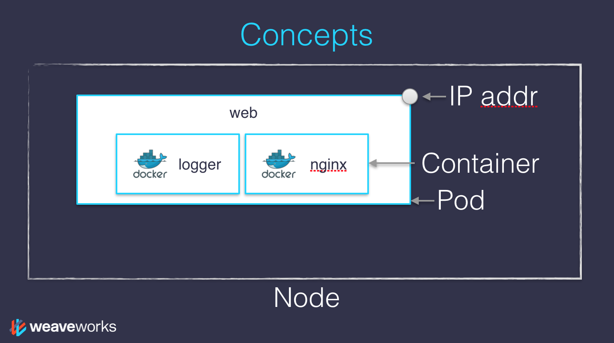

## Scaling

How do you scale the Pod in the picture above?

- **Do** create more Pods:
  - each Pod can be on a different node;
  - each Pod has its own IP address.
- **Do not** add more NGINX containers to the Pod:
  - all the NGINX containers would be on the same node;
  - they would all have the same IP address, so all but one fail with
    `Address already in use`.

You can see this failure with a Pod that has two NGINX containers:

```yaml
apiVersion: v1
kind: Pod
metadata:
  name: two-nginx
spec:
  containers:
    - name: first
      image: nginx
    - name: second
      image: nginx
```

One of the two containers keeps restarting. Its log shows
`bind() to 0.0.0.0:80 failed (98: Address already in use)`.

## Together or separate

Should you put a web application server and a cache (like Memcached or Redis) in the
same Pod?

- **In the same Pod**, they:
  - are scaled together;
  - can talk very efficiently over `localhost`.
- **In different Pods**, they:
  - can be scaled separately;
  - must talk over remote IP addresses, which adds latency and lowers performance.

Both choices can make sense. It depends on your goals.

## Credits

- The first diagram is courtesy of Lucas Käldström, in
  [this presentation](https://speakerdeck.com/luxas/kubeadm-cluster-creation-internals-from-self-hosting-to-upgradability-and-ha).
  It is one of the best Kubernetes architecture diagrams available.
- The second diagram is courtesy of Weaveworks:
  - a *pod* can have several containers that work together;
  - IP addresses belong to *pods*, not to single containers.

Both diagrams are used with permission.

---

> [!info] Adapted from container.training
> This page is derived from [`slides/k8s/concepts-k8s.md`](https://github.com/jpetazzo/container.training/blob/565636291ec03abf1f2ab8bf6b935478e00e69a2/slides/k8s/concepts-k8s.md)
> in **[container.training](https://github.com/jpetazzo/container.training)** by Jérôme Petazzoni and contributors,
> used under [CC BY 4.0](https://creativecommons.org/licenses/by/4.0/).
> **Changes were made**: restructured from slides into a single page, remark
> markup converted to Obsidian callouts, referenced files inlined or linked.
> Rewritten as prose; Docker, "master" and runtime details brought up to date, with
> corrections; a runnable example of two containers on one port added.

<!-- uplink -->
Part of [[kubernetes/concepts/index|Concepts]].
