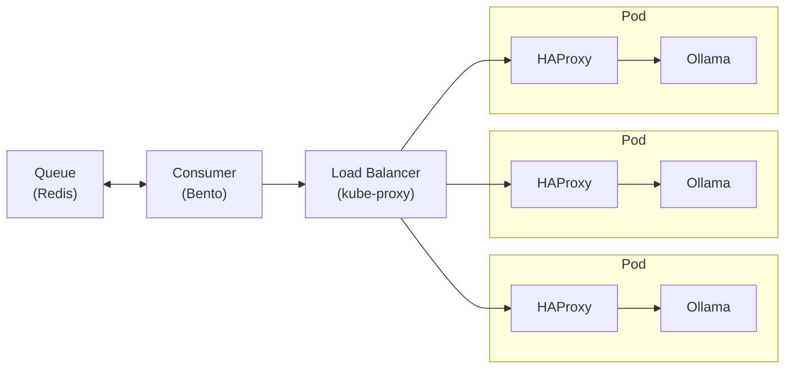
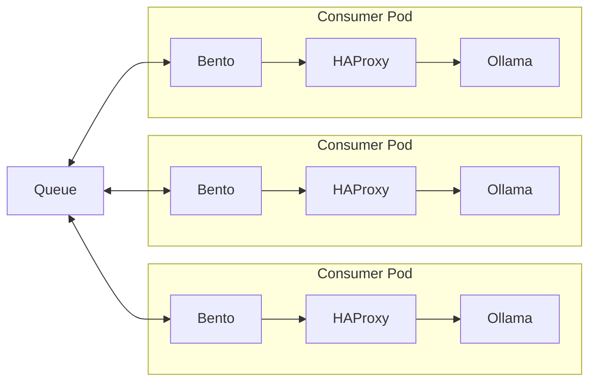

# Autoscaling with KEDA

- Cluster autoscaling = automatically add nodes *when needed*

- *When needed* = when Pods are `Pending`

- How do these pods get created?

- When the Ollama Deployment is scaled up

  - ... manually (e.g. `kubectl scale`)

  - ... automatically (that's what we want to investigate now!)

## Ways to implement autoscaling

- Custom code

  (e.g. crontab checking some value every few minutes and scaling accordingly)

- Kubernetes Horizontal Pod Autoscaler v1

  (aka `kubectl autoscale`)

- Kubernetes Horizontal Pod Autoscaler v2 with custom metrics

  (e.g. with Prometheus Adapter)

- Kubernetes Horizontal Pod Autoscaler v2 with external metrics

  (e.g. with KEDA)

## Custom code

- No, we're not going to do that!

- But this would be an interesting exercise in RBAC

  (setting minimal amount of permissions for the pod running our custom code)

## HPAv1

Pros: very straightforward

Cons: can only scale on CPU utilization

How it works:

- periodically measures average CPU *utilization* across pods

- if utilization is above/below a target (default: 80%), scale up/down

## HPAv1 in practice

- Create the autoscaling policy:
  ```bash
  kubectl autoscale deployment ollama --max=1000
  ```
  (The `--max` is required; it's a safety limit.)

- Check it:
  ```bash
  kubectl describe hpa
  ```

- Send traffic, wait a bit: pods should be created automatically

## HPAv2 custom vs external

- Custom metrics = arbitrary metrics attached to Kubernetes objects

- External metrics = arbitrary metrics not related to Kubernetes objects

🤔

## HPAv2 custom metrics

- Examples:

  - on Pods: CPU, RAM, network traffic...

  - on Ingress: requests per second, HTTP status codes, request duration...

  - on some worker Deployment: number of tasks processed, task duration...

- Requires an *adapter* to:

  - expose the metrics through the Kubernetes *aggregation layer*

  - map the actual metrics source to Kubernetes objects

Example: the [Prometheus adapter][prometheus-adapter]

[prometheus-adapter]: https://github.com/kubernetes-sigs/prometheus-adapter

## HPAv2 custom metrics in practice

- We're not going to cover this here

  (too complex / not enough time!)

- If you want more details, check [my other course material][hpav2slides]

[hpav2slides]: https://2024-10-enix.container.training/4.yml.html#toc-scaling-with-custom-metrics

## HPAv2 external metrics

- Examples:

  - arbitrary Prometheus query

  - arbitrary SQL query

  - number of messages in a queue

  - and [many, many more][keda-scalers]

- Also requires an extra component to expose the metrics

Example: [KEDA (https://keda.sh/)](https://keda.sh)

[keda-scalers]: https://keda.sh/docs/latest/scalers/

## HPAv2 external metrics in practice

- We're going to install KEDA

- And set it up to autoscale depending on the number of messages in Redis

## Installing KEDA

Multiple options (details in the [documentation][keda-deploy]):

- YAML

- Operator Hub

- Helm chart 💡

```bash
helm upgrade --install --repo https://kedacore.github.io/charts \
 --namespace keda-system --create-namespace keda keda --version 2.21.0
```

[keda-deploy]: https://keda.sh/docs/latest/deploy/

## Scaling according to Redis

- We need to create a KEDA Scaler

- This is done with a "ScaledObject" manifest

- [Here is the documentation][keda-redis-lists] for the Redis Lists Scaler

- Let's write that manifest!

[keda-redis-lists]: https://keda.sh/docs/latest/scalers/redis-lists/

## `keda-redis-scaler.yaml`

```yaml
apiVersion: keda.sh/v1alpha1
kind: ScaledObject
metadata:
  name: ollama
spec:
  scaleTargetRef:
    name: ollama
  triggers:
  - type: redis
    metadata:
      address: redis.default.svc:6379
      listName: cities
      listLength: "10"
```

## Notes

- We need to update the `address` field with our namespace

  (unless we are running in the `default` namespace)

- Alternative: use `addressFromEnv` and set an env var in the Ollama pods

- `listLength` gives the target ratio of `messages / replicas`

- In our example, KEDA will scale the Deployment to `messages / 10`

  (rounded up!)

> [!note] Scaling to zero
> The manifest above sets `listLength: "10"`: the target is 10 messages per replica.
> KEDA's `minReplicaCount` defaults to 0, so with an empty list it scales the
> Deployment down to zero after the cooldown (5 minutes).

## Trying it out

- Apply the ScaledObject manifest

- Start a Bento pipeline loading e.g. 100-1000 cities in Redis

  (100 on smaller clusters / slower CPUs, 1000 on bigger / faster ones)

- Check pod and node resource usage

- What do we see?

🤩 The Deployment scaled up automatically!

🤔 But Pod resource usage remains very low (A few busy pods, many idle)

💡 Bento doesn't submit enough requests in parallel!

## Improving throughput

We're going to review multiple techniques:

1. Increase parallelism inside the Bento pipeline.

2. Run multiple Bento consumers.

3. Couple consumers and processors more tightly.

## 1️⃣ Increase pipeline parallelism

- Set `parallel` to `true` in the `http` processor

- Wrap the input around a `batched` input

  (otherwise, we don't have enough messages in flight)

- Increase `http` timeout significantly (e.g. to 5 minutes)

## Results

🎉 More messages flow through the pipeline

🎉 Many requests happen in parallel

🤔 Average Pod and Node CPU utilization is higher, but not maxed out

🤔 HTTP queue size (measured with HAProxy metrics) is relatively high

🤔 Latency is higher too

Why?

## Too many requests in parallel

- Earlier, we didn't have enough...

- ...Now, we have too much!

- However, for a very big request queue, it still wouldn't be enough

💡 We currently have a fixed parallelism. We need to make it dynamic!

## 2️⃣ Run multiple Bento consumers

- Restore the original Bento configuration

  (flip `parallel` back to `false`; remove the `batched` input)

- Run Bento in a Deployment

  (e.g. with the [Bento Helm chart][bento-helm-chart])

- Autoscale that Deployment like we autoscaled the Ollama Deployment

[bento-helm-chart]: https://github.com/warpstreamlabs/bento-helm-chart

## Results

🤔🤔🤔 Pretty much the same as before!

(High throughput, high utilization but not maxed out, high latency...)

🤔🤔🤔 Why?

## Unbalanced load balancing

- All our requests go through the `ollama` Service

- We're still using the default Kubernetes service proxy!

- It doesn't spread the requests properly across all the backends

## 3️⃣ Couple consumers and processors

What if:

instead of sending requests to a load balancer,

each queue consumer had its own Ollama instance?

## Current architecture



## Proposed architecture



## 🏗️ Let's build something!

- Let's implement that architecture!

- See next slides for hints / getting started

## Hints

We need to:

- Update the Bento consumer configuration to talk to localhost

- Store that configuration in a ConfigMap

- Add a Bento container to the Ollama Deployment

- Profit!

## Results

🎉 Node and Pod utilization is maximized

🎉 HTTP queue size is bounded

🎉 Deployment autoscales up and down

## ⚠️ Scaling down

- Eventually, there are less messages in the queue

- The HPA scales down the Ollama Deployment

- This terminates some Ollama Pods

🤔 What happens if these Pods were processing requests?

- The requests might be lost!

## Avoiding lost messages

Option 1:

- cleanly shutdown the consumer

- make sure that Ollama can complete in-flight requests

  (by extending its grace period)

- find a way to terminate Ollama when no more requests are in flight

Option 2:

- use *message acknowledgement*

---

> [!info] Adapted from container.training
> This page is derived from [`slides/k8s/bento-hpa.md`](https://github.com/jpetazzo/container.training/blob/565636291ec03abf1f2ab8bf6b935478e00e69a2/slides/k8s/bento-hpa.md)
> in **[container.training](https://github.com/jpetazzo/container.training)** by Jérôme Petazzoni and contributors,
> used under [CC BY 4.0](https://creativecommons.org/licenses/by/4.0/).
> **Changes were made**: restructured from slides into a single page, remark
> markup converted to Obsidian callouts, referenced files inlined or linked,
> scaling ratio corrected, KEDA pinned, tested on kind.

<!-- uplink -->
Part of [[kubernetes/mlops/index|MLOps]].
