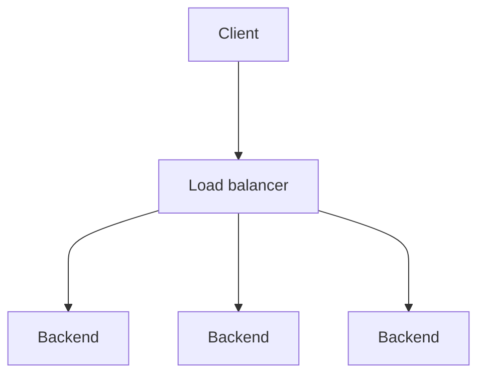
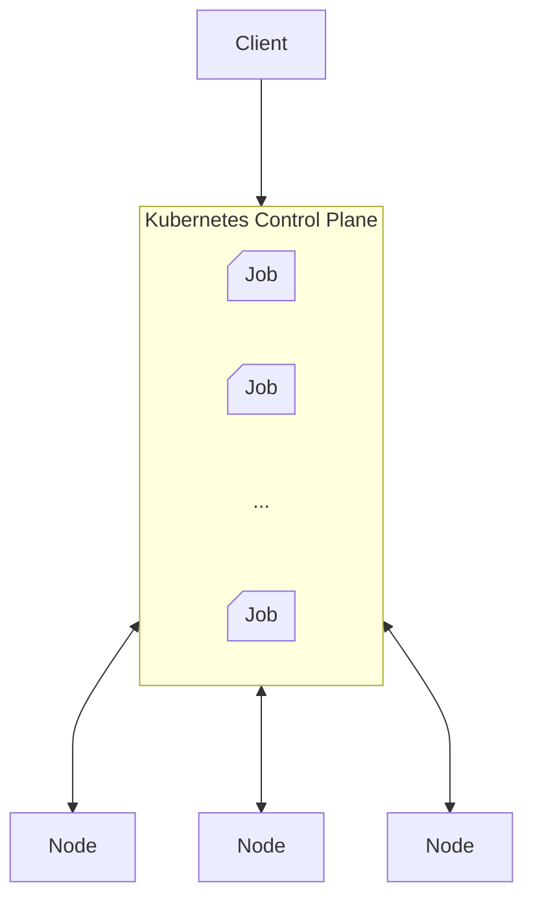
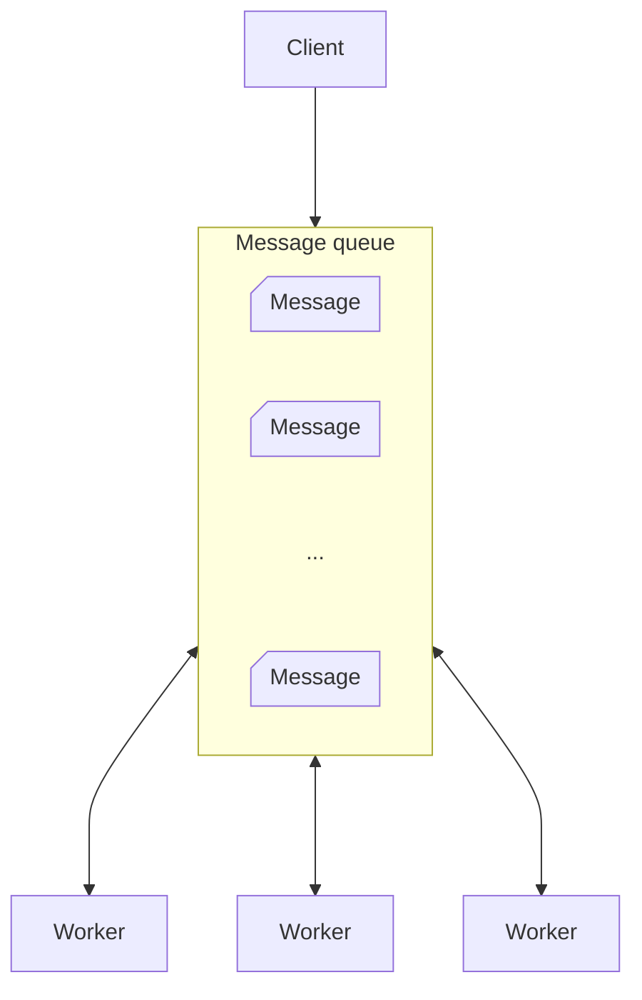

# Message Queue Architecture

> [!note] Not tested locally
> An architecture discussion; its code is pseudo-code.

There are (at least) three ways to distribute load:

- load balancers

- batch jobs

- message queues

Let's do a quick review of their pros/cons!

## 1️⃣ Load balancers



## Load balancers

- Latency: ~milliseconds (network latency)

- Overhead: very low (one extra network hop, one log message?)

- Great for short requests (a few milliseconds to a minute)

- Supported out of the box by the Kubernetes Service Proxy

  (by default, this is `kube-proxy`)

- Suboptimal resource utilization due to imperfect balancing

  (especially when there are multiple load balancers)

## 2️⃣ Batch jobs



## Batch jobs

- Latency: a few seconds (many Kubernetes controllers involved)

- Overhead: significant due to all the moving pieces involved

  (job controller, scheduler, kubelet; many writes to etcd and logs)

- Great for long requests (a few minutes to a few days)

- Supported out of the box by Kubernetes

  (`kubectl create job hello --image alpine -- sleep 60`)

- Asynchronous processing requires some refactoring

  (we don't get the response immediately)

## 3️⃣ Message queues



## Message queues

- Latency: a few milliseconds to a few seconds

- Overhead: intermediate

  (very low with e.g. Redis, higher with e.g. Kafka)

- Great for all except very short requests

- Requires additional setup

- Asynchronous processing requires some refactoring

## Dealing with errors

- Load balancers

  - errors reported immediately (client must retry)
  - some load balancers can retry automatically

- Batch jobs

  - Kubernetes retries automatically
  - after `backoffLimit` retries, Job is marked as failed

- Message queues

  - some queues have a concept of "acknowledgement"
  - some queues have a concept of "dead letter queue"
  - some extra work is required

## Some queue brokers

- Redis (with e.g. RPUSH, BLPOP)

  *light, fast, easy to setup... no durability guarantee, no acknowledgement, no dead letter queue*

- Kafka

  *heavy, complex to setup... strong deliverability guarantee, full featured*

- RabbitMQ

  *somewhat in-between Redis and Kafka*

- SQL databases

  *often requires polling, which adds extra latency; not as scalable as a "true" broker*

## More queue brokers

Many cloud providers offer hosted message queues (e.g.: Amazon SQS).

These are usually great options, with some drawbacks:

- vendor lock-in

- setting up extra environments (testing, staging...) can be more complex

(Setting up a singleton environment is usually very easy, thanks to web UI, CLI, etc.; setting up extra environments and assigning the right permissions with e.g. IAC is usually significantly more complex.)

## Implementing a message queue

1. Pick a broker

2. Deploy the broker

3. Set up the queue

4. Refactor our code

## Code refactoring (client)

Before:
```python
response = http.POST("http://api", payload=Request(...))
```

After:
```python
client = queue.connect(...)
client.publish(message=Request(...))
```

Note: we don't get the response right way (if at all)!

## Code refactoring (server)

Before:
```python
server = http.server(request_handler=handler)
server.listen("80")
server.run()
```

After:
```python
client = queue.connect(...)
while true:
  message = client.consume()
  response = handler(message)
  # Write the response somewhere
```

---

> [!info] Adapted from container.training
> This page is derived from [`slides/k8s/queue-architecture.md`](https://github.com/jpetazzo/container.training/blob/565636291ec03abf1f2ab8bf6b935478e00e69a2/slides/k8s/queue-architecture.md)
> in **[container.training](https://github.com/jpetazzo/container.training)** by Jérôme Petazzoni and contributors,
> used under [CC BY 4.0](https://creativecommons.org/licenses/by/4.0/).
> **Changes were made**: restructured from slides into a single page, remark
> markup converted to Obsidian callouts, referenced files inlined or linked.

<!-- uplink -->
Part of [[kubernetes/mlops/index|MLOps]].
