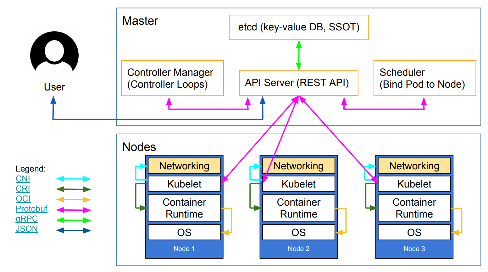
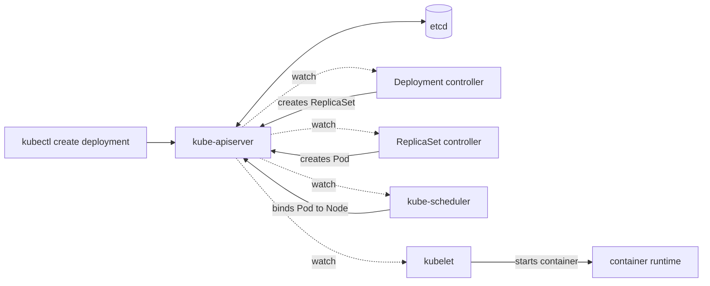

# Kubernetes architecture and the API



My own notes, going further into the API than
[[kubernetes/concepts/architecture]] does — particularly Group-Version-Kind and
watch semantics, with hands-on demonstrations.

## What is on a node?

- our containerised workload
- a container runtime — containerd, CRI-O, Docker
- **kubelet**, the Kubernetes agent that connects to **kube-apiserver**, registers
  the node and waits for instructions
- possibly **kube-proxy**, used for internal communication

## What is in the control plane?

- Everything is stored in **etcd**, the only stateful component
- **kube-apiserver**, the only component that reads from and writes to etcd. It
  receives requests from every other component

That single-writer property is the thing to hold on to: no other component ever
touches etcd, so the API server is both the choke point and the only place where
authentication, validation and admission can happen.

## Communication protocols

### The API server

- **kube-apiserver** exposes a REST API
- almost all requests and responses are JSON
- for performance, requests and responses can use **protobuf** — which is what all
  internal communication uses, between control plane components and kubelet

### On the nodes

The **kubelet** agent uses specific protocols:

**CRI** (Container Runtime Interface)

- used to talk to the container runtime, such as containerd
- adds an abstraction layer over the different runtimes
- based on gRPC and protobuf

**CNI** (Container Network Interface)

- used to talk to network plugins
- network plugins are implemented as executables invoked by kubelet
- they provide IPAM
- they configure network interfaces in pods and on nodes

See [[kubernetes/my-notes/cni]] for the plugin contract in detail.

## The Kubernetes API

**kube-apiserver** is a server with no intelligence of its own. For resources, it:

- receives API requests made to the cluster
- authenticates them
- validates them
- reads data from etcd
- writes data to etcd
- returns responses to clients

Being a plain API, it is usable from `curl`, `kubectl`, or anything else.

### The API is declarative

- we **cannot** tell the API *start a pod*
- we tell the API *here is the definition of the pod `myapp`*
- **kube-apiserver** stores that definition in etcd
- **kube-scheduler** notices the new pod and assigns it to a node, then the
  **kubelet** of that node notices it and starts its containers

(For higher-level objects, like a Deployment, it is **kube-controller-manager** that
notices the change and creates the objects below it, down to the pods.)

### The API's main capabilities

- create, read, update and delete objects
- **watch** objects
- objects are precisely typed
- types are validated and versioned
- storage and watch operations are provided by etcd

### Creating an object

> [!example] Hands-on
> Creating a `Namespace` object named `hello-world`:
>
> ```bash
> kubectl create -f- <<EOF
> apiVersion: v1
> kind: Namespace
> metadata:
>   name: hello-world
> EOF
> ```
>
> The equivalent through the CLI's convenience command:
>
> ```bash
> kubectl create namespace hello-world
> ```

### Reading it back

> [!example] Hands-on
> ```console
> $ kubectl get namespace hello-world
> NAME          STATUS   AGE
> hello-world   Active   6s
> ```
>
> And asking for everything, as YAML:
>
> ```console
> $ kubectl get namespace hello-world -o yaml
> apiVersion: v1
> kind: Namespace
> metadata:
>   creationTimestamp: "2022-08-12T13:12:14Z"
>   labels:
>     kubernetes.io/metadata.name: hello-world
>   name: hello-world
>   resourceVersion: "57669"
>   uid: 915ef06e-b22f-4bf1-afb4-ab2a4fad4cf8
> spec:
>   finalizers:
>   - kubernetes
> status:
>   phase: Active
> ```

We see considerably more information than we supplied. Nothing alarming:

- some data, such as `spec.finalizers`, is added automatically
- some data, such as `status`, is dynamic

See [[kubernetes/extending/finalizers]] for what that `finalizers` entry does.

### Requests and responses

Most requests and responses use the same shape:

```yaml
apiVersion: xxx
kind: yyy
metadata:
  name: zzz
  # ...more metadata...
# ...other specs...
```

Those fields are mandatory in most cases.

The output above is YAML for readability, but the API itself uses JSON.

### API versions

The `apiVersion` field names an **API group**.

It may be `v1` — the "core" or "legacy" group — or it may name a group and version as
`group/version`:

- `apps/v1`
- `rbac.authorization.k8s.io/v1`
- `networking.k8s.io/v1`

(Older material also shows `extensions/v1beta1`; that group is no longer served since
Kubernetes 1.22.)

> [!important] apiVersion says nothing about your Kubernetes version
> It indirectly indicates the version of the `kind`, not of the cluster. A cluster
> running 1.31 still serves `v1` objects.

### Group-Version-Kind (GVK)

A particular type is identified by the combination of:

- the **API group** it belongs to — core, `apps`, `metrics.k8s.io`
- the **version** of that API group — `v1`, `v1beta1`
- the **Kind** — Pod, Role, Job

GVK appears constantly throughout the API. Conversions are possible between versions
and between API groups, which is what lets a cluster serve the same underlying object
as both `v1beta1` and `v1`.

See [[kubernetes/extending/extending-api]] and [[kubernetes/extending/crd]] for
adding your own.

### Updates

Taking our `hello-world` namespace, there are several ways to update it:

- `kubectl apply`, supplying the YAML file
- `kubectl edit`
- `kubectl patch`
- helpers such as `kubectl label` or `kubectl set`

In every case `kubectl` will:

1. fetch the object's current definition
2. merge the change in
3. submit the result

### Adding a label

The simplest way is `kubectl label`.

> [!example] Hands-on
> In one terminal, watch the namespaces:
>
> ```bash
> kubectl get namespaces --show-labels --watch
> ```
>
> In another, label the namespace:
>
> ```bash
> kubectl label namespaces hello-world color=red
> ```
>
> The first terminal shows the change appear:
>
> ```console
> $ kubectl get namespaces --show-labels --watch
> NAME              STATUS   AGE     LABELS
> default           Active   5h26m   kubernetes.io/metadata.name=default
> hello-world       Active   78m     kubernetes.io/metadata.name=hello-world
> kube-node-lease   Active   5h26m   kubernetes.io/metadata.name=kube-node-lease
> kube-public       Active   5h26m   kubernetes.io/metadata.name=kube-public
> kube-system       Active   5h26m   kubernetes.io/metadata.name=kube-system
> hello-world       Active   81m     color=red,kubernetes.io/metadata.name=hello-world
> ```

## What is special about watch?

**kube-apiserver** does nothing by itself.

All the logic and intelligence is implemented by the controllers in
**kube-controller-manager**. A **controller** watches a set of resources and takes
action when they change.

Examples:

- when a `Pod` object is created, it gets scheduled and started
- when a pod belonging to a `ReplicaSet` enters a *terminated* state — after a crash,
  say — it is replaced
- when a `Deployment` object is updated, it triggers a rolling update

This is the core pattern of Kubernetes: everything is a control loop comparing
desired state to actual state. See [[kubernetes/extending/operators]] for writing
your own.

### Watching events

`kubectl get --watch` shows changes. Adding `--output-watch-events` also shows:

- the difference between *ADDED* and *MODIFIED* resources
- *DELETED* resources

> [!example] Hands-on
> In one terminal, watch pods with all events shown:
>
> ```bash
> kubectl get pods --watch --output-watch-events
> ```
>
> In another, create a short-lived pod:
>
> ```bash
> kubectl run pause --image=alpine --rm -ti --restart=Never -- sleep 5
> ```
>
> The first terminal shows the pod's whole lifecycle:
>
> ```console
> $ kubectl get pods --watch --output-watch-events
> EVENT      NAME    READY   STATUS              RESTARTS   AGE
> ADDED      pause   0/1     Pending             0          0s
> MODIFIED   pause   0/1     Pending             0          0s
> MODIFIED   pause   0/1     ContainerCreating   0          0s
> MODIFIED   pause   0/1     ContainerCreating   0          2s
> MODIFIED   pause   1/1     Running             0          6s
> MODIFIED   pause   0/1     Completed           0          11s
> MODIFIED   pause   0/1     Completed           0          13s
> MODIFIED   pause   0/1     Terminating         0          13s
> DELETED    pause   0/1     Terminating         0          13s
> ```

Note there is no single "the pod started" event — just a series of modifications.
That is the whole model: controllers react to state, not to notifications.

## The other control plane components

- kube-apiserver
- etcd
- kube-controller-manager
- kube-scheduler

### kube-controller-manager

A collection of loops watching every type of object. This is where Kubernetes' logic
lives.

When we create a Deployment — `kubectl create deployment web --image=nginx`:

1. we create a `Deployment` object
2. the *Deployment controller* notices it and creates a `ReplicaSet`
3. the *ReplicaSet controller* notices that and creates the `Pod`



All the watches go through kube-apiserver: no component other than kube-apiserver
talks to etcd.

### kube-scheduler

When a pod is created it is in the *pending* state. The **kube-scheduler**, or some
scheduler, has to bind that pod to a node:

- the default scheduler is efficient
- other schedulers can take other things into account — the price of a node, for
  instance ([demo scheduler](https://github.com/kelseyhightower/scheduler))

A pod can stay *pending* for several reasons:

- the cluster has no resources left
- we have reached the pods-per-node limit, which defaults to **110 on RKE2**
- the pod has constraints that cannot be satisfied
- the scheduler is not running

That last one is worth remembering when debugging: a pod stuck in *pending* with no
scheduling events at all usually means the scheduler itself is down, not that the
cluster is full. See [[kubernetes/observability/cluster-sizing]].

---

> [!info] Diagram attribution
> The architecture diagram at the top of this page comes from
> [container.training](https://github.com/jpetazzo/container.training) by Jérôme
> Petazzoni and contributors, used under
> [CC BY 4.0](https://creativecommons.org/licenses/by/4.0/), and was contributed to
> that project by Lucas Käldström. The text is my own. See [[attribution]].

<!-- uplink -->
Part of [[kubernetes/my-notes/index|My own Kubernetes notes]].
