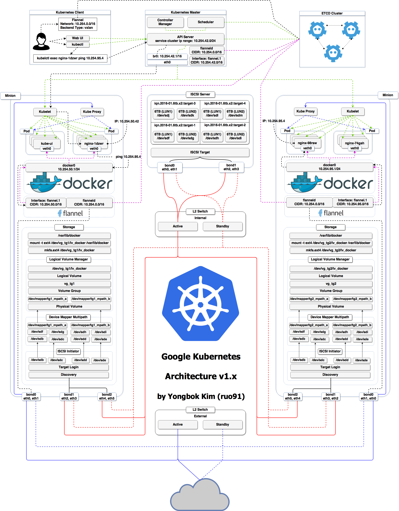
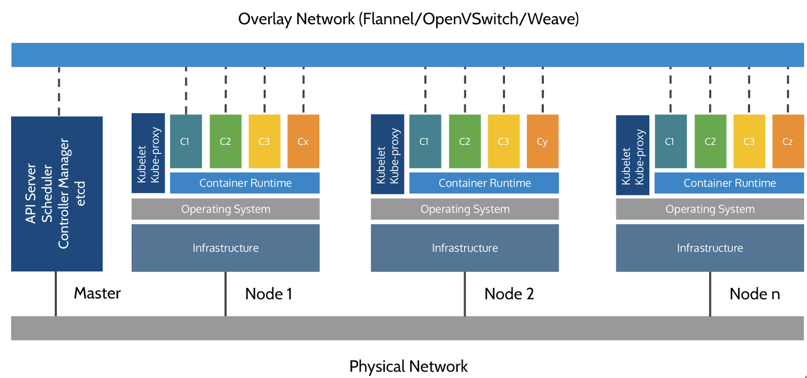
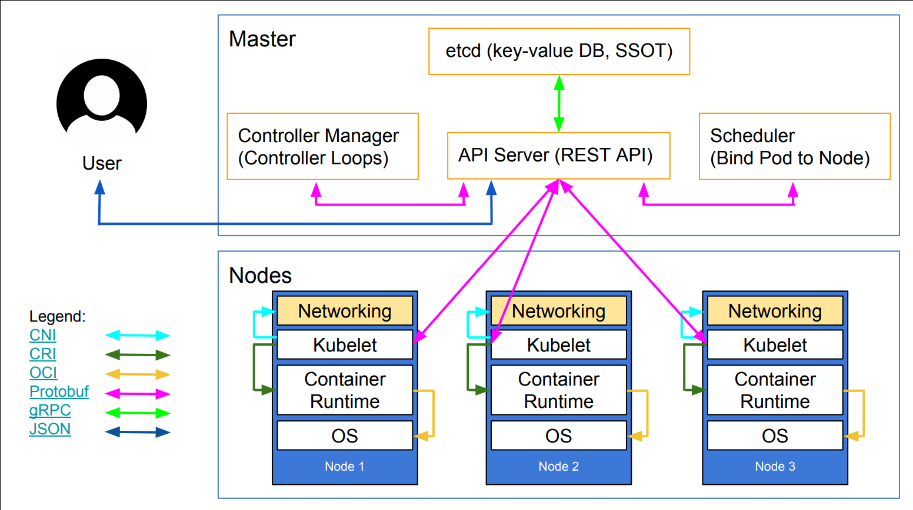
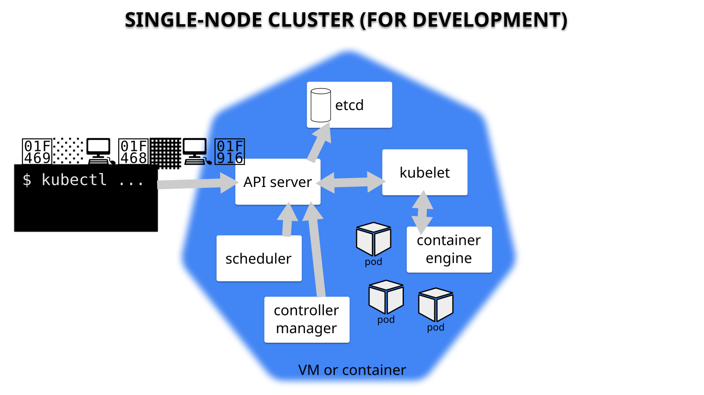
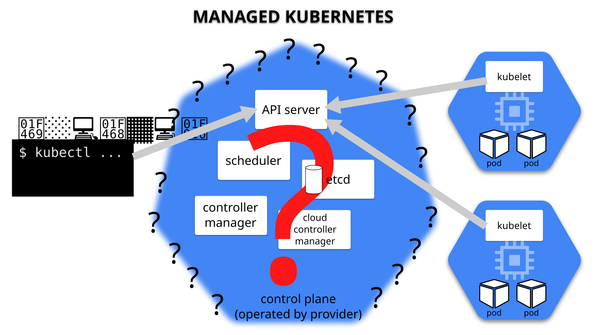
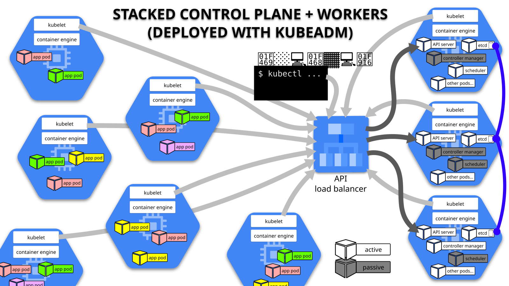
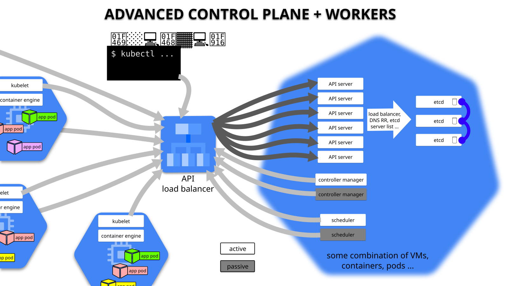
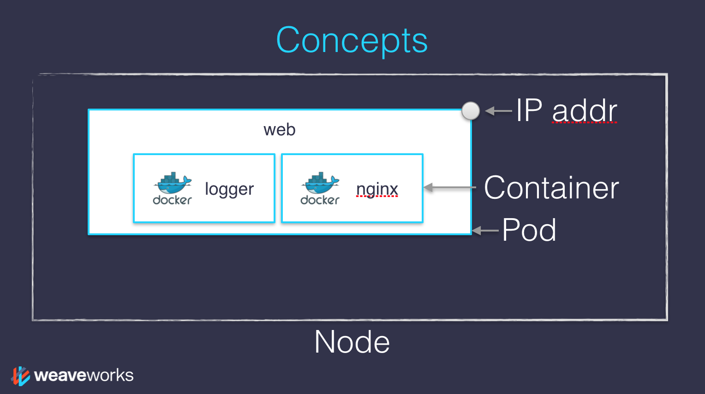

# Kubernetes concepts

Kubernetes is a container management system. It deploys and manages containerised
applications across a cluster.

These are my own notes, written against a specific platform — **RKE2** with
**Cilium** — rather than a vanilla kubeadm cluster. Where that changes the answer,
it is called out.

> [!note] Partly tested
> The generic claims are tested on a kind cluster: one controller-manager process, the
> EndpointSlice controller, one IP per pod, and two NGINX containers in one pod. The
> RKE2 and Cilium specifics are not tested locally.

## Basic things we can ask Kubernetes to do

- Start 5 containers using the image `mysite:v1.3`
- Put a load balancer in front of those containers
- Increase the number of containers to 10
- Deploy the new version of my image, `mysite:v1.4`
- Update one container at a time, so requests keep being served

## Other things Kubernetes can do for us

- **Autoscaling** — add containers based on CPU or other metrics
- **Resource management and scheduling** — CPU/RAM reservations, placement constraints
- **Deployment patterns** — canary, blue/green
- **Job scheduling** and parallelisation
- **Fine-grained access control** — *who* can do *what* to *which* resource
- **Automation of complex operations** with *operators* — failover, databases,
  replication

## Architecture

The same thing, simplified:

### The nodes

The nodes that run our containers hold several services:

| Service | Role | In RKE2 |
| --- | --- | --- |
| **container runtime** | runs containers | `containerd` |
| **kubelet** | the node agent | a separate `kubelet` binary, started by the `rke2` process |
| **kube-proxy** | maintains network rules on the node | replaced — we let the **Cilium** CNI handle it |

> [!note] Cilium replaces kube-proxy
> In this deployment Cilium runs in kube-proxy replacement mode, implementing
> Service routing with eBPF instead of iptables or IPVS rules. That removes
> `kube-proxy` from the node entirely, and is why `iptables-save` on these nodes
> looks nothing like it does on a stock cluster. See
> [[kubernetes/networking/cni]] and [[kubernetes/my-notes/cni]].

> [!warning] Correction
> The original said kubelet is built into the `rke2-server` binary. That is k3s. RKE2
> extracts a `kubelet` binary from its runtime image and runs it as a separate process.

### The control plane

The Kubernetes control plane is a collection of these services:

- **kube-apiserver** — exposes the Kubernetes API. It is the front end for the
  control plane. It is designed to scale horizontally, meaning it scales by
  deploying additional instances.
- **etcd** — a consistent, highly available key/value store used as the backing
  store for all cluster data.
- **kube-scheduler** — watches for newly created pods with no assigned node, and
  selects a node for them to run on. The factors taken into account include
  individual and collective resource requirements, hardware, software and policy
  constraints, affinity and anti-affinity specifications, data locality,
  inter-workload interference and deadlines.
- **kube-controller-manager** — runs the controllers. Logically each controller is a
  separate process, but to reduce complexity they are all compiled into one binary
  and run in one process. They include:
  - **Node controller** — detects and responds to a node going down
  - **Replication controller** — maintains the correct number of pods for each
    ReplicationController object
  - **EndpointSlice controller** — populates EndpointSlice objects, joining Services
    to Pods
  - **Service account and token controllers** — create default accounts and API
    access tokens for new namespaces
> [!warning] Correction
> The original listed the Endpoints controller. The Endpoints API is deprecated since
> Kubernetes 1.33, and `kubectl get endpoints` prints a warning. EndpointSlices replace
> it.

- **cloud-controller-manager** — runs the controllers that interact with the
  underlying cloud provider. See
  [[kubernetes/cluster-setup/cloud-controller-manager]].

## Control plane placement

### On dedicated nodes

- It is normal to dedicate nodes to running the control plane.
- It then matters to prevent our applications running on those nodes, using a
  mechanism called a **taint** — see
  [[kubernetes/workloads/taints-and-tolerations]].
- The node count must allow the control plane to be resilient.

### Outside containers

- The control plane services are plain binaries, so they can run on any machine.
- `etcd` being a critical component, it is often preferable to deploy it on
  dedicated servers outside the cluster.

### Topologies

A single-node cluster is perfectly workable for development or testing:

With a cloud provider's managed service, the control plane is invisible:

A good-practice deployment for a real cluster looks like this:

And here is a cluster large enough that the control plane services have to be split
out to absorb the load:

## How many nodes should a cluster have?

There is no particular rule — anywhere from one node for development up to 5,000
nodes. The only thing that matters for production is having enough nodes able to
take part in electing a quorum without taking risks.

> [!important] Quorum means an odd number
> etcd needs a majority to accept writes, so it wants an odd member count: 3
> tolerates one failure, 5 tolerates two. Four members tolerate exactly the same
> single failure as three, while making the majority harder to reach — so an even
> count is never the right answer. See
> [[kubernetes/cluster-setup/cluster-backup]].

## Container runtimes

- [containerd](https://github.com/containerd/containerd)
  - a CNCF graduated project, first written by Docker
  - used by the Docker Engine, microk8s, k3s, RKE2 and GKE
  - has its own CLI, `ctr`
- [CRI-O](https://github.com/cri-o/cri-o)
  - a CNCF graduated project, mostly maintained by Red Hat
  - used by OpenShift
  - intended to be the most minimal runtime for Kubernetes
- [and others](https://kubernetes.io/docs/setup/production-environment/container-runtimes/)

See [[containers/docker]] and [[containers/podman]] for the container side of this.

## Interacting with Kubernetes

We interact with Kubernetes through its API, which is mostly RESTful. See
[[kubernetes/concepts/internal-apis]].

The basic resources we manage are:

- **nodes**
- **pods** — the wrappers holding our containers
- **containers**

## Scaling

To increase the number of containers for a deployed application, it matters to
understand that a **pod is bound to a node**. So:

- We create new **pods**:
  - each new pod can land on a different node
  - each pod gets its own IP address
- We do **not** add more NGINX containers to one pod:
  - all the NGINX containers would be on the same node
  - and we would get `Address already in use` errors

The second point is the one worth internalising: containers in a pod share a network
namespace, so they share a port space. Two NGINX containers in one pod both want port
80, and the second fails.

## Together or separate?

Should a cache server and an application be deployed in the same pod?

**In the same pod:**

- they must be scaled together
- they can communicate efficiently over their `localhost` interface

**In different pods:**

- they can be scaled separately
- they communicate over their pod IPs, which are routable, adding latency and so
  affecting performance

The general answer is separate pods, unless the two processes are genuinely one unit
that would never be scaled or deployed independently — a sidecar shipping logs, for
instance.

---

> [!info] Diagram attribution
> The architecture diagrams on this page come from
> [container.training](https://github.com/jpetazzo/container.training) by Jérôme
> Petazzoni and contributors, used under
> [CC BY 4.0](https://creativecommons.org/licenses/by/4.0/). Two of them were
> contributed to that project by **Weaveworks** and **Lucas Käldström**, which their
> filenames record. The surrounding text is my own. See [[attribution]].

<!-- uplink -->
Part of [[kubernetes/my-notes/index|My own Kubernetes notes]].
