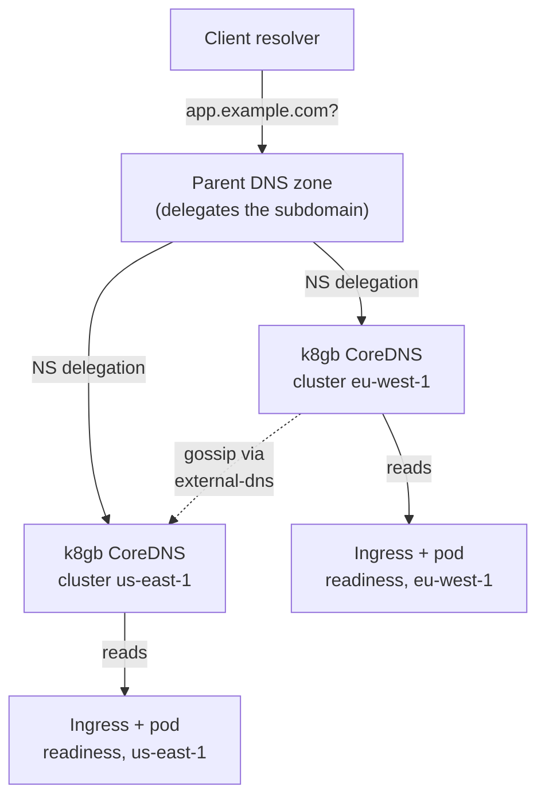

# K8GB

> [!note] Not tested locally
> Exercising K8GB means two clusters with a delegated DNS zone between them;
> its own local demo creates two dedicated kind clusters, which is more than
> the test harness's two-cluster budget.

[K8GB](https://www.k8gb.io/) — Kubernetes Global Balancer — provides **global service
load balancing** across geographically separate clusters, using DNS. It is a CNCF
incubating project.

The problem: an Ingress balances traffic *within* a cluster. When the cluster itself
fails, or when you want European users served from `eu-west-1` and American ones from
`us-east-1`, you need something above it. Traditionally that meant an F5 GTM, a
NetScaler, or a cloud provider's global load balancer — dedicated hardware or
software outside Kubernetes.

K8GB does it with DNS and the health information Kubernetes already has.

## How it works



Three pieces:

1. **CoreDNS with the k8gb plugin** in each cluster, serving the delegated zone and
   answering from local cluster state.
2. **Kubernetes-native health checks** — it reads liveness and readiness probe status
   for the pods behind an Ingress. No separate health-check configuration.
3. **DNS delegation** — the parent zone delegates a subdomain to the k8gb instances,
   and `external-dns` publishes each cluster's records to the provider.

Because every cluster runs its own authoritative server, there is no central component
to fail. A cluster that is down simply stops answering, and the resolver tries
another.

## The Gslb resource

```yaml
apiVersion: k8gb.io/v1beta1
kind: Gslb
metadata:
  name: test-gslb-failover
  namespace: test-gslb
spec:
  resourceRef:
    apiVersion: networking.k8s.io/v1
    kind: Ingress
    name: test-gslb-failover
  strategy:
    type: failover
    primaryGeoTag: eu-west-1
```

It wraps an existing Ingress rather than replacing it — the Ingress keeps doing
in-cluster routing, and the `Gslb` adds the cross-cluster policy on top.

## Strategies

| Strategy | Behaviour |
| --- | --- |
| `roundRobin` | All healthy clusters returned, resolvers pick |
| `failover` | Only the `primaryGeoTag` cluster, unless it is unhealthy |
| `geoip` | Answer based on the resolver's location |

`failover` is the one most deployments want: an active site and a standby that only
receives traffic when the primary's pods stop being ready.

## What DNS costs you

> [!warning] Failover takes as long as the TTL, and clients ignore TTLs anyway
> DNS-based load balancing cannot fail over faster than caches expire. With a 30
> second TTL, a client that resolved just before the outage keeps trying the dead
> cluster for up to 30 seconds — and that is the optimistic case.
>
> In practice it is worse. Java applications historically cached DNS **forever** by
> default (`networkaddress.cache.ttl`), browsers pin resolutions for the life of a
> connection, and intermediate resolvers routinely enforce a minimum TTL regardless of
> what you publish.
>
> So budget for tens of seconds of failover for well-behaved clients, and accept that
> some will need restarting. If you need sub-second failover, DNS is the wrong layer —
> use anycast, or a global load balancer terminating connections.

Low TTLs also mean more queries, so the authoritative servers must be reliable — they
are now on the critical path for every new connection.

## Where it fits

**Good fit:** active-passive disaster recovery across clusters, serving users from
their nearest region, and multi-cluster setups where you want the policy expressed as
a Kubernetes resource in Git rather than in a vendor appliance.

**Poor fit:** anything needing failover in under a few seconds, single-cluster
deployments — where an Ingress and pod anti-affinity are the right tools — and cases
where an existing cloud global load balancer already does the job.

> [!tip] It composes with the cloud provider rather than replacing it
> `external-dns` publishes to Route 53, Cloud DNS, Infoblox, NS1 and others, so K8GB
> is the *controller* deciding which records should exist while the provider remains
> the resolver. That is usually easier to justify than replacing an existing DNS
> platform.

Delegation is the part to get right first: the parent zone must delegate the
subdomain to every cluster's k8gb instance, and getting that wrong produces a setup
that works from one cluster and not from outside.

## Where to go next

- [[kubernetes/networking/ingress]] — the in-cluster layer this sits above
- [[kubernetes/networking/externaldns]] — the component publishing the records
- [[kubernetes/observability/goldpinger]] — proving the clusters themselves are healthy
- networking — the DNS mechanics underneath

## Sources

- [K8GB documentation](https://www.k8gb.io/latest/)

<!-- uplink -->
Part of [[kubernetes/networking/index|Networking]].
