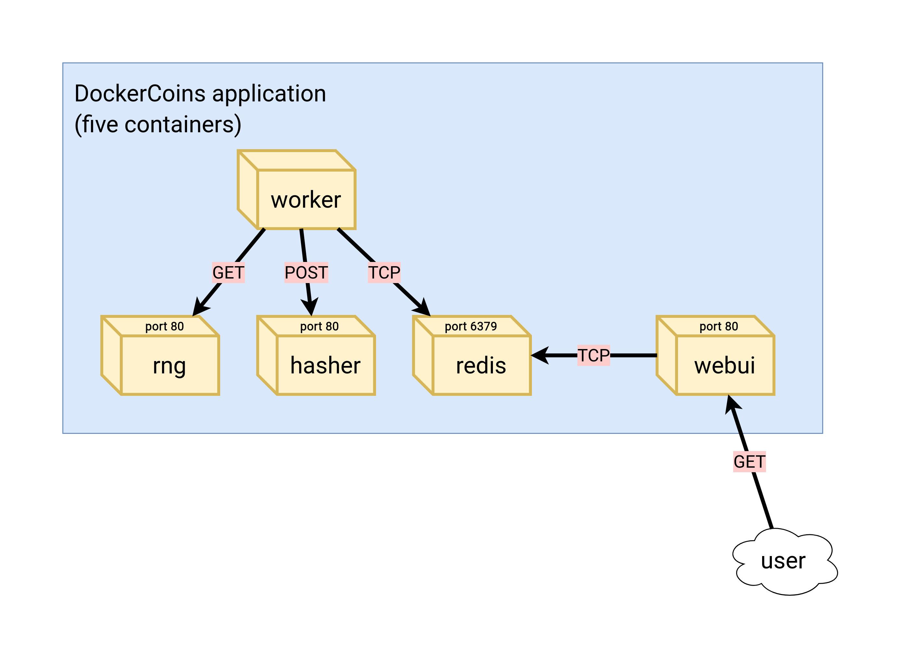

# Our demo apps

> [!important] These labs expect the upstream repository
> Commands below reference files by their path in a local clone. Get it with:
>
> ```bash
> git clone https://github.com/jpetazzo/container.training
> ```
>
> The manifests can also be browsed at the pinned commit
> [`56563629`](https://github.com/jpetazzo/container.training/tree/565636291ec03abf1f2ab8bf6b935478e00e69a2).

We use a few demo apps in the demos and labs. Let's get to know them first.

## The `color` app

- Source code: https://github.com/jpetazzo/color
- Image name: `jpetazzo/color`, or `ghcr.io/jpetazzo/color`
- Available for the linux/amd64, linux/arm64 and linux/arm/v7 platforms

It is an HTTP server that listens on port 80. It serves a web page with a single line
of text. The background color of the page comes from the hostname: if the hostname
is `blue-xyz-123`, the background is `blue`.

The page is "curl-friendly": it contains `\r` characters that hide the HTML tags in a
terminal, so `curl` shows a clean line of text.

## The `color` app in action

Create a Deployment called `blue` with the image `jpetazzo/color`, expose it with a
Service, then connect to the Service with a web browser and with `curl`.

> [!example] Hands-on
> - Create and expose the Deployment:
>   ```bash
>   kubectl create deployment blue --image=jpetazzo/color
>   kubectl expose deployment blue --port=80
>   ```
>
> - In another terminal, forward a local port to the Service, and leave it running:
>   ```bash
>   kubectl port-forward service/blue 8080:80
>   ```
>
> - Open `http://localhost:8080/` in a browser, or use `curl`:
>   ```bash
>   curl localhost:8080
>   ```

The Pod's hostname starts with `blue-`, so the page is blue.

## Dockercoins

An app with 5 microservices:

| Service | Role |
| --- | --- |
| `worker` | runs an infinite loop that connects to the other services |
| `rng` | web service; generates random numbers |
| `hasher` | web service; computes SHA sums |
| `redis` | holds a single counter, incremented by the `worker` at each loop |
| `webui` | web app; shows a graph of the rate of increase of the counter |

It uses a mix of Node, Python and Ruby. The components are very simple: about 50 lines
of code for the most complex one.



## Deploying Dockercoins

Pre-built images are available as `dockercoins/<component>:v0.1` (for example
`dockercoins/worker:v0.1`). The containers find each other through DNS: for example,
the worker connects to `http://hasher/`. A Kubernetes YAML manifest is available in
*the* repository.

## The repository

"The" repository is https://github.com/jpetazzo/container.training. It hosts the
slides, the demo apps, deployment scripts, and more.

All the sample commands and labs assume that it is cloned in `~/container.training`.
Let's clone it.

## Cloning the repo

> [!example] Hands-on
> - There is a convenient shortcut to clone the repository:
>   ```bash
>   git clone https://container.training
>   ```

`https://container.training` redirects to the GitHub repository, so the clone lands in
`~/container.training` when you run it from your home directory.

## Running Dockercoins

All the Kubernetes manifests are in the `k8s` subdirectory. This directory has a
`dockercoins.yaml` manifest.

> [!example] Hands-on
> - Deploy Dockercoins:
>   ```bash
>   kubectl apply -f ~/container.training/k8s/dockercoins.yaml
>   ```

The `webui` is exposed with a `NodePort` Service. Connect to it through the
`NodePort`, or with `kubectl port-forward`. The worker can take a minute to start.

## Details

- If the `worker` Deployment is scaled up, the graph goes up.
- The `rng` Service is meant to be a bottleneck. It caps the graph at 10 hashes per
  second until `rng` is scaled up.
- The services have artificial latency, so the app does not use much CPU, RAM or
  network.

## More colors

The repository also contains a `rainbow.yaml` manifest. It creates three namespaces:
`blue`, `green` and `red`. Each namespace runs an instance of the `color` app. We can
use it later for a *literal* blue-green deployment.

---

> [!info] Adapted from container.training
> This page is derived from [`slides/k8s/demo-apps.md`](https://github.com/jpetazzo/container.training/blob/565636291ec03abf1f2ab8bf6b935478e00e69a2/slides/k8s/demo-apps.md)
> in **[container.training](https://github.com/jpetazzo/container.training)** by Jérôme Petazzoni and contributors,
> used under [CC BY 4.0](https://creativecommons.org/licenses/by/4.0/).
> **Changes were made**: restructured from slides into a single page, remark
> markup converted to Obsidian callouts, referenced files inlined or linked.
> Rewritten as prose, with commands for the `color` app.

<!-- uplink -->
Part of [[kubernetes/workloads/index|Workloads]].
