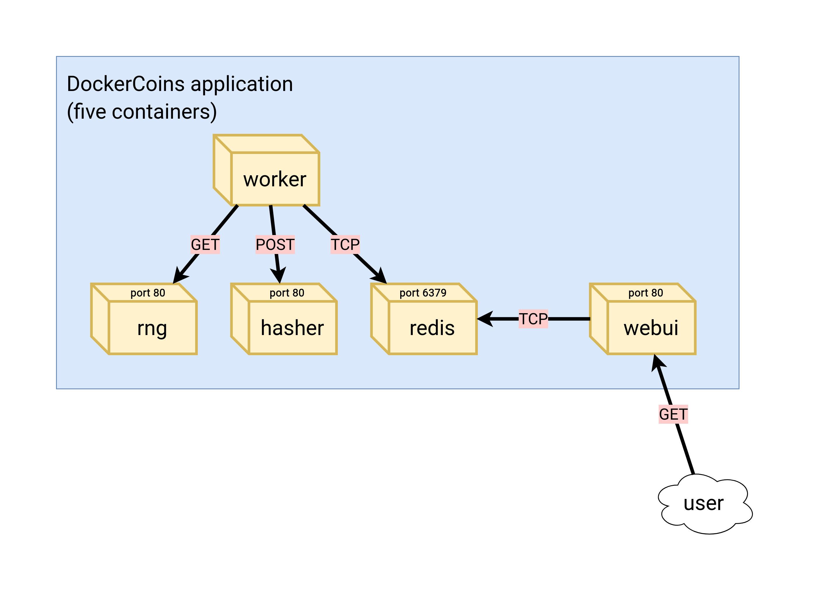

# Scaling our demo app

Our goal is to get more DockerCoins: to increase the number of loops per second shown
on the web UI.

Let's look at the architecture again:



The loop runs in the worker. Perhaps we can add more workers?

## Adding another worker

All we have to do is scale the `worker` Deployment.

> [!example] Hands-on
> - Open a new terminal to keep an eye on our pods:
>   ```bash
>   kubectl get pods -w
>   ```
>
> - Now, create more `worker` replicas:
>   ```bash
>   kubectl scale deployment worker --replicas=2
>   ```

After a few seconds, the graph in the web UI goes up.

## Adding more workers

If 2 workers give us 2x speed, what about 3 workers?

> [!example] Hands-on
> - Scale the `worker` Deployment further:
>   ```bash
>   kubectl scale deployment worker --replicas=3
>   ```

The graph in the web UI goes up again. This is looking great: we are going to be rich!

## Adding even more workers

Let's see if 10 workers give us 10x speed.

> [!example] Hands-on
> - Scale the `worker` Deployment to a bigger number:
>   ```bash
>   kubectl scale deployment worker --replicas=10
>   ```

The graph peaks at 10 hashes/second. We can add as many workers as we want: we never
go past 10 hashes/second.

> [!note]- Extra details
> ## Didn't we briefly exceed 10 hashes/second?
>
> It may *look like it*, because the web UI shows the instant speed. The instant speed
> can briefly exceed 10 hashes/second. The average speed cannot. The instant speed can
> be biased because of how it is computed.

> [!note]- Extra details
> ## Why instant speed is misleading
>
> - The web UI computes the instant speed in the browser.
> - It reads the hash counter once per second, and computes (h2-h1)/(t2-t1).
> - The workers update the counter once per second.
> - These timings are not exact. For example, the web UI check interval depends on
>   JavaScript timers in the browser.
> - Sometimes, between two web UI measurements, the workers update the counter
>   *twice*.
> - During that cycle, the instant speed looks much bigger. The lower instant speed
>   before and after compensates for it.

## Why are we stuck at 10 hashes per second?

Production-quality code would have instrumentation (Datadog, Honeycomb, New Relic,
statsd, Sumologic, and so on). This code does not. Instead, we can benchmark our web
services with tools like `ab`, or the simpler `httping`.

## Benchmarking our web services

We want to check `hasher` and `rng`, with `httping`. It is like `ping`, but it sends
HTTP `GET` requests and measures how long each one takes.

It is used like this:

```
httping [-c count] http://host:port/path
```

Or even simpler:

```
httping ip.ad.dr.ess
```

We use `httping` on the ClusterIP addresses of our services. A ClusterIP is only
reachable from inside the cluster: run `httping` on a node, or in a Pod. `httping` is
packaged in Debian and Ubuntu (`apt-get install httping`), but not in Alpine.

## Obtaining ClusterIP addresses

We can read the output of `kubectl get services`, or get the addresses with a
template, as below.

> [!example] Hands-on
> - Retrieve the IP addresses:
>   ```bash
>   HASHER=$(kubectl get svc hasher -o go-template={{.spec.clusterIP}})
>   RNG=$(kubectl get svc rng -o go-template={{.spec.clusterIP}})
>   ```

Now `$HASHER` and `$RNG` hold the IP addresses of our services.

## Checking `hasher` and `rng` response times

> [!example] Hands-on
> - Check the response times for both services:
>   ```bash
>   httping -c 3 $HASHER
>   httping -c 3 $RNG
>   ```

- `hasher` is fine: it replies in a few milliseconds.
- `rng` is not: with 10 workers, it takes about 700 milliseconds to reply.

Something is wrong with `rng`, but what? [[kubernetes/workloads/daemonset]] continues
the investigation.

---

> [!info] Adapted from container.training
> This page is derived from [`slides/k8s/scalingdockercoins.md`](https://github.com/jpetazzo/container.training/blob/565636291ec03abf1f2ab8bf6b935478e00e69a2/slides/k8s/scalingdockercoins.md)
> in **[container.training](https://github.com/jpetazzo/container.training)** by Jérôme Petazzoni and contributors,
> used under [CC BY 4.0](https://creativecommons.org/licenses/by/4.0/).
> **Changes were made**: restructured from slides into a single page, remark
> markup converted to Obsidian callouts, referenced files inlined or linked.
> Rewritten as prose, with a note on where ClusterIPs can be reached.

<!-- uplink -->
Part of [[kubernetes/workloads/index|Workloads]].
