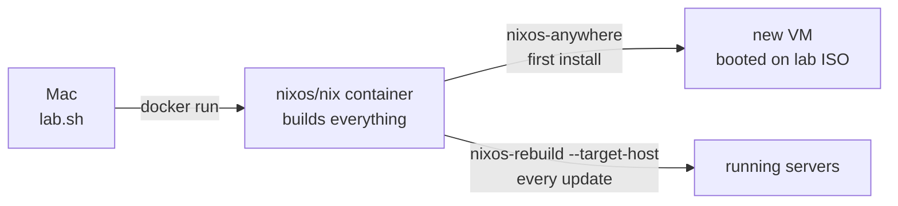

# NixOS home lab overview

> [!note] Not tested locally
> The lab needs an Apple Silicon Mac with macOS 26 or later. The test harness cannot
> run it. The commands come from the lab scripts, and were run by hand on vfkit.

A small infrastructure on a Mac: a Git server, CI, and a three-node Kubernetes
cluster. Each machine is a VM run by `vfkit`, and each is one output of a single
flake. Nothing is configured by hand on a machine.

The lab code is planned to be public at
[github.com/d3vs3c00ps/nix-lab](https://github.com/d3vs3c00ps/nix-lab). This section
explains it step by step, including what went wrong. The concepts behind each step
are in [[linux/distributions/nixos/index|NixOS]].

## Prerequisites

On the Mac (Apple Silicon, macOS 26 or later):

- `vfkit` (Homebrew), to run the VMs. See vfkit.
- A Docker runtime. Linux builds run in a `nixos/nix` container.
- `vmnet-helper`, so the VMs share one network. No root is needed on macOS 26+.

```bash
brew install vfkit
brew tap nirs/vmnet-helper
brew install vmnet-helper
```

There is no build VM. `lab/lab.sh` starts a `nixos/nix`
container (store in the named volume `nix-lab-store`) to run `nix`, `nixos-anywhere`
and `nixos-rebuild`.

## The model



1. One **generic installer ISO** is built in the container. It is a live NixOS in
   RAM with SSH and one public key. It has no host configuration.
2. `lab.sh install <host>` boots a VM with a blank disk on the ISO. Then
   **nixos-anywhere** partitions the disk with disko and installs the host from the
   flake. See [[linux/distributions/nixos/automated-install]].
3. After that, `lab.sh deploy <host>` runs `nixos-rebuild switch --target-host`.
   Data is kept.

The ISO is a boot medium, not an artifact. The flake is the artifact.

## Machines

| Host | IP | vCPU / RAM / disk | Role |
| --- | --- | --- | --- |
| gitea | 192.168.64.10 | 2 / 2 GB / 20 GB | Git server |
| woodpecker | 192.168.64.11 | 2 / 2 GB / 30 GB | CI |
| k8s-01 | 192.168.64.20 | 2 / 4 GB / 20 GB | Kubernetes control plane |
| k8s-02, k8s-03 | 192.168.64.21, .22 | 2 / 4 GB / 20 GB | Kubernetes workers |

All VMs are `aarch64-linux`. The disk is `/dev/vda`. The MAC addresses are
`52:54:00:00:00:10`, `:11`, `:20`, `:21`, `:22`.

## Network

`lab.sh` starts each VM as `vmnet-run -- vfkit ... --device virtio-net,fd=4,mac=<mac>`.
All VMs join one vmnet network, `192.168.64.0/24`:

| Address | What |
| --- | --- |
| `.1` | The Mac, and the gateway |
| from `.2` | DHCP leases (the installer ISO gets one) |
| `.10`, `.11`, `.20` - `.22` | Static IPs of the servers |

The static servers are below the DHCP pool only by convention: leases start at `.2`.

Plain `virtio-net,nat` in vfkit does not work here: it isolates the guests from each
other (ARP between VMs failed). `vmnet-run` gives every VM a descriptor (`fd=4`) on
the same vmnet network instead. See vfkit. Servers use systemd-networkd and match the NIC by
type, so the NIC name does not matter.

Names come from one module, written into `/etc/hosts` on every machine. The domain
is `lab.home.arpa`, which RFC 8375 reserves for home networks:

```nix
# modules/lab-hosts.nix
{
  networking.hosts = {
    "192.168.64.10" = [ "gitea" "gitea.lab.home.arpa" ];
    "192.168.64.11" = [ "woodpecker" "woodpecker.lab.home.arpa" ];
    # ...
  };
}
```

The servers use public resolvers (`1.1.1.1`, `9.9.9.9`). The Mac's `/etc/hosts` needs
the Gitea and Woodpecker names too, see [[labs/nixos-homelab/woodpecker]].

> [!warning] networkd turns systemd-resolved on
> `/etc/resolv.conf` then points to the stub `127.0.0.53`. Pods that inherit it
> make CoreDNS fail with `Loop detected`. The fix is in
> [[labs/nixos-homelab/kubernetes#The 127.0.0.53 stub and CoreDNS]].

## Commands

```text
lab/lab.sh [--regen-secrets] iso | up [host...] | install [--force] <host> | deploy <host>
           | start | stop | ip | ssh <host> [cmd] | smoke [host...] | destroy <host>
```

| Command | What it does |
| --- | --- |
| `iso` | Build the installer ISO in the container |
| `up [host...]` | Install every host (or those named) that has no VM yet |
| `install <host>` | Install one host. `--force` erases an existing one |
| `deploy <host>` | `nixos-rebuild switch` from the container to a running host |
| `start`, `stop` | Boot a host from its disk, or power it off over SSH |
| `ip`, `ssh <host> [cmd]` | Show the static IP, or run SSH as root |
| `smoke [host...]` | Check SSH, hostname, systemd state, DNS, ping between hosts |
| `destroy <host>` | Delete a VM and its disk, after you type its name |

`up` and `install` never touch a host that already has a `lab/state/<host>` folder.

```bash
lab/lab.sh up gitea woodpecker k8s-01 k8s-02 k8s-03
lab/lab.sh smoke
```

Steps that need more than `lab.sh` have their own scripts:
`lab/ci-bootstrap.sh` ([[labs/nixos-homelab/woodpecker]]) and
`lab/k8s-bootstrap.sh` ([[labs/nixos-homelab/kubernetes]]).

## The SSH key

`lab.sh` creates the key on first use in `secrets/ssh/id_nix_lab`, with an SSH config
next to it. The `secrets/` folder is gitignored, except `secrets/woodpecker.yaml`
(encrypted). Back it up: git does not save it. `LAB_SECRETS` can point elsewhere. The public key is copied to `keys/id_nix_lab.pub`,
which is tracked: Nix reads only tracked files, and the ISO and the hosts trust it.

```bash
ssh -F secrets/ssh/config gitea     # user root
```

A new key means every host must be reinstalled: installed hosts do not trust it.

## Repository layout

```text
nix-lab/
├── flake.nix              # mkHost helper, one output per machine
├── flake.lock
├── keys/id_nix_lab.pub    # the only key in the repo
├── lab/                   # lab.sh, ci-bootstrap.sh, k8s-bootstrap.sh
├── modules/
│   ├── common.nix         # every host: flakes, gc, key-only SSH, base tools
│   ├── lab-hosts.nix      # the IP plan
│   ├── server.nix         # headless hosts: static IP, public DNS, root SSH by key
│   ├── disk-vm.nix        # disko: GPT, 512M ESP, ext4 root on /dev/vda
│   └── k8s.nix            # Kubernetes node
├── hosts/                 # gitea, woodpecker, k8s-01..03, installer
└── k8s/                   # Helm values for Cilium and CoreDNS
```

`mkHost` gives every installed host the same base:

```nix
mkHost = name: nixpkgs.lib.nixosSystem {
  specialArgs = { inherit inputs; };
  modules = [
    disko.nixosModules.disko
    ./modules/common.nix
    ./modules/lab-hosts.nix
    ./hosts/${name}
    # nixos-rebuild list-generations then shows which commit runs here
    { system.configurationRevision = self.rev or self.dirtyRev or null; }
  ];
};
```

There is no `system = ...` argument: `common.nix` sets
`nixpkgs.hostPlatform = lib.mkDefault "aarch64-linux"`, and each host's generated
`hardware-configuration.nix` sets it again.

## What was checked on vfkit

- 5 hosts installed, and `lab.sh smoke` passes.
- Woodpecker server and agent are active, with decrypted secrets, and reach Gitea.
- 3 Kubernetes nodes are Ready, 10 pods Running, pod DNS works (cluster and
  external).
- The Cilium connectivity test passes: 82 tests (708 actions), 48 skipped by design.

Not checked on vfkit: a real Woodpecker login and pipeline, and the hard-kill
fallback of `lab.sh stop`.

## Steps

1. [[labs/nixos-homelab/installer-iso]] — one ISO for every new VM
2. [[labs/nixos-homelab/gitea]] — the first server, installed with nixos-anywhere
3. [[labs/nixos-homelab/woodpecker]] — CI, and the first host with secrets
4. [[labs/nixos-homelab/kubernetes]] — `services.kubernetes` with Cilium

<!-- uplink -->
Part of [[labs/nixos-homelab/index|NixOS home lab]].
