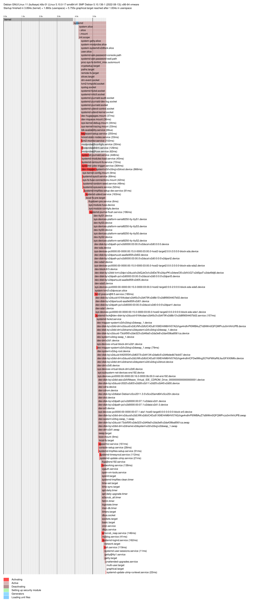

# systemd

What systemd changes, per Red Hat's own summary:

- controls *units* rather than daemons
- manages dependencies between units
- tracks processes using service information
- services belong to a **cgroup**
- CPU, memory and I/O limits are simple to configure
- kills daemons cleanly
- reduces boot time

Related: [[linux/cli/journalctl]] for the journal, [[linux/boot/grub]] for what
runs before systemd.

## Targets

Targets are simply groups of units. Runlevels are represented as target units,
giving these equivalences:

| Target | Old runlevel |
| --- | --- |
| `poweroff.target` | runlevel 0 |
| `rescue.target` | runlevel 1 |
| `multi-user.target` | runlevels 2, 3 and 4 |
| `graphical.target` | runlevel 5 |
| `reboot.target` | runlevel 6 |

The old names still work: `runlevel3.target` is a link to `multi-user.target`.

Determine the default target:

```bash
systemctl get-default
```

Set the default target:

```bash
systemctl set-default multi-user.target
```

Switch target on the running system:

```bash
systemctl isolate multi-user.target
```

## Units

### Inspecting a unit

Start with the unit file itself (Rocky Linux 10, shortened):

```console
$ systemctl cat chronyd

# /usr/lib/systemd/system/chronyd.service
[Unit]
Description=NTP client/server
Documentation=man:chronyd(8) man:chrony.conf(5)
After=ntpdate.service sntp.service ntpd.service
Conflicts=ntpd.service systemd-timesyncd.service
ConditionCapability=CAP_SYS_TIME

[Service]
Type=notify
PIDFile=/run/chrony/chronyd.pid
Environment="OPTIONS="
EnvironmentFile=-/etc/sysconfig/chronyd
ExecStart=/usr/sbin/chronyd -n $OPTIONS
...
PrivateTmp=yes
ProtectHome=yes
ProtectSystem=strict
ReadWritePaths=/run /var/lib/chrony -/var/log
...

[Install]
WantedBy=multi-user.target
```

Then every resolved property, including defaults the unit file never mentions:

```console
$ systemctl show --all chronyd

Type=notify
Restart=no
PIDFile=/run/chrony/chronyd.pid
NotifyAccess=main
RestartUSec=100ms
TimeoutStartUSec=1min 30s
TimeoutStopUSec=1min 30s
WatchdogUSec=0
MainPID=235
Result=success
ExecStart={ path=/usr/sbin/chronyd ; argv[]=/usr/sbin/chronyd -n $OPTIONS ; ignore_errors=no ; start_time=[Thu 2026-11-05 14:29:11 UTC] ; stop_time=[n/a] ; pid=235 ; code=(null) ; status=0/0 }
Slice=system.slice
ControlGroup=/system.slice/chronyd.service
MemoryCurrent=6574080
TasksCurrent=1
Delegate=no
CPUAccounting=yes
CPUQuotaPerSecUSec=infinity
....
```

The output is cut here for readability — there are a great many properties.

> [!note] `[not set]` means "no value"
> A numeric property with no value, such as `MemoryCurrent` of a stopped unit,
> shows as `[not set]`. Older systemd versions printed `18446744073709551615`
> instead: 2^64 − 1, the same "unset" marker. It never meant 16 exabytes of memory.

Query a single property:

```console
$ systemctl show -p CPUWeight chronyd
CPUWeight=[not set]
```

### Overriding a unit with a drop-in

Never edit the shipped unit file (`/usr/lib/systemd/system/chronyd.service`) — a
package update will overwrite it. Use a **drop-in** instead. Two ways:

**Manually** — create a directory named after the unit, and any `.conf` file
inside it:

```bash
mkdir -p /etc/systemd/system/chronyd.service.d
cat > /etc/systemd/system/chronyd.service.d/50-resources.conf <<'EOF'
[Service]
Restart=always
CPUAffinity=0 1 2 3
EOF
systemctl daemon-reload
```

**With systemctl** — which creates and reloads the drop-in for you:

```bash
systemctl edit chronyd
```

```ini
[Service]
Restart=always
CPUAffinity=0 1 2 3
```

`systemctl edit` names its file `override.conf`. Either way `systemctl status` now
shows the drop-in:

```console
$ systemctl status chronyd

● chronyd.service - NTP client/server
     Loaded: loaded (/usr/lib/systemd/system/chronyd.service; enabled; preset: enabled)
    Drop-In: /etc/systemd/system/chronyd.service.d
             └─50-resources.conf
     Active: active (running) since Thu 2026-11-05 14:29:13 UTC; 22min ago
       Docs: man:chronyd(8)
             man:chrony.conf(5)
   Main PID: 263 (chronyd)
      Tasks: 1 (limit: 102437)
     Memory: 1.5M (peak: 1.7M)
        CPU: 29ms
     CGroup: /system.slice/chronyd.service
             └─263 /usr/sbin/chronyd -n -F 2
```

> [!tip] Replacing rather than appending
> Drop-ins *append* to lists. Most services accept only one `ExecStart=` (only
> `Type=oneshot` accepts several), so to change it you must clear it first with an
> empty `ExecStart=` line, then set the new one:
>
> ```ini
> [Service]
> ExecStart=
> ExecStart=/usr/sbin/chronyd -n -u chrony $OPTIONS
> ```
>
> `systemctl edit --full` copies the whole unit into `/etc` instead, if that is
> what you actually want.

### Security-related options

The list below comes from Red Hat. How you use them is too environment-specific to
cover here.

| Option | Effect |
| --- | --- |
| `PrivateTmp=` | filesystem namespace for `/tmp` and `/var/tmp` (files land under `/tmp/systemd-private-*-[unit]-*/tmp`) |
| `PrivateNetwork=` | network namespace with a single loopback device |
| `JoinsNamespaceOf=` | lets multiple units share a `PrivateTmp=` |
| `SELinuxContext=` | SELinux security context for the process |
| `ProtectSystem=` | mounts `/usr` and `/boot` read-only; `full` also covers `/etc`; `strict` the whole filesystem |
| `ProtectHome=` | `/home`, `/root`, `/run/user` appear empty; or `read-only` |
| `PrivateDevices=` | private `/dev` namespace with only pseudo devices (`/dev/null`, `/dev/zero`, …) |
| `ReadWritePaths=`, `ReadOnlyPaths=`, `InaccessiblePaths=` | configure filesystem namespaces |
| `NoNewPrivileges=` | the process and its children cannot escalate privileges |

> [!note] Renamed directives
> The original notes listed `ReadWriteDirectories=`, `ReadOnlyDirectories=` and
> `InaccessibleDirectories=`. Those names are deprecated; the `*Paths=` forms above
> replace them.

`systemd-analyze security <unit>` scores a unit against these and is the fastest
way to find what is worth setting.

## Basic usage

### Unit file locations

| Purpose | Path | Precedence |
| --- | --- | --- |
| Packages / maintenance | `/usr/lib/systemd/system` | lowest |
| Administrators | `/etc/systemd/system` | overrides the others |
| Non-persistent, runtime | `/run/systemd/system` | between the two |

To identify and compare overridden files:

```bash
systemd-delta
```

### Managing services

The examples use RHEL's unit names. On openSUSE, Apache is `apache2.service`.

```bash
systemctl start httpd.service
systemctl stop httpd.service
systemctl restart httpd.service
systemctl reload httpd.service
```

> [!warning] Correction — braces are not a menu
> The original note wrote `systemctl {start,stop,restart,reload} httpd.service`.
> Typed into bash, the braces expand to
> `systemctl start stop restart reload httpd.service`: one `start` of four units
> named `stop`, `restart`, `reload` and `httpd`. Pick one verb per command.

Several at once:

```bash
systemctl restart httpd mariadb
```

If the unit type is omitted, systemd assumes `.service` — so
`systemctl restart httpd` is equivalent to `systemctl restart httpd.service`.

Enable or disable at boot:

```bash
systemctl enable httpd
systemctl disable httpd
```

Enable and start in one command:

```bash
systemctl enable --now httpd mariadb
```

Check state:

```bash
systemctl status httpd
systemctl status httpd -l    # untruncated
```

List running services:

```bash
systemctl list-units -t service --state=running
```

`systemctl -t service` alone lists every *active* service, including one-shot
services that ran and exited.

List installed service unit files:

```bash
systemctl list-unit-files -t service
```

List failed units:

```bash
systemctl --failed
```

## Advanced usage

### Managing a remote host

```bash
systemctl -H <hostname> restart httpd
```

Prerequisites: SSH access to the host as a user permitted to talk to its system
D-Bus (in practice root, or a user with the right polkit rules), and systemd on
the far end. `systemctl -H` tunnels D-Bus over SSH — it does **not** run
`systemctl` remotely via a shell, so the local and remote systemd versions must be
compatible. Use `-M <machine>` instead for local containers registered with
`systemd-machined`.

### Analysing boot performance

The two examples below come from an older RHEL 7 host. Some units in them
(`lvm2-lvmetad`, `network.service`, `rhel-import-state`) no longer exist in current
releases, but the commands and the way to read them have not changed.

Which unit is to *blame* — that is, takes longest:

```console
$ systemd-analyze blame
          3.014s kdump.service
          2.306s tuned.service
          2.261s NetworkManager-wait-online.service
          1.220s postfix.service
          1.196s dev-mapper-rhel\x2droot.device
          1.066s lvm2-monitor.service
           583ms firewalld.service
           350ms network.service
           330ms polkit.service
           301ms httpd.service
           249ms chronyd.service
           223ms boot.mount
           212ms lvm2-pvscan@8:2.service
           207ms systemd-user-sessions.service
           176ms sshd.service
           100ms rsyslog.service
            81ms NetworkManager.service
            69ms systemd-journald.service
            57ms systemd-udevd.service
             7ms sys-kernel-config.mount
```

The whole startup chain, showing how units sequence and what each cost:

```console
$ systemd-analyze critical-chain

The time when unit became active or started is printed after the "@" character.
The time the unit took to start is printed after the "+" character.

multi-user.target @7.933s
└─tuned.service @5.626s +2.306s
  └─network.target @5.615s
    └─network.service @5.264s +350ms
      └─NetworkManager-wait-online.service @2.997s +2.261s
        └─NetworkManager.service @2.915s +81ms
          └─network-pre.target @2.913s
            └─firewalld.service @2.328s +583ms
              └─polkit.service @1.988s +330ms
                └─basic.target @1.979s
                  └─sockets.target @1.978s
                    └─dbus.socket @1.978s
                      └─sysinit.target @1.973s
                        └─systemd-update-utmp.service @1.961s +10ms
                          └─auditd.service @1.774s +184ms
                            └─systemd-tmpfiles-setup.service @1.748s +24ms
                              └─rhel-import-state.service @1.601s +145ms
                                └─local-fs.target @1.598s
                                  └─boot.mount @1.373s +223ms
                                    └─local-fs-pre.target @1.372s
                                      └─lvm2-monitor.service @305ms +1.066s
                                        └─lvm2-lvmetad.service @370ms
                                          └─lvm2-lvmetad.socket @292ms
                                            └─-.slice
```

> [!tip] `blame` and `critical-chain` answer different questions
> A unit can be slow (`blame`) without delaying boot at all, because nothing waits
> on it. Only the critical chain actually costs you boot time —
> `NetworkManager-wait-online.service` above is the classic offender.

You can also render a timeline as SVG:

```bash
systemd-analyze plot > systemd-analyze.svg
```



## Control groups

Since containers brought them back into focus, *cgroups* — a Linux kernel feature —
are worth understanding. Here we use them for resource management: quotas, limits
and priorities.

### Slices, scopes and services

| Concept | Meaning |
| --- | --- |
| **Slice** | a unit type that builds the cgroup hierarchy |
| **Scope** | a group of externally-created processes |
| **Service** | a process or group of processes started by systemd |

The standard slices:

- **user.slice** — user sessions: their shells, `sshd` session processes
- **system.slice** — system services such as `sshd`, `apache`
- **machine.slice** — virtual machines and containers registered with
  `systemd-machined`

All start with the same weight.

View the hierarchy (RHEL 7 again):

```console
$ systemd-cgls
├─1 /usr/lib/systemd/systemd --switched-root --system --deserialize 22
├─user.slice
│ └─user-0.slice
│   ├─session-2.scope
│   │ ├─1839 sshd: root@pts/0
│   │ ├─1843 -bash
│   │ └─2397 systemd-cgls
│   └─session-1.scope
│     ├─ 814 login -- root
│     └─1817 -bash
└─system.slice
  ├─rhsmcertd.service
  │ └─1295 /usr/bin/rhsmcertd
  ├─rsyslog.service
  │ └─1290 /usr/sbin/rsyslogd -n
  ├─sshd.service
  │ └─1289 /usr/sbin/sshd -D
  ├─postfix.service
  │ ├─1591 /usr/libexec/postfix/master -w
  │ ├─1597 qmgr -l -t unix -u
  │ └─2393 pickup -l -t unix -u
```

And a `top` equivalent for cgroups:

```console
$ systemd-cgtop
Path                                Tasks   %CPU  Memory  Input/s   Output/s

/                                     164   0.8   204.5M     -        -
/system.slice/NetworkManager.service    2     -       -      -        -
/system.slice/auditd.service            1     -       -      -        -
/system.slice/chronyd.service           1     -       -      -        -
```

### Setting resource limits

`systemctl set-property` applies the value at once and writes a drop-in for you,
in `/etc/systemd/system.control/chronyd.service.d/50-CPUWeight.conf`:

```bash
systemctl set-property chronyd CPUWeight=200
```

To change it only until reboot, without creating a persistent drop-in (it goes in
`/run/systemd/system.control/` instead):

```bash
systemctl set-property --runtime httpd CPUWeight=200
```

### Resource control properties

> [!warning] cgroup v1 property names are deprecated
> The original notes used `CPUShares=`, `MemoryLimit=` and the `BlockIO*` family.
> Those are cgroup **v1** properties. Every current distribution boots with cgroup
> **v2** by default. systemd 257 (RHEL 10, Leap 16) still accepts `CPUShares=` and
> `MemoryLimit=` with a warning that support "will be removed soon". Use the v2
> names.

| Legacy (v1) | Current (v2) | Notes |
| --- | --- | --- |
| `CPUShares=1024` | `CPUWeight=100` | relative weight, `1`–`10000`, default `100` |
| `StartupCPUShares=` | `StartupCPUWeight=` | applies during boot only, to prioritise a service |
| `CPUQuota=` | `CPUQuota=` | unchanged. `200%` allows the equivalent of two full CPUs |
| `MemoryLimit=1G` | `MemoryMax=1G` | hard limit; exceeding it invokes the OOM killer |
| — | `MemoryHigh=1G` | soft limit; above it the processes are slowed down and memory is reclaimed, but nothing is killed |
| `BlockIOWeight=1000` | `IOWeight=100` | v1 range `10`–`1000`, v2 range `1`–`10000` |
| `BlockIODeviceWeight=` | `IODeviceWeight=` | per device or mount point |
| `BlockIOReadBandwidth=` | `IOReadBandwidthMax=` | maximum read bandwidth |
| `BlockIOWriteBandwidth=` | `IOWriteBandwidthMax=` | maximum write bandwidth |

Accounting gives the usage numbers in `systemctl status` and `systemd-cgtop`.
CPU, memory and task accounting are on by default; I/O accounting is not:

```ini
[Service]
CPUAccounting=yes
MemoryAccounting=yes
IOAccounting=yes
```

> [!warning] Correction — a limit does not need accounting turned on
> The original note said accounting must be enabled before a limit does anything.
> It does not: setting a limit such as `MemoryMax=` or `IOWeight=` turns on the
> matching cgroup controller by itself. `IOAccounting=yes` is only needed for the
> I/O numbers.

An example limiting a service's write bandwidth on one path:

```ini
[Service]
IOAccounting=yes
IOWriteBandwidthMax=/var/log 5M
```

Confirm which cgroup version is in use:

```bash
stat -fc %T /sys/fs/cgroup/
# cgroup2fs -> v2 (unified)
# tmpfs     -> v1 (legacy)
```

<!-- uplink -->
Part of [[linux/boot/index|Boot and init]].
