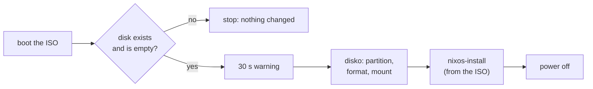

# Automated NixOS install

Red Hat has Kickstart and Debian has preseed: an answer file that the installer reads
so it asks no questions. NixOS has no answer file, because it does not need one. The
system configuration already says everything an answer file would: disks, packages,
users, services. What is left is to run the install without a person at the console.

| Kickstart or preseed | NixOS |
| --- | --- |
| an answer file, read by the installer | the NixOS configuration itself, plus a disk layout for [disko](https://github.com/nix-community/disko) |
| `%packages`, `%post` scripts | options in the configuration: nothing runs after the install |
| mistakes found during the install | `nix build` fails before any disk is touched |
| the installer downloads packages | the ISO can carry the finished system: no network needed |
| every install may differ with the mirror's state | every install from one ISO is the same system |

There are two common ways:

- **A custom installer ISO** that installs itself when it boots. Like a Kickstart USB
  stick: for machines you can boot from a medium. This repository has one, in
  `nixos/autoinstall/`, and the rest of this note is about it.
- **[nixos-anywhere](https://github.com/nix-community/nixos-anywhere)**, which
  installs over SSH onto a machine running any Linux, for example a cloud VM or a
  rescue system. See [[#nixos-anywhere|the end of this note]].

## How the ISO works

The ISO is the normal minimal NixOS installer, plus two things:

1. **The target system, already built**, in the ISO's Nix store. `nixos-install` copies
   it from there, so the install needs no network and gets exactly what was tested.
2. **A systemd service** that runs at boot. It checks the disk, waits 30 seconds with
   a warning on the console, partitions and formats with disko, runs `nixos-install`,
   and powers the machine off.



> [!danger] This wipes a disk without asking
> That is the point of it, and also the risk. Two safety nets are built in: by
> default it installs only onto an **empty** disk, and it waits 30 seconds first.
> Set `wipe = true` in `installer.nix` only for ISOs you use on machines meant to be
> reinstalled. Never leave such a stick lying around.

It powers off instead of rebooting. A reboot would start the ISO again, if it is still
in the machine. After the install, the machine's firmware lists the new disk first, so
the stick only boots again if you choose it in the firmware's boot menu. If you do,
the ISO sees a disk that is not empty, and stops.

### When the install fails

The service writes its messages to every console the kernel has: the screen and a
serial line alike. If a step fails, it prints `autoinstall: FAILED` and the last lines
of its log (`journalctl -u autoinstall`), then stops. Nothing powers off, so you can
log in on the console as `nixos`, with no password, and look. Only a failure in
partitioning or later has touched the disk.

## The files

Four files in `nixos/autoinstall/`. Edit `target.nix` and `disk.nix` for your
machine; `installer.nix` rarely needs changes.

### flake.nix

```nix
# A NixOS installer ISO that installs a fixed system with no questions, like a
# Kickstart or preseed install. Build and test it with scripts/nixos-iso.sh.
# See content/linux/distributions/nixos/automated-install.md.
{
  description = "Unattended NixOS installer ISO";

  inputs = {
    nixpkgs.url = "github:NixOS/nixpkgs/nixos-26.05";
    disko.url = "github:nix-community/disko";
    disko.inputs.nixpkgs.follows = "nixpkgs";
  };

  outputs = { nixpkgs, disko, ... }:
    let
      systems = [ "x86_64-linux" "aarch64-linux" ];
      forSystem = system: rec {
        # The system that ends up on the disk.
        target = nixpkgs.lib.nixosSystem {
          inherit system;
          modules = [ disko.nixosModules.disko ./disk.nix ./target.nix ];
        };
        # The ISO that installs it.
        installer = nixpkgs.lib.nixosSystem {
          inherit system;
          specialArgs = { inherit target; };
          modules = [ ./installer.nix ];
        };
      };
    in
    {
      packages = nixpkgs.lib.genAttrs systems (system: {
        iso = (forSystem system).installer.config.system.build.isoImage;
        default = (forSystem system).installer.config.system.build.isoImage;
      });
      nixosConfigurations = nixpkgs.lib.listToAttrs (map (system: {
        name = "target-${system}";
        value = (forSystem system).target;
      }) systems);
    };
}
```

### disk.nix

```nix
# The disk layout, for disko: GPT, a 512 MB EFI system partition, ext4 for the rest.
# /dev/vda is the first disk of a QEMU VM. On a real machine, use a stable name
# from /dev/disk/by-id/, so the install cannot pick the wrong disk.
{
  disko.devices.disk.main = {
    type = "disk";
    device = "/dev/vda";
    content = {
      type = "gpt";
      partitions = {
        ESP = {
          size = "512M";
          type = "EF00";
          content = {
            type = "filesystem";
            format = "vfat";
            mountpoint = "/boot";
            mountOptions = [ "umask=0077" ];
          };
        };
        root = {
          size = "100%";
          content = {
            type = "filesystem";
            format = "ext4";
            mountpoint = "/";
          };
        };
      };
    };
  };
}
```

### target.nix

```nix
# The system to install. Replace it with your own configuration.
{ modulesPath, ... }:
{
  # Drivers for a QEMU VM. On real hardware, use the hardware-configuration.nix that
  # nixos-generate-config writes, or nixos-facter.
  imports = [ "${modulesPath}/profiles/qemu-guest.nix" ];

  boot.loader.systemd-boot.enable = true;
  boot.loader.efi.canTouchEfiVariables = true;
  # A serial console too, so the test can watch the VM boot.
  boot.kernelParams = [ "console=ttyS0,115200" "console=ttyAMA0,115200" "console=tty0" ];

  networking.hostName = "autoinstalled";

  services.openssh.enable = true;
  users.users.root.openssh.authorizedKeys.keys = [
    "ssh-ed25519 AAAAC3NzaC1lZDI1NTE5AAAAIExampleKeyReplaceMe your.name@example.com"
  ];

  system.stateVersion = "26.05";
}
```

### installer.nix

```nix
# The installer ISO. It carries the finished target system, so the install needs no
# network, and a service that installs it at boot:
#   1. stop if the disk is missing, or not empty (unless wipe = true)
#   2. wait 30 seconds, with a warning on the console
#   3. partition and format with disko, then nixos-install the target
#   4. power off, so the machine does not boot the installer again
{ config, lib, pkgs, modulesPath, target, ... }:
let
  wipe = false;           # true: also install over a disk that has partitions
  delay = 30;             # seconds to power off before the disk is touched
  disk = target.config.disko.devices.disk.main.device;
  system = target.config.system.build.toplevel;
  formatMount = "${target.config.system.build.formatMount}/bin/disko-format-mount";
in
{
  imports = [ "${modulesPath}/installer/cd-dvd/installation-cd-minimal.nix" ];

  isoImage.storeContents = [ system target.config.system.build.formatMount ];
  boot.kernelParams = [ "console=ttyS0,115200" "console=ttyAMA0,115200" "console=tty0" ];

  systemd.services.autoinstall = {
    description = "Install NixOS on ${disk}, with no questions";
    wantedBy = [ "multi-user.target" ];
    path = [ config.system.build.nixos-install config.nix.package pkgs.util-linux pkgs.gptfdisk pkgs.systemd ];
    serviceConfig.Type = "oneshot";
    script = ''
      # /dev/console is only the last console= of the kernel line. Tell every one of
      # them, so the messages show on a screen and on a serial line alike.
      say() {
        echo "autoinstall: $*"
        for c in $(cat /sys/class/tty/console/active); do echo "autoinstall: $*" >"/dev/$c"; done
      }
      # Any failure: say so, with the end of the log, where someone can see it.
      trap 'rc=$?; [ $rc = 0 ] || { say "FAILED (exit $rc). Last lines of journalctl -u autoinstall:";
        journalctl -u autoinstall -n 15 -o cat --no-pager | while read -r l; do say "  $l"; done; }' EXIT
      if [ ! -b ${disk} ]; then
        say "${disk} does not exist. Nothing was changed."; exit 1
      fi
      # wipefs lists partition tables and file systems by reading the disk itself.
      # Not lsblk: it asks udev, which may not have probed the disk this early in boot.
      if [ -n "$(wipefs --noheadings ${disk})" ]; then
        if ${lib.boolToString wipe}; then
          say "${disk} has partitions. wipe = true: they will be destroyed."
        else
          say "${disk} is not empty. Nothing was changed. Set wipe = true to install over it."
          exit 1
        fi
      fi
      say "installing NixOS on ${disk} in ${toString delay} seconds. ALL DATA ON IT WILL BE LOST."
      say "power off now to stop."
      sleep ${toString delay}
      ${lib.optionalString wipe "wipefs -a ${disk}; sgdisk --zap-all ${disk}"}
      ${formatMount}
      nixos-install --root /mnt --system ${system} --no-root-passwd --no-channel-copy
      say "done. Powering off: remove the installer medium before the next boot."
      systemctl poweroff
    '';
  };
}
```

`formatMount` is the script disko generates from `disk.nix`: it creates the
partitions and file systems, and mounts them under `/mnt`, ready for
`nixos-install`.

## Build and test

No Nix is needed on your machine: the build runs in a container with Docker, like the
note tests (see `tests/README.md`).

```bash
scripts/nixos-iso.sh build     # writes dist/nixos-autoinstall-<system>.iso
scripts/nixos-iso.sh test      # installs it into a VM, then boots the result
```

The test needs QEMU; the devcontainer installs it (`scripts/install-vm-tools.sh`). It
boots the ISO with an empty virtual disk, waits for the install to finish, boots the
disk without the ISO, and waits for the `autoinstalled login:` prompt. Then it boots the
ISO once more, and checks that it refuses to touch the now non-empty disk.

With KVM this takes a few minutes. Without it (macOS, or inside most containers), QEMU
emulates the CPU and it takes much longer. The script builds for the machine's own
architecture: build an x86_64 ISO on an x86_64 machine, or in CI.

To write the ISO to a USB stick (check the device name twice, `lsblk` shows it):

```bash
sudo dd if=dist/nixos-autoinstall-x86_64-linux.iso of=/dev/sdX bs=4M conv=fsync status=progress
```

## On real hardware

- **Name the disk by ID.** `/dev/sda` and `/dev/nvme0n1` can change between boots and
  machines. Use `/dev/disk/by-id/...` in `disk.nix`, so the install cannot pick the
  wrong disk.
- **Hardware support.** Replace the `qemu-guest.nix` import with the
  `hardware-configuration.nix` that `nixos-generate-config` writes on that machine.
- **Secrets.** The ISO's store is readable by anyone who has the ISO. Do not put
  private keys or passwords in `target.nix`. Put a public SSH key in, and deploy
  secrets after the first boot. See [[linux/distributions/nixos/server]].
- **Encryption.** disko can create LUKS volumes too. See
  [[linux/distributions/nixos/disk-encryption]] for unlocking at boot.

## nixos-anywhere

When the machine already runs Linux and you can reach it as root over SSH, there is
no need for an ISO. nixos-anywhere boots it into a NixOS installer with `kexec`,
partitions with the same disko configuration, installs, and reboots:

```bash
nix run github:nix-community/nixos-anywhere -- \
  --flake ./nixos/autoinstall#target-x86_64-linux --target-host root@203.0.113.10
```

> [!note] Not tested here
> nixos-anywhere needs a machine to install onto over SSH, so this command is not part
> of the tests for this note.

Useful options:

| Option | Effect |
| --- | --- |
| `--generate-hardware-config nixos-generate-config <path>` | Writes the target's `hardware-configuration.nix` into your flake during the install. The file must exist before the first run — `{ }` is enough — or the flake does not evaluate |
| `--vm-test` | Runs the whole install in a local VM first. Needs KVM |
| `--extra-files <dir>` | Copies a directory tree onto the new root, for example pre-generated host keys |
| `--chown <path> <uid>:<gid>` | Sets the owner of copied files. Without it they keep the user ID of whoever ran the command; give host keys to root with `--chown /etc/ssh 0:0` |
| `--build-on local` / `remote` / `auto` | Where the system is built. Replaces the deprecated `--build-on-remote` |

## Host keys and secrets before the first boot

With [[linux/distributions/nixos/server#Secrets|sops-nix]], each host decrypts its
secrets with its SSH host key. Installed the usual way, that key only exists after
the install, so the first boot has no secrets.

Generate the key **before** the install, encrypt the secrets to it, and send it with
`--extra-files`:

```bash
mkdir -p hostkeys/etc/ssh && chmod 700 hostkeys
ssh-keygen -t ed25519 -N "" -C "root@web-01" -f hostkeys/etc/ssh/ssh_host_ed25519_key

# the host's age recipient: add it to .sops.yaml, then run sops updatekeys
ssh-to-age < hostkeys/etc/ssh/ssh_host_ed25519_key.pub

nix run github:nix-community/nixos-anywhere -- \
  --flake .#web-01 --extra-files hostkeys --chown /etc/ssh 0:0 \
  --target-host root@203.0.113.10
```

Check before the install that this key can decrypt the file, as the host will:

```bash
SOPS_AGE_KEY=$(ssh-to-age -private-key -i hostkeys/etc/ssh/ssh_host_ed25519_key) \
  SOPS_AGE_KEY_FILE=/dev/null sops -d secrets/web-01.yaml >/dev/null && echo OK
```

Keep the private key outside the repository, in a password manager: it lets a
reinstalled host keep the same identity and decrypt the same secrets.

> [!note] Not tested here
> This needs a target machine and sops-nix, so the note's test does not run it. It
> was done for real on a lab VM; see [[labs/nixos-homelab/woodpecker]].

## Where to go next

- [[linux/distributions/nixos/basics]] — the manual install this replaces
- [[linux/distributions/nixos/gitops]] — building and deploying every host from one repository
- [[linux/distributions/nixos/server]] — other images: qcow2, OCI
- [[linux/distributions/nixos/testing]] — VM tests and images before an install
- [[labs/nixos-homelab/gitea]] — nixos-anywhere on a real lab VM, step by step

<!-- uplink -->
Part of [[linux/distributions/nixos/index|NixOS]].
