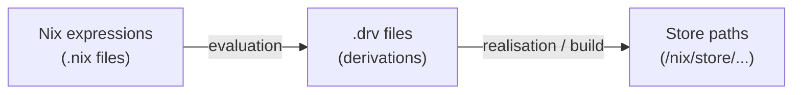

# Derivations

A **derivation** is Nix's build recipe: a precise description of how to produce one
store path from a set of inputs. Everything in a NixOS system is one, and
understanding them is what makes the rest of Nix stop feeling magical.

## Two phases

The distinction that clears up most confusion:



| Phase | What happens | Command |
| --- | --- | --- |
| **Evaluation** | Nix code is evaluated into `.drv` files. No building | `nix-instantiate` |
| **Realisation** | The `.drv` is built, or fetched from a cache | `nix-store --realise` |

An evaluation error — a syntax mistake, an infinite recursion — happens in the first
phase, before anything is compiled. A build failure happens in the second. The error
messages are very different, and knowing which phase you are in halves the debugging.

```bash
nix-instantiate '<nixpkgs>' -A hello
# /nix/store/xxxx-hello-2.12.3.drv

nix derivation show /nix/store/xxxx-hello-2.12.3.drv | jq
```

## What a derivation contains

```bash
nix derivation show nixpkgs#hello | jq '.derivations[] | {name, outputs, inputDrvs: (.inputs.drvs|keys), env: (.env|keys)}'
```

> [!warning] Correction
> The JSON format changed: Nix 2.34, in NixOS 26.05, prints format `version` 4. The
> derivations are now under `.derivations`, and `inputDrvs` and `inputSrcs` became
> `inputs.drvs` and `inputs.srcs`. The earlier `jq '.[] | ...'` filter fails on
> current Nix.

Essentially:

| Field | Meaning |
| --- | --- |
| `name` | The package name |
| `system` | Target platform, e.g. `x86_64-linux` |
| `builder` | The program that performs the build — usually `bash` |
| `args` | Its arguments |
| `env` | Environment variables, including `src` and build flags |
| `inputs.drvs` | Other derivations that must be built first |
| `inputs.srcs` | Source paths already in the store |
| `outputs` | The paths this produces — `out`, and often `dev`, `man`, `lib` |

Note there is **no `install` step**. A derivation's builder writes into `$out` and
that directory becomes the store path. Nothing is copied elsewhere afterwards.

## The hash

The store path is derived from a hash over the **entire** derivation — every input,
recursively.

```text
/nix/store/wq2y4bl5m7i9v6rk3z8x1c0dhpqn5jfa-openssl-3.0.12
           └──────────────┬──────────────┘
                    hash of all inputs
```

> [!important] Change any input and everything downstream gets a new path
> Patch glibc and every package built against it gets a new hash, a new path, and
> must be rebuilt. This is why a `nixpkgs` update can trigger thousands of rebuilds
> or downloads — the "mass rebuild" that gates changes to core packages upstream.
>
> It is also exactly what makes the system trustworthy: a path uniquely identifies
> everything that went into producing it. There is no way for a package to be
> "the same version but built differently" and share a name.

## Writing one

The primitive:

```nix
derivation {
  name = "hello";
  system = "x86_64-linux";
  builder = "${pkgs.bash}/bin/bash";
  args = [ ./builder.sh ];
}
```

Nobody writes these by hand. `stdenv.mkDerivation` wraps it with the standard build
phases:

```nix
{ lib, stdenv, fetchurl, cmake, pkg-config, openssl, zlib }:

stdenv.mkDerivation (finalAttrs: {
  pname = "myapp";
  version = "1.2.3";

  src = fetchurl {
    url = "https://example.com/myapp-${finalAttrs.version}.tar.gz";
    hash = "sha256-AAAA...";
  };

  nativeBuildInputs = [ cmake pkg-config ];   # needed at build time
  buildInputs = [ openssl zlib ];             # linked into the result

  meta = {
    description = "An example application";
    license = lib.licenses.mit;
  };
})
```

The file is a function: its arguments are the packages it uses, and
`pkgs.callPackage ./myapp.nix { }` passes them in. A name used in the body but
missing from the argument list is an `undefined variable` error.

The default phases — `unpack`, `patch`, `configure`, `build`, `check`, `install`,
`fixup` — handle an autotools or CMake project with no explicit phases at all.
`cmake` in `nativeBuildInputs` makes the configure phase run `cmake` with
`-DCMAKE_INSTALL_PREFIX=$out`, then `make` and `make install` run. Write a phase,
such as `buildPhase = '' ... '';`, only when the default does not fit. Most package
definitions in `nixpkgs` are a `src`, a list of inputs, and `meta`.

> [!warning] Correction
> An earlier version used `cmake`, `pkg-config`, `openssl`, `zlib` and `lib` without
> listing them in the arguments, so it did not evaluate. It also rewrote the
> configure, build and install phases that the defaults already do. `finalAttrs`
> replaces `rec`: an override of `version` then also changes the URL.

> [!note] `nativeBuildInputs` versus `buildInputs` matters when cross-compiling
> `nativeBuildInputs` runs **on the build machine** — compilers, `pkg-config`,
> generators. `buildInputs` is linked into the output and must target the **host**
> platform. On a native build they behave identically, so the distinction is easy to
> get wrong and only breaks when someone cross-compiles.

## The build sandbox

Builds run isolated: no network, a minimal filesystem, a fixed user and a fixed
timestamp.

```nix
nix.settings.sandbox = true;      # the default on Linux
```

This is what makes reproducibility enforceable rather than aspirational. A build
cannot quietly depend on something installed on the machine, because it cannot see it.

The exception is **fixed-output derivations**, which are allowed network access
precisely because their output hash is declared in advance:

```nix
src = fetchurl {
  url = "https://example.com/myapp-1.2.3.tar.gz";
  hash = "sha256-AAAA...";
};
```

If what arrives does not hash to the stated value, the build fails. That is how
downloading is made safe inside a sandbox.

> [!warning] "hash mismatch" on a fixed-output derivation
> Either upstream changed the tarball — worth investigating rather than assuming
> benign — or the hash is simply wrong. To find the correct one, put in a fake and
> read the error:
>
> ```text
> hash mismatch in fixed-output derivation:
>   specified: sha256-AAAA...
>   got:       sha256-Xr8f...
> ```
>
> Do not paste the "got" value without asking why it changed. Reproducible-source
> projects publish stable tarballs; a changing hash on a released version is a signal.

## Reproducibility, honestly

Nix guarantees that the same inputs produce the same **derivation**. It does not
guarantee the same **output bytes** — that depends on the build itself being
deterministic, and many are not: embedded timestamps, build paths, parallelism
ordering.

Check:

```bash
nix build nixpkgs#hello --rebuild
nix store diff-closures /run/current-system /nix/var/nix/profiles/system-42-link
```

`--rebuild` builds again and compares. A difference means that package is not
bit-reproducible, which the [reproducible builds](https://reproducible-builds.org/)
project tracks across distributions.

> [!important] Nix gives reproducible *dependency graphs*, not reproducible *binaries*
> This is a genuinely important distinction that enthusiasm often blurs. What Nix
> guarantees is that everyone building the same expression uses byte-identical
> dependencies, compilers and flags. Whether the compiler then emits identical bytes
> is a property of the compiler.
>
> For supply chain purposes that first guarantee is still the valuable one — it is
> the same property an SBOM tries to reconstruct after
> the fact, except here it is intrinsic. See
> cosign-advanced on provenance.

## Closures

The transitive dependency set of a store path — everything needed to run it:

```bash
nix path-info -r /run/current-system | head
nix path-info -Sh nixpkgs#hello              # closure size
nix why-depends /run/current-system "nixpkgs#perl^out"
```

`nix why-depends` is the tool for "why is Perl on my minimal server?" — it prints the
chain of references that pulled it in. `^out` picks one output: `perl` has several,
and `why-depends` refuses a package that is more than one store path.

```bash
nix-store --query --references /nix/store/xxx      # direct dependencies
nix-store --query --referrers /nix/store/xxx       # what depends on it
nix-store --query --roots /nix/store/xxx           # why GC will not remove it
```

That last one answers the other common question: why garbage collection is not
reclaiming something.

## Binary caches

Because a store path is fully determined by its inputs, a build can be **substituted**
from a cache instead of performed:

```nix
nix.settings = {
  substituters = [ "https://cache.nixos.org" "https://myorg.cachix.org" ];
  trusted-public-keys = [
    "cache.nixos.org-1:6NCHdD59X431o0gWypbMrAURkbJ16ZPMQFGspcDShjY="
    "myorg.cachix.org-1:AAAA..."            # the key your cache publishes
  ];
};
```

This is why installing a package on NixOS is usually a download rather than a
compile, despite everything being built from source in principle. The cache is
trusted by signature, which is what the public keys are for: a cache with no key in
`trusted-public-keys` is ignored, so each substituter needs its key.

## Where to go next

- [[linux/distributions/nixos/language]] — the expressions that evaluate to these
- [[linux/distributions/nixos/basics]] — garbage collection and closures in practice
- sbom — the same problem, solved differently elsewhere

## Further reading

- [NixOS Wiki: Derivations](https://wiki.nixos.org/wiki/Derivations)
- [Zero to Nix: Derivations](https://zero-to-nix.com/concepts/derivations/)

<!-- uplink -->
Part of [[linux/distributions/nixos/index|NixOS]].
