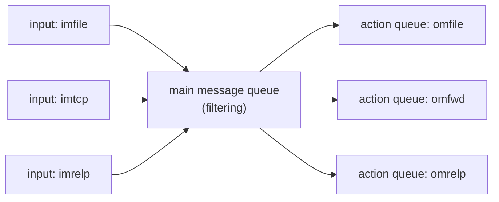
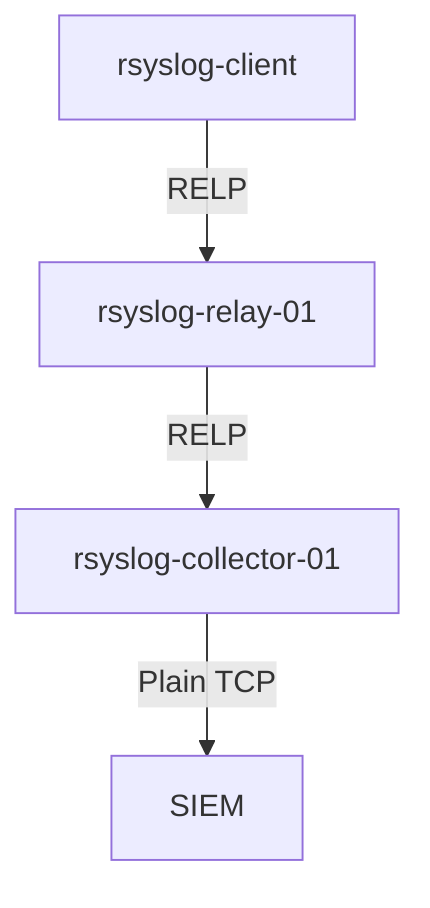
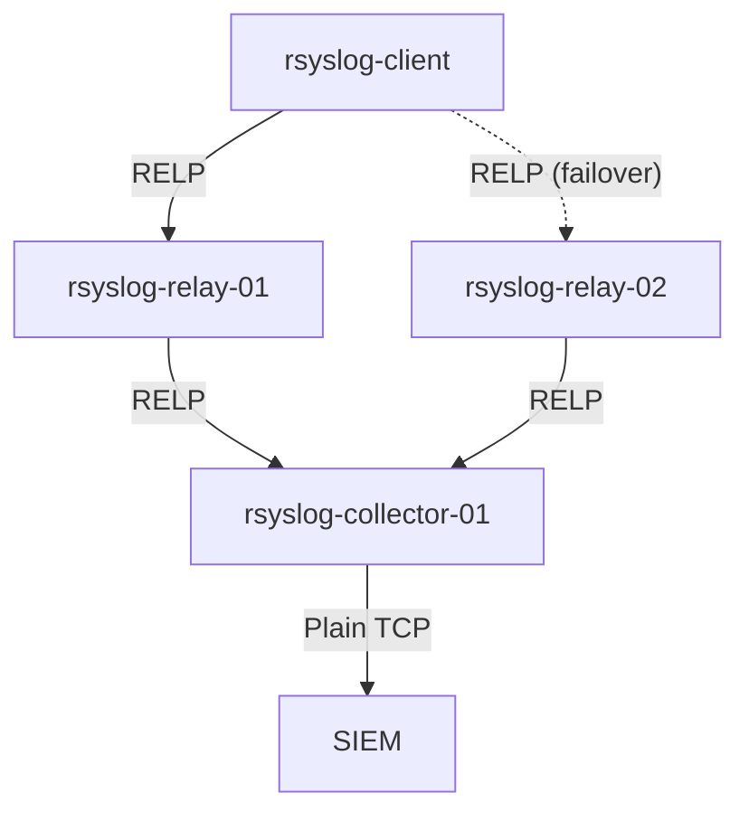

# rsyslog

rsyslog is the *rocket-fast system for log processing*. It is the default syslog
implementation on most Linux distributions; the alternative is
[[linux/logging/syslog-ng]]. For the protocol itself see
[[linux/logging/syslog]].

## Configuration formats

rsyslog understands three configuration formats:

| Format | Origin | Status |
| --- | --- | --- |
| **basic** | inherited from `sysklogd` | most widespread, one rule per line |
| **advanced** | formerly *RainerScript*, added in v6 | current format, more precise |
| **obsolete legacy** | v5 attempt to extend `sysklogd` | abandoned as too complex — do not use |

The advanced format is the one to use for configuration you intend to keep. It
needs multiple lines, and was less performant in v7, but that was resolved in v8.

The shipped default configuration is still mostly *basic*, because it is easier to
read and answers the simplest needs perfectly well. All formats can be mixed in
one file.

Take forwarding mail logs to a relay. In *basic*, over TCP:

```ini
mail.err @@server.example.net
```

The same in *advanced*:

```ini
mail.err action(type="omfwd" target="server.example.net" protocol="tcp")
```

As soon as you want to add anything, the advanced format is preferable:

```ini
mail.err action(type="omfwd" target="server.example.net" protocol="tcp" queue.type="linkedList")
```

The two are equally readable there, just different lengths. But for the simple
case of writing one log type to a file, advanced is genuinely more verbose:

```ini
mail.info   /var/log/maillog
```

```ini
if prifilt("mail.info") then {
    action(type="omfile" file="/var/log/maillog")
}
```

Module loading is where advanced clearly wins — legacy:

```ini
$ModLoad imtcp
$InputTCPMaxSessions 500
```

versus advanced:

```ini
module(load="imtcp" maxSessions="500")
```

> [!note] `@` versus `@@`
> In the basic format a single `@` means UDP and a double `@@` means TCP. It is
> the kind of detail that makes the advanced format worth the extra typing.

> [!warning] Two errors rsyslog rejects
> An `omfwd` action needs a `target` ("either target or targetSrv must be specified";
> releases before 8.2608 say "parameter 'target' required"). The legacy directive is
> `$InputTCPMaxSessions`, with an `s`.

## Queues

rsyslog uses a single **main message queue** for all inputs, plus one queue per
**action**. Once the main queue's worker has filtered messages they are
distributed into the action queues, and each message is removed from the main
queue as soon as it has been handed on.



Each queue's mode is set with `queue.type`:

### Direct queues

```ini
queue.type="Direct"
```

No queuing and no buffer at all — the message is delivered immediately. This is the
default for actions. Useful for writing to a file, where the extra indirection buys
nothing.

### Disk queues

```ini
queue.type="Disk"
```

- uses **only** disk as its buffer
- very reliable, but slower
- written in chunks of 10 MB by default, tunable with `queue.maxFileSize`
- each chunk is a separate file
  - named with a prefix set by `queue.filename`
  - plus an 8-digit suffix incrementing from 1: `forwarding.00000001`
- the storage directory is set by `queue.spoolDirectory`
- reliability can be increased further, at a performance cost:
  - `queue.syncqueuefiles="on"` forces a sync after every write
  - `queue.checkpointInterval` writes periodic checkpoints

### In-memory queues

Very fast but less reliable, and memory is not released while the destination is
unreachable. Two modes:

| Mode | Directive | Behaviour |
| --- | --- | --- |
| FixedArray | `queue.type="FixedArray"` | default for the main queue and rulesets; memory allocated at startup, fastest |
| LinkedList | `queue.type="LinkedList"` | memory allocated on demand |

### Disk-assisted memory queues

- enabled automatically as soon as `queue.filename` is configured
- the disk queue kicks in when the primary queue fills, or when you want it to
  survive a shutdown (`queue.saveOnShutdown="on"`)
- disk writing starts once the queue reaches `queue.highWatermark` — by default
  90% of `queue.size`, which itself defaults to 50k messages (1k in some cases)
- disk writing stops at `queue.lowWatermark` (default 70% of `queue.size`) and
  stays off until the disk queue is empty
- avoids message loss when disk writes are too slow

### Sizing

`queue.size` is a **number of messages, not an amount of memory**. For sizing,
a message averages around 512 bytes.

Only disk and disk-assisted queues accept `queue.maxDiskSpace` — which is
**unlimited by default**, so set it unless you want a log outage to fill the
filesystem.

Full parameter list:
[queue parameters](https://www.rsyslog.com/doc/master/rainerscript/queue_parameters.html).

Forwarding to a collector with an in-memory queue:

```ini
action(type="omfwd" target="192.168.2.11" port="10514" protocol="tcp"
       queue.filename="forwarding" queue.size="1000000" queue.type="LinkedList"
      )
```

### What happens when a queue fills

1. rsyslog begins throttling ingestion from the source — but only for sources
   where that is meaningful (TCP, files, the local `/dev/log` socket). A UDP
   sender cannot be throttled, so its messages are simply lost.
2. Meanwhile messages start being discarded by severity:
   - `queue.discardMark` — the fill level at which discarding begins, 80% of
     `queue.size` by default.
   - `queue.discardSeverity` — messages of this severity **or less severe** are
     the ones discarded. The default is `8`, which is outside the valid 0–7 range
     and therefore means "discard nothing".
   - `queue.timeoutEnqueue` — as a last resort, how long (default 2000 ms) a
     message waits to be enqueued before being dropped to avoid a crash.

> [!warning] The defaults do not protect you
> With `discardSeverity` at its default, nothing is ever discarded early, so a
> sustained outage runs the queue to full and then drops messages indiscriminately
> at `timeoutEnqueue`. If some logs matter more than others, set
> `queue.discardSeverity` deliberately.

## Parsers

Before a message can be processed it passes through parsers, which detect its
format and hand it on to the actions. The default parser chain is:

1. `rsyslog.rfc5424`
2. `rsyslog.rfc3164`

As covered in [[linux/logging/syslog]], RFC3164 imposes no formal structure, so a
malformed message will not be rejected — it will simply be interpreted as RFC3164.

To override the chain or use a specific one, you need a ruleset.

## Tags

The TAG field holds the name of the program that sent the message, often with its
process ID: `named[12345]:`. RFC3164 says a TAG is at most 32 alphanumeric characters
and that any other character ends it. rsyslog is more lenient: the TAG runs to the
first colon or space. So `systemd-journald[99]:` and `my.app/v2:` are whole tags, and
a 40-character tag is kept.

`$programname` is the start of the TAG, up to the first `[`, `/` or `:`. For the
three tags above: `named`, `systemd-journald` and `my.app`.

> [!note] What ends the TAG
> The RFC says any non-alphanumeric character ends the TAG, but rsyslog keeps `-`, `.`
> and `/` in it.

## Rulesets

A ruleset is a set of rules performing actions based on filters:

```ini
ruleset(name="<name>") { <statements> }
```

A `remote` ruleset using `omfile` to write messages to a file, bound to an input
so that everything received on port 10514 lands in that file:

```ini
module(load="imtcp")
ruleset(name="remote"){
    action(type="omfile" file="/var/log/remotefile")
}
input(type="imtcp" port="10514" ruleset="remote")
```

Several rulesets, one per listener:

```ini
module(load="imptcp")

# process remote messages

ruleset(name="remote10514"){
    action(type="omfile" file="/var/log/remote10514")
}

ruleset(name="remote10515"){
    action(type="omfile" file="/var/log/remote10515")
}

ruleset(name="remote10516"){
    if prifilt("mail.*") then {
        /var/log/mail10516
        stop
        # the stop prevents this message also being written to the
        # remote10516 file. Logs received on 10516 (and only that port)
        # with mail.* priority go to their own file instead of the
        # port's general log file.
    }
    /var/log/remote10516
}

# and now define listeners bound to the relevant ruleset
input(type="imptcp" port="10514" ruleset="remote10514")
input(type="imptcp" port="10515" ruleset="remote10515")
input(type="imptcp" port="10516" ruleset="remote10516")
```

An input module must be loaded before its first `input()`, or rsyslog stops with
"input module name 'imptcp' is unknown".

This gives you more rules but fewer filters, which is both more readable and more
performant: messages are pushed straight to the right ruleset and processed
directly.

By default rulesets have no dedicated queue — messages arrive via the main message
queue. You can give a ruleset its own queue, which improves throughput on a
multi-core server:

```ini
ruleset(name="whatever" queue.type="fixedArray" queue.size="10000") {
    # ...
}
```

To stop processing a ruleset, use the special `stop` action:

```ini
if ( $programname startswith "haproxy" ) then {
    action(type="omfile" file="/var/log/haproxy.log" flushOnTXEnd="off")
    stop
}
```

## Properties

Parsers extract properties, which can then be used in filters and templates. The
most used:

| Property | Meaning |
| --- | --- |
| `$msg` | the message |
| `$rawmsg` | the message before parsing or templating |
| `$fromhost` | FQDN of the last machine the message transited |
| `$fromhost-ip` | IP of the last machine the message transited |
| `$hostname` | source machine name as present in the syslog frame |
| `$syslogfacility` | facility, numeric |
| `$syslogfacility-text` | facility, text |
| `$syslogseverity` | severity, numeric |
| `$syslogseverity-text` | severity, text |
| `$timegenerated` | timestamp of when rsyslog received the message |
| `$timereported` | timestamp of when the message was created |
| `$syslogtag` | TAG |
| `$programname` | the TAG up to the first `[`, `/` or `:` — for TAG `named[12345]:`, `named` |
| `$myhostname` | this machine's name |
| `$now` | not from the message: the current time (`YYYY-MM-DD`) |

> [!tip] `$fromhost` versus `$hostname`
> On a relay these differ, and the distinction matters when debugging: `$hostname`
> is what the original sender claimed, `$fromhost` is who actually connected to
> you. Only the latter can be trusted.

## Templates

rsyslog ships several templates. They all start with `RSYSLOG_`. Treat that prefix as
reserved: rsyslog accepts your own `RSYSLOG_Mine` today, but a later version may add a
built-in with that name. Recent versions also have `RSYSLOG_SyslogRFC5424Format`, which
writes RFC5424 like `RSYSLOG_SyslogProtocol23Format` below.

`RSYSLOG_TraditionalFileFormat` — legacy, imprecise timestamp, avoid:

```ini
template(name="RSYSLOG_TraditionalFileFormat" type="string"
         string="%TIMESTAMP% %HOSTNAME% %syslogtag%%msg:::sp-if-no-1st-sp%%msg:::drop-last-lf%\n")
```

`RSYSLOG_TraditionalForwardFormat` — legacy, imprecise timestamp, avoid:

```ini
template(name="RSYSLOG_TraditionalForwardFormat" type="string"
         string="<%PRI%>%TIMESTAMP% %HOSTNAME% %syslogtag:1:32%%msg:::sp-if-no-1st-sp%%msg%")
```

`RSYSLOG_FileFormat` — precise timestamp with timezone:

```ini
template(name="RSYSLOG_FileFormat" type="list") {
    property(name="timereported" dateFormat="rfc3339")
    constant(value=" ")
    property(name="hostname")
    constant(value=" ")
    property(name="syslogtag")
    property(name="msg" spifno1stsp="on")
    property(name="msg" droplastlf="on")
    constant(value="\n")
}
```

`RSYSLOG_ForwardFormat` — precise timestamp with timezone:

```ini
template(name="RSYSLOG_ForwardFormat" type="string"
         string="<%PRI%>%TIMESTAMP:::date-rfc3339% %HOSTNAME% %syslogtag:1:32%%msg:::sp-if-no-1st-sp%%msg%")
```

`RSYSLOG_SyslogProtocol23Format` — RFC5424-conformant:

```ini
template(name="RSYSLOG_SyslogProtocol23Format" type="string"
         string="<%PRI%>1 %TIMESTAMP:::date-rfc3339% %HOSTNAME% %APP-NAME% %PROCID% %MSGID% %STRUCTURED-DATA% %msg%\n")
```

JSON — not a built-in you can use. rsyslog has an internal `StdJSONFmt` for modules
such as `omhttp`, but `template="RSYSLOG_StdJSONFmt"` or `template="StdJSONFmt"` in a
configuration is "not found". Define it yourself, under your own name:

```ini
template(name="json" type="string"
         string="{\"message\":\"%msg:::json%\",\"fromhost\":\"%HOSTNAME:::json%\",\"facility\":\"%syslogfacility-text%\",\"priority\":\"%syslogpriority-text%\",\"timereported\":\"%timereported:::date-rfc3339%\",\"timegenerated\":\"%timegenerated:::date-rfc3339%\"}")
```

`RSYSLOG_DebugFormat` — for finding problems, never for production:

```ini
template(name="RSYSLOG_DebugFormat" type="list") {
    constant(value="Debug line with all properties:\nFROMHOST: '")
    property(name="fromhost")
    constant(value="', fromhost-ip: '")
    property(name="fromhost-ip")
    constant(value="', HOSTNAME: '")
    property(name="hostname")
    constant(value="', PRI: ")
    property(name="pri")
    constant(value=",\nsyslogtag '")
    property(name="syslogtag")
    constant(value="', programname: '")
    property(name="programname")
    constant(value="', APP-NAME: '")
    property(name="app-name")
    constant(value="', PROCID: '")
    property(name="procid")
    constant(value="', MSGID: '")
    property(name="msgid")
    constant(value="',\nTIMESTAMP: '")
    property(name="timereported")
    constant(value="', STRUCTURED-DATA: '")
    property(name="structured-data")
    constant(value="',\nmsg: '")
    property(name="msg")
    constant(value="'\nescaped msg: '")
    property(name="msg" controlcharacters="drop")
    constant(value="'\ninputname: ")
    property(name="inputname")
    constant(value=" rawmsg: '")
    property(name="rawmsg")
    constant(value="'\n$!:")
    property(name="$!")
    constant(value="\n$.:")
    property(name="$.")
    constant(value="\n$/:")
    property(name="$/")
    constant(value="\n\n")
}
```

### Why `SyslogProtocol23Format` has that name

The rsyslog team implemented the IETF draft `ietf-syslog-protocol-23`, which is
very close to the final RFC5424, and adopted this template before the RFC was
definitively approved. They chose to leave the name alone: it was already widely
used, and renaming it would have broken systems already in production.

## `call`

`call` links rulesets — treating them as subroutines:

```ini
call rulesetname
```

Which makes chaining possible:

```ini
module(load="imptcp")
ruleset(name="rs1") {
        action(type="omfile" File="/var/log/test1.log")
}
ruleset(name="rs2") {
        action(type="omfile" File="/var/log/test2.log")
        call rs1
}
input(type="imptcp" port="514" ruleset="rs2" keepAlive="on")
```

Every log arriving on 514/tcp passes through `rs2`, then `rs1`. `keepAlive` is a
parameter of the input, not of the module: `module(load="imptcp" keepalive="on")`
is rejected.

## Conditions

```ini
template(name="OnlyMsg" type="string" string="%msg:2:$%\n")
ruleset(name="sendToLogserver") {
    action(type="omfwd" target="logserver.example.com" port="514" protocol="tcp")
}

if ( $syslogfacility-text == "auth" or $syslogfacility-text == "authpriv" ) then {
    action(type="omfile" file="/var/log/auth.log")
}

if ( $programname startswith "haproxy" ) then {
    action(type="omfile" file="/var/log/haproxy.log")
    stop
}

if ( $syslogtag == 'nginx__access:' ) then {
    # write to file
    action(type="omfile" file="/var/log/nginx/access" template="OnlyMsg")
    # forward over network
    call sendToLogserver
    stop
}
```

A template and a ruleset must be defined before an action or a `call` uses them.
Without the first two statements, rsyslog disables the action: "Could not find
template 'OnlyMsg'".

## Handling multi-line messages

When logs arrive spanning several lines with control characters, you have to tell
rsyslog what to do with them. By default `EscapeControlCharactersOnReceive` is
**on**, which replaces each control character with a 3-digit escape — turning one
multi-line message into unreadable single-line output: `first line#012second line`.

A newline can only reach rsyslog inside one message over TCP with octet-counted
framing (`<length> <message>`). Over UDP, `imudp` splits the datagram at the newline
into two messages, whatever this setting says.

To preserve them, turn it **off**:

```ini
global(parser.escapeControlCharactersOnReceive="off")
```

Or in the legacy format:

```ini
$EscapeControlCharactersOnReceive off
```

> [!note] `on` is the default
> `$EscapeControlCharactersOnReceive on` changes nothing: it is the default. `off` is
> what allows multi-line messages through.

## Configuring a simple collector

Three steps:

1. load the **imtcp** module (*Input Module TCP*)
2. create a ruleset using **omfile** (*Output Module File*) to write messages to a
   file in RFC5424 format
3. bind the input to the ruleset

```ini
module(load="imtcp")
ruleset(name="remote"){
    action(type="omfile" file="/var/log/remotefile" template="RSYSLOG_SyslogProtocol23Format")
}
input(type="imtcp" port="514" ruleset="remote")
```

## Forwarding to a relay or collector

Use the **omfwd** module (*Output Module Forwarding*) —
[documentation](https://www.rsyslog.com/doc/v8-stable/configuration/modules/omfwd.html).

The simplest possible configuration:

```ini
*.* action(type="omfwd" target="rsyslog-relay-01.internal.example.com" port="514" protocol="tcp")
```

As covered under [[#Queues]], that risks losing messages when the destination is
unavailable. To limit loss over TCP, retry:

```ini
*.*  action(type="omfwd" target="rsyslog-relay-01.internal.example.com" port="514" protocol="tcp"
            action.resumeRetryCount="100"
            action.resumeInterval="30"
            action.reportSuspension="on"
            action.reportSuspensionContinuation="on"
            queue.type="Disk" queue.size="10000"
            queue.filename="forwarding"
            queue.saveonshutdown="on"
            queue.spoolDirectory="/var/spool/rsyslog"
            template="RSYSLOG_SyslogProtocol23Format")
```

This uses a disk queue, so messages are on disk as soon as they are queued, and
retries 100 times, 30 seconds apart.
That interval is approximate, because every 10 attempts it lengthens:

```text
(numRetries / 10 + 1) * action.resumeInterval
```

So with 30 seconds configured, from the 10th attempt the interval becomes 60
seconds, and from the 100th, 330 seconds.

For visibility into connectivity between source and destination:

- `action.reportSuspension` — report when the action is suspended and resumed
- `action.reportSuspensionContinuation` — keep reporting subsequent attempts

```console
$ journalctl -u rsyslog.service -f
Oct 11 16:07:56 rsyslog-client rsyslogd[18228]: omrelp: could not connect to remote server, librelp error 10015 [v8.2106.0 try https://www.rsyslog.com/e/2291 ]
Oct 11 16:07:56 rsyslog-client rsyslogd[18228]: action 'action-18-omrelp' suspended (module 'omrelp'), retry 0. There should be messages before this one giving the reason for suspension. [v8.2106.0 try https://www.rsyslog.com/e/2007 ]
Oct 11 16:09:56 rsyslog-client rsyslogd[18228]: action 'action-18-omrelp' resumed (module 'omrelp') [v8.2106.0 try https://www.rsyslog.com/e/2359 ]
```

## Using RELP

For higher reliability, use **RELP** (Reliable Event Logging Protocol), which
acknowledges at the application level rather than the TCP level.

Install the module:

```bash
zypper install -y rsyslog-module-relp     # openSUSE Leap
dnf install -y rsyslog-relp               # RHEL
```

Server:

```ini
module(load="imrelp")
ruleset(name="remote"){
    action(type="omfile" file="/var/log/remotefile" template="RSYSLOG_SyslogProtocol23Format")
}
input(type="imrelp" port="2514" maxDataSize="10k" keepAlive="on" ruleset="remote")
```

Client:

```ini
module(load="omrelp")
*.* action(type="omrelp" target="rsyslog-relay-01.internal.example.com" port="2514")
```

> [!note] `omrelp` has no `protocol` parameter
> RELP always runs over TCP, so there is nothing to select: rsyslog rejects
> `protocol="tcp"` for `omrelp`.

## Failover

Failover is implemented with successive actions in a ruleset:

```ini
if ($msg contains "error") then {
     action(type="omfwd" target="rsyslog-relay-01.internal.example.com" port="514"
            protocol="tcp")
     action(type="omfwd" target="rsyslog-relay-02.internal.example.com" port="514"
            action.execOnlyWhenPreviousIsSuspended="on"
            protocol="tcp")
     action(type="omfile" file="/var/log/localbuffer"
            action.execOnlyWhenPreviousIsSuspended="on")
}
```

`omfile` has no `tag` parameter: a `tag=` on the last action makes rsyslog reject the
whole block.

> [!important] Failover and queues are mutually exclusive per action
> Failover does not work if you attach queues to the individual actions. The
> reason is simple: a queue makes the action asynchronous, so from the ruleset's
> point of view it never fails, and the next action's
> `execOnlyWhenPreviousIsSuspended` never triggers.

> [!warning] The message in flight when a relay stops is lost
> Tested with the ruleset-queue block below, on rsyslog 8.2502: relay-01 was stopped,
> then two messages were sent. The second went to relay-02 within two seconds. The
> first went nowhere: not to relay-02, not to the buffer file, and not to relay-01
> when it came back. Failover protects what comes after the failure, not the message
> that was on the wire when it happened.

To have a global queue on the forwarding process anyway, put every action inside
one ruleset and attach the queue to the **ruleset**. The ruleset is then handled
asynchronously while each action inside it runs synchronously, so failures are
still detected:

```ini
module(load="omrelp")
ruleset(name="forwarding" queue.type="linkedList" queue.filename="fwd") {
     action(type="omrelp" target="rsyslog-relay-01.internal.example.com" port="2514")
     action(type="omrelp" target="rsyslog-relay-02.internal.example.com" port="2514"
            action.execOnlyWhenPreviousIsSuspended="on")
     action(type="omfile" file="/var/spool/rsyslog/localbuffer"
            action.execOnlyWhenPreviousIsSuspended="on")
}
*.* call forwarding
```

> [!warning] `omfile` needs a file path
> `/var/spool/rsyslog` is the spool *directory* used by `queue.spoolDirectory`. An
> `omfile` action pointed at it fails, so a last-resort tier written that way silently
> does nothing.

## Relays

Continuing the example, a relay can forward on to a collector:

```ini
module(load="imrelp")
module(load="omrelp")
ruleset(name="forwarding" queue.type="linkedList" queue.filename="fwd") {
     action(type="omrelp" target="rsyslog-collector-01.internal.example.com" port="2514")
     action(type="omfile" file="/var/spool/rsyslog/localbuffer"
            action.execOnlyWhenPreviousIsSuspended="on")
}
input(type="imrelp" port="2514" maxDataSize="10k" keepAlive="on" ruleset="forwarding")
```

And the collector can hand off to a SIEM over plain TCP:

```ini
module(load="imrelp")
ruleset(name="remote"){
  action(type="omfwd" target="siem.internal.example.com" port="514" protocol="tcp")
}
input(type="imrelp" port="2514" maxDataSize="10k" keepAlive="on" ruleset="remote")
```

> [!warning] Do not load `omfwd`
> `omfwd` is built into rsyslog. `module(load="omfwd")` fails: "could not load module
> 'omfwd'".

## A reliability-oriented worked example

Building the most reliable log distribution chain we can.

### Generating test logs

Use [flog](https://github.com/mingrammer/flog) to produce a log file:

```bash
zypper install -y go
go install github.com/mingrammer/flog@latest
~/go/bin/flog -f rfc5424 -n 2000 -t log -o /var/log/generated.log -w
```

> [!note] flog's RFC5424 is not quite RFC5424
> `flog -f rfc5424` puts a random VERSION (1, 2 or 3) after the priority, where
> RFC5424 requires `1`. Here that does not matter: `imfile` below reads each line as
> the message text. Do not send flog's output to rsyslog as syslog: it parses only the
> lines with version 1 as RFC5424.

Between attempts, clear the traces first:

```bash
systemctl stop syslog.socket rsyslog.service && \
    rm /var/log/generated.log && \
    ~/go/bin/flog -f rfc5424 -n 2000 -t log -o /var/log/generated.log -w && \
    systemctl start rsyslog.service
```

Simulate an outage with iptables — see iptables:

```bash
iptables --append INPUT --protocol tcp --dport 2514 --jump DROP   # break it
iptables --delete INPUT --protocol tcp --dport 2514 --jump DROP   # restore it
```

### Single relay



On the source:

```ini
module(load="omrelp")
ruleset(name="forwarding") {
     action(type="omrelp" target="rsyslog-relay-01.internal.example.com" port="2514"
            action.resumeRetryCount="100"
            action.resumeInterval="30"
            action.reportSuspension="on"
            action.reportSuspensionContinuation="on"
            queue.type="Disk" queue.size="10000"
            queue.filename="forwarding"
            queue.saveonshutdown="on"
            queue.spoolDirectory="/var/spool/rsyslog"
            template="RSYSLOG_SyslogProtocol23Format")
}
*.* call forwarding

module(load="imfile" statefile.directory="/var/spool/rsyslog")
input(type="imfile"
        file="/var/log/generated.log"
        tag="generated_by_flog"
        ruleset="forwarding")
```

On the relay:

```ini
module(load="imrelp")
module(load="omrelp")
ruleset(name="forwarding") {
     action(type="omrelp" target="rsyslog-collector-01.internal.example.com" port="2514"
            action.resumeRetryCount="100"
            action.resumeInterval="30"
            action.reportSuspension="on"
            action.reportSuspensionContinuation="on"
            queue.type="Disk" queue.size="10000"
            queue.filename="forwarding"
            queue.saveonshutdown="on"
            queue.spoolDirectory="/var/spool/rsyslog"
            template="RSYSLOG_SyslogProtocol23Format")
}
input(type="imrelp" port="2514" maxDataSize="10k" keepAlive="on" ruleset="forwarding")
*.* call forwarding
```

On the collector:

```ini
module(load="imrelp")
ruleset(name="forwarding") {
     action(type="omfwd" target="siem.internal.example.com" port="514" protocol="tcp"
            action.resumeRetryCount="100"
            action.resumeInterval="30"
            action.reportSuspension="on"
            action.reportSuspensionContinuation="on"
            queue.type="Disk" queue.size="10000"
            queue.filename="forwarding"
            queue.saveonshutdown="on"
            queue.spoolDirectory="/var/spool/rsyslog"
            template="RSYSLOG_SyslogProtocol23Format")
}

input(type="imrelp" port="2514" maxDataSize="10k" keepAlive="on" ruleset="forwarding")
*.* call forwarding
```

### Multiple relays



Only the source configuration changes. Note the queue is on the **ruleset**, not
the actions, so that failover still works:

```ini
module(load="omrelp")
ruleset(name="forwarding"
        queue.type="Disk" queue.size="10000"
        queue.filename="forwarding"
        queue.saveonshutdown="on"
        queue.spoolDirectory="/var/spool/rsyslog") {
     action(type="omrelp" target="rsyslog-relay-01.internal.example.com" port="2514"
            template="RSYSLOG_SyslogProtocol23Format")
     action(type="omrelp" target="rsyslog-relay-02.internal.example.com" port="2514"
            template="RSYSLOG_SyslogProtocol23Format"
            action.execOnlyWhenPreviousIsSuspended="on")
     action(type="omfile" file="/var/spool/rsyslog/localbuffer"
            template="RSYSLOG_SyslogProtocol23Format"
            action.execOnlyWhenPreviousIsSuspended="on")
}
*.* call forwarding
```

## Checking the configuration

```bash
rsyslogd -N 1 -f /etc/rsyslog.conf
```

`-N` sets the verbosity of the config check (`1` is enough) and exits without
starting. See config-validation for other daemons.

<!-- uplink -->
Part of [[linux/logging/index|Logging]].
