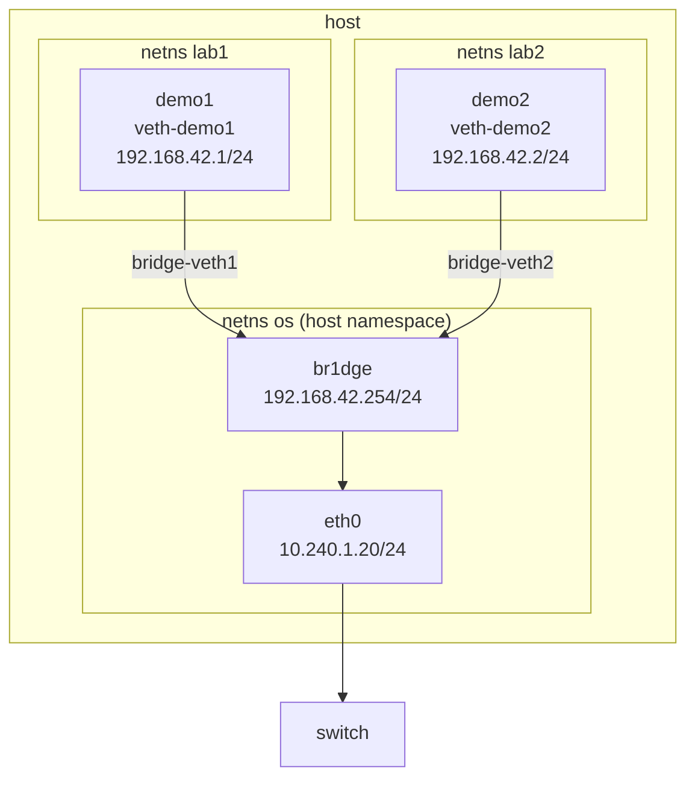
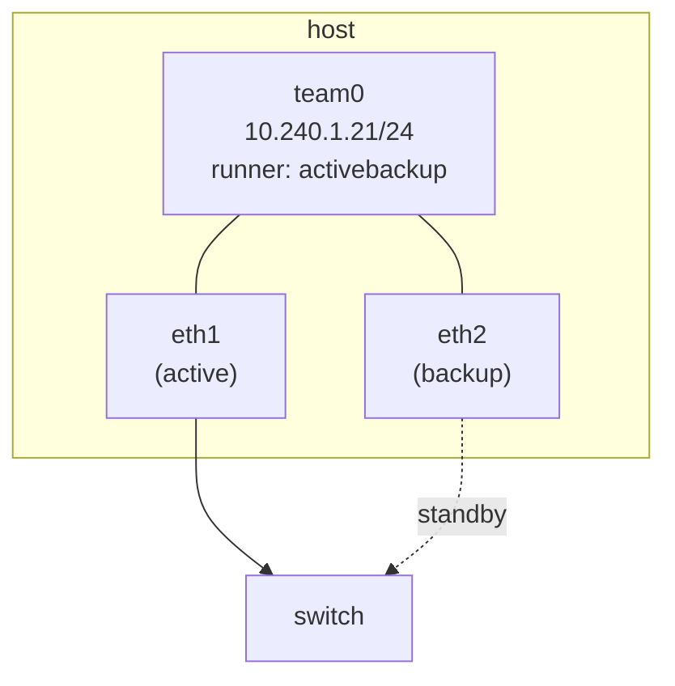
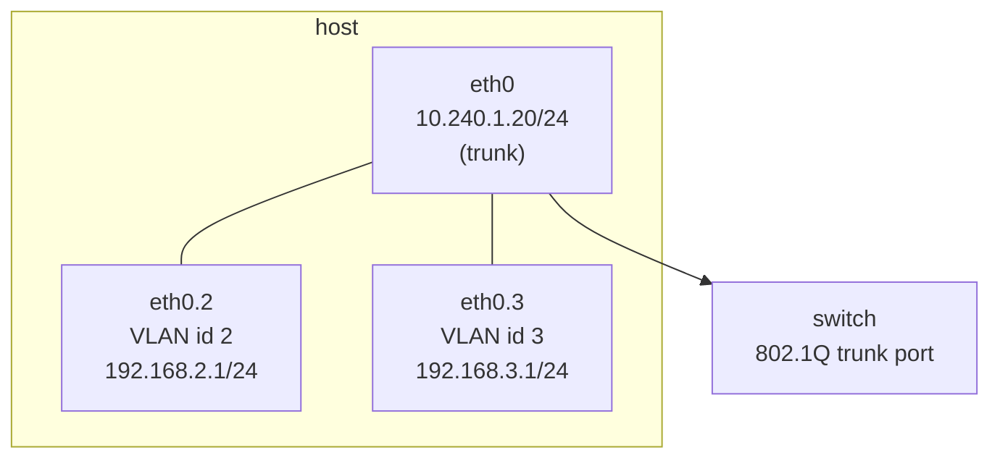
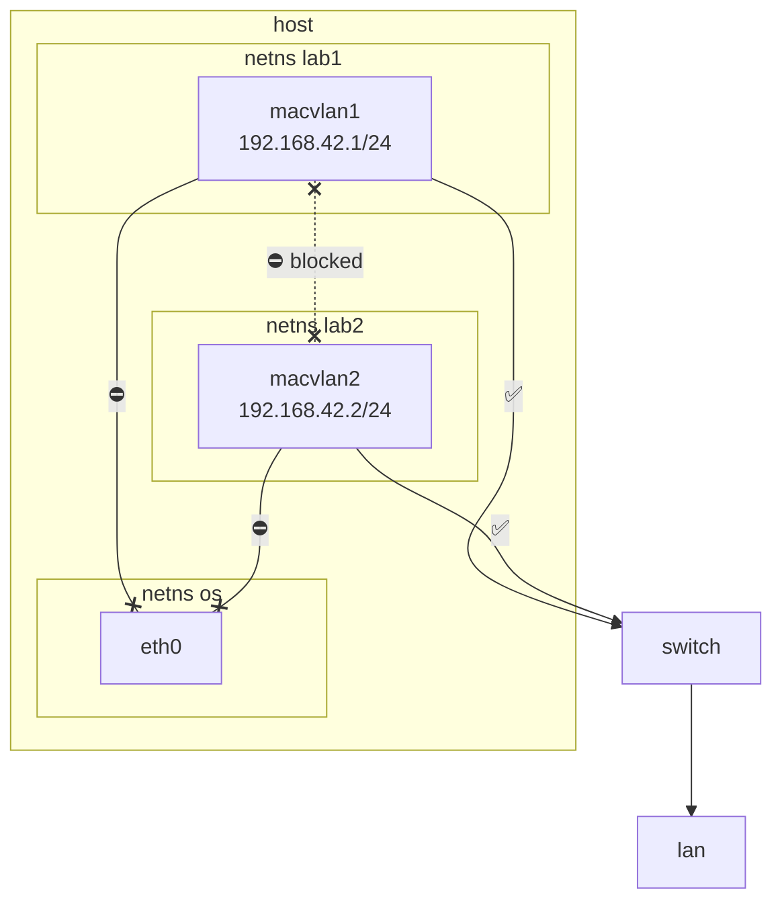
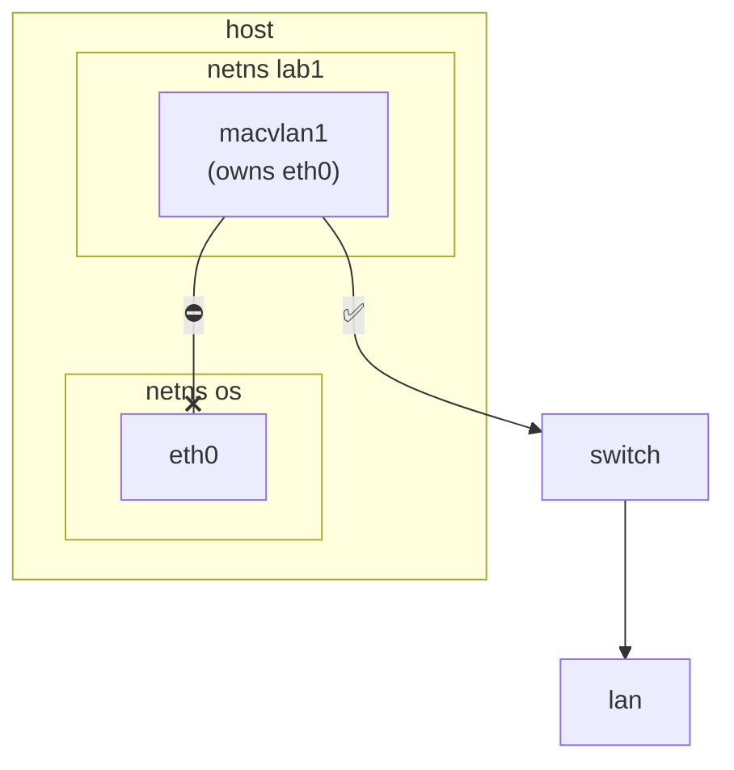

# Virtual network interfaces on Linux

## Back to Linux basics

### cgroups

Control **how much** of a resource a process may use. See
[[linux/boot/systemd#Control groups]].

### Namespaces

Limit **what a process can see**. Linux has these namespace types:

| Namespace | What it isolates |
| --- | --- |
| **pid** | a process in a pid namespace sees only the processes of that namespace |
| **net** | a process can be given a complete IP stack: virtual interfaces, routing table and netfilter rules |
| **mnt** | a filesystem can be attached to a process |
| **uts** | a process can be given a hostname different from the host system |
| **ipc** | interprocess communication — isolates shared memory pages |
| **user** | holds a mapping between UIDs/GIDs as seen by the process and by the host |
| **cgroup** | isolates the view of the cgroup hierarchy (Linux 4.6+) |
| **time** | isolates the system clock offsets (Linux 5.6+) |

### Why this matters

Thanks to namespaces a guest system — container or machine — can be given a
network of its very own. That is what the rest of this page demonstrates.

## Virtual interface types

Since we are working in purely software namespaces, we deal in virtual interfaces.

### Bridge

A bridge works like a switch: it forwards packets between the interfaces attached
to it, so it is **L2 by default**.

It supports STP, VLAN (Virtual Local Area Network), snooping and multicast.

Here is what we are going to build — worth coming back to as you work through the
steps:



> [!example] Hands-on

Create two **network namespaces**, each of which will hold one embryonic
container:

```console
$ ip netns add lab1
$ ip netns add lab2
$ ip netns list
lab2
lab1
```

Now create two `veth` pairs. One end will live in the namespace, the other will
attach to our future bridge:

```console
$ ip link add veth-demo1 type veth peer name bridge-veth1
$ ip link add veth-demo2 type veth peer name bridge-veth2
$ ip link list
1: lo: <LOOPBACK,UP,LOWER_UP> mtu 65536 qdisc noqueue state UNKNOWN mode DEFAULT group default qlen 1000
    link/loopback 00:00:00:00:00:00 brd 00:00:00:00:00:00
2: eth0: <BROADCAST,MULTICAST,UP,LOWER_UP> mtu 1500 qdisc pfifo_fast state UP mode DEFAULT group default qlen 1000
    link/ether 00:50:56:88:de:56 brd ff:ff:ff:ff:ff:ff
    altname enp11s0
    altname ens192
3: bridge-veth1@veth-demo1: <BROADCAST,MULTICAST,M-DOWN> mtu 1500 qdisc noop state DOWN mode DEFAULT group default qlen 1000
    link/ether 0e:1b:a3:c5:7c:de brd ff:ff:ff:ff:ff:ff
4: veth-demo1@bridge-veth1: <BROADCAST,MULTICAST,M-DOWN> mtu 1500 qdisc noop state DOWN mode DEFAULT group default qlen 1000
    link/ether 4e:e9:82:9a:b6:24 brd ff:ff:ff:ff:ff:ff
5: bridge-veth2@veth-demo2: <BROADCAST,MULTICAST,M-DOWN> mtu 1500 qdisc noop state DOWN mode DEFAULT group default qlen 1000
    link/ether fa:15:ec:22:25:c9 brd ff:ff:ff:ff:ff:ff
6: veth-demo2@bridge-veth2: <BROADCAST,MULTICAST,M-DOWN> mtu 1500 qdisc noop state DOWN mode DEFAULT group default qlen 1000
    link/ether a6:1f:a0:b5:b6:28 brd ff:ff:ff:ff:ff:ff
```

The interfaces exist but are `down`. Move one end of each pair into its namespace:

```console
$ ip link set veth-demo1 netns lab1
$ ip link set veth-demo2 netns lab2
$ ip link list
1: lo: <LOOPBACK,UP,LOWER_UP> mtu 65536 qdisc noqueue state UNKNOWN mode DEFAULT group default qlen 1000
    link/loopback 00:00:00:00:00:00 brd 00:00:00:00:00:00
2: eth0: <BROADCAST,MULTICAST,UP,LOWER_UP> mtu 1500 qdisc pfifo_fast state UP mode DEFAULT group default qlen 1000
    link/ether 00:50:56:88:de:56 brd ff:ff:ff:ff:ff:ff
3: bridge-veth1@if4: <BROADCAST,MULTICAST> mtu 1500 qdisc noop state DOWN mode DEFAULT group default qlen 1000
    link/ether 0e:1b:a3:c5:7c:de brd ff:ff:ff:ff:ff:ff link-netns lab1
5: bridge-veth2@if6: <BROADCAST,MULTICAST> mtu 1500 qdisc noop state DOWN mode DEFAULT group default qlen 1000
    link/ether fa:15:ec:22:25:c9 brd ff:ff:ff:ff:ff:ff link-netns lab2
```

The `veth-demo*` interfaces have disappeared — expected, since they are no longer
in our network namespace. To see them, run the command *inside* the namespace:

```console
$ ip netns exec lab1 ip link
1: lo: <LOOPBACK> mtu 65536 qdisc noop state DOWN mode DEFAULT group default qlen 1000
    link/loopback 00:00:00:00:00:00 brd 00:00:00:00:00:00
4: veth-demo1@if3: <BROADCAST,MULTICAST> mtu 1500 qdisc noop state DOWN mode DEFAULT group default qlen 1000
    link/ether 4e:e9:82:9a:b6:24 brd ff:ff:ff:ff:ff:ff link-netnsid 0

$ ip netns exec lab2 ip link
1: lo: <LOOPBACK> mtu 65536 qdisc noop state DOWN mode DEFAULT group default qlen 1000
    link/loopback 00:00:00:00:00:00 brd 00:00:00:00:00:00
6: veth-demo2@if5: <BROADCAST,MULTICAST> mtu 1500 qdisc noop state DOWN mode DEFAULT group default qlen 1000
    link/ether a6:1f:a0:b5:b6:28 brd ff:ff:ff:ff:ff:ff link-netnsid 0
```

Networking inside the namespace is now managed independently of the host:

```console
$ ip netns exec lab1 ip address add 192.168.42.1/24 dev veth-demo1
$ ip netns exec lab1 ip link set veth-demo1 up
$ ip netns exec lab1 ip a show veth-demo1
4: veth-demo1@if3: <NO-CARRIER,BROADCAST,MULTICAST,UP> mtu 1500 qdisc noqueue state LOWERLAYERDOWN group default qlen 1000
    link/ether 4e:e9:82:9a:b6:24 brd ff:ff:ff:ff:ff:ff link-netnsid 0
    inet 192.168.42.1/24 scope global veth-demo1
       valid_lft forever preferred_lft forever

$ ip netns exec lab2 ip address add 192.168.42.2/24 dev veth-demo2
$ ip netns exec lab2 ip link set veth-demo2 up
```

Note the state is `LOWERLAYERDOWN` — the peer end is still down, so there is no
carrier yet.

Create the bridge that will link the namespaces:

```console
$ ip link add name br1dge type bridge
$ ip link set br1dge up
```

> [!note] Why `br1dge` and not `bridge`
> Purely to avoid confusion with the `bridge` command used later. Any name works.

At this point we have:

- a `veth` in namespace `lab1`, and one in namespace `lab2`
- an IP address on each namespace's `veth`
- a bridge on the host

The last step is to attach the other end of each virtual cable to the bridge:

```console
$ ip link set bridge-veth1 up
$ ip link set bridge-veth2 up
$ ip link set bridge-veth1 master br1dge
$ ip link set bridge-veth2 master br1dge

$ bridge link show br1dge
3: bridge-veth1@if4: <BROADCAST,MULTICAST,UP,LOWER_UP> mtu 1500 master br1dge state forwarding priority 32 cost 2
5: bridge-veth2@if6: <BROADCAST,MULTICAST,UP,LOWER_UP> mtu 1500 master br1dge state forwarding priority 32 cost 2
```

Check the work:

```console
$ ip netns exec lab1 ping -c 2 192.168.42.2
PING 192.168.42.2 (192.168.42.2) 56(84) bytes of data.
64 bytes from 192.168.42.2: icmp_seq=1 ttl=64 time=0.031 ms
64 bytes from 192.168.42.2: icmp_seq=2 ttl=64 time=0.045 ms

--- 192.168.42.2 ping statistics ---
2 packets transmitted, 2 received, 0% packet loss, time 1022ms

$ ip netns exec lab1 ping -c 2 10.240.1.20
ping: connect: Network is unreachable

$ ping -c 2 192.168.42.1
PING 192.168.42.1 (192.168.42.1) 56(84) bytes of data.

--- 192.168.42.1 ping statistics ---
2 packets transmitted, 0 received, 100% packet loss, time 1001ms
```

So the namespaces can talk to each other through the bridge, but not to the host,
and not to the outside.

One step at a time. First give the bridge an IP address, so the host can reach the
namespaces attached to it:

```console
$ ip addr add 192.168.42.254/24 brd + dev br1dge

$ ping -c 2 192.168.42.1
PING 192.168.42.1 (192.168.42.1) 56(84) bytes of data.
64 bytes from 192.168.42.1: icmp_seq=1 ttl=64 time=0.180 ms
64 bytes from 192.168.42.1: icmp_seq=2 ttl=64 time=0.061 ms

--- 192.168.42.1 ping statistics ---
2 packets transmitted, 2 received, 0% packet loss, time 1002ms
```

A first victory: the host can now reach the namespaces via the bridge. The host now
has an address on the namespaces' network, so it is one more machine on that switch.
The bridge itself still only switches frames; no routing is involved.

> [!note] The address does not make the bridge a router
> The host's IP stack answers on the bridge, and this works with `net.ipv4.ip_forward`
> set to `0`. The host routes only when it forwards packets between interfaces, for
> example to the outside with masquerading.

The only thing still missing for outbound traffic is a default route:

```console
$ ip netns exec lab1 ip route
192.168.42.0/24 dev veth-demo1 proto kernel scope link src 192.168.42.1

$ ip netns exec lab1 ip route add default dev veth-demo1
$ ip netns exec lab2 ip route add default dev veth-demo2

$ ip netns exec lab1 ip route
default dev veth-demo1 scope link
192.168.42.0/24 dev veth-demo1 proto kernel scope link src 192.168.42.1

$ ip netns exec lab1 ping -c 2 10.240.1.20
PING 10.240.1.20 (10.240.1.20) 56(84) bytes of data.
64 bytes from 10.240.1.20: icmp_seq=1 ttl=64 time=0.067 ms
64 bytes from 10.240.1.20: icmp_seq=2 ttl=64 time=0.043 ms

--- 10.240.1.20 ping statistics ---
2 packets transmitted, 2 received, 0% packet loss, time 1002ms
```

Going further is outside the scope of this page: to genuinely reach beyond the
host you must either publish return routes into your infrastructure, or enable IP
masquerading on the host — see iptables. But you should now have a
much better feel for how bridge mode works.

> [!tip] Cleaning up
> Deleting a namespace destroys the interfaces inside it, and deleting one end of
> a `veth` pair deletes both:
> `ip netns del lab1; ip netns del lab2; ip link del br1dge`

### veth

Two namespaces can also be wired directly to each other, with no bridge in
between:

```bash
ip link add veth-demo1 netns lab1 type veth peer name veth-demo2 netns lab2
```

### Team

Teaming groups network interfaces into one logical interface at L2, like a bond.

> [!warning] Use a bond, not a team
> Red Hat deprecated teaming in RHEL 9 and removed it in RHEL 10, and the kernel's
> bonding driver is the maintained option. See [[linux/networking/nmcli#Bonds]] for
> bonds with `nmcli`. This section stays for existing systems.



> [!example] Hands-on

```console
$ zypper install -y libteam-tools libteamdctl0

$ nmcli con add type team con-name team0 ifname team0 \
    config '{"runner": {"name": "activebackup"},"link_watch": {"name": "ethtool"}}' \
    ip4 10.240.1.21/24
$ nmcli con add type team-slave con-name team0-eth1 ifname eth1 master team0
$ nmcli con add type team-slave con-name team0-eth2 ifname eth2 master team0

$ teamdctl team0 state
setup:
  runner: activebackup
ports:
  eth1
    link watches:
      link summary: up
      instance[link_watch_0]:
        name: ethtool
        link: up
        down count: 0
  eth2
    link watches:
      link summary: up
      instance[link_watch_0]:
        name: ethtool
        link: up
        down count: 0
runner:
  active port: eth1

$ ping -c 2 -I team0 10.240.1.254
PING 10.240.1.254 (10.240.1.254) from 10.240.1.21 team0: 56(84) bytes of data.
64 bytes from 10.240.1.254: icmp_seq=1 ttl=64 time=0.397 ms
64 bytes from 10.240.1.254: icmp_seq=2 ttl=64 time=0.419 ms

--- 10.240.1.254 ping statistics ---
2 packets transmitted, 2 received, 0% packet loss, time 1005ms
```

Available runners are `broadcast`, `roundrobin`, `activebackup`, `loadbalance`
and `lacp`.

> [!warning] `teamd` is deprecated
> Red Hat deprecated the teaming driver in RHEL 9 and recommends moving back to
> `bond`, which is now the better-maintained of the two. For new deployments prefer
> `nmcli con add type bond`. Leap 16's NetworkManager cannot bring a team up, so only
> the profile creation above is tested.

### VLAN

A VLAN interface can be thought of as a sub-interface: it carries the IP address
and the VLAN ID. VLAN IDs go from 1 to 4094, so a parent can carry up to 4094 of
them.



> [!example] Hands-on

```console
$ nmcli connection add type vlan con-name eth0.2 ifname eth0.2 dev eth0 id 2 ip4 192.168.2.1/24
Connection 'eth0.2' (77fda624-a0f9-483a-9e51-32bac1ce648e) successfully added.
$ nmcli connection add type vlan con-name eth0.3 ifname eth0.3 dev eth0 id 3 ip4 192.168.3.1/24
Connection 'eth0.3' (a9a3cd17-dd03-4242-a859-81df0840c6d7) successfully added.

$ nmcli con
NAME                UUID                                  TYPE      DEVICE
eth0                7ba00b1d-8cdd-30da-91ad-bb83ed4f7474  ethernet  eth0
eth0.2              77fda624-a0f9-483a-9e51-32bac1ce648e  vlan      eth0.2
eth0.3              a9a3cd17-dd03-4242-a859-81df0840c6d7  vlan      eth0.3

$ ip a
2: eth0: <BROADCAST,MULTICAST,UP,LOWER_UP> mtu 1500 qdisc pfifo_fast state UP group default qlen 1000
    link/ether 00:50:56:88:de:56 brd ff:ff:ff:ff:ff:ff
    inet 10.240.1.20/24 brd 10.240.1.255 scope global noprefixroute eth0
4: eth0.2@eth0: <BROADCAST,MULTICAST,UP,LOWER_UP> mtu 1500 qdisc noqueue state UP group default qlen 1000
    link/ether 00:50:56:88:de:56 brd ff:ff:ff:ff:ff:ff
    inet 192.168.2.1/24 brd 192.168.2.255 scope global noprefixroute eth0.2
5: eth0.3@eth0: <BROADCAST,MULTICAST,UP,LOWER_UP> mtu 1500 qdisc noqueue state UP group default qlen 1000
    link/ether 00:50:56:88:de:56 brd ff:ff:ff:ff:ff:ff
    inet 192.168.3.1/24 brd 192.168.3.255 scope global noprefixroute eth0.3
```

Note all three interfaces share the parent's MAC address — that is the defining
difference from MACVLAN below.

### MACVLAN

MACVLAN gives each virtual interface **its own MAC address** on the parent's
network segment. There are five modes:

1. Private
2. VEPA
3. Bridge
4. Passthru
5. Source

> [!warning] The switch must accept multiple MACs per port
> Every MACVLAN interface presents a new MAC on the same physical port. Switches
> with port security, or a MAC-per-port limit, will drop the traffic or disable the
> port. This is the single most common reason MACVLAN "doesn't work".

#### Private

Does not allow communication between the network namespaces, even with hairpin
mode enabled.



> [!example] Hands-on

One creation example — the other modes work the same way, only `mode` changes.

```console
$ nmcli connection add type macvlan mode private dev eth1 con-name macvlan1 \
    ifname macvlan1 ipv4.method "disabled" ipv6.method "disabled" connection.autoconnect true
$ nmcli connection add type macvlan mode private dev eth1 con-name macvlan2 \
    ifname macvlan2 ipv4.method "disabled" ipv6.method "disabled" connection.autoconnect true
$ nmcli connection up macvlan1
$ nmcli connection up macvlan2

$ ip link set macvlan1 netns lab1
$ ip link set macvlan2 netns lab2

$ ip netns exec lab1 ip address add 192.168.42.1/24 dev macvlan1
$ ip netns exec lab1 ip link set macvlan1 up
$ ip netns exec lab1 ip a show macvlan1
4: macvlan1@if3: <BROADCAST,MULTICAST,UP,LOWER_UP> mtu 1500 qdisc noqueue state UP group default qlen 1000
    link/ether ca:1b:f2:66:39:49 brd ff:ff:ff:ff:ff:ff link-netnsid 0
    inet 192.168.42.1/24 scope global macvlan1
       valid_lft forever preferred_lft forever

$ ip netns exec lab2 ip address add 192.168.42.2/24 dev macvlan2
$ ip netns exec lab2 ip link set macvlan2 up
```

To expose services locally, or even to ping the namespace's own address, you must
bring up its `lo` interface:

```console
$ ip netns exec lab2 ping -c 2 192.168.42.2
PING 192.168.42.2 (192.168.42.2) 56(84) bytes of data.

--- 192.168.42.2 ping statistics ---
2 packets transmitted, 0 received, 100% packet loss, time 1022ms

$ ip netns exec lab2 ip link set lo up
$ ip netns exec lab2 ping -c 2 192.168.42.2
PING 192.168.42.2 (192.168.42.2) 56(84) bytes of data.
64 bytes from 192.168.42.2: icmp_seq=1 ttl=64 time=0.039 ms
64 bytes from 192.168.42.2: icmp_seq=2 ttl=64 time=0.015 ms

--- 192.168.42.2 ping statistics ---
2 packets transmitted, 2 received, 0% packet loss, time 1005ms
```

And this confirms the defining behaviour — two namespaces on the *same* subnet
that still cannot reach each other:

```console
$ ip netns exec lab2 ping -c 2 192.168.42.1
PING 192.168.42.1 (192.168.42.1) 56(84) bytes of data.
From 192.168.42.2 icmp_seq=1 Destination Host Unreachable
From 192.168.42.2 icmp_seq=2 Destination Host Unreachable

--- 192.168.42.1 ping statistics ---
2 packets transmitted, 0 received, +2 errors, 100% packet loss, time 1020ms
pipe 2
```

#### VEPA

Packets are sent out through the physical interface to be processed. The switching
or routing decision is taken *outside* the host. Switching between namespaces on
the same host is only possible if the switch supports **hairpin mode** — sending a
frame back out of the port it arrived on.

#### Bridge

The mode you most often actually want: the kernel switches frames between MACVLAN
interfaces on the same parent directly, so namespaces *can* talk to each other
without the frames leaving the host. As with the other modes, the namespaces still
cannot talk to the parent interface's own address.

```bash
nmcli connection add type macvlan mode bridge dev eth1 con-name macvlan1 ifname macvlan1
```

#### Passthru

Gives a single VM or container direct access to the physical interface. Only one
MACVLAN interface may exist on the parent, and it may change the MAC address —
which is what makes it suitable for handing a NIC to a guest wholesale.



#### Source

The interface receives only the frames whose source MAC address is in its list.
This splits clients on one segment into groups by MAC address, without VLAN tags.
Useful when the clients cannot tag frames, or when the switch cannot be modified.

```bash
ip link add link eth0 name macvlan0 type macvlan mode source
ip link add link eth0 name macvlan1 type macvlan mode source
ip link set link dev macvlan0 type macvlan macaddr add 00:11:11:11:11:11
ip link set link dev macvlan0 type macvlan macaddr add 00:22:22:22:22:22
ip link set link dev macvlan1 type macvlan macaddr add 00:33:33:33:33:33
ip link set link dev macvlan1 type macvlan macaddr add 00:44:44:44:44:44
```

Frames from `00:11:11:11:11:11` and `00:22:22:22:22:22` arrive on `macvlan0`, and
frames from the two other addresses on `macvlan1`.

### IPVLAN

IPVLAN works like MACVLAN, except that all network namespaces are given **the
same MAC address**. That makes it the answer when the switch limits MACs per port,
or when a wireless interface — which cannot carry multiple MACs — is the parent.

| Mode | Behaviour |
| --- | --- |
| **L2** | Forwarding and switching happen in the namespace's stack, then out via the host interface to the switch if needed. Namespaces can send and receive multicast and broadcast. Behaves much like a bridge. |
| **L3** | Forwarding happens up to L3 in the namespace's stack, which acts as a router, then is switched and routed on the host interface. Namespaces **cannot** send or receive multicast or broadcast. |
| **L3S** | As L3, plus connection tracking for iptables — which therefore only works in this mode. |

```bash
ip link add link eth0 name ipvlan1 type ipvlan mode l2
```

<!-- uplink -->
Part of [[linux/networking/index|Linux networking]].
