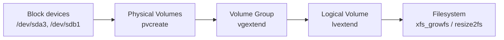

# Extending LVM volumes on a VM

One of the main advantages of virtual machines is flexible "virtual hardware" —
you can add and remove devices at will. Storage is the awkward part: growing a
disk online still requires a filesystem or volume manager that supports it, just
as on physical hardware. LVM solves that.

This walks through growing a logical volume after adding a new virtual disk, or
after expanding an existing one, without a reboot.

LVM has three layers, and you work through them in order:



## 1. Find the new disk

```console
$ cat /proc/partitions
major minor  #blocks  name

   8        0   20971520 sda
   8        1      96256 sda1
   8        2       1024 sda2
   8        3   20872192 sda3
   8       16     104448 sdb
  11        0     227328 sr0
 254        0   14647296 dm-0
 254        1     999424 dm-1
```

`/dev/sdb` is new — this system originally had only `sda`.

> [!tip] If the new disk does not appear
> A hot-added disk may need a SCSI rescan before the kernel sees it:
> `echo "- - -" > /sys/class/scsi_host/host0/scan`. For a disk that was *expanded*
> rather than added, rescan the device instead:
> `echo 1 > /sys/block/sdb/device/rescan`.

## 2. Partition it

GPT is worth using consistently, which means `parted` rather than `fdisk`/`cfdisk`:

```bash
parted /dev/sdb
```

```text
(parted) mklabel gpt
(parted) mkpart primary 0% 100%
(parted) set 1 lvm on
(parted) print
(parted) quit
```

Or non-interactively:

```bash
parted -s /dev/sdb mklabel gpt
parted -s /dev/sdb mkpart primary 0% 100%
parted -s /dev/sdb set 1 lvm on
```

Confirm the partition exists:

```console
$ cat /proc/partitions | grep sdb
   8       16     104448 sdb
   8       17     104432 sdb1
```

## 3. Create the physical volume

List the physical volumes and their sizes:

```console
$ pvs
  PV         VG     Fmt  Attr PSize  PFree
  /dev/sda3  system lvm2 a--  19.90g 4.98g
```

There is only one, so initialise the new partition:

```console
$ pvcreate /dev/sdb1
  Physical volume "/dev/sdb1" successfully created.
```

## 4. Extend the volume group

`pvs` now shows the new PV with no VG attached. Extend the volume group onto it:

```console
$ pvs
  PV         VG     Fmt  Attr PSize   PFree
  /dev/sda3  system lvm2 a--   19.90g   4.98g
  /dev/sdb1         lvm2 a--  101.98m 101.98m

$ vgextend system /dev/sdb1
  Volume group "system" successfully extended
```

`pvdisplay` gives the detail, including the extent counts:

```console
$ pvdisplay
  --- Physical volume ---
  PV Name               /dev/sda3
  VG Name               system
  PV Size               19.91 GiB / not usable 3.00 MiB
  Allocatable           yes
  PE Size               4.00 MiB
  Total PE              5095
  Free PE               1275
  Allocated PE          3820
  PV UUID               cM2AqP-uMVZ-VmWD-2Tyf-zZym-dnHn-pcqUOF

  --- Physical volume ---
  PV Name               /dev/sdb1
  VG Name               system
  PV Size               101.98 MiB / not usable 1.98 MiB
  Allocatable           yes
  PE Size               4.00 MiB
  Total PE              25
  Free PE               25
  Allocated PE          0
  PV UUID               B7aa5Q-6brP-7hrS-MUvt-SDCV-M03z-DDtSe7
```

## 5. Extend the logical volume

```console
$ lvextend -L+10M /dev/mapper/system-root
  Rounding size to boundary between physical extents: 12.00 MiB.
  Size of logical volume system/root changed from 13.97 GiB (3576 extents) to 13.98 GiB (3579 extents).
  Logical volume system/root successfully resized.
```

| Argument | Meaning |
| --- | --- |
| `-L` | grow by a size rather than by a count of physical extents |
| `+10M` | add 10 megabytes — suffixes `M`, `G`, `T`, `P`, `E` |
| `/dev/mapper/system-root` | absolute path to the LV to grow |

Physical extents (PE) are the fixed-size blocks LVM allocates in — 4 MiB here, as
shown by `vgdisplay`. Any size you request is rounded up to a whole number of
them, which is why 10 MiB became 12 MiB above.

To consume all remaining free space instead:

```bash
lvextend -l +100%FREE /dev/mapper/system-root
```

Verify with `lvdisplay`:

```console
$ lvdisplay
  --- Logical volume ---
  LV Path                /dev/system/root
  LV Name                root
  VG Name                system
  LV UUID                k4LoYY-5VFK-q8t0-avIY-vNtj-T95f-kLkrjg
  LV Write Access        read/write
  LV Status              available
  # open                 1
  LV Size                13.98 GiB
  Current LE             3579
  Segments               2
  Allocation             inherit
  Read ahead sectors     auto
  - currently set to     256
  Block device           254:0
```

`lvdisplay -m` additionally shows which PV each range of extents physically lives
on:

```console
$ lvdisplay -m
  --- Logical volume ---
  LV Path                /dev/system/root
  LV Size                13.99 GiB
  Current LE             3582
  Segments               2
  ...
  --- Segments ---
  Logical extents 0 to 3575:
    Type                linear
    Physical volume     /dev/sda3
    Physical extents    0 to 3575

  Logical extents 3576 to 3581:
    Type                linear
    Physical volume     /dev/sda3
    Physical extents    3820 to 3825
```

## 6. Grow the filesystem

The LV is bigger but the filesystem on it is not. For XFS:

```console
$ xfs_growfs /dev/mapper/system-root
meta-data=/dev/mapper/system-root isize=256    agcount=4, agsize=915456 blks
data     =                       bsize=4096   blocks=3661824, imaxpct=25
naming   =version 2              bsize=4096   ascii-ci=0
log      =internal               bsize=4096   blocks=2560, version=2
realtime =none                   extsz=4096   blocks=0, rtextents=0
data blocks changed from 3661824 to 3691520
```

For ext4:

```bash
resize2fs /dev/mapper/system-root
```

> [!tip] Do steps 5 and 6 in one command
> `lvextend -r` (or `--resizefs`) grows the filesystem straight after the volume,
> picking the right tool automatically:
> `lvextend -r -l +100%FREE /dev/mapper/system-root`

> [!warning] XFS cannot be shrunk
> `xfs_growfs` only grows in practice. XFS has no real shrink operation, so an
> over-provisioned XFS volume can only be reclaimed by backing up, recreating and
> restoring. ext4 can shrink, but only while unmounted.

> [!note] XFS can shrink a little
> Since Linux 5.12, `xfs_growfs -D <blocks>` can remove a little free space at the end
> of the last allocation group. It is marked experimental, and it cannot shrink across
> allocation groups, so it does not help to reclaim a large volume.

<!-- uplink -->
Part of [[linux/storage/index|Storage]].
