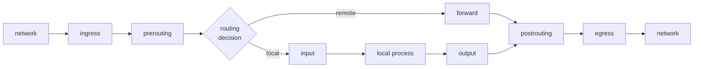

# nftables

nftables is the successor to iptables. It replaces several tools (`iptables`,
`ip6tables`, `arptables`, `ebtables`) with one `nft` command and one rule engine.
See [[networking/iptables]] for the older syntax.

## Hooks

Rules are attached to hooks in the network stack:

| Hook | When it sees the packet |
| --- | --- |
| `prerouting` | before the routing decision |
| `input` | destined for a local process |
| `forward` | traversing the router |
| `output` | originating locally, destined for a remote resource |
| `postrouting` | after the routing decision |
| `ingress` | inbound, at the device level, before `prerouting` |
| `egress` | outbound, at the device level, after `postrouting` (Linux 5.16+) |



> [!note] Hook names are lowercase in nftables
> iptables used uppercase chain names (`INPUT`, `FORWARD`). nftables hooks are
> lowercase, and *chains* are things you name yourself and attach to a hook.

## Tables, chains and rules

- A **table** holds chains, sets and maps. It has a family: `ip` (IPv4), `ip6`,
  `inet` (both), `arp`, `bridge` or `netdev`. Use `inet` for a host firewall, so one
  rule set covers IPv4 and IPv6.
- A **base chain** is attached to a hook. It has a type (`filter`, `nat` or `route`),
  a priority (lower runs first) and a policy (`accept` or `drop`) for packets that
  reach its end.
- A **regular chain** has no hook. Rules reach it with `jump` or `goto`.

Nothing exists until you create it: an empty ruleset lets every packet through.

## TL;DR

```bash
# create a table
nft add table ip filter

# list
nft list tables
nft list table ip filter
nft list ruleset

# empty a table, then delete it
nft flush table ip filter
nft delete table ip filter

# remove everything, in every table
nft flush ruleset
```

## A host firewall

A complete ruleset for a server: drop what is not allowed, keep replies to
connections the host opened, allow SSH and HTTPS, and let ping through at a limited
rate.

```nft
#!/usr/sbin/nft -f
flush ruleset

table inet filter {
    set trusted {
        type ipv4_addr
        flags interval
        elements = { 10.0.0.0/8, 192.168.0.0/16 }
    }

    chain input {
        type filter hook input priority filter; policy drop;

        # before the ct rule: the pings after the first are "established"
        icmp type echo-request limit rate over 10/second drop
        icmpv6 type echo-request limit rate over 10/second drop

        ct state established,related accept
        ct state invalid drop
        iif lo accept

        tcp dport 22 ip saddr @trusted accept
        tcp dport 443 accept
        meta l4proto { icmp, ipv6-icmp } accept

        counter limit rate 5/minute log prefix "nft-drop: "
    }

    chain forward {
        type filter hook forward priority filter; policy drop;
    }
}
```

Check the file, then load it. `-c` parses and checks without changing anything. Loading
with `-f` is atomic: either the whole file applies, or none of it.

```bash
nft -c -f /etc/nftables/rules/main.nft
nft -f /etc/nftables/rules/main.nft
```

> [!warning] Load a firewall from a console, not over SSH alone
> A mistake in the `input` chain can cut your SSH session. Keep a second session or
> a console open, or schedule a rollback first: `echo 'nft flush ruleset' | at now + 5 minutes`.

`flush ruleset` at the top matters. Without it, loading the file twice adds every rule
twice.

Rule order matters too. Connection tracking treats all the echo requests of one `ping`
as one flow, so after the first one they are `established`. A limit placed after the
`ct state` rule would only limit new pings, not the packets of a flood. So the limits
come first, as `limit rate over ... drop`.

## Prerequisites

Install the `nftables` and `conntrack-tools` packages. The kernel's connection
tracking is what makes stateful rules (`ct state established`) possible;
`conntrack-tools` gives you the `conntrack` command to look at it
(`conntrack -L`).

Private IPv4 ranges worth knowing when writing rules:

| Range | Notes |
| --- | --- |
| `10.0.0.0/8` | RFC 1918 private |
| `172.16.0.0/12` | RFC 1918 private |
| `192.168.0.0/16` | RFC 1918 private |
| `100.64.0.0/10` | RFC 6598 shared address space (carrier-grade NAT) |
| `127.0.0.0/8` | loopback |
| `169.254.0.0/16` | link-local |
| `224.0.0.0/4` | multicast (historically class D) |
| `240.0.0.0/4` | reserved (historically class E) |

Enable routing if you need it:

```bash
# for the running system
sysctl -w net.ipv4.ip_forward=1

# persistently
cat > /etc/sysctl.d/net-forward.conf <<'EOF'
net.ipv4.ip_forward = 1
net.ipv6.conf.all.forwarding = 1
EOF
sysctl --system
```

### iptables and firewalld

Only one tool should own the firewall.

- **The `iptables` command today is usually iptables-nft.** `iptables -V` shows
  `(nf_tables)`. Its rules are nftables rules, in tables named `ip filter`, `ip nat`
  and so on: `nft list ruleset` shows them. So there is no second firewall to turn
  off, but a `flush ruleset` also removes rules that Docker, libvirt or Kubernetes
  added with `iptables`.
- **firewalld** is the default firewall on openSUSE, SUSE and RHEL, and it also
  writes nftables rules. If you manage nftables by hand, stop it:
  `systemctl disable --now firewalld`.

> [!note] No `iptables.service`
> There is no `iptables.service` unit on openSUSE Leap 16 or a default RHEL install:
> it comes only from the old `iptables-services` package.

## Actions

| Action | Terminal | Behaviour |
| --- | --- | --- |
| `accept` | yes | accept the packet. It may still be dropped by a later *chain* |
| `drop` | yes | discard the packet immediately, silently |
| `reject` | yes | discard and send an error back: ICMP by default, `reject with tcp reset` for TCP |
| `queue` | yes | hand the packet to userspace |
| `continue` | no | go on with the next rule, as a rule with no verdict does |
| `return` | no | leave this chain and resume in the calling chain |
| `jump <chain>` | no | enter another chain; a `return` comes back here |
| `goto <chain>` | no | enter another chain and never come back |
| `log` | no | log the packet and keep evaluating |

When a packet reaches the end of a base chain, the chain's policy decides. At the end
of a regular chain, evaluation goes back to the rule after the `jump`.

> [!note] `return` and `goto`
> `return` goes back to the rule *following* the `jump` that entered the current
> chain. The distinction between `jump` (returns) and `goto` (does not) is the one to
> remember.

> [!note] `accept` is only terminal within its chain
> A packet accepted in one base chain is still evaluated by base chains on later
> hooks, and by other base chains on the same hook. A `drop` anywhere is final.
> This differs from iptables, where `ACCEPT` in a built-in chain ended processing for
> that table.

## Sets and maps

A set is a list to match against. Anonymous sets are written inline; named sets can be
changed without touching the rules that use them:

```bash
nft add rule inet filter input tcp dport { 80, 443 } accept
nft add element inet filter trusted { 172.16.5.0/24 }
nft delete element inet filter trusted { 172.16.5.0/24 }
```

A set with a timeout forgets its elements. That makes a simple ban list:

```bash
nft add set inet filter banned '{ type ipv4_addr; flags timeout; timeout 1h; }'
nft insert rule inet filter input ip saddr @banned drop
nft add element inet filter banned { 203.0.113.7 }
```

A verdict map chooses the action from a value, in one lookup:

```bash
nft add chain inet filter web
nft add chain inet filter ssh
nft add rule inet filter input tcp dport vmap { 80 : jump web, 443 : jump web, 22 : jump ssh }
```

## NAT

Masquerade traffic from a private network going out of `eth0`, and forward a port to
an inside host. NAT chains need their own table and `type nat` chains:

```nft
table ip nat {
    chain prerouting {
        type nat hook prerouting priority dstnat;
        iif eth0 tcp dport 8080 dnat to 192.168.1.10:80
    }
    chain postrouting {
        type nat hook postrouting priority srcnat;
        oif eth0 ip saddr 192.168.1.0/24 masquerade
    }
}
```

The `forward` chain of the host firewall above has `policy drop`, so forwarded traffic
also needs rules there, and `net.ipv4.ip_forward=1`.

## Changing rules in place

Every rule has a handle. `-a` shows it, and `delete` and `insert` use it:

```bash
nft -a list chain inet filter input
nft delete rule inet filter input handle 7
nft insert rule inet filter input position 4 tcp dport 8443 accept
```

`add` appends to the end of the chain, `insert` puts the rule first, or before the
rule with the given handle.

## Persistence

Each distribution's `nftables.service` loads a different file:

| Distribution | File the service loads |
| --- | --- |
| openSUSE Leap 16, SUSE | `/etc/nftables/rules/main.nft` |
| RHEL, Rocky, Fedora | `/etc/sysconfig/nftables.conf` |
| Debian, Ubuntu | `/etc/nftables.conf` (not tested here: no Debian test system) |

On Leap:

```bash
mkdir -p /etc/nftables/rules
echo 'flush ruleset' > /etc/nftables/rules/main.nft
nft list ruleset >> /etc/nftables/rules/main.nft
systemctl enable --now nftables.service
```

> [!tip] Which file does the service load?
> `systemctl cat nftables.service` shows it. On Leap the service runs only if
> `main.nft` exists, and never reads `/etc/nftables.conf`.

## Monitoring

Watch all events:

```bash
nft monitor
```

Chain events as JSON:

```bash
nft -j monitor chains
```

All ruleset events — chains, rules, sets, counters and quotas:

```bash
nft monitor ruleset
```

Count what a rule matches with `counter`, and follow one packet through every chain
with a trace. `insert`, not `add`: appended after the firewall's own
`tcp dport 443 accept`, the counting rule would never see a packet.

```bash
nft insert rule inet filter input tcp dport 443 counter accept
nft add chain inet filter trace_in '{ type filter hook prerouting priority -350; }'
nft add rule inet filter trace_in tcp dport 443 meta nftrace set 1
nft monitor trace
```

<!-- uplink -->
Part of [[networking/index|Networking]].
