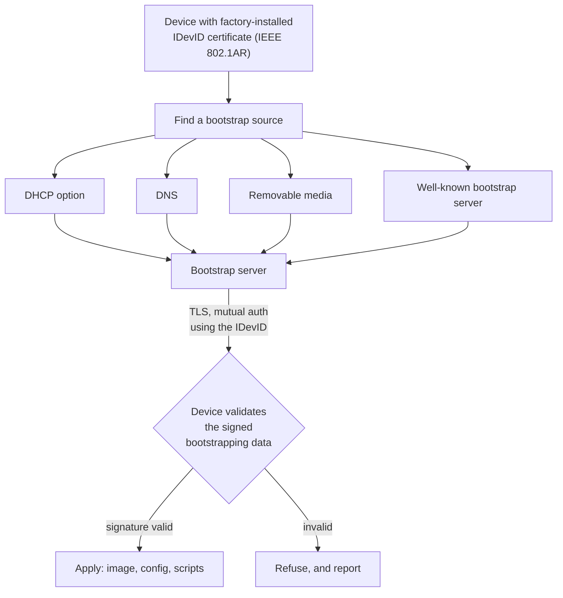

# Secure Zero Touch Provisioning

A new device arrives, is racked, and needs its configuration. The traditional answer
is DHCP: the device broadcasts, gets an address and an option pointing at a
configuration server, downloads a file, and applies it.

That works, and it is completely unauthenticated.

> [!note] Not tested locally
> A concept note: it has no commands or configuration to run.

## What is wrong with the DHCP model

> [!danger] Anything on the segment can answer a DHCP request
> A rogue DHCP server that replies faster than the legitimate one supplies its own
> option 66/67, and the device fetches and applies **that** configuration — usually
> over TFTP, with no integrity check and no encryption.
>
> The device has no way to tell the difference. It has no prior knowledge of what a
> legitimate answer looks like, so it trusts the first plausible one. The result is a
> newly provisioned device running an attacker's configuration, at the moment it has
> the least monitoring on it.
>
> This is the same class of problem as
> [[security/boot-integrity/secure-boot|unsigned boot code]]: the thing being loaded
> is trusted purely because of where it appeared to come from.

The related weaknesses: TFTP has no authentication or encryption at all, the
configuration frequently contains credentials, and there is no mutual authentication —
the *server* also cannot verify the device is what it claims to be.

## What SZTP changes

[RFC 8572](https://www.rfc-editor.org/rfc/rfc8572.html) defines Secure Zero Touch
Provisioning. The core idea is that the device ships with cryptographic identity from
the factory, and every artifact it consumes is signed.

The pieces that matter:

| Element | Role |
| --- | --- |
| **IDevID** | An IEEE 802.1AR initial device identifier — a manufacturer-installed certificate and key, unique per device |
| **Ownership voucher** | A signed artifact from the manufacturer stating who owns this serial number |
| **Signed bootstrapping data** | The image, configuration and scripts, signed by the owner |
| **Bootstrap server** | Serves the above over TLS, authenticating the device by its IDevID |

Two properties follow, and both are absent from the DHCP model:

- **The device authenticates the configuration.** It verifies the owner's signature
  before applying anything, so an untrusted source is rejected outright.
- **The server authenticates the device.** Mutual TLS with the IDevID means a device
  that is not genuinely yours does not receive your configuration and credentials.

The **ownership voucher** ([RFC 8366](https://www.rfc-editor.org/rfc/rfc8366.html)) is the key part: it lets a device that has never seen
your infrastructure establish that you are its rightful owner, using a chain rooted at
the manufacturer. That closes the bootstrapping problem — how does a device know who
to trust the first time it powers on — without any pre-staging.

## Where it is used

Primarily network equipment — routers and switches — where the vendors implement it,
and increasingly in telecommunications and edge deployments where devices are
installed by people who are not network engineers and should not have credentials.

It has not displaced PXE for general server provisioning, where the assumption is
usually a physically controlled datacentre network.

> [!important] The relevant question is whether the provisioning network is trusted
> PXE and DHCP are fine when the segment is genuinely controlled and monitored. They
> are not fine at a remote site, at a customer's premises, or anywhere the installer
> is a third party.
>
> That is the same reasoning as [[security/boot-integrity/remote-attestation]] — both
> exist for the case where you do not physically control the hardware, and both solve
> it by moving trust to something cryptographic rather than something topological.

## If you cannot use SZTP

Most server estates cannot, because the tooling assumes PXE. Mitigations that are
worth the effort:

- **DHCP snooping** on the access switches, so only authorised ports may answer.
- **HTTPS rather than TFTP** for the image — modern iPXE supports it, with certificate
  verification.
- **Sign what you serve.** A kickstart or cloud-init file with a detached signature the
  installer checks. See [[security/cryptography/openssl/signing]].
- **Provision on an isolated VLAN** with no path to anything else, and move the host
  once configured.
- **Never put durable credentials in the provisioning payload.** Issue a short-lived
  token that the host exchanges for real credentials after it can attest to its state.

People most often get that last point wrong: a kickstart file on a TFTP server
containing a root password or a join token is readable by anyone who can reach the
server, and those credentials usually outlive the installation by years.

## Where to go next

- [[security/boot-integrity/secure-boot]] — the same trust problem, one layer down
- [[security/boot-integrity/remote-attestation]] — proving a device's state after provisioning
- [[security/cryptography/pki-and-x509]] — the PKI this depends on
- [[linux/distributions/nixos/gitops]] — configuration as signed, versioned artifacts
- [[automation/ansible/vault]] — the practical answer to the last point above: keep
  the durable credentials out of the provisioning payload and let the configuration
  run deliver them afterwards, over an authenticated channel

## Sources

- [Linux.com — From DHCP to SZTP: the trust revolution](https://www.linux.com/contributed/from-dhcp-to-sztp-the-trust-revolution/)
- [RFC 8572 — Secure Zero Touch Provisioning](https://www.rfc-editor.org/rfc/rfc8572.html)
- [IEEE 802.1AR — Secure Device Identity](https://1.ieee802.org/security/802-1ar/)

<!-- uplink -->
Part of [[networking/index|Networking]].
