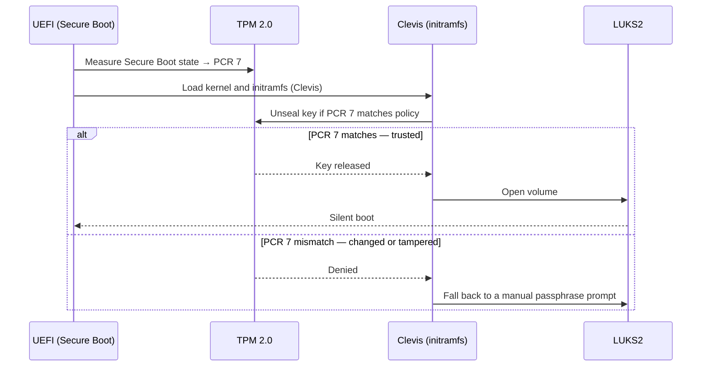
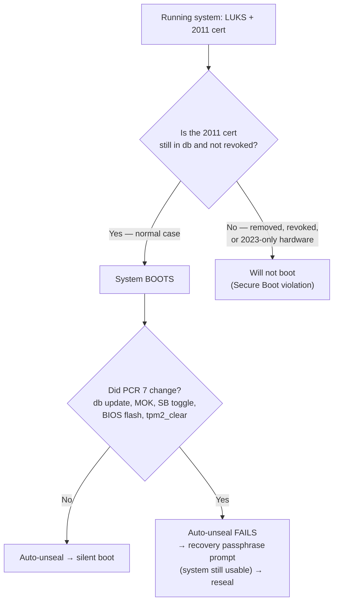
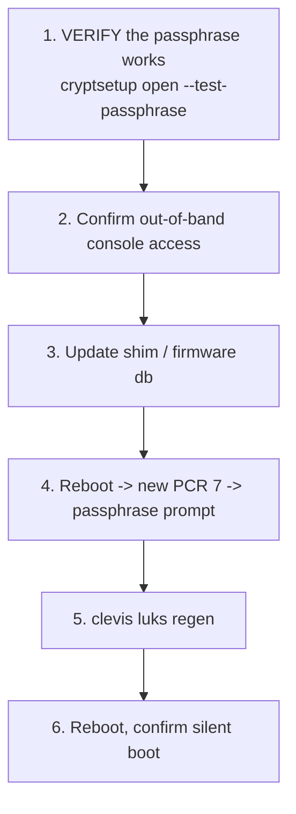

# LUKS with TPM auto-unlock

LUKS2 encrypts the disk. The [[security/boot-integrity/tpm|TPM]] auto-unlocks it
**only on a trusted boot state**, measured through
[[security/boot-integrity/secure-boot|Secure Boot]] into PCR 7. If that state does
not match, the machine falls back to asking for a passphrase.

This note assumes both of those. Read them first — the failure modes here only make
sense once PCR 7 does.

Examples target Rocky Linux 8, 9 and 10; the mechanism is the same on any EL-family
distribution with a TPM 2.0.

## How the pieces fit


| Component | Role | Function |
| --- | --- | --- |
| **LUKS2** | Volume encryption | Encrypted data plus key slots. `aes-xts-plain64` at 512 bits, **Argon2id** PBKDF. |
| **TPM 2.0** | Policy enforcer | Unseals the key only if PCR 7 matches. Does not generate the LUKS key. |
| **Secure Boot / PCR 7** | Trust measurement | Fingerprint of the Secure Boot variable store. |
| **Clevis** | Early-boot orchestrator | Runs in `initramfs` via `clevis-dracut`; unseals through the TPM and hands the key to `systemd-cryptsetup`. |

## Partition layout

| Layer | Mount | Encryption | Notes |
| --- | --- | --- | --- |
| **ESP** | `/boot/efi` | Plaintext | Firmware must read it; signature-checked by Secure Boot |
| **Boot** | `/boot` | Plaintext | GRUB reads it before any key exists |
| **PV** (partition, md device, or multipath LUN) | — | **LUKS2** | One container; LVM lives *inside* it |
| LVs on that VG | `/`, `/var`, swap… | Inherited | Encrypted automatically |

### Encrypt the PV, not each logical volume

Put LUKS on the **lowest device that aggregates the others**, and LVM inside it:

| If the PV is… | Encrypt | Never |
| --- | --- | --- |
| A bare partition (`sda3`) | The partition | Each LV on top |
| An mdraid device (`/dev/md/pv00`) | The md device | The member partitions — breaks the mirror, double-encrypts |
| A multipath SAN LUN | The multipath device | An individual path — one header per path, corrupt on failover |

> [!warning] `/boot` is not inside the PV
> `/boot` and `/boot/efi` are separate partitions *outside* the volume group.
> Verified on a stock Rocky 9.8 install, where Anaconda's own
> `autopart --type=lvm --encrypted` produces `sda3 → LUKS → LVM → root/swap` with both
> boot partitions outside the container.
>
> Per-LV encryption costs one LUKS header, one TPM binding and one reseal **per volume**,
> and any LV added later silently ships unencrypted. The only reason to do it is a
> genuinely different unlock policy per volume.

> [!danger] `/boot` integrity does **not** come from Secure Boot
> Secure Boot verifies the *kernel* signature, but the **initramfs is unsigned** on
> RHEL-family 8 and 9 without a UKI. An attacker who can write to the plaintext `/boot`
> can modify the initramfs, and **PCR 7 will not notice** — the boot *policy* did not
> change. See the demonstrated attack below.

## Boot-time unlock flow



> [!note] Kernel updates are safe
> They do not touch PCR 7. A `db`/KEK update, a MOK enrolment, toggling Secure Boot,
> a BIOS flash or `tpm2_clear` all **will** change it. The full matrix is in
> [[security/boot-integrity/tpm]].

## Implementation

### Packages

The Clevis stack is in AppStream, and `tpm2-tools` in BaseOS or AppStream, on Rocky 8,
9 and 10. No extra repository is needed:

```bash
dnf install -y clevis clevis-luks clevis-dracut \
               clevis-systemd tpm2-tools tpm2-tss
```

The `tpm2` pin used below is part of the `clevis` package itself.

> [!note] No extra repository, and no `clevis-pin-tpm2`
> Checked on 5 November 2026 with `dnf repoquery`: `clevis`, `clevis-luks`,
> `clevis-dracut` and `clevis-systemd` come from AppStream on Rocky 8.10, 9.8 and 10.
>
> `clevis-pin-tpm2` is a separate pin written in Rust, named `tpm2plus`, not the `tpm2`
> pin. It does not exist on Rocky 8. On Rocky 10 it is pulled in as a dependency of
> `clevis` anyway, and the `tpm2` pin then hands its work to it.

### LUKS2 format

Do not trust installer defaults — set the parameters explicitly:

```bash
# FIPS-compatible. Use this unless FIPS is ruled out for good.
cryptsetup luksFormat \
  --type luks2 \
  --cipher aes-xts-plain64 \
  --key-size 512 \
  --hash sha512 \
  --pbkdf pbkdf2 --pbkdf-force-iterations 600000 \
  /dev/disk/by-id/<stable-path>
```

> [!danger] Argon2id and FIPS are mutually exclusive
> `fips-mode-setup` **aborts with exit 76** if any LUKS device uses Argon2, pointing at
> `cryptsetup-luksConvertKey(8)`. The guard is in the shipped script:
>
> ```
> The following encrypted devices use Argon2 PBKDF: …
> Aborting fips-mode-setup because of that.
> ```
>
> This is not an edge case: **Anaconda's default is `argon2id`**, so a stock encrypted
> install is already in the state that blocks FIPS.
>
> `fips-mode-setup` is a Rocky 8 and 9 tool. Rocky 10 does not ship it: there, FIPS
> mode is chosen at install time (the `fips=1` boot option), and the Argon2 check above
> does not exist.
>
> It is recoverable without reformatting — verified:
> ```bash
> cryptsetup luksConvertKey --pbkdf pbkdf2 --pbkdf-force-iterations 600000 <device>
> ```
> Run it on **every keyslot of every device**, while unlocked, *before* enabling FIPS.

> [!note] How much does `pbkdf2` actually cost?
> A PBKDF slows brute force against a **low-entropy, human-chosen** passphrase. Against a
> machine-generated 256-bit recovery key neither KDF will ever be brute-forced, so
> `pbkdf2` costs essentially nothing there. It matters only if a human picks the
> passphrase.

### Dracut integration

Mandatory. Without it, a kernel update rebuilds `initramfs` without Clevis and
auto-unlock silently stops working:

```bash
cat <<'EOF' > /etc/dracut.conf.d/clevis-luks.conf
add_dracutmodules+=" clevis "
EOF

dracut --regenerate-all -f
```

> [!note] There is no `keep_dracutmodules`
> dracut's options are `dracutmodules`, `add_dracutmodules`,
> `force_add_dracutmodules` and `omit_dracutmodules`. A `.conf` file is plain shell,
> so an unknown setting is silently ignored. The `clevis` module already pulls in
> `crypt`, and `systemd` when the initramfs uses it.

> [!warning] Do not parse `ls /lib/modules`
> A `for kver in $(ls -1 /lib/modules/)` loop trips over stale directories left behind
> by removed kernels, where `dracut -f --kver` fails. `--regenerate-all` is the
> supported form; verified to cover every installed kernel.
>
> A drop-in in `/etc/dracut.conf.d/` **is** honoured automatically when new kernels are
> installed. The rebuild is a one-time retrofit, not a per-upgrade ritual. What
> matters after an upgrade is the *check*:
>
> ```bash
> lsinitrd "/boot/initramfs-$(uname -r).img" | grep -qE 'clevis|tpm2' || echo MISSING
> ```

### Bind LUKS to PCR 7

```bash
UUID=$(blkid -s UUID -o value /dev/<device>)
clevis luks bind -d "/dev/disk/by-uuid/$UUID" tpm2 \
  '{"hash":"sha256","key":"ecc","pcr_bank":"sha256","pcr_ids":"7"}'
```

> [!danger] Never bind by kernel device name
> Observed on a lab VM: after a reboot **`/dev/sda` and `/dev/sdb` swapped**. A
> `clevis luks bind -d /dev/sdb` in a kickstart would silently bind the wrong disk, and a
> scripted reseal would target the wrong device. Use `/dev/disk/by-uuid/…`,
> `/dev/disk/by-id/…` or an md path — the same discipline `/etc/crypttab` already uses.
>
> `/dev/mapper/<vg>` is never valid either: a volume group has no device node.

> [!tip] Name the sha256 PCR bank explicitly
> Without `pcr_bank`, the result depends on which pin runs. The shell `tpm2` pin uses
> the first bank that has PCRs allocated, which is `sha1` on a TPM that still has that
> bank active. When `clevis-pin-tpm2` is installed (always on Rocky 10, where `clevis`
> requires it; optional on Rocky 9), `clevis-encrypt-tpm2` hands the work to it, and
> that pin defaults to `sha256`. `"key":"ecc"` is already the default (checked in the pin's script on Rocky 8,
> 9 and 10), so writing it only documents the choice.

> [!tip] The systemd-native alternative
> On Rocky 9 and 10, `systemd-cryptenroll --tpm2-device=auto --tpm2-pcrs=7 /dev/...`
> does the same job without Clevis. Pick **one** mechanism per volume — the examples
> here standardise on Clevis for parity with Rocky 8.

## Deployment patterns

### Factory or PXE provisioning

Recovery passphrases must **never** be transmitted in plaintext. Wrap them, and have
the central vault store only the wrapped form, behind MFA and audit logging.

```bash
#!/usr/bin/env bash
set -euo pipefail

DEV="/dev/disk/by-uuid/$(blkid -s UUID -o value /dev/<device>)"

# $TEMP_PASS is the build passphrase set during kickstart
RECOV_KEY=$(head -c 32 /dev/urandom | base64)
printf '%s\n%s' "$TEMP_PASS" "$RECOV_KEY" | cryptsetup luksAddKey "$DEV"

WRAPPED=$(printf '%s' "$RECOV_KEY" | \
  openssl pkeyutl -encrypt -pubin -inkey /etc/pki/factory/pub.pem \
    -pkeyopt rsa_padding_mode:oaep -pkeyopt rsa_oaep_md:sha256 | base64 -w0)

# Escrow FIRST, and read it back, before anything becomes irreversible
curl -sS --fail -H 'Content-Type: application/json' \
  -H @/run/factory-token.hdr \
  -d "{\"host\":\"$HOSTNAME\",\"wrapped_key\":\"$WRAPPED\"}" \
  https://secrets.example.com/v1/recovery-keys
curl -sS --fail -H @/run/factory-token.hdr \
  "https://secrets.example.com/v1/recovery-keys/$HOSTNAME" >/dev/null

printf '%s' "$RECOV_KEY" | clevis luks bind -d "$DEV" -k - tpm2 \
  '{"hash":"sha256","key":"ecc","pcr_bank":"sha256","pcr_ids":"7"}'

# CRITICAL: remove the build passphrase, or every unit ships with a known key
printf '%s' "$TEMP_PASS" | cryptsetup luksRemoveKey "$DEV"
cryptsetup luksDump "$DEV" | grep -c '^  [0-9]*: luks2'   # assert expected slot count

dracut --regenerate-all -f
```

> [!danger] Remove the build passphrase
> `cryptsetup luksAddKey` authenticates with `$TEMP_PASS` and *adds* a key; it does not
> remove the one it authenticated with. A kickstart passphrase is identical on every
> machine built from that image, so without `luksRemoveKey` every unit ships with **a
> factory-known key slot**: anyone who read the kickstart could unlock the fleet.
> `luksRemoveKey` is mandatory, and the slot count should be asserted in QA.

> [!warning] Order of operations, and secrets on `argv`
> Escrow and **read back** before removing anything: a silent upload failure would
> ship a machine whose only recovery key exists nowhere. `set -euo pipefail` is not
> optional here.
>
> A bearer token passed as `-H "Authorization: Bearer $TOK"` is visible in `ps` to every
> local user; read it from a file with `-H @file` instead.

> [!note] `pkeyutl`, not `rsautl`
> `openssl rsautl -encrypt` defaults to PKCS#1 v1.5 padding and is deprecated as of
> OpenSSL 3.0. Use `openssl pkeyutl` with OAEP padding set explicitly, as above. See
> [[security/cryptography/pki-and-x509]].

### Secondary data partitions

```bash
cryptsetup luksFormat --type luks2 --cipher aes-xts-plain64 \
  --key-size 512 --hash sha512 --pbkdf pbkdf2 --pbkdf-force-iterations 600000 "$DATA_DEV"
clevis luks bind -d "$DATA_DEV" tpm2 \
  '{"hash":"sha256","key":"ecc","pcr_bank":"sha256","pcr_ids":"7"}'
```

```text
# /etc/crypttab — UUIDs, and NO _netdev for a TPM-only unlock
luks-data   UUID=<luks-uuid>   none   discard
```

```bash
systemctl enable clevis-luks-askpass.path    # required for crypttab automation
```

> [!warning] `_netdev` is the Tang idiom, not a sequencing trick
> It orders the unlock into `remote-cryptsetup.target`, after `network-online`. It does
> **not** "sequence the unlock after root pivots". On a TPM-only volume it adds a network
> dependency to a purely local operation and risks a boot hang on an isolated host.
>
> It *is* correct for a **Tang**-bound volume — see the stolen-hardware section below.

## What this does not protect against

Measured on Rocky Linux 9.8 with a TPM 2.0 and Secure Boot enabled.

### The passphrase prompt hands out a root shell

> [!danger] Demonstrated, not theoretical
> With the volume bound to PCR 7 and PCR 7 deliberately changed, the node stopped at the
> passphrase prompt. **Holding down Enter**:
>
> 1. Three `Please enter passphrase…` prompts consumed by the keypresses
> 2. `[FAILED] Failed to start Cryptography Setup` · `[DEPEND] Dependency failed for Local Encrypted Volumes`
> 3. ~217 s of `dracut-initqueue` timeouts
> 4. `Warning: Could not boot.` → `Starting Dracut Emergency Shell…` → **`dracut:/#`**
>
> A root shell in the initramfs, reached with **no credential at all**. From it, verified
> by hand: `clevis luks list` and `cryptsetup luksDump` disclose the binding and header,
> the **plaintext `/boot` mounts, and writes to it succeed** — kernels and initramfs
> images are modifiable.
>
> `clevis luks unlock` is absent from the initramfs, but `clevis-decrypt` and the
> `tpm2`/`tang`/`sss` pins are all present. Treat that as an inconvenience to an
> attacker, not a control.

**The mitigation, verified:**

```bash
grubby --update-kernel=ALL --args="rd.shell=0"
```

With it, the same Enter-flood makes the node reboot rather than open a shell, while
normal passphrase entry still works. `rd.emergency=reboot` additionally turns an
unrecoverable node into a reboot loop instead of a halt — that is an operational
preference; the security property comes from `rd.shell=0`.

### Why this decides TPM-only versus TPM + Tang

On the tested boot PCR 7 had already moved, so the TPM refused everyone. **On a healthy
boot the TPM releases the key to whatever asks** — and what is asking is a root shell an
attacker reached with the Enter key. The TPM cannot distinguish `clevis-luks-askpass`
from an attacker, because from its point of view the boot looks correct.

| | Attacker reaches `dracut:/#` on a healthy boot |
| --- | --- |
| **TPM only (PCR 7)** | Key is locally available. **Disk opens.** |
| **`sss` `t:2` — TPM *and* Tang** | TPM half unseals; Tang half needs a server the attacker does not have. **Disk stays closed.** |

This is also why a TPM alone does not protect a **stolen machine**: the TPM travels with
it, PCR 7 still matches, and the box decrypts itself on power-on. A passphrase-only
volume has the opposite profile — safe when stolen, but nothing boots unattended.

| Scenario | Passphrase only | TPM (PCR 7) | TPM + Tang (`t:2`) |
| --- | --- | --- | --- |
| Disk pulled, read elsewhere | ✅ | ✅ | ✅ |
| **Whole machine stolen and booted** | ✅ | ❌ unseals itself | ✅ Tang unreachable |
| Unattended reboot after power loss | ❌ needs a human | ✅ | ✅ while Tang is up |

### Binding to Tang as the second factor

```bash
THP=$(tang-show-keys 80)          # on the Tang server
clevis luks bind -d "$DEV" sss \
  "{\"t\":2,\"pins\":{
      \"tpm2\":{\"hash\":\"sha256\",\"key\":\"ecc\",\"pcr_bank\":\"sha256\",\"pcr_ids\":\"7\"},
      \"tang\":[{\"url\":\"http://tang.example.com\",\"thp\":\"$THP\"}]
  }}"
```

`"t":2` requires **both**. `"t":1` means *either*, which puts you back to the TPM alone
unlocking a stolen box.

Verified: with both pins reachable the volume unlocks unattended; with one Tang server
stopped, `t:2` **denies** and falls back to the passphrase.

> [!warning] Two things that break automated Tang provisioning
> - **Pin the thumbprint (`thp`)**, or `clevis-encrypt-tang` tries to ask for confirmation
>   on `/dev/tty` and dies in a kickstart with `No such device or address`.
> - **SELinux blocks non-standard ports.** `tangd_port_t` covers tcp/7406 and the shipped
>   unit uses 80; anything else needs `semanage port -a -t tangd_port_t -p tcp <port>`.
>
> Back up `/var/db/tang`. Lose it and every bound volume falls back to its passphrase,
> permanently.

> [!note] Tang does not need initramfs networking if you bind only the *data* volumes
> A volume that is not required to boot is unlocked after pivot by
> `clevis-luks-askpass.path`, once the network is up. Keep the root volume on TPM alone so
> the machine always boots, and put the second factor on the data volumes — a stolen
> machine then boots to an OS with no data. This is also the one case where `_netdev` in
> `/etc/crypttab` is correct.

---

## The 2026 `db` update — reseal procedure

### What blocks boot versus what blocks auto-unseal

These are two separate questions and conflating them causes most of the panic. For a
running system encrypted with LUKS and holding the 2011 Microsoft certificate:

| Event | Blocks **boot**? | Blocks **auto-unseal**? | Net effect |
| --- | --- | --- | --- |
| The 2011 cert simply expires (June 2026) | No | No | Nothing changes — expiry only stops Microsoft signing *new* shims |
| Kernel or OS update | No | No | Silent boot continues |
| **You update firmware `db`** to enrol the 2023 certs | No | **Yes** | Boots, but prompts for a passphrase until you reseal |
| Enrol or remove a MOK | No | Yes | Passphrase prompt, then reseal |
| Toggle Secure Boot | No | Yes | Passphrase prompt, then reseal |
| BIOS/UEFI firmware flash | No[^1] | Yes | Passphrase prompt, then reseal |
| **2011 cert removed or revoked into `dbx`** | **Yes** | n/a | Will not boot — but this is not planned, option ROMs need it |
| Disk moved to 2023-only hardware, Secure Boot on | **Yes** | n/a | The shim's 2011 signature is not in `db` |
| `tpm2_clear`, dead TPM, hardware swap | No | Yes | Passphrase prompt, then re-bind |
| **`shim-x64` package update** | No | **Yes** | shim measures `SbatLevel` into PCR 7 — **every shim security update is a reseal event** |

[^1]: A firmware flash does not block boot by itself, but it can change boot-path
measurements in PCR 0–5.



In short:

- The certificate **expiring blocks nothing** on an already-installed system.
- The **only** things that block boot are the 2011 certificate being removed or
  revoked, or moving the disk to 2023-only hardware with Secure Boot on. Neither
  happens by accident.
- The realistic disruption is **auto-unseal**. The moment you or `fwupd` update `db`
  to add the 2023 certificates, PCR 7 changes, Clevis cannot unseal, and you get the
  recovery passphrase prompt. Boot still succeeds.

> [!note] If Secure Boot is currently disabled
> PCR 7 reflects that "disabled" state. **Enabling** Secure Boot later will therefore
> also change PCR 7 and require a reseal — it is not a free hardening step on a
> TPM-bound volume.

### The reseal itself

The trap: enrolling the 2023 certificates in `db` changes PCR 7. Reboot first and
every TPM-bound volume drops to its recovery passphrase.



```bash
DEV="/dev/disk/by-uuid/<luks-uuid>"

# BEFORE touching firmware: prove the fallback works
cryptsetup open --test-passphrase "$DEV" && echo "passphrase OK"

# ... update, reboot, unlock at the console ...

# Reseal in place. regen keeps the slot -- no unbind/bind window, no hardcoded id.
SLOT=$(clevis luks list -d "$DEV" | awk -F: '/tpm2/{print $1; exit}')
clevis luks regen -d "$DEV" -s "$SLOT"
```

> [!warning] Do not unbind before rebooting
> Unbinding the TPM removes the working unlock path *before* proving the fallback works.
> If the passphrase turns out to be wrong, the volume is gone. **Test the passphrase, do
> not remove anything.**
>
> Resealing early does not help either: `clevis luks bind` seals against PCR 7 **as read
> at bind time**, and a firmware `db` capsule is only applied during the next boot — so a
> pre-reboot reseal captures the value that is about to become stale. The same applies to
> a shim update, whose new `SbatLevel` is only written on the next boot.

> [!note] What the failure looks like
> ```
> clevis-luks-askpass: ERROR: Esys_Unseal(0x99D) - tpm:session(1):a policy check failed
> clevis-luks-askpass: ERROR: Unable to run tpm2_unseal
> ```
> `0x99D` is `TPM_RC_POLICY_FAIL`. The TPM is working correctly — the sealed policy names
> a PCR 7 value that no longer matches. Do not debug it as a TPM fault.
>
> `clevis luks regen` prints `Unsealing jwk from TPM failed!` before
> `Binding regenerated successfully`. That is expected, for the same reason.

> [!danger] A PCR 7 change always costs a console visit, per container
> `regen` tries the old policy first and fails by definition, so it falls back to
> prompting. The master key cannot be re-derived from the running system either — modern
> cryptsetup keeps it in the kernel keyring, so `dmsetup table --showkeys` returns a
> `:64:logon:cryptsetup:…` reference rather than key material.
>
> So each reseal needs **a console, a stable device path, and that container's own
> passphrase**. A host with several LUKS containers needs one reseal each.

> [!tip] Lower-risk option during the transition
> Keep the recovery key immediately available and reseal once `db` is finalised,
> rather than resealing repeatedly through a multi-stage firmware rollout.

## Test plan

Results below are from a Rocky 9.8 lab system with a TPM 2.0 and Secure Boot enabled.

| ID | Case | Expected | Measured |
| --- | --- | --- | --- |
| TC-01 | Happy path | Silent boot | ✅ unsealed at **1.86 s** (vs a 40 s console stall unbound) |
| TC-02 | Different kernel | Auto-unseal survives | ✅ **PCR 7 byte-identical** across two kernels |
| TC-03 | Secure Boot off | Passphrase fallback | not run |
| TC-04 | MOK change | Auto-unseal fails | not run — `MokListRT` *is* in the PCR 7 event log |
| TC-05 | `db` update | PCR 7 changes | not run — same mechanism as TC-12 |
| TC-06 | Reseal and re-verify | Silent boot restored | ✅ via `clevis luks regen` |
| TC-07 | TPM clear | Full restore | not run |
| TC-08 | Dracut check | Modules present | ✅ `--regenerate-all` covered **every** installed kernel |
| **TC-12** | **shim/SBAT update → PCR 7** | PCR 7 changes | ✅ `0x5C014BFF…` → `0x6E956AC0…`, **PCR 8/9 unchanged** |
| **TC-13** | **Enter-flood at the prompt** | No shell | ❌ **root shell** without `rd.shell=0`; ✅ reboots with it |
| TC-18 | Cost of PCR 8/9 | Quantify | ✅ **PCR 9 moved between two boots of the same kernel** |
| TC-T1–6 | Tang / `sss` threshold | Deny when unreachable | ✅ all passed |

### Reproducing a shim update without one being available

`mokutil --set-sbat-policy latest` makes shim write its newer built-in SBAT floor on the
next boot — exactly what a real `shim-x64` update does:

```bash
mokutil --list-sbat-revocations          # current floor
mokutil --set-sbat-policy latest
# reboot -> SbatLevel rises -> PCR 7 changes -> auto-unseal fails
```

> [!danger] With Secure Boot on, the SBAT floor is a one-way ratchet
> shim never lowers it while Secure Boot is enabled; `--set-sbat-policy automatic` will
> not undo a raise. The way back is to **disable Secure Boot** in the firmware and boot
> once through shim: with Secure Boot off, shim resets `SbatLevel` to its original
> value. That needs console access. **Check your installed generations against the
> target floor first**, or the machine will not boot:
> ```bash
> objcopy -O binary --only-section=.sbat      /boot/efi/EFI/*/grubx64.efi /tmp/grub.sbat && strings /tmp/grub.sbat | grep ^grub
> objcopy -O binary --only-section=.sbatlevel /boot/efi/EFI/*/shimx64.efi /tmp/shim.sbatlevel && strings /tmp/shim.sbatlevel
> ```

> [!note] objcopy and SBAT
> objcopy refuses to write to `/dev/stdout` through a pipe (`Illegal seek`), so the
> commands write to a file first. To revert the SBAT floor, you do not need to clear the
> firmware's EFI NVRAM: shim's own code (`sbat.c`, shim 16.1) resets `SbatLevel` when it
> boots with Secure Boot disabled, so disabling Secure Boot for one boot is enough.

## Recovery and maintenance

```bash
DEV="/dev/disk/by-uuid/<luks-uuid>"

# Reseal after any PCR 7 change -- in place, keeps the slot
SLOT=$(clevis luks list -d "$DEV" | awk -F: '/tpm2/{print $1; exit}')
clevis luks regen -d "$DEV" -s "$SLOT"
clevis luks list -d "$DEV"      # expect exactly one tpm2 token
reboot

# After a kernel upgrade: CHECK, do not blindly rebuild
lsinitrd "/boot/initramfs-$(uname -r).img" | grep -qE 'clevis|tpm2' \
  && echo "CLEVIS PRESENT" || { echo "MISSING"; dracut --regenerate-all -f; }
```

> [!note] `regen` replaces `unbind` + `bind`
> Prefer it: the slot is kept, there is no window in which the volume has no TPM path,
> and there is no token id to hardcode. Deriving the slot from `clevis luks list` beats
> assuming `-t 1`.

## Limitations

| Limitation | Mitigation |
| --- | --- |
| **Enter-flood → unauthenticated root shell** | `rd.shell=0` — verified to close it |
| **A stolen machine unseals itself** | Second factor that stays behind: Tang, `sss` `t:2` |
| **Unsigned initramfs on plaintext `/boot`** | No cheap fix — PCR 8/9 are unusable, UKI is not available on EL9 bare metal. Physical lockdown + IMA detection |
| **Every `shim-x64` update breaks auto-unlock** | Budget a reseal per container per node; canary first |
| Clevis does not use TPM encrypted sessions | Prefer **fTPM**; a discrete TPM's bus is sniffable |
| PCR 7 changes on `db` / MOK / BIOS flash | Reseal procedure above; it cannot be automated away |
| `tpm2_clear` or hardware swap loses the policy | Keep an **offline** recovery passphrase |
| Argon2id blocks FIPS | Format with `pbkdf2`, or convert with `luksConvertKey` before enabling FIPS |

- **Key storage** — the LUKS2 header holds only key slots and metadata. The master
  key never persists in plaintext beyond the `cryptsetup` process lifetime.
- **Audit** — log bind, unbind and reseal operations:

  ```bash
  auditctl -w /usr/bin/clevis -p x -k clevis_policy_change
  ```

  > [!note] `auditctl`, not `auditd`
  > `auditd` is the daemon and takes no watch arguments. Use `auditctl` for a runtime
  > rule, or put the same line in `/etc/audit/rules.d/` to persist it. See
  > [[security/auditd]].

## Where to go next

- [[security/boot-integrity/tpm]] — PCR semantics and what moves them
- [[security/boot-integrity/secure-boot]] — the 2026 certificate transition in full
- [[linux/storage/lvm]] — the volume layer underneath
- [[storage/raid-and-alua]] — if the volume is a SAN LUN: encrypt the multipath
  device, never an individual path, or you get one header per path and a corrupt
  volume the first time the array fails over
- [[security/auditd]] — persisting the audit rule above

## Sources

- [Red Hat — Expiration of Secure Boot signing certificates in 2026](https://www.redhat.com/en/blog/expiration-secure-boot-signing-certificates-2026)
- [Rocky Linux — Secure Boot CA/KEK transition](https://rockylinux.org/news/2026-06-02-secure-boot-ca-kek-transition)

<!-- uplink -->
Part of [[security/boot-integrity/index|Boot integrity]].
