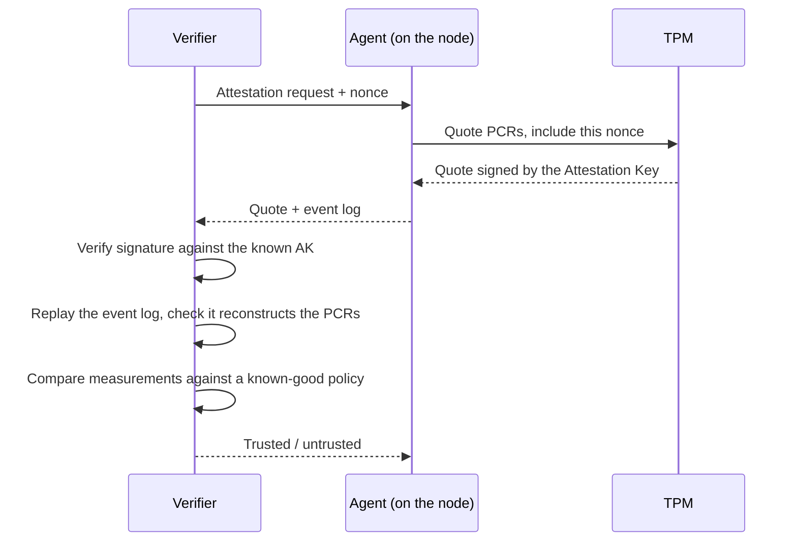
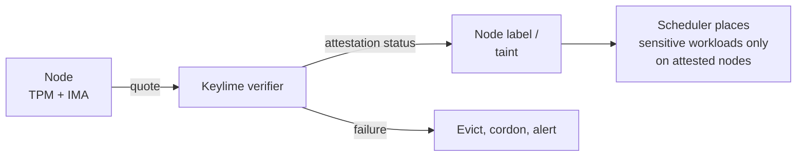

# Remote attestation

[[security/boot-integrity/tpm|Measured boot]] answers a **local** question: does this
machine's TPM hold the values I expect, so it may unlock its own disk?

Remote attestation answers a **remote** one: can this machine prove to *me*, over the
network, that it booted into a known state and has not been tampered with since?

That difference matters whenever you do not physically control the hardware — an edge
site, a colocation cage, a customer's premises, or any node you are asked to trust
with sensitive workloads.

## The mechanism

The TPM can sign a **quote**: a signed statement of its current PCR values, plus a
nonce supplied by the verifier.



Two properties make this work:

- **The nonce prevents replay.** A quote is only valid for the challenge it answers,
  so a compromised machine cannot resend a recording of its healthy self.
- **The signing key never leaves the TPM.** The Attestation Key is TPM-resident, so a
  compromised OS cannot forge a quote — it can refuse to answer, which is itself a
  signal.

> [!important] Attestation detects, it does not prevent
> A machine that fails attestation has already been modified. What you gain is the
> ability to *find out* and act — deny it a workload, refuse to release a key, remove
> it from the cluster.
>
> That is why attestation is usually paired with key release: the verifier hands over
> a decryption key or a cluster credential **only** on a successful quote, so a
> tampered machine is useless rather than merely flagged.

## From boot to runtime: IMA

Measured boot stops once the kernel is running. **IMA** — the Integrity Measurement
Architecture — continues it: the kernel measures each file before executing or
mapping it, extending the hash into a PCR (usually PCR 10) and appending to a runtime
event log.

```bash
# Is IMA active?
ls /sys/kernel/security/ima/
cat /sys/kernel/security/ima/ascii_runtime_measurements | head
```

Enable it via the kernel command line — see [[linux/boot/grub]]:

```text
ima_policy=tcb ima_template=ima-ng
```

`ima_policy=tcb` **measures** executables, libraries and files read by root. It does
not appraise anything. To also check files against reference values (appraisal), add
the built-in appraisal policy, and choose a mode:

```text
ima_policy=tcb|appraise_tcb ima_appraise=log ima_template=ima-ng
```

| Mode | Behaviour |
| --- | --- |
| `ima_appraise=log` | Appraise, log the failures, but still allow access |
| `ima_appraise=fix` | Write the reference values (the `security.ima` extended attributes) |
| `ima_appraise=enforce` | **Refuse to execute** files failing appraisal. The default when appraisal is on |

> [!warning] `ima_appraise` needs an appraisal policy
> `ima_appraise=` only acts on files that an appraisal rule selects, and the `tcb`
> policy has none, so `ima_policy=tcb ima_appraise=log` appraises nothing. Appraisal
> needs `appraise_tcb` (or your own policy). Source: the kernel's
> `admin-guide/kernel-parameters` documentation for `ima_policy` and `ima_appraise`.

> [!warning] `ima_appraise=enforce` will make an unprepared system unbootable
> Every executable and library must carry a valid signature or extended attribute
> before enforcement, and anything missing one simply will not run — including, quite
> possibly, the tools you would use to fix it.
>
> Start with `log`, build the reference set, and only then enforce. Have console
> access when you try.

The runtime log grows continuously, which is what makes *continuous* attestation
possible: a verifier can re-request a quote periodically and detect a file executed
after boot that was not in the expected set.

## Keylime

[Keylime](https://keylime.dev/) is the practical implementation — a CNCF sandbox
project providing the verifier, registrar and agent, and doing the tedious parts: AK
enrolment, periodic quoting, event log replay and policy evaluation.

| Component | Role |
| --- | --- |
| **Registrar** | Records each node's TPM identity and Attestation Key |
| **Verifier** | Periodically challenges nodes and evaluates the quotes |
| **Agent** | Runs on the node, talks to the TPM |
| **Tenant** | The CLI for enrolling nodes and setting policy |

Its key-release feature is the operationally interesting one: Keylime can deliver a
payload — a decryption key, a certificate, a join token — to a node **only** while it
continues to attest successfully. A node that drifts stops receiving it.

## In Kubernetes

The natural extension is asking whether a *pod* is running on a trustworthy node, and
this is an area of active research rather than settled practice.

Recent work on 5G network functions
([arXiv:2510.03219](https://arxiv.org/abs/2510.03219), October 2025) combines Keylime
with a **custom IMA template** that keeps measurements per pod. That is the piece plain
IMA lacks: a node-wide measurement log tells you *something* unexpected executed, but
not which workload it belonged to. Per-pod measurements turn that into a per-workload
integrity signal. The authors demonstrate it on a k3s cluster (one server, two agents)
running 5G core functions, with runtime detection of changes and a trust label per pod.

The general shape:



Node labelling on attestation status is the pragmatic integration available today —
`nodeAffinity` on attested nodes, taints on failed ones. See
[[kubernetes/workloads/taints-and-tolerations]].

## What it costs

Being realistic about why this is not everywhere:

- **Reference values are a maintenance burden.** Every kernel update, firmware update
  and package change alters measurements. Without automation tied to your build
  pipeline, policy drifts and attestation fails for benign reasons — and alerts that
  are usually benign get ignored.
- **The same PCR fragility as TPM unlocking.** A `db` update or firmware flash moves
  PCR 7, exactly as described in [[security/boot-integrity/luks]].
- **IMA has real overhead**, measuring every executed file.
- **It assumes the TPM and firmware are honest.** Attestation moves the trust boundary
  down to the hardware; it does not eliminate it.

> [!important] IMA is the only detection control for the unsigned-initramfs gap
> [[security/boot-integrity/luks]] documents an attack in which someone with physical
> access modifies the initramfs on a plaintext `/boot`. PCR 7 does not notice, and PCR 8/9
> turn out to be unusable for sealing, so there is no *prevention* on EL9 without a UKI.
>
> IMA does not prevent it either — but it **records** it, and remote attestation surfaces
> the drift instead of leaving it silent. Where that gap is unacceptable and a UKI is not
> available, this is the remaining option.

> [!note] Where this is genuinely worth it
> Confidential or regulated workloads on hardware you do not physically control; edge
> and telecommunications deployments, which is why the 5G research exists; and any
> environment where "prove this node is clean" is a contractual requirement rather
> than an aspiration.
>
> For a datacentre you control, with a solid patching and configuration baseline, the
> effort is usually better spent on [[security/security-roadmap|earlier controls]].

## Where to go next

- [[security/boot-integrity/tpm]] — PCRs, quotes and sealing
- [[security/boot-integrity/secure-boot]] — what is measured into PCR 7
- [[security/boot-integrity/luks]] — local key release, the simpler cousin
- [[security/auditd]] — the complementary runtime record

<!-- uplink -->
Part of [[security/boot-integrity/index|Boot integrity]].
