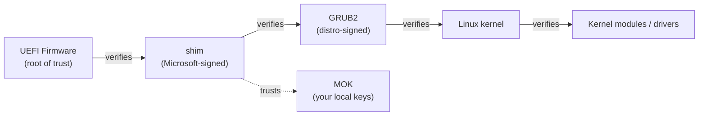
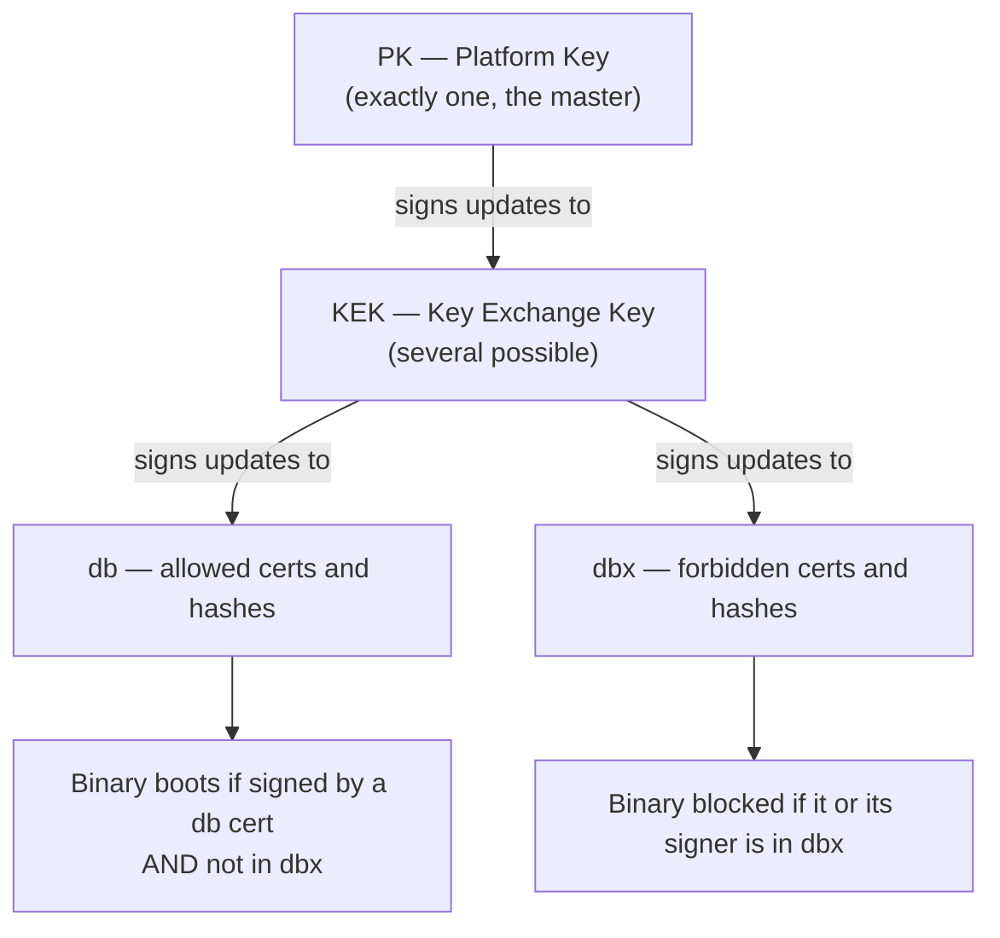
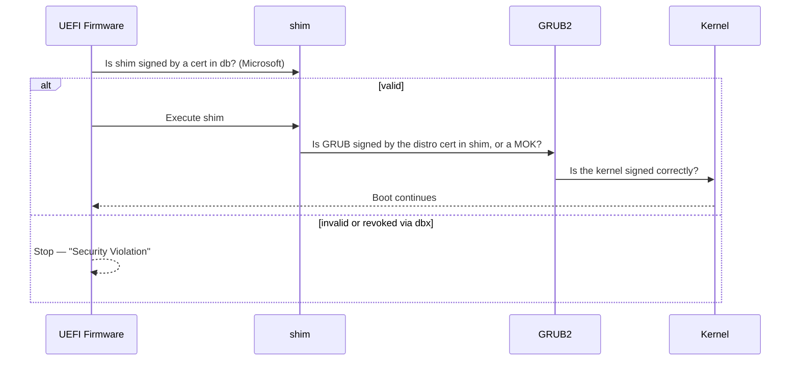
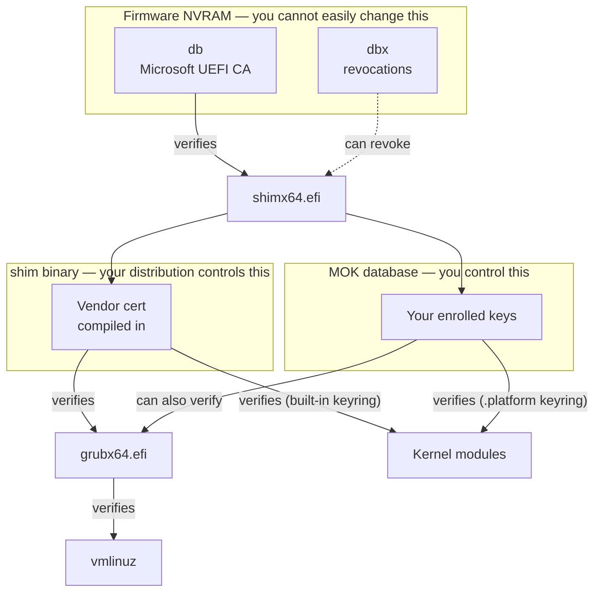
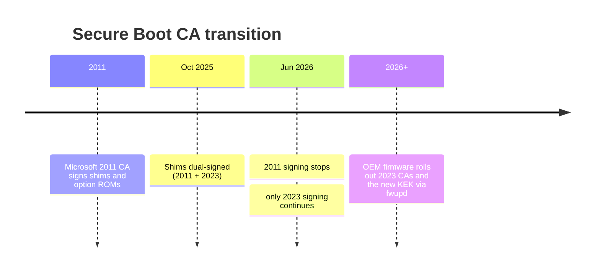
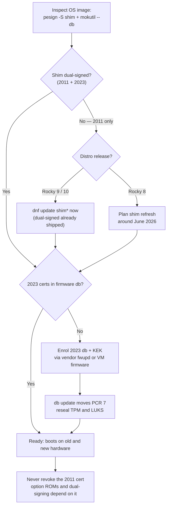
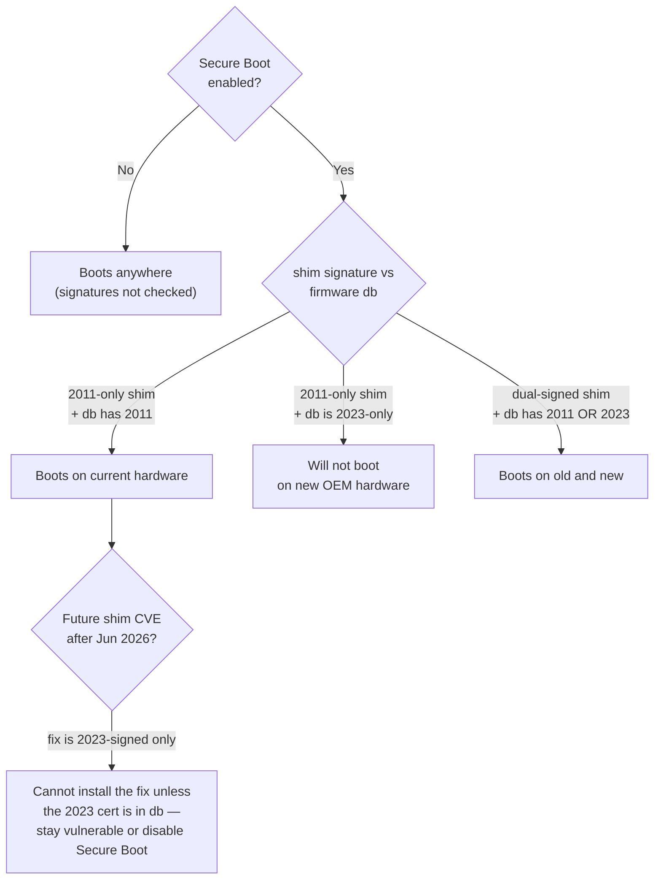
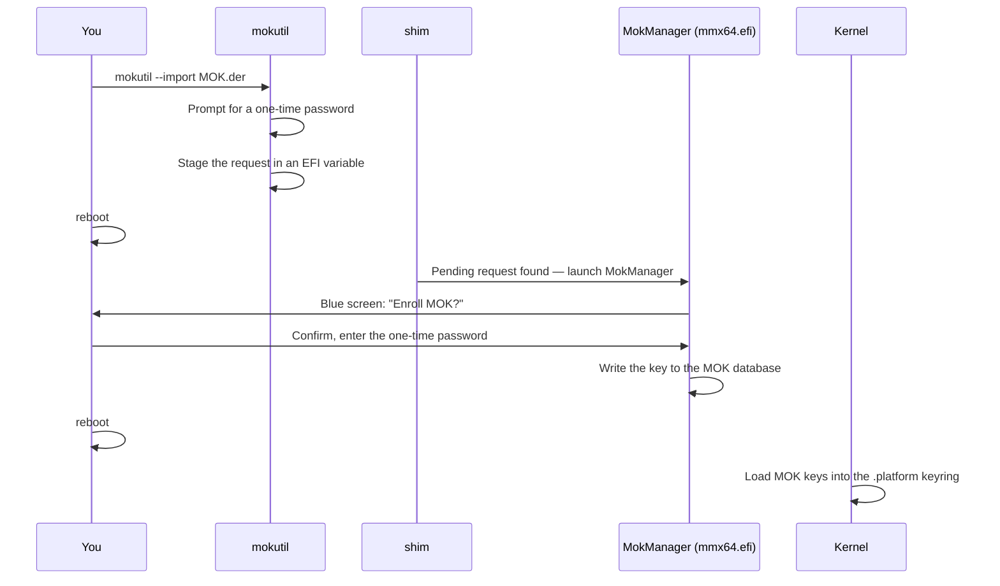

# UEFI Secure Boot

Secure Boot ensures that **only code signed by a trusted key runs before the OS
starts**. It is the defence against bootkits and rootkits that try to load ahead of
Linux, where nothing in the OS could ever see them.

Examples below use Rocky Linux 8 and 9 on `x86_64` UEFI, but the mechanism is the
same on any UEFI distribution. Its neighbours: [[security/boot-integrity/tpm]]
records the result as a measurement, and [[security/boot-integrity/luks]] is the
disk encryption that can depend on it.

## The big picture

- Secure Boot is a **chain of trust**: each stage cryptographically verifies the next
  before handing over control.
- It requires **UEFI firmware** — legacy BIOS has no equivalent.
- The root of trust lives **in the firmware**, not in the OS. The OS merely supplies
  signed binaries.
- A signature is valid if the matching public certificate is enrolled in the firmware
  **`db`** and is not revoked in **`dbx`**.



- **shim** — a tiny first-stage bootloader signed by **Microsoft**. It exists so that
  one Microsoft signature can bootstrap any Linux distribution, rather than every
  distribution needing its certificate in every OEM's firmware.
- **GRUB2 and the kernel** are signed by distribution keys **embedded inside shim**.
- **MOK** (Machine Owner Key) — keys *you* enrol locally, typically for out-of-tree
  or DKMS modules such as NVIDIA's.

### Why shim exists at all

Nearly every PC ships with Microsoft's certificate in `db` and nothing else. Without
shim, every Linux distribution would need to persuade every hardware vendor to enrol
its certificate — which is not going to happen.

Shim solves it with one level of indirection. It is a deliberately tiny bootloader
that Microsoft signs, so the firmware will run it. Shim then performs its **own**
verification of whatever comes next, against keys it carries internally and against
the MOK database. The trust decision moves from the firmware, which you cannot change,
to shim, which your distribution controls.

> [!important] Shim is a second, independent verifier — not a pass-through
> This is the part that is usually misunderstood. Shim does not ask the firmware to
> check GRUB. It checks GRUB itself, against three sources: the distribution
> certificate compiled into the shim binary, the firmware's `db`, and the **MOK**
> database.
>
> That third source is why you can boot a self-compiled kernel with Secure Boot on
> without touching firmware settings — you enrol your key with shim, not with the
> firmware.

### The files on the ESP

```bash
ls -l /boot/efi/EFI/*/
```

| File | Role |
| --- | --- |
| `shimx64.efi` | The Microsoft-signed first stage. What the firmware actually launches |
| `grubx64.efi` | The bootloader. Verified by shim, **not** by the firmware |
| `mmx64.efi` | **MokManager** — the enrolment UI shim launches when a MOK request is pending |
| `fbx64.efi` | Fallback — recreates the firmware boot entry if it was lost |
| `BOOTX64.EFI` | In `EFI/BOOT/`, the removable-media default path. Usually a copy of shim |

The vendor directory is distribution-specific: `EFI/opensuse/` on Leap,
`EFI/redhat/` on RHEL, `EFI/rocky/` on Rocky. Scripts that hardcode one break on
the others.

`mmx64.efi` is worth recognising — the blue MOK Management screen at boot is that
binary, launched by shim because a key enrolment is pending.

## The key hierarchy

A pyramid: upper keys authorise changes to lower databases.



| Key / database | Role | Notes |
| --- | --- | --- |
| **PK** (Platform Key) | Master controller | Only one. Signs KEK updates. Removing it turns Secure Boot **off**. |
| **KEK** (Key Exchange Key) | Authorises `db`/`dbx` updates | Several allowed. Microsoft owns one of them. |
| **db** | Allow-list of trusted certificates and binary hashes | If your signer's certificate is here, you boot. |
| **dbx** | Deny-list of revoked certificates and hashes | Beats `db`. |
| **MOK** | Owner-enrolled keys | Managed with `mokutil`; verified by shim, not by core firmware. |

> [!important] `db` and `dbx` are not symmetric
> - **Trust (`db`):** a binary boots if **ANY** of its signatures chains to a cert in `db`. One trusted signer is enough.
> - **Revocation (`dbx`):** a binary is blocked if **ANY** of its signatures is in `dbx`. One revoked signer is fatal, even when another signer is still trusted.
>
> So a dual-signed binary boots on firmware trusting *either* signer — but revoking
> *either one* blocks it everywhere. Red Hat states it plainly: *"If an application is
> signed with one key that is allowed (in db) and another key that is forbidden (in dbx),
> the application will not be allowed to boot."* This is exactly why the 2011 certificate
> must not be revoked.

## Boot validation flow



Each arrow is a **verify-then-execute** step; one bad signature halts the chain. The
same checks apply to kernel **modules** once the kernel is running, which is why
unsigned out-of-tree modules fail to load with Secure Boot enabled.

### Which key verifies which binary

The sequence above says *that* each stage is verified. This says *by what* — and it is
the diagram worth internalising, because every Secure Boot failure is one of these
arrows breaking:



Three separate trust stores, and knowing which one a failure involves tells you where
to fix it:

| Failure | Store at fault | Fix |
| --- | --- | --- |
| "Security Violation" before any menu | Firmware `db` — shim not trusted | Update shim, or enrol the 2023 certificates |
| Shim loads, GRUB does not | Vendor cert in shim, or MOK | Reinstall `grub2-efi-x64`, or enrol your key |
| Kernel refuses to boot | Same | Sign the kernel, or use the distribution's |
| `Required key not available` on `modprobe` | The kernel's `.platform` keyring | Enrol a MOK and sign the module |

Only the first of those involves firmware at all. The rest are fixed entirely from
inside the running system, which is the practical benefit of shim's indirection.

## The 2026 Microsoft certificate expiration

Microsoft's original 2011 signing certificate expires at the **end of June 2026**.
This is an ecosystem-wide event affecting every distribution that uses a
Microsoft-signed shim.

### What expires, and what does not

- **Expiring, for *signing*:** the 2011 signer (`Microsoft Windows UEFI Driver
  Publisher`). After June 2026 Microsoft can no longer sign *new* binaries with it.
- **Already-deployed systems keep working.** A shim signed by the 2011 certificate
  still boots, as long as that public certificate remains in `db` and is not revoked.
- **Replacement CAs, issued 2023:**
  - **Windows UEFI CA 2023** — signs bootloaders and shims.
  - **Microsoft Option ROM UEFI CA 2023** — signs device firmware: NICs, GPUs,
    storage controllers.
  - **Microsoft Corporation KEK 2K CA 2023** — the new KEK, required to apply future
    `db` updates.



### What the distributions are doing

Shipping a **dual-signed shim**, signed by both the 2011 and 2023 certificates, so it
boots on old and new firmware alike. Rocky 9 and 10 already ship one; Rocky 8's
arrives in June 2026.

> [!warning] The installer media is the gap
> If a distribution ships the dual-signed shim as a **package update** rather than a new
> minor release, the **installation media keeps the old shim**. On 2023-only firmware with
> Secure Boot enabled, a PXE/ISO/USB install then fails *before* you can update anything.
>
> Anyone building OS images must pull the updated `shim*` packages and **rebuild the
> ISO/PXE artifacts** — updating a running system is not sufficient.

> [!note] Firmware lags the distribution
> Measured on an HPE ProLiant Gen10 in 2026: the shipped shim was already **dual-signed**,
> but the firmware `db` held only `Microsoft Corporation UEFI CA 2011` and the OEM keys —
> **no 2023 CA and no 2023 KEK**. The shim side being ready does not mean the machine is.
> Check both, and expect a firmware update (SPP/iLO, not necessarily `fwupd`) to be
> required.

### What to do

1. **Update the shim package** (`dnf update shim\*`) to the dual-signed build when
   available for your release.
2. **Update the firmware `db`** so the 2023 certificates are enrolled — via `fwupd`
   on bare metal, or updated virtual firmware on VMs.
3. **Do not remove or revoke the 2011 certificate.** A dual-signed shim will *not*
   boot if either of its signers is revoked, and 2011-signed option ROMs would stop
   working too.
4. **Before rebooting after a `db` update**, understand that this changes **PCR 7**
   and therefore breaks TPM auto-unlock. See [[security/boot-integrity/tpm]] and the
   reseal procedure in [[security/boot-integrity/luks]].

> [!tip] `sbchooser` guards against a bad install
> Shipped in the `efivar` package, it prevents installing a shim that your firmware
> `db` cannot validate — which would otherwise leave an unbootable machine.

### Deciding what to do for a given image



### What boots where



> [!warning] The real cost of staying on a 2011-only shim
> It is fine today on existing hardware, and fine on nodes with Secure Boot disabled.
> But it **fails outright on new 2023-only hardware**, and — more insidiously —
> **blocks future shim security fixes**, because those will be signed with the 2023
> key only. The dual-signed shim removes both problems at no cost.

## SBAT — the revocation path that actually gets used

Everything above concerns `dbx`. In practice **shim and GRUB are almost never revoked via
`dbx` any more** — since 2022 they are revoked through **SBAT** (Secure Boot Advanced
Targeting).

| | `dbx` | **SBAT** |
| --- | --- | --- |
| Granularity | A binary hash, or a whole CA | A **component + generation** (e.g. `grub,4`) |
| Storage | `dbx` UEFI variable | `SbatLevel`, owned by shim |
| Effect of a bump | Blocks exactly what is listed | Blocks **every build of that component below the generation**, whoever signed it |
| Applied by | Firmware / `fwupdmgr` | shim itself, on boot |

> [!warning] SBAT bypasses the dual-signing story
> A dual-signed shim protects against a `db` trust gap. It does **nothing** against an
> SBAT bump: if `SbatLevel` rises past your GRUB's generation, that GRUB stops booting no
> matter how many valid signatures it carries. SBAT bumps are what broke dual-boot systems
> during CVE-2023-40547 and the August 2024 Windows update.

```bash
mokutil --list-sbat-revocations                      # the enforced floor
objcopy -O binary --only-section=.sbat      /boot/efi/EFI/*/grubx64.efi /tmp/grub.sbat && strings /tmp/grub.sbat | grep ^grub
objcopy -O binary --only-section=.sbatlevel /boot/efi/EFI/*/shimx64.efi /tmp/shim.sbatlevel && strings /tmp/shim.sbatlevel
```

> [!warning] Correction
> The commands wrote to `/dev/stdout` and piped into `strings`. objcopy cannot write its
> output to a pipe (`objcopy: /dev/stdout[.sbat]: Illegal seek`, binutils 2.41), so
> they now write to a file first.

A shim binary carries **two** built-in levels — the conservative one it applies by default,
and a newer one. `mokutil --set-sbat-policy latest` applies the newer floor on the next
boot, which is a faithful way to rehearse a shim security update without waiting for one.

> [!danger] With Secure Boot on, the floor is a one-way ratchet, and it moves PCR 7
> shim never lowers `SbatLevel` while Secure Boot is enabled; `--set-sbat-policy
> automatic` will not undo a raise. The way back is to disable Secure Boot in the
> firmware and boot once through shim, which then resets `SbatLevel` to its original
> value. **Check your installed `shim`/`grub` generations against the target floor
> before applying**, or the machine will not boot.
>
> Correction: an earlier version said reverting means clearing the firmware's EFI NVRAM.
> shim's `sbat.c` (shim 16.1) resets the level by itself when Secure Boot is off.
>
> And because shim measures `SbatLevel` into PCR 7, raising it **breaks TPM auto-unlock**
> — measured: PCR 7 moved while PCR 8 and 9 stayed put. See
> [[security/boot-integrity/luks]].

---

## Verifying the state of a machine

A complete check, in the order worth running it.

### 1. Are we even in UEFI mode?

```bash
ls /sys/firmware/efi
```

The directory exists on a UEFI boot and is absent under legacy BIOS. On BIOS there is
no Secure Boot to configure, and nothing else below will work.

### 2. Is Secure Boot enabled?

```bash
mokutil --sb-state
# SecureBoot enabled
```

Without `mokutil`, read the EFI variable directly — the last byte is the flag:

```bash
cat /sys/firmware/efi/efivars/SecureBoot-* 2>/dev/null | od -An -t u1 | awk '{print $NF}'
# 1 = enabled, 0 = disabled
```

That form is useful in a minimal container or rescue environment where `mokutil` is
not installed.

```bash
bootctl status | head -20        # also reports "Secure Boot: enabled"
```

> [!note] Secure Boot cannot be enabled from the operating system
> There is no command that turns it on. It is a firmware setting, reached by
> interrupting POST — usually F2, Del or F12 — under Security or Boot. The OS can only
> report the state.
>
> Enabling it also changes PCR 7, so any TPM-bound LUKS volume will need resealing
> afterwards. See [[security/boot-integrity/luks]].

### 3. What is enrolled?

```bash
mokutil --db                       # full certificate dump
mokutil --list-enrolled            # MOKs you have enrolled
mokutil --list-new                 # enrolments pending a reboot
mokutil --db | grep "Subject:"     # readable summary
```

`--kek`, `--pk` and `--dbx` show the other stores.

### 4. Are the boot components actually signed?

```bash
sudo dnf install -y pesign

sudo pesign -S -i /boot/efi/EFI/redhat/shimx64.efi
sudo pesign -S -i /boot/efi/EFI/redhat/grubx64.efi
sudo pesign -S -i /boot/vmlinuz-$(uname -r)
```

The vendor directory differs per distribution, so find it rather than hardcoding:

```bash
SHIM=$(find /boot/efi/EFI -iname 'shimx64.efi' | head -n1)
sudo pesign -S -i "$SHIM"
```

### 5. What did the kernel think at boot?

```bash
sudo dmesg | grep -i "secure boot"
sudo dmesg | grep -i "signature"
sudo journalctl -b | grep -iE "secure.boot|uefi|signature|verification"
```

On a Secure Boot system the kernel logs `Secure boot enabled` early, and enables
**lockdown** — which blocks `/dev/mem`, unsigned module loading, and kexec of an
unsigned image:

```bash
cat /sys/kernel/security/lockdown
# none [integrity] confidentiality
```

`[integrity]` in brackets is the active mode. That is a useful confirmation that
Secure Boot is doing something, rather than merely being reported as on.

### One script

```bash
#!/bin/bash
echo "== UEFI mode ==";     [ -d /sys/firmware/efi ] && echo yes || echo "no (legacy BIOS)"
echo "== Secure Boot ==";   mokutil --sb-state 2>/dev/null || echo "mokutil not installed"
echo "== lockdown ==";      cat /sys/kernel/security/lockdown 2>/dev/null || echo "n/a"
echo "== shim signers =="
SHIM=$(find /boot/efi/EFI -iname 'shimx64.efi' 2>/dev/null | head -n1)
[ -n "$SHIM" ] && sudo pesign -S -i "$SHIM" | grep -i 'common name' || echo "shim not found"
echo "== enrolled MOKs =="; mokutil --list-enrolled 2>/dev/null | grep -c 'Subject:' || echo 0
echo "== pending =="; mokutil --list-new 2>/dev/null | grep -c 'Subject:' || echo 0
```

## Other useful commands

```bash
# What is enrolled? (also --kek / --pk / --dbx)
mokutil --db                       # full certificate dump
```

> [!note] `mokutil --short` does not exist on EL8
> It is only in newer builds. For a portable summary of every enrolled certificate:
>
> ```bash
> mokutil --db | grep -E "Issuer:|Subject:"
> ```
>
> `mokutil` is in BaseOS, so it is always available. `efi-readvar` (from `efitools`)
> is **not packaged for EL8, not even in EPEL** — do not go looking for it. The raw
> variables are under `/sys/firmware/efi/efivars/` or via `efivar -l`, but for
> certificate inspection `mokutil` is the right tool.

Which certificates is the shim signed with?

```bash
# pesign is not installed by default
sudo dnf install -y pesign

# The EFI vendor directory is distro-specific — .../EFI/rocky/ on Rocky,
# .../EFI/redhat/ on RHEL. Find the shim rather than hardcoding a path:
SHIM=$(find /boot/efi/EFI -iname 'shimx64.efi' | head -n1)
sudo pesign -S -i "$SHIM"
```

The same works for `grubx64.efi` or the kernel.

### Is my shim dual-signed?

`pesign -S` prints one block per signature. Count the Microsoft signers:

| Signer common name in `pesign -S` | Means |
| --- | --- |
| `Microsoft Windows UEFI Driver Publisher` | signed by the **2011** key |
| `Microsoft UEFI CA 2023 signer` | signed by the **2023** key |
| `Red Hat UEFI Publisher 2024`, or the Rocky publisher | the distribution's own embedded certificate — normal |

- **Dual-signed and ready** — both `...Driver Publisher` and `...UEFI CA 2023 signer`
  are present.
- **2011-only** — only `Microsoft Windows UEFI Driver Publisher` is present.

```bash
# Quick yes/no readiness check.
# Drop sudo if already root — a failed sudo would give a false "2011-only".
[ "$(id -u)" -eq 0 ] && SUDO="" || SUDO="sudo"
SHIM=$(find /boot/efi/EFI -iname 'shimx64.efi' | head -n1)
out=$($SUDO pesign -S -i "$SHIM")
n2011=$(echo "$out" | grep -c "Microsoft Windows UEFI Driver Publisher")
n2023=$(echo "$out" | grep -c "Microsoft UEFI CA 2023 signer")
echo "2011 sig: $n2011 | 2023 sig: $n2023"
if [ "$n2011" -ge 1 ] && [ "$n2023" -ge 1 ]; then
  echo "DUAL-SIGNED (2011 + 2023) — ready for the transition"
elif [ "$n2023" -ge 1 ]; then
  echo "2023-ONLY — boots only if the 2023 cert is in your firmware db"
else
  echo "2011-ONLY (old shim) — run: dnf update shim\\* for the dual-signed build"
fi
```

> [!example] A typical result on an unpatched Rocky 8 node
> `pesign -S` returns only `Microsoft Windows UEFI Driver Publisher`, meaning a
> 2011-only shim. The fix is `sudo dnf update shim\*` — noting that Rocky and RHEL 8
> get the dual-signed shim in June 2026, while 9 already has it. Re-run the check
> afterwards and expect `Microsoft UEFI CA 2023 signer` to appear as well.

What to look for in `db`:

| Certificate | Why it matters |
| --- | --- |
| `Microsoft Corporation UEFI CA 2011` | the old one — **keep it** |
| `Windows UEFI CA 2023` | new bootloader CA, needed for post-June-2026 shims |
| `Microsoft Option ROM UEFI CA 2023` | needed for signed device firmware |
| `Microsoft Corporation KEK 2K CA 2023` (in **KEK**) | needed for future `db` updates |

If only the 2011 certificate is present, the machine is not yet ready for a
2023-only shim. A dual-signed shim still works meanwhile — track your vendor's
`fwupd` updates.

## Signing your own kernel modules

The situation everyone eventually hits: an out-of-tree module — NVIDIA, VirtualBox,
a DKMS driver, something you built — will not load.

```text
modprobe: ERROR: could not insert 'vboxdrv': Required key not available
```

```bash
sudo dmesg | grep -i "module verification failed"
```

The module is unsigned, or signed by a key the kernel does not trust. With Secure Boot
on, the kernel enforces module signatures; with it off, the same module loads fine —
which is why this appears immediately after enabling Secure Boot on a machine that
worked yesterday.

The fix is to generate a key, enrol it as a MOK, and sign the module with it.

### The enrolment flow



> [!important] Enrolment must happen at the console, and cannot be automated
> MokManager runs before the OS, prompts on the physical screen, and requires the
> one-time password you typed into `mokutil`. There is no way to complete it over SSH
> and no unattended path — which is deliberate: it is what stops malware enrolling its
> own signing key.
>
> On a remote server this means arranging out-of-band console access — IPMI, iDRAC,
> iLO, or a serial console. Plan for that before you start, because a machine sitting
> at a blue MokManager prompt has not finished booting.

### 1. Generate a key pair

```bash
sudo mkdir -p /root/module-signing && cd /root/module-signing
```

```text
# /root/module-signing/x509.conf
[ req ]
default_bits = 4096
distinguished_name = req_distinguished_name
prompt = no
string_mask = utf8only
x509_extensions = extensions

[ req_distinguished_name ]
O = Example Corp
CN = Example Corp Module Signing Key
emailAddress = your.name@example.com

[ extensions ]
basicConstraints = critical,CA:FALSE
keyUsage = digitalSignature
extendedKeyUsage = codeSigning
subjectKeyIdentifier = hash
authorityKeyIdentifier = keyid:always
```

```bash
sudo openssl req -x509 -new -nodes -utf8 -sha512 -days 3650 -batch \
  -config /root/module-signing/x509.conf \
  -outform DER -out /root/module-signing/MOK.der \
  -keyout /root/module-signing/MOK.priv

sudo chmod 600 /root/module-signing/MOK.priv
```

`-outform DER` matters: `mokutil --import` expects DER, not PEM. Convert if you need a
readable copy:

```bash
sudo openssl x509 -inform DER -in MOK.der -out MOK.pem
openssl x509 -in MOK.pem -noout -text | head -20
```

> [!note] `CA:TRUE` versus `CA:FALSE` in this config differs between vendors
> Oracle's documentation uses `basicConstraints=critical,CA:TRUE`; other guides use
> `CA:FALSE`. Both are used in the wild and both work for module signing, because the
> kernel matches the signature against a key in its keyring rather than validating a
> certificate chain.
>
> `CA:FALSE` is the more conservative choice for a key whose only job is signing
> modules — it cannot then be used to issue further certificates. Use `CA:TRUE` only
> if you intend the key to sign a bootloader that shim will chain-validate.

> [!danger] This private key can sign kernel code
> `MOK.priv` signs anything the kernel will then load into ring 0. Leaked, it is a
> persistent, signed rootkit that survives Secure Boot. Keep it at mode 600 on a
> machine that is not the one being signed, or in an HSM for anything at fleet scale
> — and never in a configuration repository.

### 2. Enrol it

```bash
sudo mokutil --import /root/module-signing/MOK.der
# input password:
# input password again:
```

That password is one-time, used only at the MokManager prompt on next boot. It is not
stored.

```bash
mokutil --list-new          # confirm the request is staged
sudo reboot
```

At boot, MokManager appears: **Enroll MOK → Continue → Yes → enter the password →
Reboot**. Afterwards:

```bash
mokutil --list-enrolled | grep -A2 'Example Corp'
sudo keyctl list %:.platform
```

The `.platform` keyring is where MOK keys land, and where the kernel looks when
verifying a module.

### 3. Sign the module

```bash
sudo /usr/src/kernels/$(uname -r)/scripts/sign-file sha256 \
  /root/module-signing/MOK.priv \
  /root/module-signing/MOK.der \
  /lib/modules/$(uname -r)/extra/vboxdrv.ko
```

`sign-file` comes from `kernel-devel`, so that package must match the running kernel:

```bash
sudo dnf install -y kernel-devel-$(uname -r) mokutil keyutils openssl
```

Verify and load:

```bash
modinfo vboxdrv | grep -E '^sig'
# sig_id:         PKCS#7
# signer:         Example Corp Module Signing Key
# sig_key:        3F:8A:...
# sig_hashalgo:   sha256

sudo modprobe vboxdrv
```

Find everything currently unsigned:

```bash
for mod in $(lsmod | awk 'NR>1{print $1}'); do
  modinfo "$mod" 2>/dev/null | grep -q '^sig_id:' || echo "UNSIGNED: $mod"
done
```

> [!warning] A kernel update unsigns your modules again
> `sign-file` signs one `.ko` for one kernel. A new kernel means new module builds,
> which are unsigned until you re-sign them — so the driver that worked yesterday
> fails after `dnf update kernel`.
>
> DKMS can automate it. Point it at the same key:
>
> ```text
> # /etc/dkms/framework.conf
> mok_signing_key=/root/module-signing/MOK.priv
> mok_certificate=/root/module-signing/MOK.der
> sign_tool="/etc/dkms/sign_helper.sh"
> ```
>
> The **MOK itself survives** kernel updates — it lives in firmware-adjacent storage,
> not in the kernel. You enrol once and re-sign per kernel.

### Signing a kernel

The same key can sign a kernel image, using `pesign` rather than `sign-file`, because
a kernel is a PE binary:

```bash
sudo pesign --certificate 'Example Corp Module Signing Key' \
  --in /boot/vmlinuz-$(uname -r) \
  --out /boot/vmlinuz-$(uname -r).signed \
  --sign

sudo pesign -S -i /boot/vmlinuz-$(uname -r).signed
```

This needs the key in the **pesign NSS database** rather than as loose files, which is
a separate import step. In practice, signing your own kernel is rare — the
distribution's is already signed, and the module path above covers the usual need.

### Troubleshooting

| Symptom | Cause |
| --- | --- |
| `Required key not available` | Module unsigned, or key not enrolled |
| Enrolled, still refused | Signed with a different key than the one enrolled — compare `modinfo` `sig_key` against `mokutil --list-enrolled` |
| MokManager never appeared | Request expired or was cancelled. Re-run `mokutil --import` |
| `sign-file: No such file` | `kernel-devel` missing, or a version mismatch with the running kernel |
| Works after a kernel update, then stops | Modules rebuilt and unsigned. Automate with DKMS |
| Everything breaks after `dnf update shim*` | `sudo dnf reinstall shim-x64 grub2-efi-x64` |

## Key takeaways

- Secure Boot is a verify-then-execute chain rooted in firmware:
  `PK → KEK → db/dbx → shim → GRUB → kernel → modules`.
- `db` allows, `dbx` forbids, and `dbx` wins.
- **Shim is a second, independent verifier**, not a pass-through. It checks GRUB
  against its own embedded certificate and the MOK database — which is why you can
  trust your own key without touching firmware.
- **MOK enrolment requires physical console access**, by design. Plan for
  out-of-band access before starting on a remote machine.
- A kernel update unsigns out-of-tree modules; the MOK survives. Enrol once, re-sign
  per kernel, automate with DKMS.
- The 2026 change is about **signing certificates rotating**, not about machines
  suddenly failing to boot.
- Update shim and `db` now, never revoke 2011, and reseal TPM/LUKS afterwards
  because **PCR 7 changes** on a `db` update.

## Where to go next

- [[security/boot-integrity/tpm]] — how the Secure Boot state becomes PCR 7
- [[security/boot-integrity/luks]] — disk encryption bound to that measurement
- [[linux/boot/grub]] — the bootloader being verified here

## Sources

**The 2026 certificate transition:**

- [Red Hat — Expiration of Secure Boot signing certificates in 2026](https://www.redhat.com/en/blog/expiration-secure-boot-signing-certificates-2026)
- [Rocky Linux — Secure Boot CA/KEK transition](https://rockylinux.org/news/2026-06-02-secure-boot-ca-kek-transition)

**Shim and the chain of trust:**

- [It's FOSS — What are shim files?](https://itsfoss.com/secure-boot-shim-file/) — the
  conceptual framing of why shim exists as a Microsoft-signed intermediary

**Verification commands:**

- [OneUptime — Verify and enable UEFI Secure Boot on RHEL 9](https://oneuptime.com/blog/post/2026-03-04-verify-enable-uefi-secure-boot-rhel-9/view)
  — `mokutil --sb-state`, the `efivars` fallback, `pesign` checks and the `dmesg`
  greps

**Kernel and module signing:**

- [Red Hat — Signing a kernel and modules for Secure Boot](https://docs.redhat.com/en/documentation/red_hat_enterprise_linux/10/html/managing_monitoring_and_updating_the_kernel/signing-a-kernel-and-modules-for-secure-boot)
  (RHEL 10; equivalent chapters exist for
  [9](https://docs.redhat.com/en/documentation/red_hat_enterprise_linux/9/html/managing_monitoring_and_updating_the_kernel/signing-a-kernel-and-modules-for-secure-boot_assembly_managing-kernel-command-line-parameters-with-uki)
  and 8)
- [Oracle Linux — Signing kernel images and modules for Secure Boot](https://docs.oracle.com/en/operating-systems/oracle-linux/9/secure-boot/sboot-SigningKernelModulesforUseWithSecureBoot.html)
  — the `openssl` x509 configuration and `sign-file` invocation above follow this
  procedure
- [OneUptime — Troubleshooting unsigned kernel modules on RHEL 9](https://oneuptime.com/blog/post/2026-03-04-troubleshoot-secure-boot-unsigned-kernel-modules-rhel-9/view)
  — the `Required key not available` diagnosis and the unsigned-module scan

> [!note] On verifying these
> Red Hat's documentation site blocks automated retrieval, so the signing procedure
> here was cross-checked against Oracle Linux's equivalent chapter, which documents the
> same `openssl` → `mokutil --import` → `sign-file` workflow. Where the two differ —
> the `basicConstraints` value — that difference is called out in place rather than
> silently resolved.

<!-- uplink -->
Part of [[security/boot-integrity/index|Boot integrity]].
