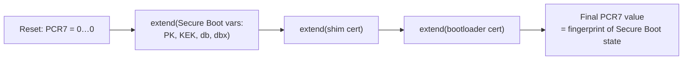
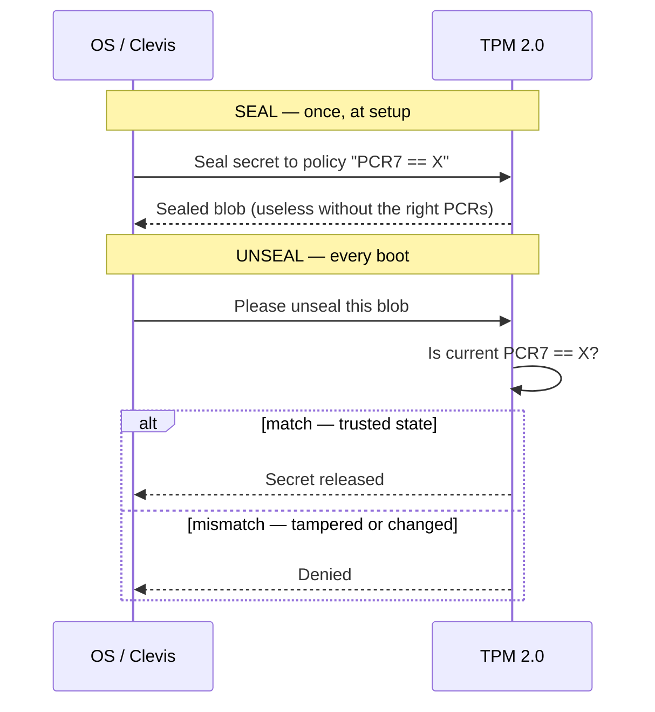

# TPM 2.0 and measured boot

The TPM is a small tamper-resistant chip that **records what code ran during boot**
and can **release a secret only if that record still matches**. It is how a disk can
auto-unlock on a trusted, unmodified machine and refuse to on a tampered one.

This note covers the measurement machinery. Its two neighbours cover the ends:
[[security/boot-integrity/secure-boot]] is what gets measured, and
[[security/boot-integrity/luks]] is the secret being released.

## Core concepts

- **TPM 2.0** — Trusted Platform Module: a discrete chip, or a firmware TPM (fTPM),
  that stores keys and measurements isolated from the OS.
- **PCR** — Platform Configuration Register: a slot inside the TPM holding a hash
  representing "what has happened so far".
- **Measured boot** — each boot stage hashes the next component and **extends** that
  hash into a PCR *before* handing control to it.
- **Sealing** — encrypting a secret so it can only be decrypted (**unsealed**) while
  chosen PCRs hold the expected values.

> [!important] For disk unlock, the TPM guards the key, it does not choose it
> Here it is a policy enforcer. Your LUKS key is made by `cryptsetup`, Clevis or
> `systemd-cryptenroll`. The TPM holds a sealed copy and refuses to hand it back unless
> the machine is in the state you sealed against.
>
> Correction: an earlier version said the TPM does not generate keys at all. It can:
> it has its own random number generator, and `tpm2_create` makes keys inside it. It
> just does not make the LUKS key.

## PCRs are append-only

You cannot *write* a PCR, only **extend** it. Each extension mixes the old value with
a new hash:

```text
PCR_new = HASH( PCR_old || HASH(component) )
```

This is one-way and **order-dependent**: any change in what ran, or the order it ran
in, produces a completely different final value. A PCR is therefore a fingerprint of
the boot path that cannot practically be forged. PCRs reset only on power-on or
reset — you cannot roll one back to replay a trusted state.



### Seeing the extend operation

The arithmetic is worth doing once, because it makes the append-only property
concrete. A PCR starts at all zeros, and each extend is a SHA-256 over the
concatenation of the old value and the new measurement:

```bash
# Simulate: extend a zeroed PCR with the hash of "component-a"
OLD=$(printf '%064d' 0)
NEW=$(printf 'component-a' | sha256sum | cut -d' ' -f1)

# PCR_new = SHA256( PCR_old || SHA256(component) )
printf "$(echo "${OLD}${NEW}" | sed 's/../\\x&/g')" | sha256sum
```

Two properties follow directly:

- **Order matters.** Extending with A then B gives a different value from B then A, so
  a reordered boot sequence is detectable even if the same components ran.
- **You cannot go back.** There is no operation that removes a measurement. Software
  that has already been measured cannot un-measure itself, which is what stops
  compromised code from hiding by resetting the register.

The real thing, against your own TPM:

```bash
# A resettable debug PCR (16) — safe to experiment with
sudo tpm2_pcrreset 16
sudo tpm2_pcrread sha256:16

sudo tpm2_pcrextend 16:sha256=$(echo -n "component-a" | sha256sum | cut -d' ' -f1)
sudo tpm2_pcrread sha256:16
```

> [!warning] From the OS, only PCR 16 and 23 are resettable
> They exist for debugging and application use. The boot PCRs — 0 through 15 — cannot
> be reset by software at all; only a platform reset clears them. PCRs 17 to 22 belong
> to a dynamic launch (DRTM: Intel TXT, AMD SKINIT), which resets them from a higher
> locality; the OS cannot. That is the whole security property, so do not go looking
> for a way around it.

### Which PCR measures what

Following the UEFI specification:

| PCR | Measures | Stable across kernel updates? |
| --- | --- | --- |
| **0** | UEFI firmware code | Changes on a BIOS/UEFI update |
| **1** | Firmware configuration and UEFI variables | Changes on a settings change |
| **2–3** | Option ROMs and their configuration | Changes on a hardware or firmware change |
| **4** | Bootloader and boot path — the shim and GRUB binaries | Changes if the bootloader binary changes |
| **5** | GPT / partition table | Changes on partition layout change |
| **7** | **Secure Boot state** — PK, KEK, db, dbx, MOK | **Yes** — but changes on any Secure Boot key or db change |
| **8** | GRUB commands and the kernel command line | Changes when the command line or GRUB config changes |
| **9** | Files GRUB read — the kernel and initramfs | Changes on **every kernel update** |
| **14** | MOK / shim-enrolled keys | Changes on MOK enrolment |

> [!note] PCR 8 and PCR 9 are not the same thing, and the difference matters
> PCR 8 covers what GRUB was *told to do* — its commands and the kernel command line.
> PCR 9 covers what GRUB *loaded* — the kernel image and initramfs themselves.
>
> So adding a kernel parameter moves PCR 8; installing a new kernel moves PCR 9. A
> policy sealed to PCR 8 alone survives kernel updates but catches someone appending
> `init=/bin/bash` to the command line, which is a genuinely useful distinction.

> [!tip] PCR 7 is the sweet spot for auto-unlock
> It reflects the Secure Boot *policy* — which is what you actually want to trust —
> but not the kernel version. A routine `dnf upgrade kernel` does not break an unlock
> sealed to PCR 7, whereas sealing to PCR 8/9 would break on every kernel update.

### Measured: which PCRs actually hold still

Three boots on one Rocky 9.8 machine:

| | PCR 7 | PCR 8 | PCR 9 |
| --- | --- | --- | --- |
| kernel A, boot 1 | `5C014BFF…` | `06379456…` | `A4936F21…` |
| kernel B | `5C014BFF…` | `74AE5EBB…` | `80DCACE1…` |
| kernel A, boot 2 | `5C014BFF…` | `06379456…` | **`50B34CD5…`** |

- **PCR 7 never moved** — across two kernels, an initramfs regeneration and three reboots.
- **PCR 8** is deterministic per kernel; it returned to its earlier value when kernel A booted again.
- **PCR 9 changed between two boots of the *same* kernel.** A one-shot boot entry wrote
  `grubenv`, and GRUB measures it.

> [!danger] PCR 9 is unusable for sealing
> It moves on *any* GRUB environment change — a one-shot boot entry, a changed default, a
> `grubby` edit — not merely on kernel updates. Sealing to it would break on things that
> are not updates at all.
>
> This matters because PCR 8+9 is the only PCR set that would cover the **initramfs**.
> Ruling it out leaves the unsigned-initramfs gap in
> [[security/boot-integrity/luks]] with no cheap mitigation short of a UKI.

### What PCR 7 actually measures

Read from a live event log rather than assumed. This prints the type of each PCR 7
event and, for variables, their name:

```bash
tpm2_eventlog /sys/kernel/security/tpm0/binary_bios_measurements \
  | awk '/PCRIndex:/ { p = ($2 == 7) } p && /EventType:|UnicodeName:/'
```

Summarised, on the Rocky machine measured above:

```text
EV_EFI_VARIABLE_DRIVER_CONFIG   SecureBoot, PK, KEK, db, dbx
EV_SEPARATOR
EV_EFI_VARIABLE_AUTHORITY       db, SbatLevel, MokListRT
```

> [!important] `SbatLevel` is in there
> That is the empirical proof that a **shim update which raises the SBAT level changes
> PCR 7** — and `MokListRT` means MOK changes do too. Neither is obvious from the usual
> "PCR 7 = Secure Boot state" summary.

## Sealing and unsealing



Seal once against the current known-good PCR 7; unseal automatically on every boot.
A mismatch means the machine is in a different state than when you sealed, so the
secret stays locked and the system falls back to a manual passphrase — see
[[security/boot-integrity/luks]].

## What changes PCR 7, and therefore breaks auto-unlock

| Event | PCR 7 changes? | Why |
| --- | --- | --- |
| `dnf upgrade kernel` | No | Kernel hashes go to PCR 8/9, not 7 |
| Firmware `db`/`KEK` update | **Yes** | PCR 7 hashes the Secure Boot variable store |
| Enrol or remove a MOK | **Yes** | Changes the Secure Boot key set |
| Toggle Secure Boot on or off | **Yes** | Changes the measured Secure Boot state |
| BIOS/UEFI firmware flash | **Yes**, often PCR 0–7 | The firmware itself changed |
| `tpm2_clear`, TPM reset, hardware swap | **Yes**, everything | TPM secrets are wiped |

> [!warning] The 2026 Secure Boot CA rollout changes PCR 7
> The Microsoft UEFI CA from 2011 expired in June 2026, and its replacement, the
> Microsoft UEFI CA 2023, must be enrolled into `db` — see
> [[security/boot-integrity/secure-boot]]. That is a change
> to the Secure Boot variable store, so **PCR 7 changes**. Any LUKS volume
> auto-unlocking against PCR 7 must be **resealed after the `db` update**, or the
> machine will drop to the recovery passphrase on next boot.
>
> On a fleet, this is the difference between a routine update and every node asking
> for a password at once. Plan the reseal into the same maintenance window.

> [!warning] Add to the list: **every `shim-x64` package update**
> shim measures `SbatLevel` into PCR 7, so a routine shim security update breaks TPM
> auto-unlock exactly as a `db` update does. Red Hat documents the symptom in
> *"Clevis TPM2 no longer decrypts LUKS devices after a restart"*.
>
> Measured: raising the SBAT floor moved PCR 7 from `0x5C014BFF…` to `0x6E956AC0…` while
> **PCR 8 and PCR 9 did not move at all** — same kernel, same initramfs, same GRUB. The
> `SbatLevel` variable is isolated as the sole cause.

## Working with a real TPM

### Is one present?

```bash
sudo dnf install -y tpm2-tools

ls -la /dev/tpm0 /dev/tpmrm0
cat /sys/class/tpm/tpm0/tpm_version_major     # 2
sudo tpm2_getcap properties-fixed | head -20
```

`/dev/tpm0` is the raw device; `/dev/tpmrm0` is the kernel's resource manager, and is
what `tpm2-tools` should normally use — it handles the TPM's very limited number of
concurrent object slots for you.

```bash
sudo tpm2_getcap properties-fixed | grep -A1 TPM2_PT_MANUFACTURER
sudo tpm2_getcap handles-persistent          # what is already stored
sudo tpm2_getcap pcrs                        # which banks exist
```

`tpm2_getcap pcrs` is worth running first on any unfamiliar machine — a TPM may expose
`sha1` and `sha256` banks, or only one, and reading a bank that does not exist gives a
confusing error rather than an empty result.

### Reading PCRs

```bash
sudo tpm2_pcrread sha256                     # every PCR in the sha256 bank
sudo tpm2_pcrread sha256:0,4,7,8,9           # just the boot-relevant ones
sudo tpm2_pcrread sha256:7                   # the Secure Boot state
```

```text
sha256:
  0 : 0xA1B2C3D4E5F6...
  4 : 0x9F8E7D6C5B4A...
  7 : 0x3C2B1A0F9E8D...
  8 : 0x7A6B5C4D3E2F...
  9 : 0x1F2E3D4C5B6A...
```

The values are meaningless in isolation. They matter only as a **comparison** against
a known-good baseline, which is the next section.

### The event log — why a PCR has the value it does

A PCR is a single hash with no explanation. The **event log** is the itemised record
of every measurement that produced it:

```bash
sudo tpm2_eventlog /sys/kernel/security/tpm0/binary_bios_measurements
```

```bash
# Just the events touching PCR 7
sudo tpm2_eventlog /sys/kernel/security/tpm0/binary_bios_measurements \
  | grep -A4 'PCRIndex: 7'
```

> [!important] The event log is what turns "it changed" into "here is what changed"
> Firmware appends an entry per measurement — the PCR index, the digest, and a
> description of the component. Replaying the log reconstructs the PCR values, so a
> verifier can check both that the log is honest *and* what it contains.
>
> This is the difference between "PCR 7 does not match, unlock failed" and "PCR 7 does
> not match because a new certificate was added to `db`". When a TPM-bound unlock
> breaks, the event log is where you find out why — see
> [[security/boot-integrity/luks]].

The log lives in `securityfs` and needs it mounted:

```bash
sudo mount -t securityfs securityfs /sys/kernel/security   # if absent
ls -l /sys/kernel/security/tpm0/
```

### Baseline and drift detection

Measured boot detects change; it can only do so against a recorded known-good state.

```bash
# Capture a baseline while the machine is in a state you trust
sudo tpm2_pcrread sha256 > /root/pcr-baseline.txt
sudo cp /root/pcr-baseline.txt /root/pcr-baseline-$(date +%Y%m%d).txt
sudo chmod 600 /root/pcr-baseline*.txt
```

```bash
# Later, or on every boot
sudo tpm2_pcrread sha256 > /tmp/pcr-current.txt
diff /root/pcr-baseline.txt /tmp/pcr-current.txt && echo "PCRs unchanged"
```

As a systemd unit that checks at every boot:

```ini
# /etc/systemd/system/pcr-check.service
[Unit]
Description=Compare boot measurements against the baseline
After=multi-user.target

[Service]
Type=oneshot
ExecStart=/usr/local/sbin/pcr-check.sh

[Install]
WantedBy=multi-user.target
```

```bash
#!/bin/bash
# /usr/local/sbin/pcr-check.sh
BASE=/root/pcr-baseline.txt
CUR=$(mktemp)
trap 'rm -f "$CUR"' EXIT

tpm2_pcrread sha256 > "$CUR"

if ! diff -q "$BASE" "$CUR" >/dev/null; then
    logger -p auth.warning -t pcr-check "PCR drift detected"
    diff "$BASE" "$CUR" | logger -p auth.warning -t pcr-check
    exit 1
fi
logger -p auth.info -t pcr-check "PCRs match baseline"
```

Route those to your log aggregation — see [[linux/logging/rsyslog]] — and the drift
becomes an alert rather than something nobody looks at.

> [!warning] Update the baseline after every legitimate change
> A kernel update moves PCR 9. A GRUB configuration change moves PCR 8. A firmware
> update moves PCR 0. All of these are expected, and all of them make the check fail.
>
> A drift alert that fires on every patch cycle gets ignored within a month, and then
> the one that matters is ignored too. Tie the baseline refresh to your patching
> process so it is updated deliberately, with a record of who approved it — that
> record is most of the value.

> [!note] This detects, it does not prevent
> By the time a PCR has drifted, the modified code has already run. What you gain is
> knowing. Preventing requires binding something the machine *needs* to those values —
> a LUKS key, as in [[security/boot-integrity/luks]], or a credential released only on
> a valid quote, as in [[security/boot-integrity/remote-attestation]].

### Sealing a secret by hand

Clevis and `systemd-cryptenroll` wrap this, but doing it once with `tpm2-tools` shows
what they are doing:

```bash
# 1. A primary key in the owner hierarchy
sudo tpm2_createprimary -C o -g sha256 -G rsa -c primary.ctx

# 2. A policy that says "PCR 7 must equal its current value"
sudo tpm2_startauthsession -S session.ctx
sudo tpm2_policypcr -S session.ctx -l sha256:7 -L pcr7.policy
sudo tpm2_flushcontext session.ctx

# 3. Seal a secret under that policy
echo -n "my-secret-key" | sudo tpm2_create -C primary.ctx \
  -u sealed.pub -r sealed.priv -L pcr7.policy -i -

# 4. Load and unseal — only succeeds while PCR 7 matches
sudo tpm2_load -C primary.ctx -u sealed.pub -r sealed.priv -c sealed.ctx
sudo tpm2_startauthsession --policy-session -S session.ctx
sudo tpm2_policypcr -S session.ctx -l sha256:7
sudo tpm2_unseal -p session:session.ctx -c sealed.ctx
sudo tpm2_flushcontext session.ctx
```

Change the Secure Boot configuration and step 4 fails with a policy error — which is
exactly the behaviour a LUKS auto-unlock depends on.

```bash
sudo tpm2_flushcontext -t          # clear stuck transient objects
rm -f primary.ctx sealed.* session.ctx pcr7.policy
```

> [!tip] `tpm2_flushcontext -t` when commands start failing with "out of memory"
> A TPM holds very few transient objects — often three. A script that creates
> sessions without flushing them fills that space, and every subsequent command fails
> with an error that sounds like a host memory problem. It is not; flush the contexts.
> On `/dev/tpm0`, with no resource manager, it happens at once: objects stay loaded
> after each command, and the sealing steps above fail with this error.

> [!danger] `tpm2_clear` wipes every TPM secret
> It resets the TPM's ownership and destroys everything sealed to it. Anything
> depending on the TPM to unlock will need its recovery passphrase and a fresh seal.
> Last resort only, and never on a machine you cannot physically reach.

## Key takeaways

- The TPM records boot state in PCRs and releases secrets only when that state
  matches — seal once, unseal every boot.
- PCRs are append-only, order-dependent fingerprints. **PCR 7 is the Secure Boot
  state**, and the best anchor for disk auto-unlock.
- **PCR 8 is the kernel command line, PCR 9 is the kernel and initramfs.** Sealing to
  7 survives kernel updates; sealing to 9 does not.
- **The event log explains a PCR value**; the PCR alone only tells you it changed.
- A baseline plus a diff turns measured boot into drift detection — but the baseline
  must be refreshed with every legitimate change, or the alert becomes noise.
- Kernel updates are safe for PCR 7. `db` updates, MOK changes, firmware flashes and
  `tpm2_clear` are not — each needs a reseal.

## Where to go next

- [[security/boot-integrity/secure-boot]] — what is being measured into PCR 7, and signing your own binaries
- [[security/boot-integrity/luks]] — binding a LUKS volume to the TPM, and the reseal procedure
- [[security/boot-integrity/remote-attestation]] — proving these values to a remote party

## Sources

**Measured boot and PCR usage:**

- [OneUptime — Configure TPM 2.0 measured boot on RHEL 9](https://oneuptime.com/blog/post/2026-03-04-configure-tpm-2-0-measured-boot-rhel-9/view)
  — the PCR 0/4/8/9 assignments, the `tpm2_pcrread` and `tpm2_eventlog` invocations,
  and the baseline-and-diff workflow above follow this article

**The 2026 certificate transition:**

- [Red Hat — Expiration of Secure Boot signing certificates in 2026](https://www.redhat.com/en/blog/expiration-secure-boot-signing-certificates-2026)
- [Rocky Linux — Secure Boot CA/KEK transition](https://rockylinux.org/news/2026-06-02-secure-boot-ca-kek-transition)

**Specifications:**

- [TCG PC Client Platform Firmware Profile](https://trustedcomputinggroup.org/resource/pc-client-specific-platform-firmware-profile-specification/)
  — the authoritative definition of which PCR holds what, and the event log format

<!-- uplink -->
Part of [[security/boot-integrity/index|Boot integrity]].
