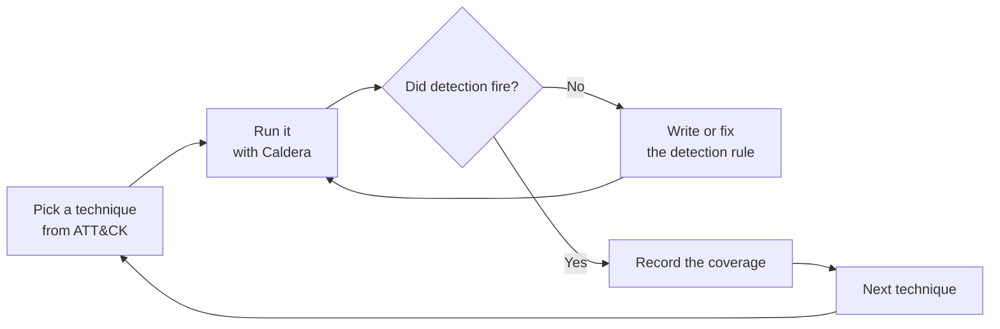

# MITRE Caldera

[Caldera](https://caldera.mitre.org) is an adversary emulation platform. It runs
[[security/mitre-attack-and-d3fend|ATT&CK]] techniques against your own systems, on a
schedule, so you can find out whether your detections actually fire.

The distinction from a penetration test matters: a pentest asks "can we get in?".
Caldera asks "when someone does *this specific thing*, do we notice?" — a question
you should be able to answer continuously rather than annually.

> [!warning] Only against systems you own or are authorised to test
> Caldera executes real techniques — credential access, lateral movement, persistence.
> Running it outside an explicit authorisation is indistinguishable from an attack, to
> both your monitoring and the law. Get the authorisation in writing, scope it, and
> tell the people who will see the alerts.

## Concepts

| Term | Meaning |
| --- | --- |
| **Agent** | A small implant on a target, polling the server for instructions |
| **Ability** | One executable action, mapped to an ATT&CK technique |
| **Adversary** | An ordered collection of abilities — a profile to emulate |
| **Operation** | A run of an adversary profile against a group of agents |
| **Planner** | The logic deciding which ability to run next |
| **Fact** | Data discovered during an operation, feeding later abilities |
| **Plugin** | Extends the server — `stockpile` holds most of the abilities |

The **fact** model is what makes it more than a script runner: an ability that
discovers usernames produces facts, and a later ability consumes them. The operation
adapts to what it finds, as an intruder would.

## Running the server

```bash
git clone https://github.com/mitre/caldera.git --recursive
cd caldera
pip install -r requirements.txt
python server.py --insecure --build
```

It needs Python 3.10 or later, Node.js for `--build` (the web UI), and Go, which the
server uses to compile the Sandcat agent on download.

Then `http://localhost:8888`, default credentials `red` / `admin`. On start, Caldera
replaces the clear-text passwords in the config file with Argon2 hashes.

Outside a lab, start without `--insecure`. On its first start Caldera writes
`conf/local.yml`: a copy of `default.yml` with random passwords, API keys, salt and
encryption key. It prints the passwords and API tokens once, in the start log
(`API_TOKEN: …`). Save them: the file keeps only Argon2 hashes of the API keys.
Then set your own passwords in its `users` section and restart:

```yaml
# conf/local.yml — only the users section is shown; keep every other key
users:
  red:
    red: "a-real-password"
  blue:
    blue: "another-real-password"
```

> [!warning] Correction
> An earlier version suggested a `conf/local.yml` holding only `users`. Caldera then
> reads that file instead of `default.yml`, finds no `crypt_salt`, and stops at start
> with `TypeError: encoding without a string argument`. Edit the generated file.

> [!warning] Moving from `--insecure` to a normal start
> Caldera saves its state (agents, operations) encrypted with the key from the config
> it ran with. After runs with `--insecure`, which use `default.yml`, the first start
> without it stops with "Failed to decrypt saved Caldera state due to incorrect
> encryption key". Start once with `python server.py --fresh` to drop the lab state.

> [!danger] The Caldera server is command and control infrastructure
> It exists to issue commands to implants on your estate. Exposed or left on defaults,
> it is a ready-made backdoor into every machine running an agent.
>
> Bind it to localhost or an isolated management network, put real credentials in
> `conf/local.yml` before agents connect, never run `--insecure` outside a lab, and shut
> it down between exercises. Treat it exactly as you would a C2 server, because that
> is what it is.

## Agents

```bash
# Sandcat, the default agent
curl -s -X POST -H "file:sandcat.go" -H "platform:linux" \
  http://caldera.internal:8888/file/download > splunkd
chmod +x splunkd
./splunkd -server http://caldera.internal:8888 -group red
```

Agents exist for Linux, Windows and macOS. `-group` tags them so operations can target
a subset.

The default binary names — `splunkd` and similar — are deliberate blending. That is
realistic for emulation and a good reason to keep strict inventory of what you have
deployed, so an exercise agent is not mistaken for a real intrusion six months later.

## An operation

1. **Adversaries** → pick or build a profile.
2. **Operations** → new operation, choose the adversary, the agent group and a
   planner.
3. Set the **autonomy**: fully automatic, or step-by-step with manual approval.
4. Run, and watch each ability's command, output and status.

Useful built-in profiles: *Discovery*, *Collection*, *Check* (a harmless
connectivity test), and *Thief* (collection and exfiltration).

> [!warning] Correction
> An earlier version listed a *Hunter* profile. The current stockpile plugin has no
> profile of that name; *Collection* covers the same ground.

Start with *Check*, then *Discovery*. Jumping straight to a full profile on a
production network produces a lot of alerts and very little learning.

## The purple team loop

The point of the tool:



Each iteration produces one of three outcomes, all valuable:

- **Detected** — genuine, evidenced coverage rather than an assumption.
- **Not detected** — a specific, actionable gap with a reproduction.
- **Prevented** — the technique failed outright, which is better than detection.

> [!important] Prevention is the best outcome, and it looks like a failed operation
> An ability that errors because the syscall was blocked, the binary was not present,
> or the policy refused is a **success**. It is easy to read a red operation dashboard
> as "we failed to execute" and miss that a control worked exactly as intended.
>
> Record why each ability failed. "Blocked by seccomp" and "the binary was not
> installed" are very different levels of assurance — the second disappears the moment
> someone installs it.

## Custom abilities

Encode something specific to your estate:

```yaml
- id: 8b7c2f1e-4a3d-4e5f-9a1b-2c3d4e5f6a7b
  name: Enumerate Kubernetes service accounts
  description: Lists service accounts using a mounted token
  tactic: discovery
  technique:
    attack_id: T1613
    name: Container and Resource Discovery
  platforms:
    linux:
      sh:
        command: |
          TOKEN=$(cat /var/run/secrets/kubernetes.io/serviceaccount/token)
          curl -sk -H "Authorization: Bearer $TOKEN" \
            https://kubernetes.default.svc/api/v1/serviceaccounts
```

Drop it into a plugin's `data/abilities/<tactic>/` directory.

That specific ability is worth running: it tests whether you would notice a pod
enumerating the API with its default token — which is
[[kubernetes/security/authn-authz|exactly what an attacker does first]] after
compromising a container, and which most clusters do not detect.

## Plugins

| Plugin | Purpose |
| --- | --- |
| `stockpile` | The main ability and adversary library |
| `atomic` | Imports Atomic Red Team tests |
| `response` | Automated incident response actions — the blue side |
| `emu` | CTID's emulation plans for named threat groups |
| `manx` | Reverse-shell agent |
| `debrief` | Reporting from completed operations |

`atomic` is worth enabling immediately: [Atomic Red
Team](https://github.com/redcanaryco/atomic-red-team) is a large, well-maintained
library of small per-technique tests, and Caldera can orchestrate them.

## Caldera or Atomic Red Team

They overlap and are often compared:

| | Atomic Red Team | Caldera |
| --- | --- | --- |
| Model | Individual tests you run manually | Orchestrated operations with agents |
| Chaining | No — one technique at a time | Yes, with facts flowing between abilities |
| Infrastructure | A script | A server and agents |
| Best for | Validating one detection quickly | Emulating a realistic multi-stage intrusion |

Start with Atomic Red Team. It is far less setup, and validating individual detections
is where most of the early value is. Move to Caldera when you want to test whether you
detect a *chain* rather than a single event — which is usually where real detection
fails.

## Where to go next

- [[security/mitre-attack-and-d3fend]] — the framework being emulated
- [[security/security-roadmap]] — where detection sits among other controls
- [[security/offensive/index|Offensive tooling]] — the individual tools
- [[security/neuvector]] — runtime detection that this validates

<!-- uplink -->
Part of [[security/index|Security]].
