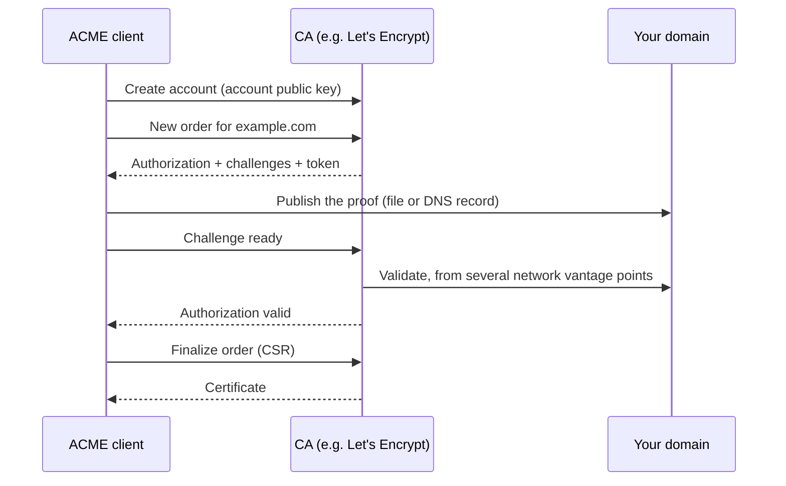

# ACME

**Automated Certificate Management Environment**, [RFC 8555](https://www.rfc-editor.org/rfc/rfc8555).
A protocol between your server and a certificate authority that replaces the old
manual ritual — generate a CSR, paste it into a web form, prove ownership by clicking
a link in an email, download a file — with an API call.

Let's Encrypt built it and made it free. Most large public CAs now offer it too, and
you can run it internally.

## What ACME actually proves

This is the part worth being precise about, because it sets the ceiling on what a
public certificate is worth.

ACME performs **Domain Validation**. It proves that whoever asked for the certificate
could, at that moment, change something only the domain's controller should be able
to change. That is all. It says nothing about who they are, whether the business
exists, or whether the site is trustworthy.

That is not a weakness of ACME — it is what DV certificates have always meant, and
the Organisation and Extended Validation tiers that claim more have been quietly
demoted by browsers, which no longer display them differently. Treat every public
certificate as proof of domain control and nothing else, and the security model gets
much clearer.

> [!important] The account key is not the certificate key
> ACME uses two entirely separate key pairs, and conflating them causes real
> confusion. The **account key** identifies you to the CA and signs every request in
> the protocol. The **certificate key** is the one that ends up in the certificate
> and on your server. The CA never sees either private key.

## The flow



Every step is a signed JSON request. The client does all of this in a couple of
seconds and you normally never see it — but when issuance fails, knowing which step
failed is the whole diagnosis.

The proof itself is a **key authorization**, which binds the CA's random token to
*your account key* so the token cannot be replayed by anyone else who observes it:

```text
keyAuthorization = token || "." || base64url(JWK thumbprint of the account key)
```

The JWK thumbprint (RFC 7638) is already a SHA-256 hash of the account's public key,
written as JSON.

> [!note] One hash, not two
> RFC 8555 (section 8.1) uses the JWK thumbprint as it is: `base64url(SHA256(...))`
> applied to the thumbprint again would hash twice. The test of this note recomputes
> the key authorization that the client sends and checks it.

## The three challenges

| Challenge | Proves control by | Needs | Wildcards |
| --- | --- | --- | --- |
| **http-01** | Serving a file on port 80 | Inbound port 80 | No |
| **dns-01** | Publishing a TXT record | DNS write access | **Yes** |
| **tls-alpn-01** | A special TLS handshake on port 443 | Inbound port 443 | No |

### http-01 — the default

The client serves the key authorization at a well-known path:

```text
http://example.com/.well-known/acme-challenge/<token>
```

The CA fetches it over **plain HTTP on port 80**. It will follow redirects, including
to HTTPS, and will not validate the certificate it meets there — so redirecting all
HTTP to HTTPS does not break it.

Simple, needs no credentials, and fails in exactly two situations: **port 80 is
firewalled**, and **you want a wildcard**. Wildcards are impossible here by
construction — there is no host to fetch a file from for `*.example.com`.

### dns-01 — the powerful one

The client publishes a TXT record:

```text
_acme-challenge.example.com.  IN  TXT  "gfj9Xq...Rg85nM"
```

whose value is `base64url(SHA256(keyAuthorization))`.

This is the only way to get a **wildcard** certificate, and the only way to certify a
host with no inbound internet access at all — an internal load balancer, a device on
a private network, a machine that does not exist yet. The validation happens entirely
in DNS.

The cost is that your client needs **write credentials for your DNS zone**, sitting on
a web server. That is a genuinely dangerous credential: it can usually rewrite your
MX records and your A records too.

> [!tip] Delegate validation with a CNAME instead of handing out zone credentials
> Point the challenge name at a throwaway zone, and give the client credentials for
> *that* zone only:
>
> ```text
> _acme-challenge.example.com.  IN  CNAME  example.com.acme-validation.net.
> ```
>
> ACME clients follow the CNAME, so validation still works, but a compromised web
> server can now only write TXT records in a zone that holds nothing else. Every
> serious dns-01 deployment should do this. `acme-dns` is a small purpose-built
> server for exactly this pattern.

### tls-alpn-01 — the niche one

[RFC 8737](https://www.rfc-editor.org/rfc/rfc8737). The client answers a TLS
handshake on **port 443** that requests the ALPN protocol `acme-tls/1`, presenting a
self-signed certificate carrying the key authorization in an extension.

Useful when port 80 is unavailable and you cannot use DNS, and when you want
validation handled entirely inside the TLS terminator with nothing served over HTTP.
It requires the terminating process to implement it — which rules it out if something
else already owns port 443.

## Validation is now done from several places at once

Since **15 September 2025**, the CA/Browser Forum requires publicly trusted CAs to
perform domain validation and CAA checks from **multiple network perspectives** —
Multi-Perspective Issuance Corroboration, MPIC (ballot SC-067, phased in from
15 March 2025). Let's Encrypt had been doing it voluntarily since 2020.

The attack it stops is BGP hijacking: divert traffic for a victim's IP prefix long
enough to answer one http-01 challenge, and you get a valid certificate for their
domain. Requiring corroboration from vantage points in different networks makes that
enormously harder.

The practical consequence for you: **split-horizon DNS and geographically restricted
firewalls break validation** in ways that look intermittent. If validation succeeds
from your own network and fails at the CA, that is where to look.

## CAA — saying which CAs may issue for you

[RFC 8659](https://www.rfc-editor.org/rfc/rfc8659). A DNS record that tells every CA
whether they are allowed to issue for your domain. CAs are required to check it, and
it is the cheapest control in this entire note.

```text
example.com.  IN  CAA  0 issue "letsencrypt.org"
example.com.  IN  CAA  0 issuewild ";"
example.com.  IN  CAA  0 iodef "mailto:security@example.com"
```

That says: only Let's Encrypt may issue, nobody may issue wildcards, and report
violations to that address.

You can tighten it further ([RFC 8657](https://www.rfc-editor.org/rfc/rfc8657)) so
that only *your* ACME account, using *one* challenge type, may issue:

```text
example.com.  IN  CAA  0 issue "letsencrypt.org; accounturi=https://acme-v02.api.letsencrypt.org/acme/acct/12345; validationmethods=dns-01"
```

Now a compromised web server cannot obtain a certificate at all, because http-01 is
excluded.

> [!warning] CAA does not stop a compromised or coerced CA
> It is a policy statement that well-behaved CAs honour. Detection of the ones that
> do not is Certificate Transparency's job — see
> [[security/cryptography/tls-protocol]]. Use both.

## Certificate lifetimes are collapsing

This is why ACME stopped being optional.

Ballot **SC-081v3** passed in April 2025, with all four major browser vendors in
favour, and sets a phased reduction of the maximum public TLS certificate lifetime:

| From | Maximum lifetime | Domain validation reuse |
| --- | --- | --- |
| 15 March 2026 | **200 days** | 200 days |
| 15 March 2027 | 100 days | 100 days |
| 15 March 2029 | **47 days** | 10 days |

Let's Encrypt has issued at 90 days for a decade. It now also offers 6-day
certificates (160 hours, the `shortlived` ACME profile, generally available since
January 2026) and 45-day ones (the `tlsserver` profile), and it plans to shorten its
default to 45 days by February 2028. The direction is settled.

By 2029 a certificate that used to be renewed once a year is renewed about eight
times, and the validation behind it can barely be reused at all — every renewal is a
fresh challenge. There is no version of that which a human does by hand.

> [!important] The shorter lifetime *is* the security control
> Revocation has never worked. CRLs are enormous and stale, OCSP is a privacy leak
> and gets soft-failed by every browser, and OCSP stapling is inconsistently
> deployed. A certificate that expires in six days is revoked in six days by
> construction, without any of that machinery. This is the industry giving up on
> revocation and solving the problem with time instead.

## ARI — letting the CA schedule your renewals

[RFC 9773](https://www.rfc-editor.org/rfc/rfc9773), published June 2025.
**ACME Renewal Information** adds a `renewalInfo` endpoint that a client polls to ask
"when should I renew this certificate?" and gets back a `suggestedWindow`.

Two things it fixes:

- **Thundering herds.** Without it, everyone renews at a fixed fraction of the
  lifetime and the CA absorbs synchronised load. ARI spreads clients out.
- **Mass revocation.** When a CA discovers it must revoke a batch of certificates —
  which has happened repeatedly, over compliance bugs — it can move the suggested
  window to *now* and have clients re-issue themselves, instead of emailing thousands
  of operators and hoping. Let's Encrypt runs a yearly mass-revocation simulation,
  required by Mozilla's root program, and ARI is how it tells clients to renew.

Turn it on. Recent certbot, lego and acme.sh all support it; lego v5 uses it by
default (`--ari-disable` turns it off). With 47-day certificates
coming, a client that ignores ARI is a client that will one day be serving a revoked
certificate.

## Clients

| Client | Good for |
| --- | --- |
| **certbot** | The reference. Python, plugins for nginx/apache, systemd timer |
| **lego** | Single Go binary, over 150 DNS providers, easy to embed |
| **acme.sh** | Pure shell, no dependencies, good on appliances and BSDs |
| **Caddy** | Web server with ACME built in and on by default. No configuration at all |
| **Traefik** | Same, for a reverse proxy in front of containers |
| **cert-manager** | Kubernetes-native. See [[kubernetes/security/cert-manager]] |
| **step-ca** | Run your *own* ACME CA — see [below](#running-acme-internally) |

### certbot, http-01

```bash
certbot --nginx -d example.com -d www.example.com \
  --agree-tos -m security@example.com --no-eff-email
```

It obtains the certificate and edits the nginx configuration to use it. Renewal runs
from a systemd timer that comes with the package, not from certbot itself: on
openSUSE it is the separate `certbot-systemd-timer` package. Verify the renewal path
actually works, without waiting sixty days:

```bash
certbot renew --dry-run
```

### lego, dns-01, wildcard

```bash
export CLOUDFLARE_DNS_API_TOKEN=...

lego run --email security@example.com \
     --dns cloudflare \
     --domains 'example.com' --domains '*.example.com' \
     --accept-tos
```

> [!note] lego v5 options go after `run`
> In lego v5 the options belong to the `run` subcommand. The v4 form,
> `lego --email ... --accept-tos run`, fails with `flag provided but not defined`.

### Always test against staging first

```bash
certbot certonly --dry-run ...
lego run --server https://acme-staging-v02.api.letsencrypt.org/directory ...
```

Staging issues untrusted certificates from a test root, and its rate limits are far
looser. The production rate limits are per registered domain and per account, and
they reset slowly — a retry loop that hammers production will lock you out for a
week, at which point you have an outage you cannot fix by trying again.

## The failure that actually happens

Not issuance. **Reload.**

The certificate renews correctly, the files on disk are new, and the daemon keeps
serving the old one out of memory until it is restarted — which happens weeks later,
after it has expired, usually at the weekend.

```bash
# certbot: run on successful renewal only
certbot renew --deploy-hook "systemctl reload nginx"

# or, for everything, drop it in:
# /etc/letsencrypt/renewal-hooks/deploy/reload-nginx.sh
```

Use `--deploy-hook`, not `--post-hook`: the deploy hook runs only when a certificate
was actually renewed.

And monitor expiry **from the outside**, against the running service — not by
checking a file's dates:

```bash
# exits non-zero if the served certificate expires within 21 days
echo | openssl s_client -servername example.com -connect example.com:443 2>/dev/null \
  | openssl x509 -noout -checkend $((21*86400))
```

That is the check that catches a failed reload, a wrong file path, and a load
balancer serving a stale copy. See
[[security/cryptography/openssl/commands]].

## Running ACME internally

The interesting consequence of ACME being a protocol rather than a service: you can
run it yourself, and get automated renewal for internal hosts that will never be
reachable from the public internet.

[`step-ca`](https://smallstep.com/docs/step-ca/) is the usual choice. It is a private
CA with an ACME server built in, so your internal services use certbot or lego
exactly as they would against Let's Encrypt, pointed at your own directory URL.

```bash
step ca init --acme
certbot certonly --standalone \
  --server https://ca.internal.example.com/acme/acme/directory \
  -d service-01.internal.example.com
```

> [!tip] Prefer this to a hand-rolled CA
> [[security/cryptography/certificate-generation]] shows a scripted CA, which is the
> right tool for a lab and for understanding what the pieces are. For anything that
> has to keep working, an internal ACME CA is strictly better: renewal is automatic,
> lifetimes can be short, and nobody has to remember what they did last year. The
> hand-rolled script's real failure mode is not weak cryptography — it is a
> ten-year certificate that nobody can reissue because the person who made it left.

Also worth knowing: **Pebble**, a deliberately tiny ACME server from the Let's Encrypt
team, for testing clients in CI.

## Troubleshooting

| Symptom | Cause |
| --- | --- |
| `Timeout during connect` | Port 80 blocked, or an AAAA record pointing somewhere that does not answer |
| Validation succeeds locally, fails at the CA | Split-horizon DNS, or geo-restricted firewall — see [MPIC](#validation-is-now-done-from-several-places-at-once) |
| `DNS problem: NXDOMAIN` on dns-01 | Propagation. Raise the client's DNS propagation wait, and lower the zone's TTL before switching |
| `CAA record prevents issuance` | Your CAA does not list this CA, or excludes this challenge method |
| `too many certificates already issued` | Rate limit. Stop retrying. Use staging |
| Certificate renewed but browser sees the old one | The daemon was not reloaded |

Inspect what is actually being served rather than what is on disk — that distinction
resolves most of these. [[security/cryptography/openssl/troubleshooting]] has the
commands.

## Where to go next

- [[security/cryptography/pki-and-x509]] — what is inside the certificate you just got
- [[security/cryptography/certificate-generation]] — issuing by hand, for labs
- [[kubernetes/security/cert-manager]] — ACME as a Kubernetes controller
- [[kubernetes/networking/ingress-tls]] — wiring it into an Ingress

<!-- uplink -->
Part of [[security/cryptography/index|Cryptography, PKI and TLS]].
