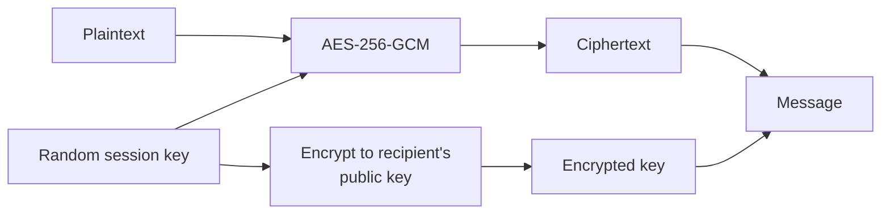

# Cryptography foundations

Everything in this section — certificates, TLS, ACME, the `openssl` commands — is an
arrangement of about six primitives. Learn the primitives and the rest stops being
folklore.

This note is deliberately hands-on: every concept comes with a command you can run.

## What cryptography actually gives you

Four properties, and they are not the same thing:

| Property | Question it answers | Primitive |
| --- | --- | --- |
| **Confidentiality** | Can anyone else read this? | Encryption |
| **Integrity** | Has this been altered? | Hash, MAC |
| **Authenticity** | Did it really come from them? | MAC, signature |
| **Non-repudiation** | Can they later deny sending it? | Signature only |

The last row is the one people get wrong. A **MAC** proves a message came from
someone holding the shared secret — but both parties hold it, so either could have
produced it, and neither can prove which. A **signature** uses a key only one party
holds, so it settles the question. Non-repudiation needs asymmetric cryptography.

> [!warning] What cryptography does not give you
> It does not give you availability, authorisation, or a correct implementation.
> A perfectly encrypted channel to a server that hands your data to anyone who asks
> is worthless. Most real-world failures are key management, protocol design, and
> bugs — not broken maths. Nobody factors your RSA key; they find it in a git
> repository.

## Symmetric encryption

One key, used for both encryption and decryption. Both parties must already have it.

```bash
# Encrypt a file with AES-256, deriving the key from a passphrase
openssl enc -aes-256-cbc -pbkdf2 -iter 600000 -salt \
  -in secret.txt -out secret.enc

# Decrypt
openssl enc -d -aes-256-cbc -pbkdf2 -iter 600000 \
  -in secret.enc -out secret.txt
```

**AES** is the standard block cipher — a 128-bit block size regardless of whether the
key is 128, 192 or 256 bits. **ChaCha20** is the standard stream cipher, and is
faster than AES on hardware without AES-NI instructions, which is why it exists in
TLS alongside it.

Symmetric cryptography is **fast**. Measure the gap yourself:

```console
$ openssl speed -evp aes-256-gcm      # hundreds of MB/s to several GB/s
$ openssl speed rsa2048               # a few thousand signatures/s
```

That difference — three or four orders of magnitude — is the entire reason
[hybrid encryption](#hybrid-encryption-why-everything-real-is-hybrid) exists.

### Modes of operation

A block cipher encrypts exactly one 128-bit block. The **mode** is how you extend
that to a message of any length, and choosing it badly is how symmetric encryption
fails in practice.

| Mode | What it does | Verdict |
| --- | --- | --- |
| **ECB** | Each block encrypted independently | **Never.** Identical plaintext blocks give identical ciphertext blocks, so structure leaks straight through |
| **CBC** | Each block XORed with the previous ciphertext | Legacy. Needs an unpredictable IV, and is malleable — see below |
| **CTR** | Turns the block cipher into a stream cipher | Fine, but unauthenticated |
| **GCM** | CTR plus a built-in authentication tag | **Default choice** |
| **ChaCha20-Poly1305** | Stream cipher plus a built-in tag | Equal choice, better without AES-NI |

You can see the ECB problem directly. Encrypt a bitmap of a solid shape under ECB and
the shape is still visible in the ciphertext — every identical run of pixels encrypts
to the same bytes. This is the famous "ECB penguin".

> [!danger] Two ways to destroy a symmetric cipher without breaking it
> **Reusing an IV or nonce.** With CTR or GCM, encrypting two different messages
> under the same key and nonce XORs them together for the attacker. With **GCM** it
> is worse than a confidentiality loss: nonce reuse leaks the authentication
> subkey, and the attacker can then **forge** messages. Nonces must never repeat for
> a given key — use a counter, not a random value, unless you can afford 96 bits of
> randomness and few enough messages to stay clear of the birthday bound.
>
> **Encrypting without authenticating.** CBC and CTR give you confidentiality only.
> An attacker who cannot read the ciphertext can still *modify* it — flipping a bit
> in a CBC ciphertext block flips the corresponding bit in the next plaintext block.
> This is not theoretical; padding-oracle attacks on CBC broke real systems for a
> decade. Always use an AEAD mode.

### AEAD

**Authenticated Encryption with Associated Data** does confidentiality and integrity
in one pass, and it is what you should use for anything new. GCM, CCM and
ChaCha20-Poly1305 are AEAD modes.

It takes four inputs and emits two:

```text
key + nonce + plaintext + associated data  →  ciphertext + authentication tag
```

The **associated data** is authenticated but not encrypted — a message header,
a record sequence number, a routing key. Anything the recipient must be able to read
before decrypting, but which must not be tamperable. TLS authenticates its record
headers this way.

Decryption checks the tag **first**. If it fails, you get an error and no plaintext —
not "decrypt and hope". That property is what kills padding oracles.

> [!warning] `openssl enc` cannot do AEAD
> `openssl enc -aes-256-gcm` stops with `enc: AEAD ciphers not supported`. The modes
> it does accept (CBC, CTR) have no authentication, so `openssl enc` never gives you
> integrity. For files, use `openssl cms` (it supports AES-GCM) or
> [age](https://github.com/FiloSottile/age). See
> [[security/cryptography/openssl/signing]].
>
> ```bash
> # cms with AES-256-GCM, to the holder of recipient.crt
> openssl cms -encrypt -binary -aes-256-gcm -in secret.txt -out secret.cms recipient.crt
> openssl cms -decrypt -binary -in secret.cms -inkey recipient.key -out secret.txt
> ```
>
> Keep `-binary`: without it, `cms` treats the input as text and changes every line
> ending to CRLF.

> [!warning] Correction
> An earlier version said `openssl enc -aes-256-gcm` works but drops the tag. On
> OpenSSL 3 it refuses to run at all.

### The problem symmetric cryptography cannot solve

Both parties need the same key **before** they can talk securely. So how do you send
it? And for *n* parties who all need to talk privately in pairs, you need
`n(n-1)/2` keys — 4,950 keys for 100 machines, each needing secure distribution and
rotation.

That is the problem asymmetric cryptography exists to solve.

## Hash functions

A hash takes any input and produces a fixed-size digest. It is **one-way** and has no
key.

```console
$ echo -n "hello" | openssl dgst -sha256
SHA2-256(stdin)= 2cf24dba5fb0a30e26e83b2ac5b9e29e1b161e5c1fa7425e73043362938b9824

$ echo -n "hellp" | openssl dgst -sha256
SHA2-256(stdin)= fdd7585e08c4e2afd71dcabdb4636c89d557a3f42db9e2040c8bbd1708aa4ce7
```

One changed character changes the whole digest — the **avalanche** property.

Three properties are required, in increasing order of difficulty to break:

| Property | Means |
| --- | --- |
| **Preimage resistance** | Given a digest, you cannot find *an* input producing it |
| **Second preimage resistance** | Given an input, you cannot find a *different* input with the same digest |
| **Collision resistance** | You cannot find *any* two inputs with the same digest |

Collision resistance is the weakest link because of the **birthday bound**: finding a
collision in an *n*-bit hash costs about 2^(n/2) work, not 2^n. SHA-256 therefore
offers 128 bits of collision resistance, not 256.

| Hash | Status |
| --- | --- |
| **MD5** | Broken. Collisions in seconds on a laptop |
| **SHA-1** | Broken. Chosen-prefix collisions demonstrated in 2020 for a few tens of thousands of dollars |
| **SHA-256 / SHA-384 / SHA-512** | Fine. The default |
| **SHA-3, BLAKE2, BLAKE3** | Fine. Different internal construction, useful when you want that |

> [!note] "Broken" depends on what you were using it for
> SHA-1 collisions break **signatures and certificates**, where an attacker who
> controls both documents can get one signed and present the other. They do not break
> **HMAC-SHA1**, which does not rely on collision resistance. Git's use of SHA-1 was
> uncomfortable for the same reason and is being migrated, not because commits are
> forgeable today. Still: use SHA-256 for anything new.

> [!warning] A hash is not encryption, and it is not a password store
> Hashing is not reversible, but it is also *fast* — which means an attacker with a
> digest of something low-entropy simply computes candidates until one matches.
> Billions per second on a GPU. That is what
> [password hashing functions](#deriving-keys-two-different-jobs) exist to stop.

### Length extension

SHA-1, SHA-256 and SHA-512 use the Merkle–Damgård construction, and it leaks: given
`H(secret || message)` and the *length* of `secret`, an attacker can compute
`H(secret || message || padding || suffix)` without knowing the secret at all.

So the obvious "authenticate by hashing the secret with the message" construction is
broken. Use HMAC, which is built specifically to resist this. SHA-3 and BLAKE2/3 are
not affected.

## MACs

A **Message Authentication Code** is a keyed hash: integrity *and* authenticity, from
a shared secret.

```bash
openssl dgst -sha256 -hmac "shared-secret" payload.json
```

HMAC is the standard construction:

```text
HMAC(K, m) = H( (K ⊕ opad) || H( (K ⊕ ipad) || m ) )
```

The nested structure is what makes it immune to length extension. This is what signs
webhooks and API requests — GitHub, Stripe and Slack all send an HMAC of the request
body in a header.

> [!warning] Compare MACs in constant time
> `if (computed == received)` with a normal string comparison returns early on the
> first differing byte. An attacker measures the timing and recovers the expected MAC
> one byte at a time. Use `hmac.compare_digest` (Python), `hmac.Equal` (Go),
> `crypto.timingSafeEqual` (Node) — never `==`.

## Deriving keys — two different jobs

Both are called "key derivation" and they have opposite requirements. Using one where
the other belongs is a common and serious mistake.

### From a password — make it slow

The input has little entropy, so the function must be **deliberately expensive** to
make guessing uneconomic.

| Function | Use it? |
| --- | --- |
| **Argon2id** | First choice. Tunable memory, time and parallelism |
| **scrypt** | Good. Memory-hard |
| **bcrypt** | Acceptable. Note the 72-byte input truncation |
| **PBKDF2** | Only when required for compliance. Cheap to accelerate on GPUs, so use a very high iteration count |
| **A bare hash** | Never |

Memory-hardness is the point of the modern ones: a GPU or ASIC can do billions of
SHA-256 operations per second, but cannot cheaply give each of those cores a
gigabyte of RAM.

Always use a unique random **salt** per password, stored alongside the hash. Without
it, identical passwords produce identical digests and one precomputed table breaks
every account at once.

```bash
# Argon2id via the reference CLI (package: argon2 / libargon2)
echo -n "correct horse battery staple" | argon2 "$(openssl rand -hex 16)" -id -t 3 -m 16 -p 4
```

### From an existing key — make it fast

When the input is already a high-entropy secret — a Diffie–Hellman shared secret, a
master key — you do not need slowness. You need to turn one strong key into several
independent ones. That is **HKDF** (RFC 5869), and it is what TLS 1.3 uses.

```bash
openssl kdf -keylen 32 \
  -kdfopt digest:SHA2-256 \
  -kdfopt hexkey:00112233445566778899aabbccddeeff \
  -kdfopt salt:some-salt \
  -kdfopt "info:tls13 client traffic" \
  HKDF
```

The `info` label is what makes the outputs independent: derive with `info:encryption`
and `info:mac` from the same master key and you get two keys with no usable relation
between them. Never reuse one key for two purposes — derive.

## Asymmetric cryptography

Two mathematically linked keys. What one does, only the other can undo.

```bash
# Modern, algorithm-agnostic generation
openssl genpkey -algorithm ED25519 -out private.pem
openssl pkey -in private.pem -pubout -out public.pem

# RSA, when you need compatibility
openssl genpkey -algorithm RSA -pkeyopt rsa_keygen_bits:3072 -out rsa.pem

# EC, the usual middle ground
openssl genpkey -algorithm EC -pkeyopt ec_paramgen_curve:P-256 -out ec.pem
```

The private key stays on one machine, forever. The public key is published — that is
the whole point, and the reason the key-distribution problem goes away.

**Which key does what depends on the operation**, and this table is worth memorising:

| Operation | Key used | Undone with |
| --- | --- | --- |
| Encrypt *to* someone | Their **public** key | Their **private** key |
| Sign something | Your **private** key | Your **public** key |

Encryption and signing run the keys in opposite directions. "Signing is encrypting
with the private key" is a common shorthand and it is wrong for every real scheme —
RSA-PSS and Ed25519 are not RSA-OAEP run backwards.

### The two families

| | RSA | Elliptic curve |
| --- | --- | --- |
| Hard problem | Factoring large integers | Discrete logarithm on a curve |
| 128-bit security needs | 3072-bit key | 256-bit key |
| Speed | Slow keygen and signing, fast verify | Fast throughout |
| Use for | Compatibility with old things | Everything new |

Named curves you will meet: **X25519** for key agreement and **Ed25519** for
signatures (both from Curve25519, and not interchangeable), plus the NIST curves
**P-256** and **P-384**, which you need where FIPS compliance is required.

Equivalent strengths, from NIST SP 800-57 — the asymmetry is striking:

| Security strength | Symmetric | RSA | Elliptic curve |
| --- | --- | --- | --- |
| 112 bits | 3DES | 2048 | 224 |
| 128 bits | AES-128 | 3072 | 256 |
| 192 bits | AES-192 | 7680 | 384 |
| 256 bits | AES-256 | 15360 | 512 |

That row for 256-bit security is why nobody uses 15360-bit RSA: the cost grows
brutally, while an elliptic curve gets there with 512 bits. It is also why "just use
RSA-4096" is not the safety margin people think — it buys you roughly 140 bits of
security for several times the signing cost of RSA-2048. Measure it with
`openssl speed rsa2048 rsa4096 ecdsap256` before choosing.

> [!important] RSA padding is not optional, and the default is wrong
> Textbook RSA is deterministic and insecure. The padding scheme is what makes it
> work, and you must pick one explicitly:
>
> - **OAEP** for encryption. The old **PKCS#1 v1.5** is vulnerable to Bleichenbacher
>   padding-oracle attacks and is still the OpenSSL default.
> - **PSS** for signatures. PKCS#1 v1.5 signatures are still widely used and still
>   accepted, but PSS is randomised and has a security proof.
>
> See [[security/cryptography/openssl/signing]] for the exact flags. Elliptic-curve
> schemes have no equivalent footgun — one more reason to prefer them.

## Key agreement

Encryption is not how two parties get a shared key in practice. **Diffie–Hellman** is.

Both sides agree on public parameters, each generates a private value, and they
exchange the corresponding public values:

```text
Alice picks a, sends  A = g^a mod p
Bob   picks b, sends  B = g^b mod p

Alice computes  B^a = g^(ba) mod p
Bob   computes  A^b = g^(ab) mod p     ← the same number
```

An eavesdropper sees `g`, `p`, `A` and `B` and cannot get `g^ab` from them — that is
the discrete logarithm problem. **The shared secret is never transmitted.** It is
computed independently on both sides.

```bash
# X25519 is the elliptic-curve version, and what TLS 1.3 uses
openssl genpkey -algorithm X25519 -out alice.pem
openssl genpkey -algorithm X25519 -out bob.pem
openssl pkey -in alice.pem -pubout -out alice.pub
openssl pkey -in bob.pem   -pubout -out bob.pub

# Each side derives the same secret from its own private key and the other's public
openssl pkeyutl -derive -inkey alice.pem -peerkey bob.pub | xxd
openssl pkeyutl -derive -inkey bob.pem   -peerkey alice.pub | xxd
```

Run those last two lines and compare the output. They are identical, and neither
value crossed the wire.

> [!danger] Diffie–Hellman alone has no authentication
> An attacker in the middle can run a separate exchange with each side and relay
> between them. Both ends get a working encrypted channel — to the attacker. DH gives
> you a shared secret with *somebody*; it says nothing about who.
>
> Fixing that is the job of the **signature** over the exchange, and of the
> **certificate** that vouches for the signing key. See
> [[security/cryptography/pki-and-x509]].

### Forward secrecy

Generate the DH values fresh for each session — **ephemeral**, the `E` in ECDHE — and
discard them afterwards. Then an attacker who records traffic today and steals the
server's long-term private key next year still cannot decrypt it: the keys that
protected those sessions no longer exist anywhere.

This is why TLS 1.3 removed static RSA key transport entirely. Any scheme where the
long-term key can decrypt past traffic fails this, and "we recorded it, we will
decrypt it later" is a real adversary model — see
[[security/cryptography/post-quantum]].

## Digital signatures

Sign with the private key, verify with the public key. This gives integrity,
authenticity **and** non-repudiation.

```bash
# Ed25519 signs the message directly
openssl pkeyutl -sign -inkey private.pem -rawin -in release.tar.gz -out release.sig
openssl pkeyutl -verify -pubin -inkey public.pem -rawin \
  -in release.tar.gz -sigfile release.sig
# Signature Verified Successfully
```

In practice you sign a **hash**, not the data: signing is expensive and asymmetric
operations have a size limit, while a digest is 32 bytes regardless of input size.
That is also why a broken hash breaks signatures — if an attacker can find two
documents with the same digest, a signature over one is a valid signature over the
other.

A **certificate** is nothing more than this: a signature, by a certificate authority,
over the statement "this public key belongs to this name". Everything in
[[security/cryptography/pki-and-x509]] follows from that one sentence.

## Hybrid encryption — why everything real is hybrid

Asymmetric encryption is slow and size-limited. A 2048-bit RSA key with OAEP padding
can encrypt **190 bytes** with SHA-256 (214 with SHA-1, OpenSSL's OAEP default). Not
190 kilobytes.

So no real system RSA-encrypts your data. They all do this:

1. Generate a random symmetric key for this message or session.
2. Encrypt the data with that key, using an AEAD mode.
3. Encrypt *only the symmetric key* with the recipient's public key — or agree it
   with Diffie–Hellman, which is better because it gives forward secrecy.
4. Send both.



TLS does this. PGP does this. `age`, S/MIME, JWE, LUKS, and every disk encryption
scheme do this. When you see "encrypted with RSA-2048 and AES-256" on a product page,
this is what it means — the RSA protects the AES key, and the AES protects the data.

Modern designs name the two halves explicitly: the **KEM** (key encapsulation
mechanism) that establishes the key, and the **DEM** (data encapsulation mechanism)
that uses it. That split is exactly why post-quantum migration replaces the KEM and
leaves the DEM alone.

## Randomness

Every key, nonce, salt and IV depends on unpredictable random numbers, and this is a
routine source of catastrophic, silent failure. Predictable randomness means
recoverable keys, and nothing about the output looks wrong.

```bash
openssl rand -hex 32          # 32 random bytes, hex
openssl rand -base64 32
```

Use the operating system's CSPRNG — `getrandom(2)` on Linux, or `/dev/urandom`, both
of which are correct and non-blocking once the pool is seeded. In code use
`secrets` (Python), `crypto/rand` (Go), `crypto.randomBytes` (Node) — never
`random`, `rand()`, or `Math.random()`.

> [!warning] The classic failure is a VM or container with no entropy at boot
> Cloned images and freshly booted VMs have historically generated keys from an
> unseeded pool, producing duplicate SSH host keys across thousands of hosts. Modern
> kernels block early boot until seeded and use `RDRAND` where available, but
> generating long-lived keys in the first seconds of a machine's life is still worth
> avoiding.

## Choosing parameters today

| Job | Use | Avoid |
| --- | --- | --- |
| Symmetric encryption | AES-256-GCM, ChaCha20-Poly1305 | ECB, any unauthenticated mode |
| Hashing | SHA-256, SHA-384, BLAKE3 | MD5, SHA-1 |
| Message authentication | HMAC-SHA-256, or an AEAD tag | Bare hashes, `H(key‖msg)` |
| Password storage | Argon2id | Any plain hash, unsalted anything |
| Key derivation from a key | HKDF-SHA-256 | Reusing one key for two purposes |
| Signatures | Ed25519, ECDSA P-256, RSA-3072 with PSS | RSA-1024, DSA, SHA-1 signatures |
| Key agreement | X25519, ECDHE P-256 | Static RSA, non-ephemeral DH |
| Encrypting a file | `age`, `openssl cms` | `openssl enc`, hand-rolled RSA |

> [!important] The real rule
> Do not assemble primitives yourself. Every item in the left column is a place where
> a correct-looking combination is insecure — MAC-then-encrypt, an IV derived from a
> counter you also send, a signature over a hash the attacker chooses. Use a library
> that makes the decision for you: **libsodium**, **Tink**, **age**, or your
> language's high-level TLS API. `openssl` subcommands are excellent for *inspecting*
> cryptographic objects and poor for *building* systems out of them.

## Where to go next

- [[security/cryptography/pki-and-x509]] — binding a public key to a name, with certificates
- [[security/cryptography/tls-protocol]] — how these primitives combine on the wire
- [[security/cryptography/post-quantum]] — which of them a quantum computer breaks, and what replaces them
- [[security/cryptography/openssl/introduction]] — the tool, in detail

<!-- uplink -->
Part of [[security/cryptography/index|Cryptography, PKI and TLS]].
