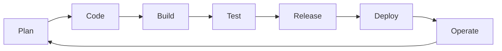

# The DevSecOps chain

"Shift left" is usually presented as a slogan and implemented as a pile of scanners
bolted onto a pipeline. The useful version is more specific: **each class of problem
has one stage where it is cheapest to catch**, and putting a control anywhere else
either misses things or annoys people into disabling it.

## The stages



| Stage | Controls | Catches |
| --- | --- | --- |
| **Plan** | Threat modelling, [[security/mitre-attack-and-d3fend\|ATT&CK]] mapping | Design flaws — the only stage that can |
| **Code** | Pre-commit hooks, secret scanning, IDE linting | Secrets, obvious injection, dependency additions |
| **Build** | SAST, dependency scanning, SBOM generation, image scanning | Known-vulnerable dependencies, insecure patterns |
| **Test** | DAST, integration tests, fuzzing | Runtime behaviour, authentication and authorisation flaws |
| **Release** | Signing, provenance, policy gate | Unapproved or unverified artifacts |
| **Deploy** | Admission control, IaC scanning, signature verification | Misconfiguration, unsigned images |
| **Operate** | Runtime detection, continuous re-scanning, [[security/caldera\|emulation]] | Newly disclosed CVEs, actual intrusion |

## What each stage genuinely cannot do

Being clear about this prevents most of the wasted effort:

- **SAST cannot find design flaws.** Authorisation modelled wrongly is correct code
  doing the wrong thing. Only threat modelling catches it, and only at plan time.
- **Dependency scanning cannot tell you if you are exploitable.** It matches versions
  against a database. Reachability is what [[security/supply-chain/vex|VEX]] and
  `govulncheck` address.
- **DAST cannot cover what it cannot reach.** Anything behind authentication or a
  complex workflow goes untested unless you configure it deliberately.
- **Admission control cannot inspect intent.** It checks the shape of a manifest, not
  whether the image does something reasonable.
- **Runtime detection cannot prevent.** By the time it fires, it happened.

> [!important] Every stage has a false-negative rate, and stacking tools does not fix it
> Two SAST tools do not give you twice the coverage; they give you two overlapping
> subsets and roughly twice the false positives. Depth at one well-placed gate beats
> breadth across five badly-placed ones.

## Placing the gates

The pipeline that works looks roughly like:

```yaml
# Code — fast, local, blocking
pre-commit:
  - gitleaks git --pre-commit --staged  # secrets, before they exist in history
  - hadolint Dockerfile
  - golangci-lint run

# Build — a few minutes, blocking
build:
  - semgrep --config=auto --error     # SAST
  - govulncheck ./...                 # reachable vulnerabilities
  - syft . -o cyclonedx-json=sbom.json
  - sbomqs score sbom.json --basic
  - grype sbom:./sbom.json --fail-on high
  - trivy config .                    # IaC and Dockerfile misconfiguration

# Release — blocking
release:
  - cosign sign --key "$KMS_KEY" "$IMAGE@$DIGEST"
  - cosign attest --predicate sbom.json --type cyclonedx --key "$KMS_KEY" "$IMAGE@$DIGEST"

# Deploy — enforced by the cluster, not the pipeline
# → Kyverno verifyImages, Pod Security Admission, NetworkPolicy

# Operate — continuous, non-blocking
# → Dependency-Track re-scanning, Falco or NeuVector, Caldera exercises
```

> [!warning] Correction
> The pre-commit line was `gitleaks detect --staged`. `detect` has no `--staged` flag
> (gitleaks 8.30 refuses it), and `detect` and `protect` are deprecated since 8.19. The
> current command is `gitleaks git --pre-commit --staged`.

> [!important] The deploy gate must not live in the pipeline
> A check that runs in CI can be bypassed by anyone who can deploy another way —
> `kubectl apply`, a different pipeline, a break-glass path. Signature verification
> and pod security have to be enforced **by the cluster**, at admission, where there
> is no way around them.
>
> This is the single most common structural mistake: excellent CI security, and a
> cluster that will run anything. See [[kubernetes/security/kyverno]] and
> [[kubernetes/security/pod-security-admission]].

## What blocks and what does not

| Control | Blocking? | Why |
| --- | --- | --- |
| Secret detection | **Yes**, always | A committed secret is compromised and must be rotated. There is no "review later" |
| SAST critical findings | Yes | With a documented exception process |
| SAST everything else | No | Report, track, fix — blocking on every finding trains people to bypass it |
| Fixable High/Critical CVEs | Yes | With [[security/supply-chain/vex\|VEX]] for genuine non-applicability |
| Unfixable CVEs | No | Nothing to do; track with a review date |
| Missing signature | **Yes**, at admission | The whole point of signing |
| Runtime alerts | No | Alert and respond |

> [!warning] A gate that fires constantly gets disabled
> The failure mode is predictable: a scanner produces 400 findings, the team cannot
> triage them, someone adds `|| true`, and the gate is now decorative while still
> appearing on the compliance report.
>
> Better to block on a small set of things that are genuinely unacceptable and always
> actionable — secrets, unsigned artifacts, fixable criticals — and report the rest.
> A gate people trust is worth more than a gate that is comprehensive on paper.

## Secrets deserve their own treatment

The one class of finding where the response is not "fix it in the next sprint":

- **Pre-commit** — `gitleaks` or `trufflehog`, so it never enters history.
- **Server-side** — push protection, because pre-commit hooks are advisory and
  routinely skipped.
- **Historical scanning** — the repository already contains things.
- **Rotation** — a secret that reached a remote branch is compromised, regardless of
  whether the commit was later removed. Removing it from history does not un-leak it.

## Maturity, honestly ordered

Everyone wants the full pipeline immediately. The order that actually works:

1. **Secret scanning**, blocking. Cheapest control with the highest hit rate.
2. **Dependency scanning** on build, reporting only at first.
3. **Minimal base images** — see [[security/secure-container-images]]. Removes whole
   categories of finding rather than reporting them.
4. **Admission control** in audit mode, then enforcing.
5. **SBOM generation and storage** — [[security/supply-chain/sbom-lifecycle]].
6. **Signing and verification** — [[security/supply-chain/cosign]].
7. **SAST**, tuned, once there is capacity to act on it.
8. **Runtime detection**, once the preventive layers mean an alert is meaningful.
9. **Continuous validation** — [[security/caldera]].

Steps 1 to 3 deliver most of the risk reduction. Steps 7 onwards are where most
programmes start, which is why so many produce dashboards rather than outcomes.

## A note on reference architectures

Vendor DevSecOps reference architectures — Sonatype's is a widely circulated example —
are useful for the **shape** of the pipeline and the vocabulary. They are also
marketing, and will place a product at every stage.

Read them for the stage decomposition, then choose tools on merit. The stages are
industry-standard; the product at each one is not.

## Where to go next

- [[security/security-roadmap]] — sequencing this as actual work
- [[security/supply-chain/sbom-lifecycle]] — the build-to-operate loop in detail
- [[security/secure-container-images]] — the build-time controls
- [[security/cvss]] — why severity alone is a poor gate

<!-- uplink -->
Part of [[security/index|Security]].
