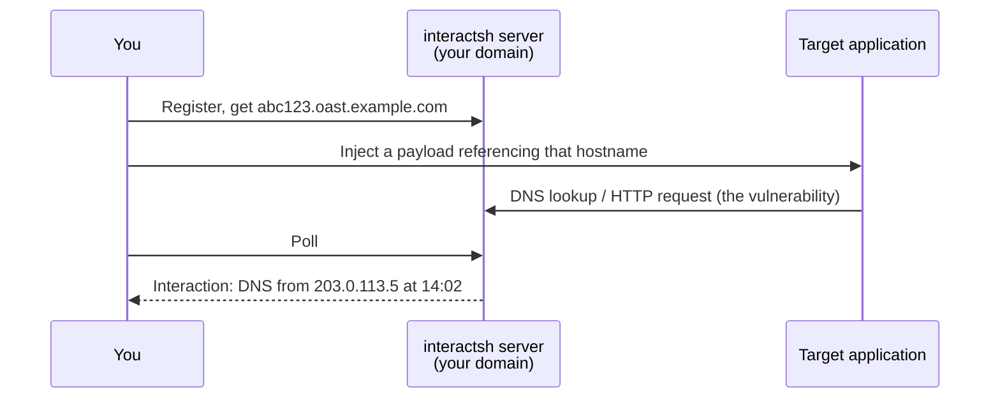

# interactsh

[interactsh](https://github.com/projectdiscovery/interactsh) detects **out-of-band**
interactions: it gives you a unique domain, and tells you whenever anything resolves
or connects to it.

That solves a specific problem. Some vulnerability classes produce no visible
response:

| Class | Why it is blind |
| --- | --- |
| **Blind SSRF** | The server makes the request; you never see the result |
| **Blind command injection** | The command runs; output is not returned |
| **XXE without output** | The entity is resolved; the document is not echoed |
| **Deserialisation** | Code executes; nothing is reflected |
| **Log4Shell-style JNDI** | The lookup happens somewhere you cannot observe |

In every case the target *reaches out*. interactsh is the thing it reaches.

> [!warning] Only against systems you are authorised to test
> Triggering an out-of-band interaction means making a target's server connect
> somewhere you control. That is unambiguously active testing.

## How it works



The correlation ID is unique per payload, so you know **which** injection point fired
— which is what makes it usable at scale rather than just a yes/no.

## The client

```bash
go install -v github.com/projectdiscovery/interactsh/cmd/interactsh-client@latest

# or the container image (multi-arch)
docker run --rm projectdiscovery/interactsh-client:v1.4.1
```

```bash
interactsh-client
# [INF] Listing 1 payload for OOB Testing
# c8f3k2m1.oast.pro
```

Then use that hostname in a payload, and interactions appear as they arrive:

```text
[c8f3k2m1] Received DNS interaction from 203.0.113.5 at 2026-08-11 14:02:31
[c8f3k2m1] Received HTTP interaction from 203.0.113.5 at 2026-08-11 14:02:31
```

Useful flags:

```bash
interactsh-client -json -o interactions.json
interactsh-client -n 10                    # generate several payloads
interactsh-client -dns-only
interactsh-client -v                       # full requests and responses
```

Without `-server`, the client registers with one of the public servers (`oast.pro`,
`oast.live`, `oast.site`, `oast.online`, `oast.fun`, `oast.me`).

> [!important] DNS-only interactions still tell you a great deal
> A target with no outbound HTTP but working DNS resolution will still leak — its
> resolver performs the lookup. So a DNS interaction with **no** HTTP interaction
> means the vulnerability is real *and* egress filtering is partially working.
>
> That distinction is genuinely useful defensively: it separates "not exploitable"
> from "exploitable but contained".

## Running your own server

The public instances are convenient and the wrong choice for real work.

> [!danger] Public interactsh servers see your findings
> The default `oast.pro` and similar are shared infrastructure. Every interaction —
> including internal hostnames, tokens and request bodies that a vulnerable server
> sends — arrives at somebody else's machine.
>
> Data exfiltrated through an SSRF you are testing lands there too. For anything
> touching your own estate, self-host.

You need a domain and a host with a public IP:

```bash
go install -v github.com/projectdiscovery/interactsh/cmd/interactsh-server@latest
```

Delegate a subdomain to it:

```text
oast.example.com.     NS    ns1.oast.example.com.
ns1.oast.example.com. A     203.0.113.10
```

```bash
TOKEN=$(openssl rand -hex 32)
interactsh-server -domain oast.example.com \
  -ip 203.0.113.10 \
  -token "$TOKEN"
```

```bash
interactsh-client -server https://oast.example.com -token "$TOKEN"
```

The server answers DNS for the domain, and HTTP, HTTPS, SMTP and LDAP on their
usual ports. On start it gets a Let's Encrypt certificate for the domain with ACME,
so ports 53, 80 and 443 must be reachable. `-skip-acme` turns HTTPS off instead.

A token is not optional — an open server is a free OOB service for anyone who finds
it. `-token` sets one and turns authentication on; `-auth` alone generates a random
one.

> [!note] Set `TOKEN` first
> The client uses `$TOKEN`, so set it before you start the server. `-auth` is not
> needed with `-token`.

## With nuclei

The integration is automatic. Templates using `{{interactsh-url}}` work with no
setup:

```yaml
http:
  - raw:
      - |
        GET /?url=http://{{interactsh-url}} HTTP/1.1
        Host: {{Hostname}}

    matchers:
      - type: word
        part: interactsh_protocol
        words:
          - "http"
```

```bash
nuclei -l targets.txt -iserver https://oast.example.com -itoken "$TOKEN"
```

Point [[security/offensive/nuclei]] at your own server for the same reason.

## Testing egress filtering

The purely defensive use, and a good one.

Egress filtering is the control that turns many vulnerabilities from critical to
minor: an SSRF that cannot reach the internet cannot exfiltrate. But egress rules are
rarely tested, and drift.

From inside the environment you want to verify:

```bash
# Should FAIL on a properly restricted host
curl -m 5 "http://c8f3k2m1.oast.example.com/"
dig +short c8f3k2m1.oast.example.com
```

Then check whether the interaction arrived. Four outcomes, all informative:

| DNS seen | HTTP seen | Means |
| --- | --- | --- |
| No | No | Fully restricted — DNS and egress both blocked |
| Yes | No | HTTP egress blocked; DNS still leaks |
| Yes | Yes | No egress filtering |
| No | Yes | Unusual — direct IP connectivity without resolution |

Row two is the common real-world state, and worth knowing about: DNS is almost always
allowed, so DNS remains an exfiltration channel even where HTTP egress is blocked.

Run this from a pod as well as a VM — pod egress is frequently unrestricted even
where node egress is not. See [[kubernetes/networking/netpol]].

## Where to go next

- [[security/offensive/nuclei]] — the scanner that consumes this
- [[kubernetes/networking/netpol]] — restricting egress properly
- [[security/mitre-attack-and-d3fend]] — exfiltration as a tactic
- [[networking/iptables]] — egress filtering at the host

<!-- uplink -->
Part of [[security/offensive/index|Offensive tooling]].
