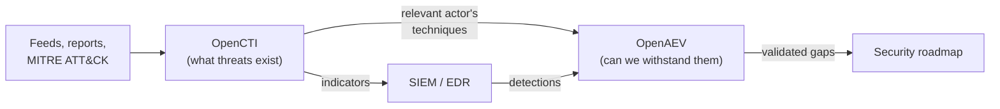

# OpenCTI and OpenAEV

Two open-source platforms from [Filigran](https://filigran.io/), addressing opposite
halves of the same question.

| Platform | Answers |
| --- | --- |
| **OpenCTI** | What do we know about the threats out there? |
| **OpenAEV** | Would we actually survive them? |

> [!note] OpenAEV was OpenBAS until November 2025
> Filigran announced the new name on 6 November 2025.
> It was renamed from **OpenBAS** — Breach and Attack Simulation — to **OpenAEV** —
> Adversarial Exposure Validation. Documentation, blog posts and container images from
> before then use the old name, and the repository moved. If you find `openbas`
> references, they are the same product.

## OpenCTI

[OpenCTI](https://docs.opencti.io/latest/) is a threat intelligence platform. It
ingests, correlates and stores structured knowledge about threats, built on the
**STIX 2.1** data model.

The problem it solves is fragmentation: threat intelligence arrives as vendor reports,
MISP feeds, CERT advisories, blog posts and CSV files, and none of it correlates. A
platform that normalises all of it into one graph lets you ask questions across
sources.

### The model

Everything is a STIX object with typed relationships:

| Object | Example |
| --- | --- |
| **Threat actor** / **Intrusion set** | A named group |
| **Malware** | A family, with its variants |
| **Attack pattern** | A [[security/mitre-attack-and-d3fend\|MITRE ATT&CK]] technique |
| **Indicator** | An IP, a hash, a domain — with a validity period |
| **Observable** | The raw artifact an indicator refers to |
| **Vulnerability** | A CVE |
| **Report** | The source that asserted all of the above |

The relationships are the point. "This intrusion set *uses* this malware, which
*implements* this attack pattern, and was *seen in* this report" is a traversable
graph rather than four unrelated records.

> [!important] Indicators expire; techniques do not
> An IP address is useful for weeks. A hash is useful until the malware is
> recompiled. The **attack pattern** stays relevant for years.
>
> OpenCTI models indicator validity explicitly, which is what stops a threat feed
> becoming a permanently growing blocklist of addresses that were reassigned long ago.
> Build detections on techniques where you can, and treat indicators as perishable.

### Connectors

The ecosystem is the reason to use it. Connectors come in four kinds:

- **External import** — MITRE ATT&CK, MISP, AlienVault OTX, CVE feeds, vendor reports
- **Internal enrichment** — VirusTotal, Shodan, Hybrid Analysis, adding context to an
  observable
- **Internal import** — parsing PDFs and STIX bundles you upload
- **Stream** — pushing indicators out to a SIEM, EDR or firewall

That last category is what makes it operational rather than a library: indicators
flow from the platform into the tools that act on them.

## OpenAEV

[OpenAEV](https://docs.openaev.io/latest/) validates whether your defences work, by
running real attack scenarios against your environment and measuring what was
detected, prevented and reported.

It is intelligence-driven — that is the distinguishing claim — so a scenario can be
built from what OpenCTI says a relevant threat actor actually does, rather than from a
generic checklist.

| Concept | Meaning |
| --- | --- |
| **Scenario** | A sequence of injects, modelling an intrusion |
| **Inject** | One action — execute an implant, send an email, call an API |
| **Simulation** | A run of a scenario against defined targets |
| **Agent** | An endpoint executing the technical injects |
| **Player** / **Team** | The people involved, for the human parts of the exercise |

Injects are not purely technical. It also drives the **process** side — sending a
phishing email to a team, notifying a responder, testing whether an escalation
actually happens. That is what separates it from a purely technical tool like
[[security/caldera]].

> [!warning] This runs real attack techniques against real systems
> Authorisation, scoping and notification are prerequisites, not formalities. Tell
> the people who will see the alerts, and agree in advance what is out of scope. The
> caveats in [[security/caldera]] apply identically.

## How they fit together



The loop is the value: intelligence identifies what a relevant adversary does, OpenAEV
tests whether you would detect it, and the gaps become work rather than a slide.
Without OpenAEV, OpenCTI is a well-organised library. Without OpenCTI, OpenAEV runs
generic scenarios.

## Running them

The [XTM Docker stack](https://github.com/FiligranHQ/xtm-docker) brings up the whole
platform for evaluation:

```bash
git clone https://github.com/FiligranHQ/xtm-docker
cd xtm-docker
cp .env.sample .env
```

```bash
# Each secret on its own line: several need a set format (UUIDv4, base64).
set_env() { sed -i "s|^$1=.*|$1=$2|" .env; }
set_env POSTGRES_USER openaev
set_env RABBITMQ_DEFAULT_USER opencti
for k in MINIO_ROOT_PASSWORD RABBITMQ_DEFAULT_PASS POSTGRES_PASSWORD \
         OPENSEARCH_ADMIN_PASSWORD OPENCTI_ADMIN_PASSWORD OPENAEV_ADMIN_PASSWORD \
         XTM_ONE_ADMIN_PASSWORD XTM_ONE_POSTGRES_PASSWORD XTM_ONE_SECRET_KEY \
         PLATFORM_REGISTRATION_TOKEN OPENAEV_ADMIN_ENCRYPTION_SALT; do
  set_env "$k" "$(openssl rand -hex 32)"
done
for k in OPENCTI_ADMIN_TOKEN OPENCTI_HEALTHCHECK_ACCESS_KEY \
         OPENAEV_ADMIN_TOKEN OPENAEV_HEALTHCHECK_KEY; do
  set_env "$k" "$(cat /proc/sys/kernel/random/uuid)"
done
set_env OPENCTI_ENCRYPTION_KEY "$(openssl rand -base64 32)"
set_env OPENAEV_ADMIN_ENCRYPTION_KEY "$(openssl rand -base64 32)"
grep -in changeme .env      # what is left: SMTP and IMAP, set by hand
docker compose up -d
```

> [!warning] Not one `sed` for every secret
> `sed -i "s/ChangeMe/$(openssl rand -hex 16)/g" .env` misses the lowercase
> `changeme` values (the OpenCTI admin password among them), gives every secret the
> same value, and turns `ChangeMe_UUIDv4` into a token that is not a UUID.
> `OPENAEV_ADMIN_TOKEN` is all zeros in the sample and needs its own value.

> [!danger] Change every default in `.env` before the first start
> The sample environment contains placeholder passwords and admin tokens. Bringing the
> stack up unchanged and reachable gives anyone who finds it an administrative account
> on a platform holding your threat intelligence — and, through OpenAEV, the ability
> to execute injects on your agents.
>
> This is evaluation tooling. Do not expose it, and generate real secrets first. See
> [[security/secure-container-images]] on the general point.

Resource requirements are substantial — the stack runs Elasticsearch, Redis,
RabbitMQ, PostgreSQL and an S3 store alongside the two platforms. The S3 store was
MinIO; the current stack uses Silo, still under the `minio` service name and the
`MINIO_` variables. Budget 16 GB of RAM for anything beyond a demonstration.

## Whether you need this

**Worth it when** you have a security team that consumes threat intelligence, are
already doing detection engineering, and have somewhere for the findings to go.

**Not worth it when** the platform would become a place feeds arrive and nobody reads.
An unused OpenCTI is a large operational burden producing nothing — and it is a
common outcome, because installing it is much easier than staffing it.

The lighter first step is mapping your existing detections to
[[security/mitre-attack-and-d3fend|ATT&CK]] on paper, and validating a handful of
techniques with [[security/caldera]] or Atomic Red Team. That surfaces most of the same
gaps for a fraction of the effort.

## Where to go next

- [[security/mitre-attack-and-d3fend]] — the framework both are built around
- [[security/caldera]] — the lighter-weight emulation option
- [[security/security-roadmap]] — where validated gaps should end up
- [[security/resources]] — vulnerability and intelligence feeds

<!-- uplink -->
Part of [[security/index|Security]].
