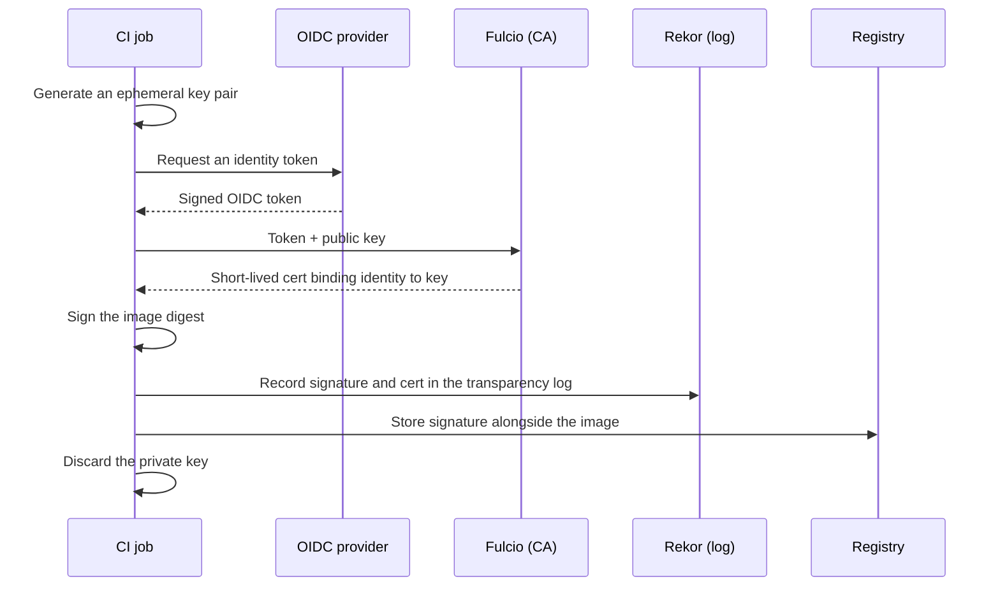

# cosign — keyless signing and attestations

Beyond [[security/supply-chain/cosign|signing an image with a key]], cosign supports
identity-based signing with no long-lived key at all, and can attach signed
*statements about* an artifact rather than just a signature over it.

## Keyless signing

"Keyless" is a slight misnomer: there is still a key, it just exists for about ten
minutes.



In a workflow with an OIDC (OpenID Connect) token available — GitHub Actions,
GitLab CI — there is no key to pass. `--yes` only skips the prompt about the public
log:

```bash
cosign sign --yes "myregistry/myapp@${DIGEST}"
```

Verification asserts **who signed**, not which key was used:

```bash
cosign verify \
  --certificate-identity "https://github.com/myorg/myrepo/.github/workflows/release.yml@refs/heads/main" \
  --certificate-oidc-issuer "https://token.actions.githubusercontent.com" \
  "myregistry/myapp@${DIGEST}"
```

> [!important] This is a stronger claim than a key signature
> A key signature says "someone holding this key signed it" — and keys get copied. A
> keyless signature says "*this workflow, in this repository, on this branch*, signed
> it", verified against the identity provider at signing time. Compromising it means
> compromising the repository or the CI provider, not exfiltrating a file.

With cosign v3 and the public Sigstore instance, the signature also gets a signed
timestamp from a timestamp authority, and the log entry goes to Rekor v2.

**Trade-off:** verification depends on the Sigstore trust root (Fulcio's CA, the
Rekor and timestamp keys). In an
air-gapped environment you either mirror the trust root
(`cosign initialize --mirror`) or stay with KMS-backed keys, which is why the
[[security/secure-container-images|internal PKI approach]] remains the right default
for disconnected deployments.

## The transparency log

Every keyless signature is recorded in **Rekor**, an append-only, publicly auditable
log. Two consequences:

- You can prove a signature existed at a point in time, even after the certificate
  expired — which is what makes ten-minute certificates workable.
- A malicious signature cannot be issued invisibly; it leaves a public record.

```bash
# Searches the Rekor v1 log (rekor.sigstore.dev) only
rekor-cli search --artifact myfile.tar.gz
```

Since October 2025, new entries go to **Rekor v2**, one log per year
(`log2025-1.rekor.sigstore.dev`). Rekor v2 has **no search index**: you cannot look
up an entry by artifact or by email. Keep the Sigstore bundle that cosign writes
(`--bundle`, or the referrer in the registry): it holds the entry and its proof.

> [!warning] Rekor is public — do not sign secrets into it
> The log records the certificate, which contains the signing identity, and the
> artifact digest. Signing a private artifact publishes the fact of its existence and
> its hash. This is also true with a key: cosign v3 uploads key signatures to the
> public log by default. For internal work, run a private Rekor instance, or sign
> with a signing config that has no log — see
> [[security/supply-chain/cosign#Key-based signing]].

> [!warning] Correction
> The note said `COSIGN_EXPERIMENTAL=0` keeps key signatures out of Rekor. It does
> not: that variable gated keyless signing in cosign v1, and has had no effect since
> v2. Key signatures went to the public log in v2 too.

## Attestations

A signature says "this artifact is from me". An **attestation** says "this artifact is
from me, *and here is a signed statement about it*" — how it was built, what is inside
it, what tests it passed.

The envelope is [in-toto](https://in-toto.io/), and the payload is a predicate whose
type identifies what kind of claim it makes:

```bash
# Attach a signed SBOM
cosign attest --predicate sbom.json --type cyclonedx \
  --key "$KMS_KEY" "myregistry/myapp@${DIGEST}"

# A custom predicate
cosign attest --predicate scan-results.json \
  --type https://example.com/scan/v1 \
  --key "$KMS_KEY" "myregistry/myapp@${DIGEST}"
```

Verify and inspect:

```bash
cosign verify-attestation --key cosign.pub --type cyclonedx \
  "myregistry/myapp@${DIGEST}" | jq -r '.payload | @base64d | fromjson | .predicate'
```

> [!tip] `attest` and `attach` are not the same thing
> `cosign attach sbom` stores an SBOM beside the image, unsigned. `cosign attest`
> wraps it in a signed in-toto statement. Only the second proves the SBOM was not
> swapped for a shorter one. `cosign attach sbom` is deprecated, and prints a warning
> that it does not sign: use `attest`.

## SLSA provenance

[SLSA](https://slsa.dev/) provenance is an attestation with a standard predicate
describing **how** the artifact was built: which source revision, which builder, which
parameters.

```bash
cosign verify-attestation \
  --type slsaprovenance \
  --certificate-identity-regexp "^https://github.com/slsa-framework/slsa-github-generator" \
  --certificate-oidc-issuer https://token.actions.githubusercontent.com \
  "myregistry/myapp@${DIGEST}"
```

`--type slsaprovenance` means SLSA provenance v0.2, which the
`slsa-github-generator` container workflow still produces. For v1 provenance (for
example from GitHub's `actions/attest-build-provenance`), use
`--type slsaprovenance1`. A type that does not match finds no attestation.

The value is being able to assert *"this image was built by our pipeline from our
main branch"* rather than *"this image was signed by something holding our key"*. It
is the control that would have caught several real-world build-system compromises,
where the attacker produced legitimately signed artifacts from modified sources.

## Policies that check the predicate

Verifying that an attestation exists is weak — you usually want to assert something
about its content. cosign evaluates CUE or Rego against the predicate:

```bash
cosign verify-attestation --key cosign.pub --type cyclonedx \
  --policy no-gpl.rego "myregistry/myapp@${DIGEST}"
```

Kyverno can do the same at admission, so a pod is rejected unless its image carries an
attestation whose content satisfies a rule:

```yaml
apiVersion: policies.kyverno.io/v1
kind: ImageValidatingPolicy
metadata:
  name: built-from-main
spec:
  validationActions: [Deny]
  matchConstraints:
    resourceRules:
      - apiGroups: [""]
        apiVersions: ["v1"]
        operations: ["CREATE", "UPDATE"]
        resources: ["pods"]
  matchImageReferences:
    - glob: "myregistry/*"
  attestors:
    - name: cosign
      cosign:
        key:
          data: |-
            -----BEGIN PUBLIC KEY-----
            ...
            -----END PUBLIC KEY-----
  attestations:
    - name: provenance
      intoto:
        type: https://slsa.dev/provenance/v1
  validations:
    - expression: >-
        images.containers.map(image, verifyAttestationSignatures(image, attestations.provenance, [attestors.cosign])).all(e, e > 0)
      message: no signed SLSA v1 provenance
    - expression: >-
        images.containers.map(image, extractPayload(image, attestations.provenance).predicate.buildDefinition.externalParameters.workflow.ref == 'refs/heads/main').all(e, e)
      message: the image was not built from main
```

That rule says: only run images whose signed provenance states they were built from
`main`. For keyless provenance, replace `key:` with a `keyless:` identity. See
[[kubernetes/security/kyverno]].

> [!warning] Correction
> The note showed a `verifyImages` fragment of a `kyverno.io/v1` `ClusterPolicy`.
> Kyverno 1.19 marks `ClusterPolicy` as deprecated, and its `verifyImages` rule did
> not find attestations in the cosign v3 layout in our test. The fragment also failed
> as written: with the default `Audit` action, Kyverno refuses `mutateDigest: true`.
> The `ImageValidatingPolicy` above was tested with the Kyverno 1.19.2 CLI.

## Where to go next

- [[security/supply-chain/cosign]] — the basics, and admission-time verification
- [[security/supply-chain/cosign-troubleshooting]] — when verification fails
- [[security/supply-chain/sbom-lifecycle]] — attesting SBOMs in a pipeline
- [[security/security-roadmap]] — where signing sits among the other controls

<!-- uplink -->
Part of [[security/supply-chain/index|Supply chain]].
