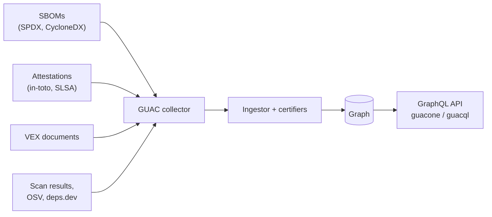

# GUAC

[GUAC](https://docs.guac.sh/) — Graph for Understanding Artifact Composition —
ingests supply chain metadata from many sources and assembles it into a **single
queryable graph**.

It exists because of the gap every SBOM programme hits. You have SBOMs. You have
signatures, attestations, VEX documents and scan results. They live in different
systems, keyed differently, and none of them answers the question you actually have
during an incident:

> A critical vulnerability was announced in some compression library. Which of our
> *running* services contain it, which team owns them, and which are internet-facing?

Answering that means joining build metadata to deployment reality. GUAC is a graph
database and ingestion pipeline built for that join.

## The model



Nodes are artifacts, packages, sources and builders; edges are the relationships
between them — *contains*, *was built from*, *is vulnerable to*, *is dependent on*.
Once that graph exists, the interesting queries are traversals rather than joins
across four tools.

## What it makes answerable

| Question | Why it is hard without a graph |
| --- | --- |
| What is affected by this CVE, transitively? | Requires walking every dependency tree you have |
| Which artifacts were built from this repository? | Provenance lives in attestations, not in the SBOM |
| If this package is compromised, what is the blast radius? | Needs reverse dependency traversal |
| Is anything we run built by a builder we no longer trust? | Needs provenance joined to inventory |
| Which of our SBOMs are missing or stale? | Requires knowing what *should* exist |

That last one is underrated: GUAC surfaces artifacts with **no** metadata, which is
usually a larger risk than anything in the SBOMs you do have.

## Running it

The quickest way to see it work is the bundled compose setup:

```bash
git clone https://github.com/guacsec/guac
cd guac
make start-service
```

That brings up the collector, ingestor, GraphQL server and an in-memory backend, in
the foreground. For a quick look without the clone, the GraphQL server alone also
works, with its default in-memory `keyvalue` backend:

```bash
guacgql --gql-listen-port 8080
```

Then load some documents:

```bash
guacone collect files ./my-sboms/
guacone collect files ./attestations/
```

And query — either through GraphQL directly, or the convenience commands:

```bash
guacone query known package "pkg:golang/github.com/some/library@v1.2.3"
guacone query vuln purl "pkg:oci/myapp@sha256:abc123..."
```

> [!note] Query commands
> In GUAC 1.1 the query commands are `known`, `vuln`, `patch` and `bad`, and `known`
> and `vuln` take a type first (`package`, `source`, `artifact`; `purl`, `uri`,
> `artifact`). There is no `guacone query dependents`.

The [GraphQL documentation](https://docs.guac.sh/guac/guac-graphql/) covers the schema
properly; the CLI wraps the handful of queries people actually run.

## Certifiers

Ingestion is only half of it. **Certifiers** enrich the graph from external sources on
an ongoing basis:

- `osv` — matches packages in the graph against the
  [OSV](https://osv.dev/) vulnerability database
- `scorecard` — attaches OpenSSF Scorecard results to source repositories
- `cd` — licence data from ClearlyDefined
- `eol` — end-of-life dates for the packages

```bash
guacone certifier osv
```

deps.dev is not a certifier: `guacone collect deps_dev` pulls in its dependency and
licence metadata, or `--add-depsdev-on-ingest` does it during ingestion.

This is what makes the graph answer questions about vulnerabilities disclosed *after*
ingestion, without re-uploading anything.

## Where it fits

> [!important] GUAC is downstream of everything else, and depends on it entirely
> It ingests; it does not generate. Feed it bad data and you get a confident graph of
> bad data. In practice its value is gated on the quality of what
> [[security/supply-chain/sbom-lifecycle|your pipeline produces]] — which is a good
> argument for running [[security/supply-chain/sbomqs]] as a build gate before any of
> this.

It also does not replace [Dependency-Track](https://dependencytrack.org/). The two
overlap but answer different questions: Dependency-Track is excellent at continuous
per-project vulnerability monitoring; GUAC is for relationship questions across the
whole estate. Running both is reasonable.

> [!warning] Expect this to be a project, not an afternoon
> GUAC is genuinely powerful and genuinely early. Deploying it seriously means
> operating a graph backend, a collector fleet, and a pipeline that reliably emits
> attestations for everything you build. It repays that at organisational scale and
> is hard to justify for a handful of services.

## Where to go next

- [[security/supply-chain/sbom-lifecycle]] — producing what GUAC consumes
- [[security/supply-chain/vex]] — the suppression layer it also ingests
- [[security/supply-chain/cosign-advanced]] — attestations and SLSA provenance
- [[security/security-roadmap]] — where this sits in a sequence of work

## Further reading

- [How GUAC works](https://docs.guac.sh/guac/how-guac-works/)
- [The GraphQL API](https://docs.guac.sh/guac/guac-graphql/)
- [Expanding your view](https://docs.guac.sh/guac/expanding-your-view/)
- [Sécuriser sa supply chain avec GUAC](https://blog.stephane-robert.info/docs/securiser/supply-chain/guac/) — a walkthrough in French

<!-- uplink -->
Part of [[security/supply-chain/index|Supply chain]].
