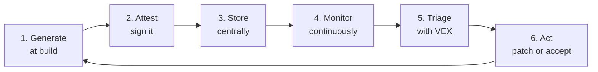

# SBOM lifecycle

An [[security/supply-chain/sbom|SBOM]] is only worth producing if something consumes
it. This note is the operational loop around it.



The loop matters more than any single step: a vulnerability disclosed today must
reach step 4 without anyone rebuilding anything.

## 1. Generate

In CI, as part of the build that produces the artifact — never as a separate job that
can drift:

```bash
syft myregistry/myapp:1.2.3 -o cyclonedx-json=sbom.json
```

Generate against the **digest**, not the tag. A tag can be re-pushed; the SBOM then
describes something that is no longer there.

```bash
DIGEST=$(crane digest myregistry/myapp:1.2.3)
syft "myregistry/myapp@${DIGEST}" -o cyclonedx-json=sbom.json
```

## 2. Attest

Sign the SBOM and attach it to the image, so a consumer can verify both what it says
and who said it:

```bash
cosign attest --predicate sbom.json --type cyclonedx \
  --key "$KMS_KEY" "myregistry/myapp@${DIGEST}"
```

See [[security/supply-chain/cosign-advanced]]. An unsigned SBOM sitting beside an
image proves nothing — anyone who can write to the registry can replace it with a
shorter one.

## 3. Store

Upload to something that keeps SBOMs and re-evaluates them —
[Dependency-Track](https://dependencytrack.org/) is the common choice:

```bash
curl -X POST "https://dtrack.example.com/api/v1/bom" \
  -H "X-Api-Key: $DTRACK_API_KEY" \
  -F "project=$PROJECT_UUID" \
  -F "bom=@sbom.json"
```

> [!important] This is the step that makes the rest worthwhile
> Dependency-Track continuously re-matches stored SBOMs against new advisories, so a
> CVE published six months after a release surfaces against every affected project
> without a rebuild. Without central storage you are back to grepping repositories
> during an incident.

## 4. Monitor

Two different scans, doing two different jobs:

| Scan | When | Blocks | Purpose |
| --- | --- | --- | --- |
| **Build-time** — Grype or Trivy in CI | Every build | Yes | Stop new known-vulnerable artifacts shipping |
| **Continuous** — Dependency-Track against stored SBOMs | Always | No | Find what became vulnerable after release |

```bash
grype sbom:./sbom.json --fail-on high
```

Scanning the SBOM rather than the image again is faster and gives identical results,
because the SBOM is what the scanner was going to build anyway.

## 5. Triage

Most findings on a well-built image are not exploitable in your context: the
vulnerable function is never called, the component is not reachable, the affected code
path is compiled out. Record that decision **once**, machine-readably, rather than
re-deciding it every scan:

```bash
vexctl create --product="pkg:oci/myapp@sha256:..." \
  --vuln="CVE-2026-1234" \
  --status="not_affected" \
  --justification="vulnerable_code_not_in_execute_path" \
  --file vex.json
```

See [[security/supply-chain/vex]]. Prioritise what remains with exploitation signals —
[CISA KEV](https://www.cisa.gov/known-exploited-vulnerabilities-catalog) and
[EPSS](https://www.first.org/epss/) — rather than severity alone. See
[[security/cvss]].

## 6. Act

Patch, accept with an expiry date, or mitigate. An accepted risk with no review date
is an ignored risk.

> [!warning] The gap nobody closes: SBOM to deployment
> Every step above tells you an *artifact* is affected. None of them tells you whether
> that artifact is **running**, in which cluster, exposed to what. Correlating build
> data with deployment reality is the job of
> [[security/supply-chain/guac]], and it is the difference between "we have 4,000
> findings" and "three of them are in something internet-facing".

## Putting it in a pipeline

```yaml
- name: Generate SBOM
  run: syft "myregistry/myapp@${DIGEST}" -o cyclonedx-json=sbom.json

- name: Check SBOM quality
  run: sbomqs score sbom.json --category vulnerability

- name: Scan
  run: grype sbom:./sbom.json --fail-on high

- name: Attest and attach
  run: cosign attest --predicate sbom.json --type cyclonedx --key "$KMS_KEY" "myregistry/myapp@${DIGEST}"

- name: Upload for continuous monitoring
  run: |
    curl -X POST "$DTRACK_URL/api/v1/bom" \
      -H "X-Api-Key: $DTRACK_API_KEY" \
      -F "project=$PROJECT_UUID" -F "bom=@sbom.json"
```

The `sbomqs` step is worth keeping: its Vulnerability category scores purls and CPEs,
so it shows the day your build tooling silently starts emitting SBOMs without them,
which would otherwise be discovered during an incident. It reports and does not fail
the job; to block, use the threshold check in [[security/supply-chain/sbomqs]].

> [!note] No `quality` category
> sbomqs 2.x has no `quality` category and stops with "invalid category".

## Where to go next

- [[security/supply-chain/sbom]] — formats and what goes in one
- [[security/supply-chain/vex]] — suppressing findings honestly
- [[security/supply-chain/guac]] — correlating with what is deployed
- [[security/secure-container-images]] — the build-time controls upstream of this

<!-- uplink -->
Part of [[security/supply-chain/index|Supply chain]].
