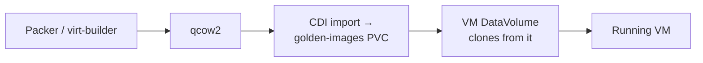

# KubeVirt with GitOps

Because a VM is a Kubernetes resource, it can live in Git and be reconciled by Argo CD
or Flux like anything else. That is genuinely one of the better arguments for
KubeVirt — VM definitions get review, history and rollback for free.

It also introduces problems that containers do not have, because VMs are stateful and
long-lived.

> [!note] Partly tested
> No test cluster runs KubeVirt: the test Mac has no KVM, and KubeVirt on arm64
> cannot use software emulation. The tests check the release URLs, validate every
> manifest against KubeVirt's API schema, and run `virtctl` and the `jq` commands
> offline. How a running cluster behaves is not tested.

## What belongs in Git

| In Git | Not in Git |
| --- | --- |
| `VirtualMachine` definitions | `VirtualMachineInstance` — created by the controller |
| Instance types and preferences | Disk contents |
| `DataVolume` templates and sources | Populated PVCs |
| Services, NetworkPolicies, NADs | Snapshots taken ad hoc |
| `runStrategy` | Anything the guest writes |

The rule: Git holds the **desired shape** of the VM. It does not hold its state, and
attempting to make it do so ends badly.

## A basic layout

```text
vms/
├── base/
│   ├── kustomization.yaml
│   └── vm-template.yaml
└── overlays/
    ├── dev/
    │   └── kustomization.yaml
    └── prod/
        └── kustomization.yaml
```

```yaml
# base/vm-template.yaml
apiVersion: kubevirt.io/v1
kind: VirtualMachine
metadata:
  name: app-vm
spec:
  runStrategy: Always
  instancetype:
    kind: VirtualMachineClusterInstancetype
    name: u1.medium
  preference:
    kind: VirtualMachineClusterPreference
    name: rhel.9
  dataVolumeTemplates:
    - metadata:
        name: app-vm-root
      spec:
        storage:
          accessModes: [ReadWriteMany]
          volumeMode: Block
          resources:
            requests:
              storage: 20Gi
        source:
          pvc:
            namespace: golden-images
            name: rocky9-golden
  template:
    spec:
      evictionStrategy: LiveMigrate
      domain:
        devices:
          disks:
            - name: rootdisk
              disk:
                bus: virtio
          interfaces:
            - name: default
              masquerade: {}
      networks:
        - name: default
          pod: {}
      volumes:
        - name: rootdisk
          dataVolume:
            name: app-vm-root
```

> [!warning] Correction
> An earlier version used the preference `rocky.9`. KubeVirt's common preferences
> have no such name. `rhel.9` fits Rocky Linux 9 and other RHEL 9 rebuilds.

Cloning from a golden PVC rather than pulling from a URL keeps builds fast and
deterministic — the image is built once, elsewhere, and referenced here. A clone from
another namespace (`golden-images` here) needs permission: the VM's namespace must be
allowed to create `datavolumes/source` in the source namespace (a Role and a
RoleBinding there).

The base lists the files, and each overlay puts the base in its own namespace and
changes what differs:

```yaml
# base/kustomization.yaml
apiVersion: kustomize.config.k8s.io/v1beta1
kind: Kustomization
resources:
  - vm-template.yaml
```

```yaml
# overlays/dev/kustomization.yaml
apiVersion: kustomize.config.k8s.io/v1beta1
kind: Kustomization
namespace: app-dev
resources:
  - ../../base
patches:
  - target:
      kind: VirtualMachine
      name: app-vm
    patch: |-
      - op: replace
        path: /spec/runStrategy
        value: Manual
      - op: replace
        path: /spec/instancetype/name
        value: u1.small
```

```bash
kubectl kustomize vms/overlays/dev
```

> [!warning] One namespace per environment, not `namePrefix`
> Kustomize does not know KubeVirt's fields. `namePrefix: prod-` renames the
> `VirtualMachine`, but not the names in `dataVolumeTemplates` and in the `dataVolume`
> volume. Two VMs in one namespace then fight over the same disk. Put each
> environment in its own namespace, as above.

## The drift problem

Argo CD will report a VM as `OutOfSync` for reasons that are not drift.

> [!warning] KubeVirt and CDI write to the objects you manage
> Controllers add annotations such as `kubevirt.io/latest-observed-api-version`, and
> webhooks fill in defaults. Argo may see a live object that differs from the
> manifest and call it drift. With self-heal on, it then writes the field back, again
> and again.
>
> Tell it to ignore the fields that change in your cluster, in the Argo CD
> `Application`:
>
> ```yaml
> spec:
>   ignoreDifferences:
>     - group: kubevirt.io
>       kind: VirtualMachine
>       jsonPointers:
>         - /spec/template/metadata/annotations
> ```
>
> Argo CD 3.0 and later ignore `/status` on every resource by default, so it needs no
> entry. Argo CD 2.x needed `/status` in the list.

A change under `spec.template` does not restart a running VM. KubeVirt applies it at
the next restart and sets the `RestartRequired` condition on the VM until then.

> [!warning] Correction
> An earlier version said that editing a `dataVolumeTemplates` entry makes Argo
> recreate the DataVolume and destroy the disk. Argo does not manage that DataVolume:
> KubeVirt creates it, once, when it is missing. So an edit does not change a disk
> that exists. Rename the entry (and the volume that uses it), and the VM gets a new,
> freshly imported disk.
> Treat the template as fixed after the first apply, and use a new VM name for a
> rebuild.

```yaml
metadata:
  annotations:
    argocd.argoproj.io/sync-options: Prune=false
```

`Prune=false` on VM resources is a reasonable safety net: an accidental deletion in
Git then does not delete the VM and its disks.

## Power state in Git

`runStrategy` in Git means someone stopping a VM with `virtctl stop` will find Argo
starting it again within minutes.

| Strategy | Meaning |
| --- | --- |
| `Always` | Keep it running; restart on failure |
| `RerunOnFailure` | Restart only if it failed |
| `Manual` | Whatever `virtctl` last set — **the GitOps-friendly choice for ad hoc control** |
| `Halted` | Keep it stopped |
| `Once` | Start once, do not restart |

`Manual` lets Git own the definition while humans own the power switch, which is
usually what people actually want.

## Secrets in cloud-init

SSH keys and passwords must not be inline in a repository. Reference a Secret:

```yaml
      volumes:
        - name: cloudinit
          cloudInitNoCloud:
            secretRef:
              name: app-vm-cloudinit
```

```bash
kubectl create secret generic app-vm-cloudinit --from-file=userdata=./user-data.yaml
```

Manage the Secret itself with Sealed Secrets or External Secrets — see
[[kubernetes/configuration/sealed-secrets]].

KubeVirt also has a dedicated access-credential mechanism, which injects SSH keys
through the guest agent and can update them **without restarting the VM**:

```yaml
      accessCredentials:
        - sshPublicKey:
            source:
              secret:
                secretName: vm-ssh-keys
            propagationMethod:
              qemuGuestAgent:
                users: ["rocky"]
```

That is the better option for key rotation across a fleet — rotating a key becomes a
Secret update rather than a rebuild.

## Golden images as a pipeline

The VM manifests in Git should reference an image built elsewhere:



Version the golden PVC — `rocky9-golden-2026-08` — so a VM manifest references a
specific build. Then rebuilding a VM against a newer image is a reviewable one-line
change, and rolling back is the same.

## Applications inside the VM

GitOps stops at the VM boundary. What runs *inside* is a separate problem, and the
honest answers are: configuration management from cloud-init
([[automation/ansible/index|Ansible]]), a golden image containing everything, or an
agent that pulls its own configuration.

> [!note] Do not try to manage guest internals through Kubernetes
> It is tempting to reach for the guest agent to run commands and converge state. That
> way lies a bespoke, unreliable configuration management system. Use a real one, and
> let Kubernetes own the VM's shape rather than its contents.

## Where to go next

- [[kubernetes/cicd-gitops/argocd]] — the reconciler doing the work
- [[virtualization/kubevirt/advanced]] — the storage and network settings referenced here
- [[virtualization/kubevirt/troubleshooting]] — when sync produces something unexpected
- [[automation/ansible/index|Ansible]] — configuring the inside of the VM

<!-- uplink -->
Part of [[virtualization/kubevirt/index|KubeVirt]].
