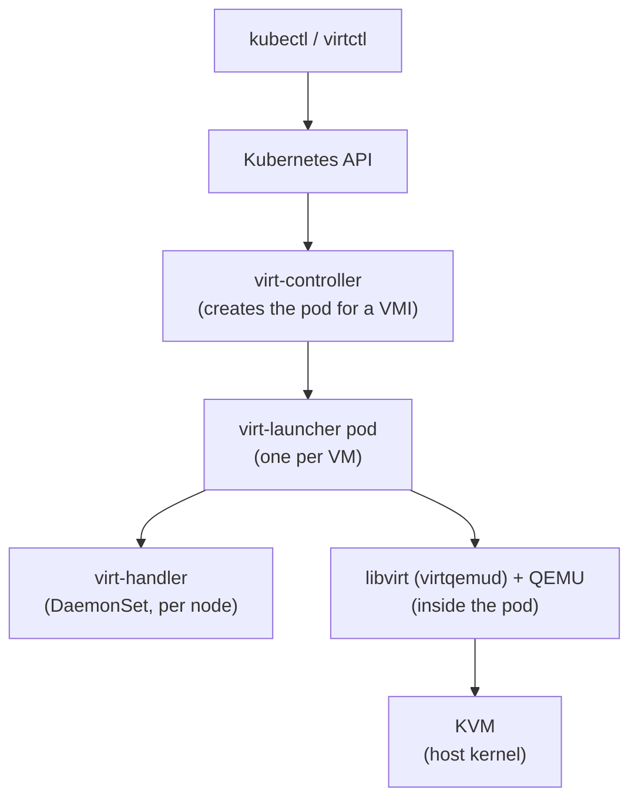

# What KubeVirt is

[KubeVirt](https://kubevirt.io/) lets Kubernetes run **virtual machines** alongside
containers, as first-class API objects.

```bash
kubectl get vms
kubectl get vmis
```

A VM becomes something you declare in YAML, version in Git, and reconcile like any
other resource — with the same RBAC, the same network policies, the same GitOps
pipeline.

> [!note] Partly tested
> No test cluster runs KubeVirt: the test Mac has no KVM, and KubeVirt on arm64
> cannot use software emulation. The tests check the release URLs, validate every
> manifest against KubeVirt's API schema, and run `virtctl` and the `jq` commands
> offline. How a running cluster behaves is not tested.

## Why this exists

The honest answer is **migration**, not elegance. Most organisations adopting
Kubernetes have workloads that cannot be containerised: appliances shipped as VM
images, software licensed per-VM, applications needing a different kernel, or legacy
systems nobody will rewrite.

The alternatives are running two platforms — one for VMs, one for containers, with
two operational models — or KubeVirt: one control plane, one API, one set of tooling.

Broadcom's changes to VMware licensing turned this from a niche interest into a
common migration path. KubeVirt is the base of several products sold as vSphere
replacements, for example Red Hat OpenShift Virtualization and SUSE Virtualization
(Harvester).

## Architecture



| Component | Role |
| --- | --- |
| **virt-api** | Extends the Kubernetes API with the VM types |
| **virt-controller** | Watches `VirtualMachine`/`VirtualMachineInstance` objects and creates pods |
| **virt-handler** | A DaemonSet, the node agent — the KubeVirt analogue of the kubelet |
| **virt-launcher** | One pod per running VM. Holds libvirt (`virtqemud`) and QEMU |
| **CDI** | Containerized Data Importer — populates disks from images or URLs. A separate project, installed on its own |

> [!important] Every VM runs inside a pod
> This is the design decision everything else follows from. `virt-launcher` is an
> ordinary pod, so a VM automatically gets a pod IP, participates in Services and
> NetworkPolicies, is scheduled by the normal scheduler, is subject to resource
> requests and limits, and appears in every monitoring tool you already run.
>
> It also means a VM inherits pod constraints. It is evicted when the node drains, it
> counts against namespace quota, and its lifecycle is bounded by the pod's.

## VirtualMachine and VirtualMachineInstance

Two objects, and the distinction matters:

| Object | Analogous to | Meaning |
| --- | --- | --- |
| `VirtualMachine` (VM) | Deployment | The **definition**, plus whether it should be running |
| `VirtualMachineInstance` (VMI) | Pod | A **running** VM. Ephemeral |

```yaml
apiVersion: kubevirt.io/v1
kind: VirtualMachine
metadata:
  name: web-01
spec:
  runStrategy: Always        # the desired power state
  template:                  # the VMI to create
    spec:
      domain:
        devices:
          disks:
            - name: rootdisk
              disk:
                bus: virtio
        resources:
          requests:
            memory: 2Gi
      volumes:                 # each disk needs a volume of the same name
        - name: rootdisk
          containerDisk:
            image: quay.io/containerdisks/fedora:latest
```

Creating a bare VMI gives you a VM that, once stopped, is gone. A `VirtualMachine`
wrapping it survives restarts and gives you a power switch:

```bash
virtctl start web-01
virtctl stop web-01
```

## What it needs from the host

KubeVirt is not a hypervisor. It orchestrates [[virtualization/kvm/index|KVM]] on your
nodes, so the nodes need hardware virtualisation. Once KubeVirt runs, `virt-handler`
advertises `/dev/kvm` as the node resource `devices.kubevirt.io/kvm`:

```bash
kubectl get nodes -o json | jq '.items[].status.allocatable | keys' | grep -i kvm
```

No output means no node offers KVM. Before you install KubeVirt, check the node itself
instead: `ls /dev/kvm` on the host.

> [!warning] No automatic fallback to emulation
> Without `/dev/kvm`, KubeVirt does not fall back to software emulation: VMs stay
> pending until you turn emulation on. Emulation is much slower and only fits CI and
> labs. Turn it on in the `KubeVirt` resource:
>
> ```yaml
> spec:
>   configuration:
>     developerConfiguration:
>       useEmulation: true
> ```

> [!warning] Emulation does not work on arm64 nodes
> On arm64, KubeVirt always gives the guest the `host-passthrough` CPU mode, and the
> cluster-wide `cpuModel` setting does not change that. Without KVM, the VM fails:
> `CPU mode 'host-passthrough' for aarch64 qemu domain on aarch64 host is not
> supported by hypervisor`. Seen with KubeVirt v1.9.1 on kind on Apple Silicon, where
> Docker Desktop has no `/dev/kvm`. A lab on a Mac needs x86-64 nodes with KVM, or
> real arm64 hardware.

> [!warning] Nested virtualisation is the usual stumbling block
> A cluster on cloud VMs needs nesting enabled on the underlying instances, which many
> instance types do not offer. Bare metal nodes are the normal answer for production
> KubeVirt — which is a meaningful infrastructure requirement, not a detail.

## When it is a good idea

**Good fit:** migrating off a traditional hypervisor, running VMs and containers side
by side with one control plane, VM workloads you want under GitOps, and development
environments needing full VMs.

**Poor fit:** a pure VM estate with no containers — you are adding Kubernetes as
overhead for nothing — very high VM density, and organisations without existing
Kubernetes operational maturity.

> [!note] KubeVirt makes Kubernetes a prerequisite, not a simplification
> Running VMs on it means every VM problem is now also a Kubernetes problem. A
> networking issue could be in the VM, in the CNI, in the Service, or in KubeVirt's
> own bridging. If the team is not already comfortable operating Kubernetes, this adds
> a layer rather than removing one.

## Where to go next

- [[virtualization/kubevirt/basics]] — installing it and running a first VM
- [[virtualization/kubevirt/advanced]] — storage, networking, live migration
- [[virtualization/kubevirt/gitops]] — declaring VMs in Git
- [[virtualization/kubevirt/troubleshooting]] — when a VMI will not start
- [[virtualization/kvm/introduction]] — the hypervisor underneath

<!-- uplink -->
Part of [[virtualization/kubevirt/index|KubeVirt]].
