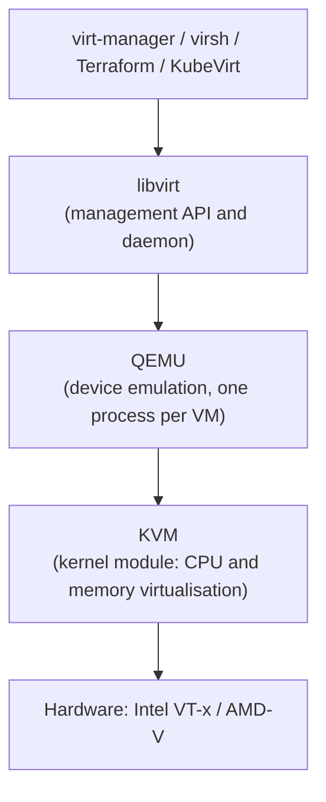

# What KVM is

**KVM** — Kernel-based Virtual Machine — is a Linux kernel module that turns the
kernel into a type-1 hypervisor. It has been in mainline since 2.6.20, which means
every Linux machine with the right CPU already has a hypervisor in it.

"KVM" in conversation usually means the whole stack, which is three separate things
worth keeping distinct:



| Component | Job |
| --- | --- |
| **KVM** | Exposes `/dev/kvm`. Gives guest code direct, safe access to the CPU through hardware virtualisation extensions |
| **QEMU** | Emulates everything that is not the CPU — disks, NICs, USB, video. One userspace process per VM |
| **libvirt** | A stable management API, XML domain definitions, storage pools, networks. What tooling talks to |

The division matters when debugging: a VM that will not boot is usually libvirt or
QEMU; a VM that runs at 5% of expected speed is usually KVM not being used at all.

## Type 1 or type 2?

The question is ill-posed for KVM and comes up constantly.

Because KVM is *in* the kernel, the host kernel **is** the hypervisor — that is the
type-1 argument. Because that kernel is also a general-purpose OS running your shell
and your web server, it looks like type 2.

> [!note] The distinction stopped being useful
> KVM turns Linux into a hypervisor rather than running on top of one. Most guest
> instructions run directly on the processor, with no emulation. Only some events
> (I/O, some privileged instructions) exit to KVM in the kernel, and some of those go
> on to QEMU. That is the property that matters for performance. Whether the
> taxonomy calls it type 1 is a naming argument, not an engineering one.

## Checking you can use it

Hardware extensions, on x86:

```bash
grep -cE 'vmx|svm' /proc/cpuinfo     # non-zero = supported
lscpu | grep -i virtu
```

`vmx` is Intel VT-x, `svm` is AMD-V. Zero usually means the feature is disabled in
firmware rather than absent. ARM64 CPUs have neither flag: on those, look for
`/dev/kvm` directly.

The device node:

```bash
ls -l /dev/kvm
# crw-rw-rw- 1 root kvm 10, 232 ... /dev/kvm
```

systemd's udev rules give `/dev/kvm` mode `0666` by default, so any user can use
it. Some distributions build systemd with `0660`; there, only members of the `kvm`
group can.

The complete check:

```bash
virt-host-validate
```

`virt-host-validate` comes with libvirt and is the better one. It checks `/dev/kvm`,
IOMMU, cgroups and the security driver, not only the CPU.

> [!warning] Nested virtualisation is off by default and quietly slow
> Running KVM inside a VM — a cloud instance, or a lab on a laptop — needs nesting
> enabled on the outer hypervisor:
>
> ```bash
> cat /sys/module/kvm_intel/parameters/nested   # Y or 1
> cat /sys/module/kvm_amd/parameters/nested
> ```
>
> Without it, `/dev/kvm` is absent in the guest. What happens next depends on the
> tool:
>
> - `virt-install` writes `<domain type='qemu'>`: full emulation with TCG. For an
>   x86 guest it prints one line, `KVM acceleration not available, using 'qemu'`,
>   which is easy to miss. For other architectures it prints nothing.
> - Plain `qemu-system-*` with no `-accel` option also uses TCG.
> - A libvirt domain that says `<domain type='kvm'>` is refused: `virsh define` and
>   `virsh start` fail with an error that names `type=kvm`.
>
> An emulated VM works, but many times slower. That is usually diagnosed as "the VM
> is broken" rather than "acceleration is off".

> [!warning] Correction
> An earlier version said QEMU always falls back to TCG silently. Only `virt-install`
> and a bare QEMU command fall back; a `type='kvm'` libvirt domain fails instead. The
> example `ls -l /dev/kvm` output showed mode `0660`; the systemd default is `0666`.

## Where it is used

KVM is the hypervisor underneath most of the industry:

- **Public cloud** — AWS Nitro, Google Compute Engine and DigitalOcean all build on
  KVM.
- **OpenStack** — the default compute driver.
- **oVirt and Proxmox** — management platforms wrapping libvirt.
- **[[virtualization/kubevirt/index|KubeVirt]]** — running VMs as Kubernetes
  workloads.
- **Local development** — Vagrant, `minikube --driver=kvm2`, GNOME Boxes.

Knowing the stack pays off in all of them, because the failure modes are the same.

## Versus containers

Not competitors so much as different boundaries, which is the framing that matters
when choosing:

| | Container | VM |
| --- | --- | --- |
| Kernel | Shared with the host | Its own |
| Boundary | Namespaces and cgroups | Hardware virtualisation |
| Start time | Milliseconds | Seconds |
| Overhead | Negligible | ~100 MB and some CPU |
| Runs a different OS | No | Yes |
| Escape means | Kernel vulnerability | Hypervisor vulnerability — far rarer |

[[containers/concepts]] makes the case that a container's boundary is a set of kernel
features. When that is not enough — genuinely untrusted code, hard multi-tenancy,
compliance requiring separation — a VM is the answer, and Kata Containers is the
middle ground that gives each pod one.

## Where to go next

- [[virtualization/kvm/basics]] — installing and creating a first VM
- [[virtualization/kvm/qemu]] — the emulation layer, and running QEMU directly
- [[virtualization/kvm/usage]] — `virsh` day to day
- [[virtualization/kvm/advanced]] — CPU pinning, hugepages, PCI passthrough
- [[virtualization/kvm/troubleshooting]] — when it does not work

<!-- uplink -->
Part of [[virtualization/kvm/index|KVM and QEMU]].
